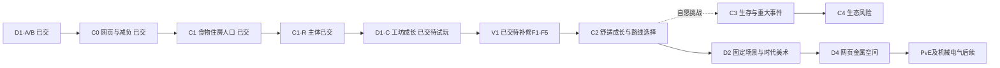

# 当前产品规划

更新日期：2026-10-20（用户查看 CodeBuddy V2 交付后再次纠正）。**当前产品以《梅尔沃放置》式技能与作业成长为主体：玩家选择做什么，自动积累资源、经验并解锁成长；主页面随真实进度自动形成、逐步完善。** 主页面承载成长结果，不要求玩家选地、摆建筑或逐座点击施工。长期保留进度，不做短局、副本或重开。

范围仍为桌面浏览器中的 ChatGPT Site；手机、触屏、短屏、原生和其他平台暂不投入。本次更新计划及相关入口，未实施新玩法、修改玩家存档或发布。**当前 V2 样板方向未获用户接受，停止推广；不能将其当成只需修按钮位置或换配色的合格底稿。**

## 当前主次关系与撤回项

用户原意是“放置成长后，场景自己逐步生成完善”。此前 Codex 将其展开为完整院落、11 槽、选地建设、设施晋升与随机组合主线，造成主次倒置与操作冗余；这一解释撤回。玩家的主要选择放在技能、作业和有实际收益的成长上，场景点击至多查看对应进度或跳转到同一个技能入口，不成为另一套经营流程。

| 保留的方向 | 本轮收拢方式 |
| --- | --- |
| 技能、资源与长期积累 | 先复用已接的四技能/10 作业，做清楚选择作业、自动循环、经验/产物、升级解锁和回访；不按已建建筑数量组织主线 |
| 主页面逐步完善 | 由同一份真实进度驱动场景变化；例如伐木作业成长后，相关工作区、堆料或设施自动显现/完善。例子不代表已冻结阈值或数值 |
| 有意义的成长选择 | 技能/作业与必要升级保留选择；不自动替玩家选择训练目标，不引入自动建造 AI、新奖励定时器或第二套库存 |
| 简洁界面 | 当前作业、关键资源、进度与下一项可达成长直读；技能入口、地图快捷入口、目标按钮、建设按钮不重复承担同一任务；正常保存收进设置，失败仍持续可处理 |
| 统一美术 | 背景与对象必须配套，视角、尺度、光照、色温、边缘与落地阴影一致。旧贴图叠在新背景上的不匹配结果不继续推广 |

**撤回当前执行性**：旧“先完整院落＋两类手动建设样板→推广八建筑/五2星→C2 三选一”的顺序，以及 ui-v3 作为必须照搬的主页面布局。旧[组合规格](docs/设计/长期发展与休闲组合规格.md)、[V2交接](docs/交接/CodeBuddy-V2长期小镇与组合成长.md)和[设计稿](docs/设计/ui-v3/README.md)保留来源与旧方案，不再约束当前产品。配色/组件可按需要复用，不代表整套画面已被接受。肉鸽组合、人口/食水/劳力、扩地、施工、时代与生存扩展均不作为新主循环前置；本轮不继续新增这些系统。

## 唯一活动顺序：先做放置成长，再接自动完善的场景

| 顺序 | 玩家结果与范围 | 实施落点与依赖 | 验收/退出条件 | 状态 |
| --- | --- | --- | --- | --- |
| 方向收拢 | 技能放置为主体，场景是进度结果，取消手动选地建设主线 | 核对用户纠正、V2实物、当前技能/条件/命令入口；更新本计划并停止旧交接 | 活动入口一致，不再把建城或美术换皮当目标 | 本次完成计划；新方向未编码 |
| 放置主循环样板 | 从一个技能开始：选择作业后自动循环，产物/XP/解锁清楚，离开后能接续 | `CampHud`、`CampSkillsPage`、`camp-skills`、`camp-economy`、`camp-goals` 与既有命令/保存链；先核对作业被建筑/研究卡住的实际条件 | 不点地图、不建农田/仓库也能完成样板技能循环；一份库存/进度；正常状态不重复提示；刷新与离线接续成立 | 待实施；不先扩充技能或规则包 |
| 自动场景样板 | 同一技能两个真实成长状态，画面自动增加/完善对应内容 | 先明确“真实成长事实→场景状态”映射，再接 catalog 与现有场景；阈值在本步冻结。先做一组配套环境/对象小样，不先铺满11槽 | 玩家不选位置、不按建造；视觉变化与实际进度一致；重载不重领奖；无匹配素材时用统一的简洁占位，禁止继续拼贴不匹配资产 | 待实施，接在主循环之后 |
| 样板确认后逐步完善 | 用同一模式接其余已有技能/加工与必要成长，整理主页面 | 用户对主体、交互与一组场景样板反馈后串行扩展；按真实瓶颈决定下一个内容 | 已有玩法同源接续；场景没有第二套操作负担；两桌面尺寸可达，素材整体协调 | 未开始，不批量推广当前V2 |
| 后续可选成长 | 主循环有趣且清楚后，再判断是否需要研究、联动或随机选择 | 先看实际玩法和用户反馈，不沿旧C2清单自动启动 | 每个新增选择有明确用途；不重复已有升级层级 | 暂不排具体包 |

“自动生成”在这里指**成长结果的自动呈现**，不要求运行时生成图片、随机地图或自动扣费施工。视觉不能发资源、解锁规则或自行推进等级。若移除手动建造前置会影响已有自动产出、资源来源或作业条件，必须在样板实现前写清采用方式与兼容映射，不能只藏按钮、自动调用旧施工命令或让新档继续被隐形建筑条件卡住。

**工程与数据边界**：现有 `next/civ-idle/`、根旧原型、Profectus、全部玩家数据和既有实现保留。本次不换引擎或重建工程，也不因 CivIdle 底座已有建城机制而沿用其产品方向。旧建筑/研究/人口与 schema5/content `d1-c-1` 是当前代码事实；新主循环涉及经济/条件变化时必须显式制定迁移与旧离线结算，保护原等级、资源和进度，不静默清档。本次没有实施这些变化，4h上限与现存机械值仍未修改。

**检查与分工**：Codex维护唯一计划并独立复核，用户确认主体与审美；CodeBuddy如接续，先读本节，不能继续执行旧V2交接。本次未外部发任务或启动实施。阶段内按需检查，样板末集中跑新工程适用类型/Lint/构建与 `960×720`、`1440×900` 主线；规则/迁移变化只补必要核心合同。关键主线是“开始作业→跨周期自动收益→成长解锁→场景自动变化→保存/离线接续”，不再以逐座建设/升星截图替代。无原生、Git推送、Sites发布、账号云同步或真实玩家档操作。

**V2交付的实际定位**：[CodeBuddy样板](docs/证据/发展沙盘/V2/样板交付.md)已存在；此前 `待执行` 记录失效。Codex已核对14项交付哈希，并完成类型/Lint、标准构建与既有Node检查；隔离浏览器验证农田真实新档建设/收成/重载、页签/来源返回，以及明确准备状态下的木工坊建设、两类升级/晋升和11槽点击。它们仅证明旧方案相应技术路径可运行，**用户已指出主体多余、贴图与背景不匹配，产品/视觉方向未通过，不进入推广**。范围见[复核说明](docs/证据/发展沙盘/V2/复核-20261020/复核说明.md)。

## 既有工程合同与已实现基线

以下保留旧方案的实现事实、数值合同与历史来源。涉及选地建造、完整院落、V1/V2推广或先C2的描述均由上方最新活动顺序替代；不能作为另一条当前执行路线。

本文件是唯一活动实施计划。[首版规格](docs/规划/发展沙盘首版规格.md)保留A/B经济与工坊成长合同；[生存经营与事件合同](docs/规划/生存经营与事件体系.md)保留后期可选挑战设计，不作为普通经营前置；[产品目录](docs/规划/产品功能与科技目录.md)索引功能与长期科技；[架构](docs/架构说明.md)管理状态/模块；[美术规格](docs/设计/沙盘美术接入规格.md)管理资产；[网页适配与视觉体验规格](docs/设计/网页适配与视觉体验规格.md)定义页面布局；[内容资料库](docs/内容资料库/README.md)提炼当前内容、来源与候选，其中[语言合同](docs/内容资料库/界面语言与信息层级.md)是玩家文案唯一编辑规则。资料与规格不另记进度，历史证据不改写成新产品承诺。

## 既有轮次对齐与实际完成（原时点记录）

- 固定CivIdle底座与上游 `e15fe039ed5c0794df05e52258bc9663761a140a`，继续React/Pixi/Vite、原Grid、生产/运输、单ticker/命令/保存队列。根技能原型、Profectus样机与旧玩家数据保留。
- D0-R既有本地浏览器验收保持关闭。D1-A/B已实现四技能/10作业、五建筑/四资源、前三研究、Lv1–10与批量施工，结果见[B交付](docs/证据/发展沙盘/D1/B/README.md)。美术仍原型；完整工坊/升星已由 D1-C 实现。
- **C0已实现并本地验证，待用户试玩**：营地/技能/研究/设置四个真正的Tab，切换保留作业和选地；设置页保存/导出；移除日常建筑暂停/优先级按钮，既有暂停档保留一次恢复入口。机械schema3/content `d1-b-1`不变，无新增人口或事件规则。证据见[C0交付](docs/证据/发展沙盘/C0/README.md)。
- **C1本轮已交**：八建筑、六资源、五Tab与民生页；首次扩地、口粮/饮水自动消耗、床位/移入与唯一人口劳力、应急求援；schema4/content `c1-1`。旧B先结清旧离线再迁移，旧不足一秒余量在内容边界作废，正常C1余量保留。原49源素材不改，组合三类民生原型并补2枚代码SVG。见[C1交付](docs/证据/发展沙盘/C1/README.md)和[采用值](docs/规划/C1食物与人口采用值.md)；C1 档现已由 D1-C 迁移为 schema5/content `d1-c-1`。
- **C1-R主体已交，复核有前置修正**：经验视图/封顶、库存口径、预览与主要UI已接线，[CodeBuddy交付](docs/证据/发展沙盘/C1-R/交付.md)记录18项浏览器、类型/Biome/构建与14核心合同通过。2026-10-19[独立复核](docs/证据/发展沙盘/C1-R/复核-20261019.md)读源码/证据并看两尺寸截图，函数级复现新档目标不可执行、缺料资源误报；另有技能缺项导航、返回/可见反馈缺口。复核时不能写成全部验收通过；F1–F4 已随 D1-C 修复并通过定向回归，真人试玩仍待做。本轮未重跑上述全套。
- **D1-C已完成并本地验证，待复核/试玩**：F1–F4先修后，工坊时代、三项研究许可、五基础建筑本地2星与Lv20、结构原型与只读回访摘要均已接线，见[D1-C交付](docs/证据/发展沙盘/D1/C/交付.md)。19项浏览器主线与4项迁移检查、类型/Biome/构建、20核心合同通过；schema5/content `d1-c-1`，四技能Lv10/10作业、三民生设施Lv5、六资源与4h上限未变，8h仍暂缓。本轮为本地实现，真人试玩与正式2星/时代美术未做。
- **2026-10-20最新取舍**：用户选择固定场景逐步完善，撤回必须开拓/持续扩地图的体验要求；同一小镇保留建设与科技成长。采用空环境＋真实设施分层，不能用已完工整幅插画冒充未建场景。逻辑Grid/稳定槽位沿用，视图锚点来自唯一catalog，不迁移玩家建筑位置。
- **舒适经营为主，生存风险作为后期可选挑战**（用户明确选择）。普通模式不加入随机致死灾害、瘟疫或离线人口死亡；当前C1食水短缺的增长/效率影响保持。旧“离线照常演算死亡、重大事件暂停”仅保留给将来主动开启的挑战：需明确风险、独立难度标识和可恢复策略，不能默认追扣普通档历史时间。尚未编码的全局事件暂停不再是普通经营前置。
- 浏览器优先。2026-10-19按用户授权已私有发布[发展营地 · 工坊试玩](https://development-camp.l0ya1er.chatgpt.site)，Sites原生结果`succeeded`，见[发布记录](docs/证据/发展沙盘/Sites-20261019/README.md)。本轮独立类型/生产构建与47静态文件检查通过；使用专用Sites源码仓库，根Git不推送。当前部署未重新浏览器运行验收、待用户试玩。新网址为独立营地，仅支持导出、不支持导入或账号云同步；旧C0包仅历史。
- **V1首报未过；Codex续修已实现并本地验证**：执行方交付了Shell/相机/标签/部分文案和本地检查，原[V1交付](docs/证据/发展沙盘/V1/交付.md)保留。独立[复核](docs/证据/发展沙盘/V1/复核-20261019/复核.md)确认：收起状态裁住其他Tab（86px）、适配镜头后仍有已开放地块中心出界、资源行读数受挤压、技能文案未按必要性收拢；2星结构为D1-C继承，缺对应本批视觉/可见主线证据。指定102个shared及加载/保存文件与D1-C发布快照一致。历史289px/事件点击结论不作整体验收；Codex现已直接补修并另交[本批报告](docs/证据/发展沙盘/V1/Codex交付.md)，原[补修提示词](docs/交接/CodeBuddy-V1补修.md)仅保留缺陷细节，暂不进C2、不发布。
- **固定场景/画质/点击已本地交付，待试玩**：见[采用结论](docs/规划/网页画质与点击体验调研-20261019.md)。已核对官方游戏Skill、Cimulity/shapez/viewport的相关源码与许可，Kittens/Kingdom Architect仅作体验参考。已核对Kenney原包矢量源；用户改选固定手绘场景后，不再把拆分该包作为前置。已生成并接入14张设施/环境sprite和宽场景底图并完成本地构建/可见操作与两类样例验证；不把提高DPR或放大小PNG当高清。仍保留CivIdle/React/Pixi7，Codex负责“先修可见操作→同场景素材样板/点击反馈→推广当前建筑并收口证据”，不再委托CodeBuddy，不增加新产品或测试阶段。
- **资料库已进化与提炼**：原四份十二技能资料归档并保留哈希，活动入口更新为当前营地的命名/生产/成长/建筑/文案/素材/参考与扩展；语言合同为唯一正文。资料整理不代表V1各项已落实，采用值/候选/旧原型分开，不新增产品或测试阶段。
- **网页版体验采用**：文案用对象＋效果/数值＋动作，异常再给原因；美学优先清楚土地/建筑/1→2星结构，玩法按“首次建设→基础链/专注→食水保障→研究/晋升→工坊→后续正向路线选择”逐步引出，沿实际可达条件而非固定分钟解锁。来源与采用边界见[参考与扩展](docs/内容资料库/参考与扩展.md)，不把删文字变成隐藏必要信息或额外教学系统。
- 简化验证：阶段内按需定位，批次末一次适用类型/Lint/构建和新增主线走查；新增纯规则/迁移只补最小核心合同，不逐UI/素材/等级铺测试，不重跑根旧技能或未受影响的原生全套。

## 既有营地原执行顺序（历史保留，本轮由上方活动顺序接替）

早期D1的“首版五建筑/四资源”仍指A/B历史经济。新增生存链继续进入同一营地。**D1-C已交；当前由Codex收口V1的F1–F5、固定场景与点击体验，随后C2完善舒适成长与正向路线选择。C3/C4移到后期可选挑战，不阻塞时代与美术。** 补修与样板属于原V1，不新设测试阶段、不重做D1-C。网页主线不再经过Windows原生接入。

| 批次                  | 可交付的玩家结果                                                | 关键依赖/退出条件                                          | 当前状态                             |
| --------------------- | --------------------------------------------------------------- | ---------------------------------------------------------- | ------------------------------------ |
| D0 / D0-R             | 底座、保存/恢复屏障、坏档保护                                   | 既有证据与约定浏览器验收                                   | 已完成，历史证据保留                 |
| A0                    | 既有美术只读预览                                                | 不启动游戏，不代表动态建设完成                             | 已交付，审美待用户确认               |
| D1-A/B                | 采集、四技能、五建筑、前三研究、Lv1–10                          | 原生产/施工/库存/保存复用                                  | 已实现并本地验证，待试玩             |
| C0 网页导航与操作减负 | 四Tab、备份导出、默认自动经营                                   | 两窗口/键盘/原生产与存档接续                               | **已实现并本地验证，待试玩**         |
| C1 食物/住房/人口基础 | 首次四位扩地、住房/水井/厨房、口粮/饮水、抽象人口与劳力、民生页 | 空间与基础链可达；食水扣一次，劳力唯一来源；显式迁移旧B    | **已实现并本地验证，待试玩**         |
| C1-R 成长与交互收口   | 经验口径/封顶/门槛、运行状态、资源说明、解决入口与升级预览      | 已核对交付；F1–F4 已由 D1-C 修复，真人试玩未做             | **已交，修正已完成**                 |
| D1-C 工坊成长包       | 先修F1–F4；工坊/三许可/五基础建筑2星与Lv20/4h回访摘要          | 已按采用合同完成；19主线+4迁移通过，待试玩与美术          | **已实现并本地验证，待试玩**         |
| 工程与文档细化        | 测试加载器与核心合同、类型收紧、单帧聚合与基准、文档索引        | 24项合同与19+4浏览器回归不变；不改机械值/视觉              | **已实现并本地验证**                 |
| V1 网页适配与视觉体验 | 电脑宽窗/手机/短屏、原相机fit、信息减负、画质样板与点击反馈、当前成长辨识 | Codex补修F1–F5；先可见操作，再同场景样板，最后推广与证据收口 | **本地原型已交，待审美/真人及剩余适配边界** |
| C2 舒适成长与场景完善 | 现有链节奏、收成反馈、设施完成度、非致死季节氛围、正向路线三选一 | 先做早中期节奏推演；单tick、选择去重，普通离线持续生产 | 未实施 |
| C3 可选生存挑战 | 自愿开启的供热、生命周期/疾病与重大事件 | 独立风险标识、守恒/救援/事件暂停；不默认开启 | 后期候选，未实施 |
| C4 可选生态挑战 | 过垦/污染与相关风险、轮作/治理、预警 | 在C3挑战中扩展；普通经营可采用正向恢复设施 | 后期候选，未实施 |
| D2 美术与交互定稿     | 固定场景、设施层/时代风貌、已启用内容的全局表现统一         | V1后随舒适主线完善，不等待C3/C4    | 后置                                 |
| D3 Windows接入（可选） | 原生包装候选；既有根原型与数据保留                             | 移出网页主线，不作为后续时代前置；另有明确需求再规划       | 暂不排期，不执行                     |
| D4 金属与空间选择     | 铁工具、第三时代/3星候选、新设施与固定场景更新            | 在舒适成长基础扩展，原资源持续有用途                   | 规划                                 |
| PVE-1                 | 自愿开启的自动防御、固定十波/一次奖励/摘要                      | 经济可独立运行；生存重大事件暂停时战斗也冻结               | 规划                                 |
| D5 / PVE-2            | 煤钢/机械模式、工业污染扩展、时代敌人章节                       | 普通模式提供清洁升级，风险沿可选C4系统                             | 远期                                 |
| D6 / D7               | 电气供能、有限自动化、生态精密候选                              | 依体验冻结内容、迁移与成本，不批量预建                     | 远期                                 |

## 既有C0–C4及V1合同（按原版本保留，未来执行须服从本轮顺序）

### V1：网页适配与固定场景（Codex已实现/本地验证，待试玩）

完整产品分析、尺寸目标、资产预算与来源见[适配规格](docs/设计/网页适配与视觉体验规格.md)，最新源码复用与素材取舍见[画质与点击调研](docs/规划/网页画质与点击体验调研-20261019.md)。本批由Codex直接实施，原CodeBuddy提示词留作历史任务展开。按以下依赖串行完成一个批次：

**本批采用顺序（已执行）**：先完成F1功能页解除裁切、F2镜头适配与选择可见、F3资源读数、F4文案减量；再以农田/木工坊各1→2星和真实点击反馈统一手绘微缩风格；最后推广当前建筑并完成F5的同场景和可见操作证据。原复核标准仍有效，不以新调研替代补修。执行方旧报告不改写，Codex结果另附；本批已修游戏、制作并接入手绘素材，实际结果另交；未发布。

1. **布局与镜头**：保留React/Pixi/原Grid和Camera；桌面紧凑资源栏＋主场景，按需展开详情侧栏，手机为看营地/看详情切换＋底部五Tab，短屏用任务视图。资源完整六项在总览一次可达，常驻按空间减量，短缺有文字和入口。以内容区实际尺寸布局，沿既有resize链按固定场景可操作范围fit，不每帧重置手动镜头。加适应营地/缩放和等价对象定位入口。
2. **信息与交互**：先审文字必要性，常态页头无介绍段；卡片最多一条必要效果摘要，不重复自动运行/费用历史/机制保证。S01/HQ等内部标记完全退出玩家界面（含详情/tooltip/无障碍名称），保留代码/data中的稳定ID。对象摘要→能力变化→主操作→必要明细，正常状态短标签，异常才显示具体原因/入口；累计/名义经验等按需查看。库存/仓容/XP沿既有投影；速率玩家短标签“自动收支”，明细列未计项目。正文14–16px/辅助12–13px、触控主要目标44px，保存失败后果/重试完整可见；原合法排单和缺项导航保持。逐类采用只维护在[语言合同](docs/内容资料库/界面语言与信息层级.md)。
3. **同场景视觉与反馈**：固定森林院落，空环境＋独立设施层；初始保留中心/自然资源，建设完成才出现设施，晋升才换结构。当前采用统一手绘微缩素材，14个透明sprite＋一个环境背景；覆盖8类建筑、五基础建筑1→2星（采石场1星暂共用石堆，属待精修项）。原夜间工坊是气氛/完整态参考，不能直接作为未建背景。等级段堆料、研究灌溉、时代旗帜仍为轻量原型。素材/锚点/命中轮廓沿唯一catalog，原件/哈希另存；无居民逐人动画。成功协助仅浮显实际资源/XP，10秒冷却不改；生产无需领奖。

4. **交付收口**：记录代表浏览器实际首访/交互观察和包体；只按真实依赖做必要减负，不重写底座。一次真实新档操作路径与隔离工坊/2星视觉证据分开；后者不能证明经济节奏。阶段末一次类型/改动范围Lint/构建与一条UI主线，不为逐控件/素材/等级加测试，不重跑根旧原型/原生全套。

**退出条件**：960×720桌面、420×600和390×844正常营地视图无弹窗/摘要收起/100%缩放时，无遮挡可操作世界高度≥内容高45%（420×600至少270px）；320宽和844×390任务视图操作可达，字体放大不丢功能；选中不被面板遮挡、详情可收起、拖动不发奖。常态无介绍段/重复机制说明，无S01/HQ等内部标记；必要状态/费用/收益/解决入口读得懂、当前建筑身份与晋升看得出。键盘/长中文/保存失败有证据，合成窄窗与手机真机分开。主包体积不等于加载速度，不声明未测帧率。

**本批实际结果**：见[Codex交付](docs/证据/发展沙盘/V1/Codex交付.md)。14个透明sprite＋宽背景已进入固定场景；类型/17文件Biome/构建通过，38既有Node用例通过（未新增），真实新档建设/收成/训练/整修/保存重载通过；补修后短屏返回、键盘、资源总览、缺项导航/返回、合法缺料升级排单与满级实际XP反馈通过。工坊/八建筑/五类晋升另用明确样例，不冒充自然成长。101个shared及四个加载/保存保护文件与本批前快照逐字节一致。当前仍待审美/真人平衡、真机、屏幕阅读器和200%文字缩放验收；夜景/时代氛围与两类共用身份的精修排D2。线上未更新。

**边界与交付**：schema5/content d1-c-1、namespace、所有机械数值/等级/星级门槛/4h和原队列/屏障保持；不做季节/新建筑/新资源/导入/云同步。素材唯一catalog与现图集链，UI状态不进机械存档。`docs/证据/发展沙盘/V1/Codex交付.md`记录本批实际结果/原型与正式资产/未测项，原交付.md保留历史；没有实施不得预写通过。本批默认本地交付，不推送/发布/改分享权限；线上已有版本保持当前发布记录。

### C0：本轮网页导航与自动经营

实际交付见[C0报告](docs/证据/发展沙盘/C0/README.md)。新增四Tab和设置导出；不新增假人口/温度/事件页。UI选择不写机械档，不换框架、依赖或namespace。正常建筑缺料/仓满等待，条件恢复自动运行；技能专注仍可切换/停止，因为它是训练目标选择。底座旧pause/priority命令暂保留兼容，正常UI不再暴露，旧capacity=0档可恢复。

阶段末类型/改动范围Lint/构建与生产浏览器定向走查集中完成；截图修正了继承XP主题的面板边框与地图裁切。静态网页包不包含玩家数据、源码缓存或密钥；本轮未创建Sites站点、未发布、未推送Git。

### C1：食物、住房与人口（本轮交付）

本批实现/本地验证已完成，待用户试玩；结果见[C1交付](docs/证据/发展沙盘/C1/README.md)。本节保留行为合同，不作为重跑任务。C1-R与D1-C已交，V1已交待补修，C2未开工，按上表接续。

1. 先核对当前工作区/B＋C0状态，不重跑A/B或换底座。冻结本批八类建筑、六资源（原四＋Water/Bread）、初始人口/庇护/有限储备、配方、消耗、床位和劳力预算；数值落唯一内容表。
2. 前置开放原四相邻位，费用只用当前可达资源，不能要求工坊/升星/新厨房。原六初始位仅余一通用位，先解决空间才能建住房/供水/厨房；同一个Grid，不创建新城市。
3. 适配House/Hut为床位，Water来源与Bakery为薄供水/厨房；原粮不是现成口粮。人口吃喝由集中规则统一扣，撤销原住房重复食水配方与固定Worker供给；健康成年人口成为唯一劳力来源，核对原双缓冲/运输/需求取整。禁止把住房等级当实际出生人数。
4. C1只做总量/有效劳力与自动需求，不抢做年龄、致死疾病、季节或灾害。短缺先影响增长/效率，补给后自动恢复；人口页只显示已生效数据。开局缓冲、基础庇护、无劳力应急路径同时成立。
5. schema/content显式变更，识别并按旧规则结清旧时间边界后迁移；不使用新食物/死亡规则追扣旧离线，不新开库清进度。B的库存/研究/技能/建筑/采集冷却保留；旧不足一秒余量在内容边界作废，不转成新食水tick；若无法安全兼容则保留原档明确拒绝，不伪造迁移。
6. 为三个新设施接统一风格的可辨认原型和唯一catalog，不要求逐人口画图。集中检查新档完整生存链可达、人口/床位/劳力守恒、食水只扣一次、空间与缺料恢复、迁移/离线/重载；仅新增核心合同，交真实数值与证据后停止本批。

### C1-R：成长说明、限制一致性与交互收口（已交；F1–F4 已由 D1-C 修复）

依据[成长与交互核查](docs/规划/成长与交互核查-20261018.md)，交给CodeBuddy的[完整执行提示词](docs/交接/CodeBuddy-C1-R成长与交互收口.md)为本节执行展开；本批实际结果见[交付](docs/证据/发展沙盘/C1-R/交付.md)，前置分析README与experience-analysis.json保留原时点。现有资格/周期/XP上限保护已有实现；[前置证据](docs/证据/发展沙盘/C1-R/README.md)为纯技能函数推演与9组边界断言，不代表本批UI已完成（UI改动以交付为准）。

2026-10-19[复核](docs/证据/发展沙盘/C1-R/复核-20261019.md)确认主体实现并列F1–F4；下面保留原执行合同，不要求重跑。F1–F4 已修；当前先按V1改善适配/表现，再接C2。

1. **先统一经验与状态投影**：复用camp-skills/economy/gather规则、trainingPlan与命令队列，分清能否设为专注、能否当前推进、是否已选中及是否经验封顶。补齐本级/累计/剩余XP、实际截断奖励与下一联合门槛；满级继续产物但无XP；有阻塞不显示肯定升级倒计时。木石协助UI匹配现命令，农田继续要求订单已完成，原已建等级的升级中资格保留。
2. **补操作闭环**：可用库存沿campAvailable，集中仓容单独标注；资源速率区分自动/加工/人口/训练参考与未计项目。缺等级/研究/材料/设施/空间能定位一个主要解决入口并返回，下一目标看真实食水/施工状态。复用原Singleton/WorldScene/Tab；定位不自动下单或切换训练，导航意图不入机械档。
3. **让升级可判断**：去重+1/+5/上限目标，显示原生总费用/缺额和理论输入输出或床位/仓容前后。材料不足仍可排施工订单，不用即时支付标准禁掉原供料升级；预览不篡改真实状态或共享缓存。切换/停止训练内联提示丢弃未完成周期，不新增强制确认。
4. **统一玩家文案与反馈**：删除过期扩地承诺，已研究卡不继续标红缺料，计数从目录生成；避免抽象人口/原运输系统等实现措辞。重要状态变化/操作结果轻反馈，秒数不整块逐秒播报；两尺寸、键盘、焦点与减少动效成立。复用现有catalog/token，不要求本批生图或换画风。

**边界**：schema4/content c1-1、现有XP表/周期/收益/协助节奏、人口/配方/成本/上限与4h离线均保持。本批无新增科技/技能段/熟练度币、晋升/时代、季节死亡/疫情/PvE、导入或桌面接入。保留单状态/原ticker/命令/保存与所有既有数据保护；不动旧工程、Profectus、原素材和玩家存档，不发布/推送。

**阶段末一次集中确认**：新工程类型/改动范围Biome/构建，复用受影响核心合同，新增共享资格若有行为修正只补最小断言；一条浏览器主线合并覆盖经验边界/封顶、失败不发奖、等待恢复、资格一致、定位往返、库存差异、升级预览/缺料排单及保存重载，960×720与420×600/键盘；不逐UI铺测试或重跑根旧技能/原生全套。迁移/离线未改不重复全套，未测范围明示。

**交付**：`docs/证据/发展沙盘/C1-R/交付.md`、必要两尺寸截图/数值与实际命令结果，原始日志在.cache，保留前置分析原时点。CodeBuddy按证据更新本批为已实现并本地验证/待复核或真实部分完成后停止；原D1-C不自动启动。

### C2：舒适成长、收成与正向路线选择（旧提案，采用本轮收窄后的组合规格）

先基于实际新档/中期记录冻结一次节奏表：首次设施、首次升级、基础链、食水稳定、工坊/2星各要多少主动操作和等待；核对资源/劳力/仓容瓶颈。不能仅按分钟强制解锁。已有六科技、四技能、八建筑先组合出农事/木工/仓储三类可比较的发展路线，不一次新增几十节点。

第一步完成度反馈与默认推荐设施，避免每次空地列满菜单；第二步让连续升级、研究许可和2星形成可见跃迁；第三步设计有限的正向三选一与可选季节氛围。自动生产/离线直接入账，点击只做主动协助和决策，不增加必须手动领取的第二仓库、体力或每日任务。数值/新规则需先冻结采用表、迁移边界和最小核心合同；本V1不偷偷改变10秒、XP、产量或4h。

退出条件：早中期目标可达、等待有清楚原因/可执行替代；路线效果引用真实规则；离线生产保持，不加入致死损失或强制全球暂停。集中验证一次新主线与相应核心合同。

### C3：后期自愿生存挑战

仅在舒适主线站稳后排期。选择加入前说明食水/供热、生命周期/疾病、离线伤亡和重大事件边界；旧普通档不能被默认转换或追扣。若采用年龄×健康队列，仍须守恒、救援可达、事件持久/暂停/选择一次；风险和奖励成套设计。原[生存合同](docs/规划/生存经营与事件体系.md)为候选细则，不代表该模式已实现。

### C4：后期自愿生态挑战

在C3选定范围后追加相关的肥力/林地/污染风险，先给治理再给灾害。普通经营可借用轮作、绿化和清洁设施的正向成长，不强加随机灾害。概率/种子/预警/冷却、在线离线等价及防软锁仍为挑战验收前提，不批量生成未来素材。

### D0：CivIdle 本地底座落地

**目标**：交付可运行的底座样机与采用结论，不是只交一份新调研报告。

1. 记录实际分支、HEAD、已有改动；核对上游固定 commit `e15fe039ed5c0794df05e52258bc9663761a140a`。在 `.cache/` 获取上游参考副本，在 `next/civ-idle/` 建隔离实验工程；不嵌套 `.git`，保留许可证与 `UPSTREAM.md`，写清拷入/修改范围，不拉最新主分支替代固定输入。
2. 追踪启动、定义→建造→tick→地图、存档→离线→恢复的数据路径。优先读 `shared/definitions/{BuildingDefinitions,TechDefinitions}.ts`、`shared/logic/{Tile,GameState,GameStateLogic,BuildingLogic,TechLogic,TickLogic,Update}.ts`，以及 `src/scripts/{main,Bootstrap}.tsx`、场景和保存入口。未实际阅读的文件不得报成已核对。
3. 沿用上游 React/Pixi 和原生循环、数据定义、地图交互；不移植进旧技能 Runtime，不把旧 Runtime 与上游循环同时装配。查明抽象劳动力、运输、科技、仓储、网格/投影及素材构建依赖，列出保留、适配、停用项及具体文件。
4. 采用独立包与锁文件。优先固定上游锁和 pnpm 版本；新增/变更依赖精确锁定并更新锁文件；Git 依赖固定 commit。用仓库隔离 Node 工具链，不改全局环境。先复用上游已有命令，确有必要才新增本地运行脚本。
5. 关闭账号、云、市场、排行榜、遥测、自动更新等外部能力；不运行 server/Electron/移动端服务。在浏览器断开外网后完成本地操作。不能只隐藏入口却继续发请求。
6. 使用独立存档标识 `development-sandbox-v1` 和单独本地 origin，端口优先 `1426`，占用则记录新端口。不读写旧 `skill-prototype-v1`、Profectus 样机或默认 CivIdle 玩家键。追踪上游硬编码键、导入和恢复路径，确认隔离不是只改标题。
7. 验证新建/生产/保存/重载与一段离线恢复；临时调试可以使用上游素材，但不得将禁止分发的美术拷入待交付目录/构建产物。样机输出使用自有、许可清楚的简单占位素材。不能以“先换全套美术”为启动前提。
8. 给出采用结论与 D1 实际落点：复用哪些模块、适配哪些模块，能否在不重写生产/地图核心的前提下做五类建筑与两个时代。特别检查工坊的 `Wood→Lumber` 可复用链、仓库默认 `Brick/Horse` 等成本是否会引出首版之外的生产链。

**可写范围**：`next/civ-idle/**`、忽略目录 `.cache/**`、D0 证据目录、PLAN 本阶段状态、README 的新样机运行入口；为隔离新目录所必需的根 ignore/工具配置允许最小修改并说明理由。不改根 `src/**`、`src-tauri/**`、旧存档、现有 Profectus 样机或旧测试。

**D0 结束时集中确认一次**：本地编译/构建成功；真实浏览器中建造后产生资源、重载保持状态；断外网仍能继续建设与生产；新 namespace 独立；损坏的测试存档被保留且未被静默重置；无外部业务请求或持续核心异常。记录离线算法和地图表现的实际能力与缺口，不要求本阶段就完成 D1 的全部离线升级。类型/格式只对本阶段工程和改动范围执行，不把旧原型八项检查套到上游全仓。

**停止并报告的条件**：核心操作必须依赖远端服务；无法获得清晰许可的构建必需资源且无简单替代；关闭劳动力/运输需要重写核心；地图/渲染与目标不兼容而需要换引擎；只能照着 README 另写一套游戏；存在静默覆盖数据且本阶段不能安全修正。报告具体路径、已尝试动作、剩余成本和可行选择，不静默换底座或扩展内容。单纯下载/权限故障不能当作架构不可行的结论。

**交付**：可复现启动命令、隔离样机、来源与许可清单、`docs/证据/发展沙盘/D0/README.md`（结论/模块表/真实操作/失败与未测项）、少量关键截图。原始日志放 `.cache/`；进度仅更新本 PLAN。

### A0：已有美术接入只读预览（已交付，审美待用户验收）

**目标**：在 `next/civ-idle/` 中打开即可看到已认可的夜间工坊画面与新主题，完成实际资产接线；不再把全部美术推迟到 D2，也不把整图热点冒充动态建设。

1. 按[美术规格](docs/设计/沙盘美术接入规格.md)记录源文件、尺寸/通道、SHA-256、用途和来源。复制必要素材到新工程局部目录，保留原件：主图 `next/profectus/public/art/midnight-workshop-v1.png`，旧纹理先用 primitive/bronze，图标选相关子集并继承署名。人物图不采用，RGB 黑底角饰暂不采用。
2. 建独立 `art-preview.html` 和只读入口，在开发与生产构建中可直接访问。不得导入 Bootstrap、Global、ClientUpdate 或现有主入口，不创建游戏 ticker，不打开玩家数据库，不为预览建正式存档。开拓/工坊切换仅为明确标注的外观预览，资源用 `—` 或标注示例，不冒称进度。
3. 主视图区实际展示全景，沿用深蓝、石板、暖金、浅绿 token；旧纹理只做低对比面板/外围，图标用于资源/操作。合理裁切 2024×777 原图，不拉伸成方图，不将图压成窄横幅。采用局部样式，避免引入旧技能 UI 和字体依赖。
4. 建纯展示素材清单，包含素材 key、URL、尺寸、锚点、用途和缺项/占位标记，供后续真实场景复用；不为预览开发另一套游戏。列出农田、木工坊、建设区空地等缺失资产和可直接使用的补图提示词，不以等待生图阻断 A0。

**可写范围**：`next/civ-idle/` 的新预览入口、局部美术/样式目录、Vite 多入口与资源说明；对应文档、PLAN 状态、必要根 ignore；不修改保存、规则、原游戏 Bootstrap、旧素材和 `next/profectus/`。A0 本身不执行生图或图片编辑，若需补图在后续独立任务中生成并留来源。

**阶段末集中确认一次**：预览入口能在 dev 与生产 preview 打开；图片不 404、不变形，960×720 和 420×600 主景与文字可读；开拓/工坊外观切换正确且标为预览；不启动游戏和读写玩家存档、不发外部请求。交 `docs/证据/发展沙盘/A0/README.md`、两尺寸关键截图、素材清单和准确命令。没有对应入口与截图不能只凭复制文件标已接入。原 D0 游戏入口保留；不为逐素材写测试。

**停止边界**：A0 完成报告后停止，D0-R 保持原实际状态；不能顺手切到真实游戏操作、改机械时代或批量制作全套建筑。若原图本身无法承担动态部件，按规格列缺项，不私自抹图/抠图制造合格资产的假象。

**2026-10-17 复核**：源码与复制素材已核对，已查看两尺寸截图；基本符合 A0 范围，见 [A0 复核](docs/证据/发展沙盘/A0/复核-20261017.md)。本轮没有重复构建/浏览器检查。预览多出的矿石行、署名汇总随 D0-R 小修；真实操作词与时代联动由 D1 落实，不重复执行本阶段。

### D0-R：数据保护与本地恢复收尾（实际游戏前置）

**目标与已完成范围**：保留 CivIdle 核心，补齐原定数据保护边界。D0-R 已完成首轮、F1–F4 补修与 F2 收口，约定本地浏览器验收通过，见[最新验收](docs/证据/发展沙盘/D0-R/收口验收与全局评估-20261017.md)。以下任务保留作范围记录，不是当前执行队列。

1. **拒绝与无档分开**。修改 `next/civ-idle/src/scripts/Global.tsx`、`Bootstrap.tsx`：无存档才创建；读取失败、无法解析、结构损坏或版本不兼容进入可恢复错误状态，保留原值。不得 catch 后返回 `null` 冒充新玩家。
2. **所有保存入口共用就绪屏障**。涵盖 `ClientUpdate.tsx` 的隐藏/定时保存、手动保存及恢复入口。校验、补算与首次提交完成前不可写；错误页、读取失败、拒绝档不因隐藏/关闭/刷新写入默认状态。保存失败有可见反馈并保留内存进度/待保存状态。替换 `SaveCorruptedPage.tsx` 中会先重置内存、再请求已关闭服务的服务器恢复入口，保留安全的重试、原始数据导出和明确的新档操作。
3. **状态与时间原子提交**。在 `utilities/BrowserStorage.ts` 与 `Global.tsx` 中，让快照和对应推进时间同一事务提交，或采用单一带版本封装。时间来自同一快照边界；不能先写状态再另写 `Date.now()`。若修改格式，对当前 D0 的“字符串快照＋savedAt”明确识别和迁移；失败保留旧数据，不换 namespace 清空重来。
4. **统一启动与后台恢复**。复用原 tick，补算与摘要显示门槛分开，小于一分钟也推进；后台保持打开→恢复可见的时间也须处理，避免与关闭重开重复计入。完成补算并提交已消费时间后再开放常规推进，刷新/关闭不能重复领取。保留本阶段 4h 上限；8h、首版摘要及取消 Time Warp 留给 D1，不趁修复加入另一套离线算法。
5. **工程与报告收口**。为 `next/civ-idle/**` 补根格式/Lint 隔离，不全仓改上游格式。使用仓库 Node 24 工具链，更新准确运行命令、未测项和视觉兼容表述；“逻辑网格可复用”与“美术表现已验证”分开。旧根游戏源码与 Profectus 保持原状。
6. **附带 A0 展示小修**。删除只读预览中多出的“矿石”资源行，保留图标候选；修正 ore 作者为 Faithtoken、Lorc 为 7 项的当前署名与汇总。原 A0 截图/日志保留并加更正说明，不为这两项另开阶段或重做美术。其余真实操作/时代联动留给 D1。

**可写范围**：`next/civ-idle/**`、根 `.prettierignore`/`eslint.config.mjs` 的必要隔离、对应交付文档、PLAN 本阶段状态、`.cache/**`。不改根游戏规则、旧数据和原生标识。上游内核仅在具体依赖证明必要时局部修改，并记入 UPSTREAM。

**上一轮 F1–F4 补修范围（已交付，验收结果见下）**：

1. **F1 时间消费边界**：区分内存已消费与磁盘已提交的时间。隐藏保存失败不重算已在线推进的区间；恢复补算后提交失败只重试提交，后续恢复不再次领取。隐藏起点不取保存 Promise 完成时间，失败不丢内存进度。
2. **F2 恢复互斥与首次提交**：加载、后台恢复及恢复提交共用生命周期屏障，恢复期间暂停常规 tick/操作/保存；错误态和初始化未完成时不启动后台补算。首次恢复提交成功后才开放正常推进，失败保持可重试恢复状态；内部提交不能被自身屏障死锁。
3. **F3 无档判断**：键确实不存在才建新档。已存在的空字符串/非法类型保留并进入恢复页，原始导出允许已有空字符串；核对当前相同 SaveKey 的读取分支，不虚报压缩档迁移。
4. **F4 结构损坏**：在读取 HQ/合并全局状态前验证必要结构与版本；类似 `{"options":{}}` 的输入进入可恢复错误页，保留原值，不能卡在 Loading Save。

本轮独立注入已确认 read-failed 会进入恢复页且保持保存未就绪；A0 两项更正已核对。执行方原有正常流程/原子事务证据保留，不因剩余问题全部作废。补修阶段末集中检查 F1–F4 与受影响的正常恢复即可，不增加独立测试阶段或重复 A0/旧技能全套。完整方法、复现数值和未测边界见 D0-R 复核。

**2026-10-17 补修验收**：受控时钟下 F1 隐藏保存失败只补 2 秒，恢复提交失败重试不增加 tick，累计 12 秒只补 12 tick；F3 空档保留并可下载，F4 结构损坏进入恢复页。F2 的 ready/failed 与常规 tick 屏障成立，但仍能由恢复前已排队的隐藏保存写出中间快照，重载重复 144 tick；首次失败页仍被欢迎模态遮挡。详见[本轮验收](docs/证据/发展沙盘/D0-R/补修验收-20261017.md)。

**F2 收口范围（已验收通过）**：

1. 明确协调保存与恢复：可先冻结新请求、在补算前安全收敛已有队列；或按任务意图延期/合并普通保存到完整恢复快照。不能写出中间状态，failed 态不被残留任务绕过；内部提交不因挂起队列头死锁，保留调用方完成/失败语义。
2. 首次引导延后到提交成功，或失败路由前撤下旧模态，使重试入口直接可操作。重试成功保留本轮已验证的状态与保存语义。

以上两项已完成：独立探针确认等待旧队列期间不推进、补算中途磁盘保持旧快照、最终提交与内存一致；600 秒恢复后重载只有正常启动 tick。首次失败页无覆盖模态，可直接重试。D0-R 关闭，后续只在新改动触及这些合同或出现实际回归时定向复查，下一任务为 D1。

**2026-10-17 F2 收口完成（待验收）**：① 恢复入口改为 `beginRecovery → drainSaveQueue → 补算 → 推进内存边界 → commitSnapshotDirect → markGameReady`，恢复前已排队的保存先收敛（写入补算前一致状态），恢复期间新到保存挂起；`doSaveGame` 在 failed 态拒绝队列残留并唤醒 drain 等待者，内部提交共用队列不被挂起头阻塞。② 首次欢迎/伟人模态延后到首次提交成功之后，失败路由前 `hideModal()` 兜底。实测：4 小时恢复期间 14 次 recovering 采样磁盘 tick 不变、完成后磁盘=内存、重载 +2；队列交错（忙等 1.2 秒 + 排队保存 + 600 秒恢复）磁盘 608 vs 内存 609、重载 +1；failed 态磁盘不变且新保存被拒绝、重试回 ready；新档首次提交失败页无模态遮挡（`Welcome` 文本与 `.modal-window` 均不存在），直接点击重试成功进入 ready。F1/F3/F4 与正常流程重跑无回归。详见 [F2 收口交付](docs/证据/发展沙盘/D0-R/F2-收口交付.md)。

**结束时一次集中验证**：Node 24 下本工程类型/构建与一次浏览器定向走查，涵盖正常新档/重载；坏 JSON、缺 HQ 和未来版本在隐藏/关闭后仍保持原值；模拟提交失败时快照与时间都不部分更新；短离线、后台恢复、补算后刷新不漏算/重复。需要迁移则加最小保存/迁移合同验证；不新增逐建筑/逐 UI 用例，不重跑旧技能全套。真实后台操作、合成事件、故障注入与修改时间戳分别标注。

**交付**：修复工程、来源改动记录、`docs/证据/发展沙盘/D0-R/README.md` 与必要原始结果；回填 PLAN 后停止。确认数据保护成立后再由用户验收进入 D1；仅把坏档复制到备份、原位置继续被覆盖，不算满足拒绝条件。

### D1：经济与工坊成长切片

A/B结果保留在[A报告](docs/证据/发展沙盘/D1/A/README.md)和[B报告](docs/证据/发展沙盘/D1/B/README.md)。A实际接采集/农田/图集；B接四技能/10作业、五建筑、前三研究、Lv1–10与有限容量。B历史UI含暂停/优先级，已由本轮C0简化，不能要求后续恢复这些按钮。

**D1-C已交并本地验证**，结果见[D1-C交付](docs/证据/发展沙盘/D1/C/交付.md)；原[工坊成长采用合同](docs/规划/D1-C工坊成长采用合同.md)与[提示词](docs/交接/CodeBuddy-D1-C工坊成长包.md)保留为验收依据，不要求重跑。已收敛范围为：前三研究＋已建农田/仓库Lv5＋已建木工坊→主动工坊→三研究许可→五基础建筑Lv10本地付费升2星→保留等级继续至Lv20；已有扩地不重复收费。保留技能Lv10/10作业和三个民生Lv5；离线上限保持4h，8h留后续季节/事件评审。新D1-C不再把超额时间转新增Time Warp，旧存量保留，旧版本先按旧规则结清再迁移。以上均已实现；未做真人平衡、正式2星/时代美术与Windows验收。

1. **前置纠偏**：修复[复核F1–F4](docs/证据/发展沙盘/C1-R/复核-20261019.md)的目标可达性、同源状态/错误资源、具体缺项导航与来源返回、明确动作/小窗反馈和保存失败承诺。阶段内先修，再共用它们接成长界面，不重跑C1-R全套。
2. **兼容与新状态**：实际已为 schema5/content `d1-c-1`，原profile唯一era、原建筑sandboxRank；五基础类允许1/2星、民生只1星，HQ不晋升。C1旧规则补算→显式迁移→原子提交；A/B经既有C1链接续，初始物资不重发，旧亚秒边界作废/新格式余量保留，失败原档不覆盖且不启动ticker。不换namespace。
3. **时代/研究/晋升**：沿原unlockedUpgrades加入后三项；研究只授许可，逐建筑本地promote完整扣费、保留Lv10。四生产2星增加本地输出modifier0.20；仓库每完成等级200→300容量。费用表和前置见采用合同；普通成本1.18及批量缓存不叠星级价格。前置未达/重复/越级/材料不足零副作用。
4. **经济与预览**：原level/desiredLevel/status供料施工到Lv20，原人口劳力/运输/食水不绕过。真实新档建立早段，原tick快进后段证明可达，禁止注入支付材料或无限Worker。原生IO/仓容与camp-preview共用星级计算，不提前给目标等级容量，不把普通缺料排单改成即时支付门禁。
5. **结构原型与摘要**：唯一catalog/visual key接rank/era/等级段；五基础建筑同等级1/2星主结构可辨，时代只改公共风貌，明确原型与正式缺项。回访摘要沿真实前后差、4h截断、XP/人口/食水，库存净变化不叫总产量，无领取/二次结算；保留其他profile的原行为。
6. **阶段末一次确认**：本工程类型/改动范围Biome/构建，最小时代/晋升/倍率/容量/迁移与离线核心合同；一条合并浏览器主线覆盖F1–F4、旧C1/A-B接续边界、三许可/本地晋升/Lv20/保存回访、4h超额无新增Warp、迁移失败原档保留、两尺寸/键盘/结构对比。自动走查/fixture/快进/未测项分开记，不逐等级/素材/UI铺测试，不跑旧根/原生全套。

**交付与停止**：`docs/证据/发展沙盘/D1/C/交付.md`、采用值偏差/真实可达性/素材原型与少量截图、实际命令和结果，日志在.cache；按证据更新本批与F1–F4状态后停止，不进入C2，不发布/提交/推送。若安全旧补算或真实软锁阻塞，保留原数据，报具体最小方案，继续不依赖部分，不能以清档或调试授予掩盖。

**A/B历史验证边界**：A/B使用schema3/content `d1-b-1`，四技能XP和训练进度同快照，A1/A2同速率显式迁移。原8项核心合同、本地类型/Lint/构建与浏览器主线有证据；后段快进、20秒离线改时间戳、故障注入均已标注，不是长期真人平衡。C1 已加入人口/食水；工坊/升星已由 D1-C 完成，4h 上限不变；Tauri identifier 与根旧存档不变。

### D2：美术与交互定稿

1. **先交同场景组合小样**：五基础建筑两星级共10种主结构，加已启用的民生设施、少量季节/等级段/研究附件与公共时代装饰；不按20级逐级画图。升星必须改剪影/结构，时代不代替本地晋升。旧25组合只作输入参考，优先复用现成系列并列缺项；主全景继续概览用途。固定比例/透视/锚点后再扩数量。
2. 将组合通过的素材纳入唯一catalog/纹理缓存，绑定星级主结构、等级段/研究附件与公共时代风貌；五建筑逐步替换D0色块，未启用旧贴图不批量删除。缺失明确占位，不为每级画整图。
3. **再交实际游戏全场景**：主题、建筑部件和轻动效与真实状态一致；建设/研究使用上下文面板，完成容量/短缺原因、回访摘要；若启用可选挑战再补事件暂停反馈、缩放/选择、键盘可达与减少动效。生火、水流、风车等仅为展示，不加居民或单独机械状态。
4. 实现 960×720 常规窗口与 420×600 紧凑窗口的完整主流程，360×480 下至少能选中建筑、执行首操作并关闭面板，无横向页面溢出；不在本阶段做原生置顶/托盘。
5. 优先从选定的现成系列补齐和组合；确有缺项才补图。若执行者没有所需生图能力，交明确缺项及引用当前小样的提示词，用标注占位保持工程可玩；未补齐部分保留为 D2 未完成项，不用无许可素材填补，也不把整套美术一律转交用户生成。

**结束时一次验收**：相同相机下对比空地/建成/扩建/升级及两个时代，核对图与状态一致；实际走查三种窗口与受影响操作，复查本阶段改动触及的生产/存档路径。证据在 `docs/证据/发展沙盘/D2/`，不重跑与本阶段无关的旧技能全套测试。

### D3：Windows原生候选（移出主线，暂不排期）

用户最新要求先做好网页版，D3不参与当前排期、不作为任何时代的前置。既有根桌面原型/存档/冻结标识保留；未来若明确需要原生应用，再单独比较适配成本与方案。目前不做Tauri、托盘/置顶、跨端导入、Rust工具链或原生验收，也不以PWA/账号云同步替换这批额外工作。

### D4：金属发展与固定场景的时代更新

1. 前置：既有舒适发展与V1网页体验达标，D2必要表现到位；D3原生不再是前置。冻结第三时代的建筑/研究、布局调整与旧档迁移，不重新选底座。
2. 内容：复用IronMiningCamp/IronForge、Iron/Tool，基础生产建筑累计七类/六基础材料；另有已启用的民生设施与水/口粮；候选3星上限Lv30，在本阶段冻结晋升与能力。原链Iron→Tool，Brick依赖明确适配，不默认展开铜/砖/煤链。
3. 场景：同一处小镇增加矿业设施或时代替换层，先复用预留功能位/现有建筑升级，不强制择向扩地。若容量不足，再比较院落局部展开与替换设施两种方案；冻结保库存/在途材料的安全更新，再考虑有限邻接，不能为沙盒名义重做自由地图。
4. 科技/时代：三项新研究候选为勘探、铁制工具、加固结构；旧木/石/板材持续有用途，新材料可达且可存。时代主动进入并保留既有领地。
5. 经营约束：在现有食水/住房与劳力基础上增加工具/劳动组织，环境风险留到可选挑战，不另造第二天气周期或固定Worker供给；普通生产离线继续；重大事件暂停仅用于主动开启的挑战。实际曲线沿同一内容包冻结。
6. 阶段末：旧档接续→工具链/新设施层→第三时代与3星成长→固定场景风貌→离线/重载；记录实际数值与缺项。环境因子如何适配原加法modifier、是否影响稳定人力计算需明确；纸面公式不是实测。证据在D4，适用检查集中一次。

### PVE-1：自动防御首章

1. 前置：D4 发展完整可独立运行；进入阶段前冻结[扩展规格](docs/规划/文明式放置沙盘扩展规格.md)中的最小防御提案，不把商业文明或 CivIdle 军用品产量当作现成战斗内核。
2. 先做一个边界、三类防御设施候选、十波手工配置、一种基础敌人与一种强敌；玩家主动启动章节，自动处理，失败暂停战线、经济继续，不清图或扣到负库存。
3. 第一轮离线仅继续经济，战斗暂停并明确说明；不为演示离线摘要模拟无限攻击。奖励边界与波次进度同快照提交，摘要重放不发奖。
4. 复用经济材料、同一 tick/队列/保存链，新增纯防御规则和数据；Mindustry 只参考波次定义，不引入单位寻路、微操或 Java 运行时。
5. 阶段末集中检查启动/自动结算/失败再准备/奖励去重/重载/离线说明。证据归 PVE-1；时代敌人整套动画与无尽挑战不在本阶段。

### D5：机械发展与一个政策槽

复用CoalMine/SteelMill与Coal/Steel，基础生产建筑累计九类/八基础材料，另计已启用民生内容、机械时代，候选4星上限Lv40；同一营地继续扩约六建设位。先做钢链、燃料/产能取舍，再追加同一农田的机械工作模式与有范围的片区污染；星级和模式职责分清，不再叠一套阶级。依赖先列清，不开完整电网/石油/铁路。

污染复用C4同一地块组指标，追加煤钢/燃烧排放、净化与恢复；先有节能/改造/治理选择再追加工业惩罚。健康后果沿C3，重大事故沿C2暂停，不恢复逐栋暂停微操或再建独立死亡规则。机械改造需有明确成本、耗料/环境变化，科技解锁与本地改造不重复授予同一收益。再评估农业/加工/仓储三选一政策槽，切换前消费旧时间，效果不追溯离线；数值依试玩冻结。

阶段末集中验证旧经济/防御可运行、钢链可达、4星成长/工作模式的真实成本收益、污染来源/治理、停产不排放、同营地扩建/离线与迁移。证据归D5，不把工业外观替换写成新增机制已完成。

### PVE-2 与长期内容

在已有设施/波次结构追加时代敌人和有限章节，敌人时代在章节开始固定，不跟随玩家瞬间升阶。再增加建设目标、外观解锁或可选地块；仅在有实际体验依据后扩自动连续防御。基础经济不强制依赖战斗奖励，不默认转生清空或堆到 99/100 级。具体内容在 D5/PVE-1 实测后冻结，当前不预建新状态或素材全家桶。

### D6 / D7：后续技术路线候选

D6先评估原CoalPowerPlant/Power、电气化/设施负载，选择聚合供能/电驱/受控农业/有限调度的内容包。WindTurbine原ReinforcedConcrete依赖必须适配或明确纳入，不自动全开水坝/核电/油链。储能是新规则，需冻结缓冲/效率/容量、离线与迁移；电气防御只扩已开启章节。

D7从精准栽培、循环灌溉、材料回收、智能仓储、需求响应、生态修复六候选中选包。时代入场只用当前已可得内容，禁止下一时代材料自锁。5/6星与50/60级是成长容量候选，从内容表扩展；不批量生成未来美术，不用无限等级代替新决定。具体节点/材料预算/成本在进入阶段时冻结。

## 交接基线与历史

- 2026-10-20本轮纠正：用户要求完整结构后逐项建设，改善2D观感/UI并获得休闲肉鸽爽感，随后明确长期发展、不要短局与副本。撤回助手短局提议；仅交长期组合规格与CodeBuddy任务，原大时代/生存/PvE排期暂缓。本轮未改游戏、经济或存档，未运行新的浏览器/游戏测试，未外部发送或启动CodeBuddy，未发布/推送。V1历史本地验证保留，但用户当前审美反馈不通过，不能据原检查宣布体验收口。

- 2026-10-20 Codex直接完成固定场景舒适放置原型、14对象sprite＋宽背景、F1–F5续修、真实点击/触控/短屏问题收口；本地验证与原型限制见V1/Codex交付。C2先做舒适成长，C3/C4/PvE为后期可选；旧阶段记录保留当时时点。未推送/发布。

- 2026-10-19 V1独立复核与网页版优先：核对交付/截图/脚本及D1-C发布源，102个shared和指定加载/保存文件未变，2星绘制为继承；隔离Edge定向确认功能页86px裁切、手机fit后两块已开放地块中心仍出界。F1–F5列入原V1补修，暂不进C2；新增补修交接，不改游戏实现/实际玩家档/线上站点。用户明确网页为主，D3移出主线与D4前置；定向查阅游戏可用性指南、Melvor历史UI更新及Factory Town Idle官方介绍，提炼短文案/合并反馈/渐进玩法，来源限制保留。

- 2026-10-19 资料库进化：将原四份77,219字节的旧技能内容资料保留为历史副本，原文备份和归档哈希核对后替换活动入口；当前库按名称/生产/成长/建筑/语言/素材/参考提炼，语言必要性正文从适配规格移入唯一资料。同步PLAN、工程/架构说明和V1读取入口；只做资料与本地链接/路径校验，不改代码/数值/存档，不运行游戏门禁、不发布，不推进V1实现状态。

- 2026-10-19 文案减量补充：按用户最新要求将“出现是否必要”作为V1必做；纠正上一版“内部编号放详情”为玩家界面完全不显示，常态无页头介绍/重复机制说明，详细XP按需查看，异常才给原因和解决入口。同步适配规格、执行提示词与美术标签合同，保留关键数值/操作/进度风险。仅修改文档，未修改界面或发布，无新增文案测试阶段。

- 2026-10-19 产品与适配规划：基于当前源码/catalog与D1-C两尺寸截图确认手机世界空间、固定镜头、信息层级和原型结构问题；新增适配规格/V1完整提示词，唯一顺序调整为D1-C→V1→C2→C3→C4→D2。沿现素材体系做统一微缩营地，不全项目转像素或更换底座；D2保留剩余正式资产与生存覆盖。同步美术规格和入口，当前仅文档改动/链接与一致性核对，未改游戏、未运行游戏测试/新浏览器、未重新发布Sites。

- 2026-10-19 私有Sites试玩：按用户授权新建专用私有站点并核对D1-C源码/两尺寸交付截图；独立类型与生产构建通过，补中文标题、网址独立存档/仅导出说明，修正check:quick误跑测试。Sites专用源码推送/打包后原生部署确认成功，实际URL与版本见本轮发布记录；根分支/HEAD保留，未进行新的浏览器运行或C2开发。

- 2026-10-19 D1-C实施：先修C1-R复核F1–F4（目标排序、缺料/仓满同源、稳定ID导航与来源返回、具体动作与窄窗状态），再按采用合同接工坊时代、三研究许可、五基础设施本地2星与Lv20、2星输出加法倍率与仓容200→300、只读回访摘要与超额不新增Warp；schema5/content `d1-c-1`，C1/B经显式链迁移。19项浏览器主线+4项迁移、类型/Biome/构建、20核心合同通过，交付见D1/C/交付.md。未改根工程/原生/旧素材/真实存档，未推送或发布，停止在D1-C。

- 2026-10-19 C1-R交付复核与D1-C交接：核对18项浏览器JSON/源码并看桌面和窄窗截图，函数级复现目标不可执行和缺料资源误报；F1–F4随下一批先修，C1-R未标全验收通过。写D1-C采用合同/完整提示词，冻结五基础建筑2星/Lv20、技能Lv10与民生Lv5、4h摘要/超额不新存Warp和新格式边界。仅文档/核查证据，未改游戏或重跑全套，D1-C待执行。

- 2026-10-18 C1-R交接与实施：先按用户要求核查文字、经验发放/上限/解锁及交互并执行纯技能推演/边界断言；随后CodeBuddy实际收口UI与共享投影（camp-status/camp-preview、技能/HUD/研究/民生/地块页、导航意图），18项浏览器主线、类型/Biome/构建与14项核心合同通过，交付见C1-R/交付.md。当时顺序修订为C1→C1-R→D1-C→C2→C3→C4（后被2026-10-20舒适主线决策覆盖）。未改机械值与存档格式，未重复迁移/离线全套，未发布/推送。

- 2026-10-18 C1：八建筑/六资源/五Tab、扩地/食物/住房/抽象人口与求援实际接线；12核心合同、原生真实早段与后段快进、B/A2迁移、短离线/故障/亚秒边界、生产构建通过，见C1证据。未做季节/死亡/重大事件暂停，未推送或发布。

- 2026-10-18 最新生存修订与C0：四Tab/导出/自动经营简化已实际交付；人口、住房、季节、死亡、生态与重大事件按C1→D1-C→C2→C3→C4规划。用户最新选择为普通离线继续、重大事件全局暂停，等待不补收益；42科技候选不代表已实施。历史记录保持时点，不再拿旧“不做人口/人口消耗”限制覆盖最新要求。

- 2026-10-18 点击与完整产品补全：新增14项功能、六分支/六时代与36命名节点及前置目录，修订点击协助/共享模拟冷却/唯一库存合同，D1分A/B/C并限定下一执行A。首批六研究不是长期上限。仅修订规划和交接，未实现新玩法或运行游戏测试。

- 2026-10-18 最新产品修订：用户明确选择单营地持续扩建，撤回分区标签/多营地建议；此前三级/三研究改为Lv1–20、1→2星、六研究，星级就是阶级，晋升不重置等级。成本曲线/时代门槛/劳动容量、十种主结构与产品交互逐项同步。只修改文档，未改规则/资产/存档或运行游戏测试；前轮49引用/25旧组合仍为历史原型输入，不代表新星级美术已齐。
- 2026-10-18 机制补充：按用户六项问题补调研/产速/多区与跨时代农田、人力/天气/污染、周期与防御边界、美学合同，D1强化真实产速与升级反馈，环境考验归D4、污染/机械改造归D5。仅修改规划/规格/交接，没有新增模拟器或运行游戏测试；先前素材准备结果保留。
- 2026-10-18 后续：用户要求完整路线与实际素材，并补充文明系列参考但保持点击放置。已写扩展规格、补齐 D4/PVE-1/D5/PVE-2 路线，并实际交 35 PNG/10 操作 SVG/新木板图标、49 项清单及 25 组合。49 项哈希/25 组合引用及本地素材文档加载检查通过；没有修改游戏加载/规则/存档或执行构建/原生验收。D1 当前是“素材已备，玩法接线未实施”，不是整体完成。
- 2026-10-18：按用户“先参考现成、简单完成”完成内容/资源/成长/科技/沙盘管理调研，校准首版规格、美术目录引用、架构与 D1 交接，仅修改文档。没有下载或接入新素材、实现新规则或运行游戏构建/测试；来源候选不是已收齐素材，成本草案不是已验证平衡。D0-R 已验收结论保留。
- 2026-10-17：Codex 已独立通过 F2 收口验收并查看当前游戏/美术预览截图，D0-R 约定范围关闭；当轮新增证据、全局评估与 D1 交接，未修改生产代码或实施 D1，未再次跑全套构建/旧技能测试；真实 Windows、完整动态美术与节奏平衡未验收。
- CodeBuddy 于 2026-10-17 交付 D0，Codex 独立复核记录数据阻塞；随后完成 A0 规划、交付与源码/素材/截图复核。CodeBuddy 再交 D0-R，Codex 核对实现并用临时 origin 和隔离浏览器定向复现 F1–F4（见 D0-R 复核）。CodeBuddy 完成 F1–F4 补修并经 Codex 定向验收（F1/F3/F4 通过、F2 两项缺口），随后完成 **F2 收口**（队列收敛与失败页模态，见 [F2 收口交付](docs/证据/发展沙盘/D0-R/F2-收口交付.md)）。原交付报告、复核、验收与原始证据保留，未修改其结论。
- 当前根原型的内容定义为 `skill-prototype-v1` / content `10.0.0` / schema `4`，根桌面版本仍为 `1.0.0`；新沙盘不复用这些存档键或版本号。
- 工作区有前轮未提交改动，交接不能只依赖远端 HEAD。执行者重新记录状态并保留原文件。
- 历史 S/B 阶段、旧测试执行记录和旧技能数据边界已转为[只读记录](docs/证据/历史/技能原型阶段记录-20261017.md)，不再参与“寻找首个未完成阶段”。
- 按最新用户 AGENTS：日常 `check:quick` 只做格式/类型/Lint，不跑单测；阶段末一次适用门禁和 UI 冒烟，核心规则或迁移保留必要合同验证。新底座使用自身工具，不把旧技能 JSON/键集门禁套到上游；本轮不运行旧原型全套或原生测试。
