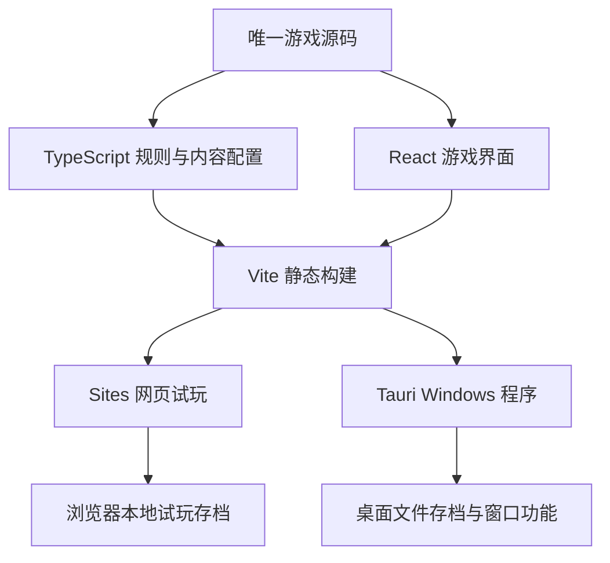

# 基础架构与原子能力

日期：2026-10-04。状态：本文保留 v0.1 原子合同和演进记录；当前目标为产品 0.6.0、schema 5/content 7.0.0。v5 增加契约、目标、事件和派队项目；v6 增加依赖永久对话选择的任务解锁；v0.6 新增返航锚点并冻结 v6 规则迁移。0.6 阶段自动门禁与 QA 构建已通过；真实 Windows 窗口和玩家数值试玩仍待验收。原子能力现状见末尾各版本记录。没有创建或发布 Site。当前架构与验收边界见 [架构说明](架构说明.md) 和 [验收记录](2026-10-03--工程基础搭建验收.md)。

本文件细化 [电脑基础版实施计划](2026-10-03--电脑基础版实施计划.md)。首版玩法和数值沿用该计划；本文负责明确基础选型、能力边界、输入输出、错误处理和验证方法。若旧计划的契约表述与本文不同，按本文的细化约定执行。

## 1. 基础决定：共享游戏源码，桌面优先，Sites 可承载试玩

推荐基础：TypeScript 游戏规则 + React/CSS 界面 + Vite 静态构建 + Tauri Windows 外壳。

Sites 可以参与同一游戏的网页构建、预览和托管。当前采用静态试玩路线，不把游戏规则放进 Site 服务端；桌面包加载本地构建资源，以满足单机离线使用。

| 部分 | 本项目职责 | 事实与限制 |
| --- | --- | --- |
| Codex / VS Code | 编写与维护游戏源代码，调试和验证 | 开发工具；规则可靠性仍需验证 |
| TypeScript 核心 | 资源、工具、升级、任务、事件和时间推进 | 网页与桌面共用同一套计算 |
| React + Vite | 中文界面，生成静态前端 | 不依赖服务端渲染完成首版玩法 |
| Tauri | 本地窗口、托盘、文件存档、Windows 包 | 桌面使用本地 HTML/CSS/JS，独立于在线 Site 可用性 |
| Sites | 将兼容前端发布成网页试玩，管理托管版本 | 发布不是源码自动同步，也不自动形成桌面存档同步 |

OpenAI 官方资料明确 Sites 可以构建、托管和分享网页、Web 应用和游戏，也支持兼容的本地项目。[Sites 官方说明](https://learn.chatgpt.com/docs/sites?surface=app)

本机已安装 Sites 0.1.75 插件明确允许无 Worker 的静态输出，包括 `dist/index.html`，要求声明 `static.directory`。因此当前 React/Vite 方案可以保留，无需为托管改用默认 Vinext starter。原参考为本机安装文件 `sites-building/SKILL.md` 第 275 行；该路径不随项目分发。

Tauri 官方要求提供可供 WebView 加载的静态前端，推荐 Vite 用于 React 等 SPA；SSR 服务端不能直接当作该静态前端。[Tauri 前端配置](https://v2.tauri.app/start/frontend/)

### 一份源码，两种交付

“共享”指规则、配置、UI 和素材来自同一份源代码；平台存储/窗口适配器可以通过构建目标选择。两种包不必逐字节相同，但同一游戏版本的规则必须一致，Web 包不得执行 Tauri 原生 API。

唯一规范源码根目录为 `D:\小游戏`。Sites 发布与桌面打包关联同一来源提交和游戏版本，线上 Site 是发布快照；本地修改后需要重新构建并发布才会上线。不要手工维护两份可分别修改的游戏源码。

若 Sites 工作流要求专用发布 checkout，则由脚本从规范源码生成并记录来源版本，禁止双向手工改规则。发布归档只包含可公开的前端产物；本地存档、备份、工具缓存、依赖和桌面构建输出均排除。

### 首版 Sites 的使用边界

当前桌面仍是主要交付，Sites 试玩是可选发布步骤，不阻塞 Windows 完成。

网页试玩明确采用设备本地存档，可导入导出；它不承诺跨浏览器、跨设备保存或自动连接桌面档。Sites 访问权限由发布时的账户/工作区实际能力决定，本轮没有验证注册、发布资格或配额。

静态托管不能直接附带 D1/R2 绑定、Worker runtime capabilities 或数据库迁移；未来云档需要增加服务端 API 和授权规则，再核查相应部署形态。原参考为本机安装文件 `sites-hosting/scripts/prepare-site-build.cjs` 第 108 行；该路径不随项目分发。

Site 的访问登录与游戏的玩家账号、存档归属、桌面登录流程需要分别设计，不能用访问权限代替游戏同步协议。云存档先留接口边界，不在 v0.1 中实现。

## 2. 原子能力的定义

一个原子能力应有明确输入、单一职责、可观察输出、可解释错误和独立验收案例。它可以是纯函数，也可以是平台操作，不要求成为微服务、MCP 工具或 Codex 技能。

首版采用单项目、单状态和统一动作入口。UI、Sites 和 Tauri 组合这些能力，不各自重复实现规则。不引入通用插件系统、复杂事件总线或网络服务。

每项实施记录至少包含：能力 ID、状态、涉及文件、依赖、验收结果。以下 G/R/S/W/H 项是原子合同的历史基线；v4 新增能力状态另列在第 9 节，实际验收不得沿用 v0.3 结果。

## 3. 共享数据契约

### 内容配置 ContentConfig

包含稳定的世界/建筑/永久能力/契约/目标/事件/选项/项目 ID、价格、产量、前置条件、奖励和工时。中文显示名称与 ID 分离。当前组合确定内容，不建立随机生成框架。

应用启动时校验 ID 唯一、引用存在、数值有限且符合范围。配置错误应阻止进入错误游戏并说明原因，不能静默使用零产量或免费价格。

### 游戏状态 GameState

包含 `schemaVersion`、`contentVersion`、`worldId`、`materials`、`totalGathered`、工具数量、已购升级、已领取任务、事件选择和 `lastSimulatedAt`。

运行修订号和已保存修订号由当前运行维护，保存确认使用它们区分新旧快照；不继承导入文件中的运行编号。成功导入后由当前运行分配下一个修订号，避免旧确认与新状态失配。

材料与生产保留小数，UI 再格式化。任务、工具、升级和事件采用单一事实来源：工具解锁来自已领取任务；事件待处理可由任务 2 已领取且没有选择推导；每秒产量从工具、升级和事件选择计算。

不要另外保存第二份权威产量、购买按钮状态或任务达标状态。查询界面时按当前状态派生。

### 动作结果 ActionResult

成功：新状态及反馈摘要，例如采集量、购买工具、奖励、解锁或事件效果。

拒绝：保留已结算状态，并返回稳定错误码，例如 `INSUFFICIENT_MATERIALS`、`LOCKED`、`ALREADY_PURCHASED`、`TASK_NOT_READY`、`ALREADY_CLAIMED`、`EVENT_NOT_PENDING`、`UNKNOWN_ID`。

“动作原子”指成功时扣款与取得工具/标记一起发生；拒绝时没有部分扣款、重复奖励或半个升级。磁盘写入是单独的持久化边界，不混淆为动作本身已经保存成功。

## 4. 八个游戏规则能力

规则能力不调用 React、浏览器存储、Tauri、网络或系统时钟。时间由调用者显式传入。

| ID / 能力 | 输入 → 输出 | 依赖 | 核心验收 |
| --- | --- | --- | --- |
| G01 创建本轮 | 已校验内容、起始时间 → 初始 GameState | 内容配置 | 零资源、零工具、无已领奖励；初始可采集 |
| G02 推进时间 | 状态、目标时间、补算策略 → 新状态、收益摘要 | 统一产量计算 | 4/秒经过 600 秒增 2400；重复时刻不增益；倒退不回退结算点 |
| G03 手动采集 | 已结算状态、内容 → 新状态、采集量 | 点击效果 | 默认余额与累计采集同时 +1；夹具升级后同时 +2 |
| G04 购买工具 | 已结算状态、工具 ID → 新状态或拒绝 | 解锁、价格配置 | 同时扣款和增加数量；不足或未解锁不购买 |
| G05 购买升级 | 已结算状态、升级 ID → 新状态或拒绝 | 条件、价格、效果配置 | 扣款与已购标记一起发生；同一升级不可重复叠加 |
| G06 领取任务 | 已结算状态、任务 ID → 新状态、奖励/解锁摘要 | 阶段前置和目标 | 不跳过前置；领奖一次；奖励不计入采集量；任务 2 产生待处理事件 |
| G07 选择事件 | 已结算状态、事件/选项 ID → 新状态、效果摘要 | 待处理条件、选项 | 仅待处理时可选；选择唯一；芯片倍率只应用一次 |
| G08 查询展示状态 | 状态、内容 → 产量、价格、可操作条件、下一目标 | 同一规则计算 | 显示产量与实际生产一致；查询不修改状态 |

G03～G07 接收已结算状态，自己不补算时间。G02 是唯一生产时间推进能力，启动恢复、计时更新和用户动作共同复用它。

## 5. 调度、存档和桌面能力

### R01 统一动作调度

输入：用户动作或计时通知，以及当前时间。

输出：最新状态、动作结果、待保存修订号和 UI 反馈。

顺序固定为：取得当前状态 → G02 结算过去时间 → 校验并执行 G03～G07 → 发布完整状态 → 排队保存。用户动作和计时通知串行处理，防止购买与领奖互相覆盖。

拒绝购买不撤销已经发生的生产。例如余额 19、旧产量 0.5/秒，经过 2 秒后购买价格 20 的采集车，应先结算到 20，再成功购买；新工具只赚购买后的收益。

相应地，余额不足的验收是“对已结算状态不扣款、不增加工具”，不能要求过去时间也完全不推进。

### 存档能力

| ID / 能力 | 输入 → 输出 | 责任与验收 |
| --- | --- | --- |
| S01 加载有效档 | 存储适配器、支持版本 → 有效状态 / 无档 / 分类错误 | 校验结构、有限数值、工具数量、ID、前置关系和版本；损坏主档可提供有效备份恢复；不静默新建覆盖 |
| S02 保存快照 | 完整快照、修订号 → 已保存修订号 / 失败原因 | 串行写入；先写临时档并校验，再替换主档，覆盖前保留有效备份；状态与结算时间一起落盘；旧快照成功不能清除新状态的未保存标记 |
| S03 导出存档 | 当前有效状态、目标位置 → 备份文件 / 失败原因 | 导出完整格式，包含版本；不依赖云端；取消对话框不改变游戏 |
| S04 导入存档 | 候选数据、当前状态 → 已切换状态 / 拒绝原因 | 校验 → 备份当前档 → 持久化候选 → 成功才替换内存；任一步失败保留当前档与状态 |

存储适配器只负责读写，存档校验和游戏规则由共享模块负责。桌面使用应用数据目录，浏览器试玩使用设备本地存储；开发档、桌面正式档和浏览器档分别隔离。

运行中保存失败：内存中的购买、领奖和事件标记仍有效，标记未保存并重试，不回滚到可重复领奖的旧状态。退出请求必须等待保存屏障；失败时保留运行状态并提示。强制终止进程可能丢失未保存进度，不能宣称这种情况也绝不丢失。

导入期间暂停用户动作、计时推进和自动保存，并通过同一调度/保存队列建立屏障：先完成先前已经开始的写入，取消尚未开始且被屏障快照替代的旧请求；不能留下会在导入后提交的旧快照。先备份当前状态，候选档校验通过后由同一写入器提交，成功才切换内存并分配新的运行修订号，然后恢复运行。候选写入失败保留旧状态和有效档，恢复运行时补算等待时间。导入是主动替换存档，采用先持久化候选再切换的边界，与普通动作保存不同。

### 保存屏障

收起和退出不是持续追赶不断更新的“最新状态”。请求进入调度队列后，暂停新用户动作、计时推进与自动保存，结算到屏障时刻，并固定要保存的状态和修订号。等待同一保存队列确认该修订已经落盘，再执行隐藏或结束进程。

成功收起后进入后台运行策略，后续时间继续由 G02 结算；成功退出后结束进程，下次启动补算。保存失败则解除暂停、保留未保存标记，并按旧生产状态补算等待时间，不假报完成。

### 启动恢复流程

1. 取得该存档的独占写入权。
2. S01 加载并校验。确实无档时才 G01 新建；不兼容或损坏时进入恢复选择。
3. G02 补算一次，保留补算候选。
4. S02 保存候选和结算时间。
5. 保存成功后开放游戏操作。失败时保留同一候选供重试，不再次从旧档重复补算。

浏览器存档若被多个标签页打开也要取得独占写入权；不能以桌面单实例代替浏览器标签页协调。第二个实例只恢复主窗口或进入只读提示，不先加载、补算或写入。

### 桌面能力

| ID / 能力 | 输入 → 输出 | 验收 |
| --- | --- | --- |
| W01 窗口偏好 | 置顶开关、紧凑/展开选择 → 实际窗口状态 | 置顶可开关；内容切换可读；游戏状态不改变 |
| W02 收起与恢复 | 隐藏/显示请求 → 可见状态 | 收起先经过保存屏障，再隐藏；托盘恢复窗口；恢复经过统一时间推进 |
| W03 真正退出 | 退出请求 → 保存结果和进程退出 | 等待屏障固定修订保存；成功后终止；失败提示并保持运行 |
| W04 独占写入 | 启动请求、应用/存档标识 → 主实例或恢复已有实例 | 第二实例在读档前停止写入路径，避免双重生产和存档覆盖 |

桌面能力通过 Tauri 适配器实现；浏览器试玩隐藏不支持的原生控制，不伪造成功。紧凑视图属于共享 UI，置顶/托盘属于桌面能力。

### H01 Sites 静态试玩发布

输入：通过检查的游戏版本、静态构建目录和该 Site 的合法发布配置。

输出：来源版本、保存版本、部署状态；只有成功发布后才返回真实可用 URL。

依赖：共享规则与 Web 适配器通过验证；Web 构建不执行原生 API，不携带本地存档或桌面输出。部署权限按实际目标受众配置。

该能力尚未执行。它负责发布同一游戏的试玩版，不新增玩法，也不把线上存档自动变为桌面档。

## 6. 时间、状态与版本规则

- 活跃时间和离线时间都走 G02，不能由加载器和 UI 各补算一遍。
- 首版采用最长 8 小时的未结算间隔收益上限；正常连续更新按实际间隔结算。离线 20 小时只获得 8 小时收益，但结算点推进到恢复时间，立即重开不再领取被截断部分。
- 时钟倒退，收益为零且结算点不回退；所有时间值必须有限。
- 离线采集计入累计采集；奖励不计入。离线不自动领奖、不替玩家作事件选择。
- 任务阶段前置是上一任务已经领取。达标查询可派生，领取标记需持久化。
- 事件产量加成由一次性的选择记录派生，加载时不再次乘进存档余额或工具产量。
- v0.1 只支持明确列出的格式/内容版本；未实现迁移前拒绝不兼容版本，不用新配置计算旧档的历史收益。
- 内容或格式升级时新增迁移能力并明确收益计算规则；迁移前备份，失败不覆盖有效旧档。

## 7. 验收例子与实施顺序

### 少量关键验收

| 场景 | 预期 |
| --- | --- |
| 初始采集一次 | 余额 +1、累计采集 +1 |
| 无升级的 2 台采集车 + 1 台加工台，经过 10 分钟 | 余额和累计采集 +2400，时间推进 10 分钟 |
| 对该补算结果重复使用同一时刻 | 新增收益 0 |
| 余额 19、产量 0.5/秒，2 秒后购买 20 的工具 | 先获得 1，再扣 20；新工具不参与之前的 2 秒 |
| 时间冻结后余额不足买工具 | 不扣款、不增加工具，返回不足原因 |
| 已领取任务再领取 | 没有第二份奖励；状态仍已领取 |
| 芯片选择后保存加载 | 仍只有一次 1.10 倍加成 |
| 保存修订 5 时，内存已经推进到 6 | 修订 5 完成不能把修订 6 标为已保存 |
| 退出期间持续收到计时通知 | 屏障暂停推进，保存固定修订后退出，不无限追赶新修订 |
| 导入前存在排队的旧保存快照 | 屏障后无旧请求能覆盖导入档；新状态使用当前运行分配的修订号 |
| 导入候选写入失败 | 当前内存与有效档保持原样 |
| 离线 20 小时，上限 8 小时，随后立刻重开 | 首次只补 8 小时，重开新增 0 |
| 开启第二个桌面实例 / 浏览器标签页 | 不进入第二条存档写入或补算路径 |

Windows 置顶、托盘、缩放、真正退出和休眠恢复必须用实际桌面程序验证；规则测试、网页试玩和 Sites 发布成功不能替代它们。

### 实施顺序

1. 保留原计划 P0/P1：核查环境，打通第一个空白桌面窗口和打包。
2. 第一条可玩链路：G01/G02/G03/G04/G08 + R01 + 最小 S01/S02，形成采集 → 买采集车 → 自动生产 → 保存/重开。
3. 在该链路中补齐存档失败、补算幂等和独占写入，确认基础可靠。
4. 增加 G05/G06/G07，接入升级、任务和事件；完善 S03/S04。
5. 完整接入 W01～W04，调整小窗布局、美术和节奏，完成 Windows 交付验收。
6. 如需分享，执行 H01，发布同版本的 Sites 静态试玩；它不是步骤 5 的前置。

后续多世界时，沿用这些规则能力，增加世界配置、结算和跨轮能力；不会为每个世界重写购买、奖励和存档。后续云同步单独增加玩家身份、云修订和冲突能力，不能把它藏在普通本地保存中。

## 8. 本次结论和证据状态

确定的基础方向：共享 TypeScript 规则 + React/Vite 前端 + Tauri 桌面；Sites 支持作为兼容静态前端的发布渠道。

仍待实际验证：本机完整工具链、前端双目标构建、窗口/存档行为、Site 注册与发布、不同缩放下的体验、玩法数值与资源占用。

本文早期原子合同曾以“未宣称代码已完成”为结论；当前工程已实现后续能力，具体状态以第 9 节和最新验收记录为准。

## 9. v5–v6 可扩展副本能力

| 能力 ID | 输入与结果 | 当前状态 |
| --- | --- | --- |
| C01 选择契约 | 世界 ID 与契约 ID → 创建对应 Run；未指定时用默认契约 | 已实现；全量单测通过，浏览器用例逐项通过 |
| C02 派生目标 | 契约主/可选目标 + 建造、波次、项目事实 → 完成状态、必选状态和奖励摘要 | 纯函数实现；领域/结算测试通过 |
| C03 触发/选择事件 | 世界、通关波次、契约目标、选项 ID 与资源 → 事件事实和解锁项目 | 已实现；选项按契约/目标约束，测试覆盖 |
| C04 派队项目 | 项目定义 + 岗位 + 时间推进 → 人力占用、产出/防御变化、完成事实和临时线索 | 已实现；终局项目可保存/解码，失败不发本轮奖励 |
| C05 成功回归归档 | Run/完成目标 → 契约结算、积分、永久目标和线索；未锁定的失败/撤离不发本轮奖励 | 已实现；返航锚点可结算明确锁定的子集见 C12 |
| C06 内容引用校验 | 稳定 ID、世界/契约/目标/事件/选项/项目/线索引用 → 配置有效或明确错误 | 已实现；新增条件仍要同步扩展规则、验证和 codec |
| C07 v3→v4 存档迁移 | 冻结 v3 定义 + 旧档 + 注入时间 → 按旧规则补算并显式迁移 | 实现及真实结构 fixture 测试通过；未对用户真实档操作 |
| C08 标签页工作台 | Runtime 摘要 → 经营、人力/建筑、任务/事件/故事、收支视图；用户操作只 dispatch | 已接入；小窗回归逐项通过，完整 e2e/桌面验收待完成 |
| C09 v4→v5 机械内容迁移 | 冻结 v4 定义 + v4 存档 + 注入时间 → 按旧规则补算，再验证当前内容定义 | 实现及定向迁移测试通过；schema 不变，内容版本升至 5.0.0 |
| C10 契约解锁与互斥分支 | 已结算目标 → 解锁后续契约；当前契约与事件选择 → 过滤可用目标/项目选项 | 已实现并有领域、存档和浏览器用例；路线平衡试玩待做 |
| C11 对话选择解锁契约 | 河岸线索 + 永久对话选项 → 当前路线和补给生效；成功回归后解锁另一条契约供返场补齐 | 已实现规则、定义校验、v9→v10 冻结迁移；领域、存档和浏览器双向返场流程通过 |
| C12 锁定返航奖励 | 必做目标完成 → 锁定积分/已完成目标/证据；后续失守或撤离只结算锚定部分，安全回归合并新增部分 | v0.6 实现中；schema5 校验、v6→v7 迁移及失败/撤离/成功流程待本阶段集中验收 |
| C13 下一波风险回报预览 | 当前防御、可达目标与挑战阶段 → 预计损伤、守住后新增奖励、提前战舍弃产出 | v0.6 界面与规则摘要实现中；UI/数值验收待本阶段集中门禁 |

0.5 阶段的 `check`（189 项单测）、13 项浏览器流程、Web/桌面构建、`native-check`（11 项 Rust 测试）和隔离标识桌面 QA 构建均通过；这不是 0.6 的验收结果。真实 Windows 窗口和长时间玩法体验仍待验收。内容合同只组合已经实现的规则条件；独立玩法需要新增纯规则、验证和迁移，不由主题或配置文案替代。
