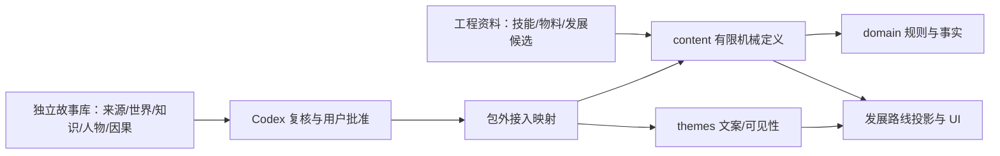

# 工程执行与故事研究交接

更新时间：2026-10-11。工程仓库为 [xuxiaoyu233/game](https://github.com/xuxiaoyu233/game)，本地 remote 指向该地址。本轮本地 HEAD 为 044febd0bac54c702b4264e59213b90b11d089df；此前记录为私有仓库，访问以实际权限为准。

**本轮修订仅在本地，未提交/推送。** 网页端只读 main 可能获得旧计划；交接应提供最新修订文件包，或由用户安排同步后执行。不能用旧“两技能四物品维修目标”的任务清单继续施工。

## 稳定核心与任务分工

以 Melvor Idle 式技能协作、生产链、工具提升与发展解锁为主干。单活动与小窗口是首轮控制/交互选择，故事是逐步接入的内容。其余放置游戏作局部参考；修补城市尚未获用户选择。

| 任务                                                     | 执行者                 | 交付与状态                                                   |
| -------------------------------------------------------- | ---------------------- | ------------------------------------------------------------ |
| [工程执行](GPT-工程执行提示词.md)                        | 网页版 GPT             | 先 S0 分层、路径、职责与实际瘦身，再 P0–P4；每次一个阶段     |
| [故事/命名研究或修订](WorkBuddy-故事与命名调研提示词.md) | WorkBuddy              | 已有候选包，按新核心修订，回传完整新版本与差异               |
| 汇总与复核                                               | 本窗口 Codex，用户验收 | 唯一 PLAN、资料/机械接入对照、来源与因果核对；题材由用户选择 |

工程用通用功能词，不等待整卷故事完成，但先验收 S0 整理，不并行施工后续玩法。WorkBuddy 可在独立副本继续研究，获取已冻结阶段的技能/资源概念作为输入，不改工程源码或 PLAN；新的玩法建议列为候选请求，不写进故事包充作工程事实。

## 已收到的 WorkBuddy 包

输入为用户提供的交付.zip，SHA-256 为 5DAC08BA3ADF27E502BD7D3BC07A50417A3CF079BB02E693051F88F2DA999F2C，结构：

- 两份报告：01-决策与结论.md、02-依据与候选.md。
- 独立 story-library/ 下的 01-来源与参照.md、02-方向与命名.md、03-世界与故事.md；以章节/相对链接组织，没有独立 README 文件，独立包入口与版本说明需在修订时明确。
- tools/pace-check.py：报告附带节奏推算脚本，未执行、未接入 CI。

候选包含盐沼、修补城市、通信方向；推荐修补仍未获用户选定。原 ZIP 未修改，故事包未迁入仓库成为正史。

复核后仍需处理：

1. 旧版数值的条件推算不能证明单活动必须增加队列；所谓主动/挂机倍率比较了不同活动 XP 速率，需重写度量解释。
2. 可选证据不能成为必经结论唯一前置，需给跳过路径或限制结论；完整篇幅不证明每条因果路径闭合。
3. 工具磨损、配额、截止时间和维修单经济没有批准，不自动接入技能核心。
4. 名称碰撞检索仅覆盖已检索范围，未检出不等于零碰撞；题材相近也不自动否决候选。
5. 按新技能/生产路线重新检查世界能否容纳多种成长与材料用途，不能只靠维修故事委托串所有活动。

## 解耦与共同搭建

故事文献包维护来源、阅读范围、稳定编辑 ID、版本、命名、知识、人物关系和叙事证据。相对链接独立阅读；编辑 ID 不进入存档，不包括工程路径、类型/schema、周期/XP/价格。

工程维护包外“故事/知识编辑 ID→机械 ID/文案 ID＋采用版本、条件、可见范围、批准依据”。实际解锁与物料关系只来自同一 content 定义；文献/知识依赖不自动成为游戏科技节点。运行时不解析 Markdown。

**解耦不等于各写各的。** 每个阶段对齐一次玩家路线、内容/解锁关系、适用实现和资料映射，缺口回传给相应负责人。来源资料可以厚，首发只采用实际服务该档玩法的条目。

## 会话和并行方式

分层、目录和保存位置以[架构说明](../架构说明.md)为唯一合同。S0 先固定职责与整理规则，再开始玩法设计：

- 新故事文献目标为独立 story-library/，目录尚未建立。工作副本与原始 ZIP 在 .local-data/collaboration/ 下按 working/incoming 分开；交接输出在 artifacts/collaboration/，均不作为第二份生效正文。
- 当前 PLAN、架构/路径表、main/门禁/锁文件等公共区由本窗口统一整合；工程阶段执行者在自己的 checkout/worktree 做分配清单内的修改，报告跨层影响。
- 每项交接写任务/阶段、输入 HEAD/资料版本、可写文件、负责人和交付路径；“另一个窗口”或“只负责工程”不足以保护并行写入。

推荐本窗口协调，工程另开执行会话，WorkBuddy 继续独立资料任务。不自动创建新聊天或发送任务。

工程若在本机并行，应使用不同 checkout/worktree 和分支；不能同一目录里同时切分支或改 PLAN。两个聊天窗口不会隔离文件。WorkBuddy 只编辑独立候选目录并交付 ZIP，可与工程研究并行。

阶段开始说明输入版本/HEAD 与负责目录；阶段结束回传差异和未定项。Codex 汇总唯一 PLAN/工程映射，用户验收后再进入下一阶段。独立故事库可修改自己的知识与故事关系，改变已采用机械概念时发候选变更，不能直接覆盖工程。

## 检查与权限

阶段内部定向检查，阶段末集中适用门禁；规则测试、纸面推演、浏览器、原生构建和实机验收分别记录。具体阶段与命令只见 PLAN。

沿用现有入口/平台和单运行时，允许重构不合适的旧玩法。隔离新档，保留旧加载/迁移证据，不清理用户存档。不自动提交/推送、发布、启用云同步或自启动。
