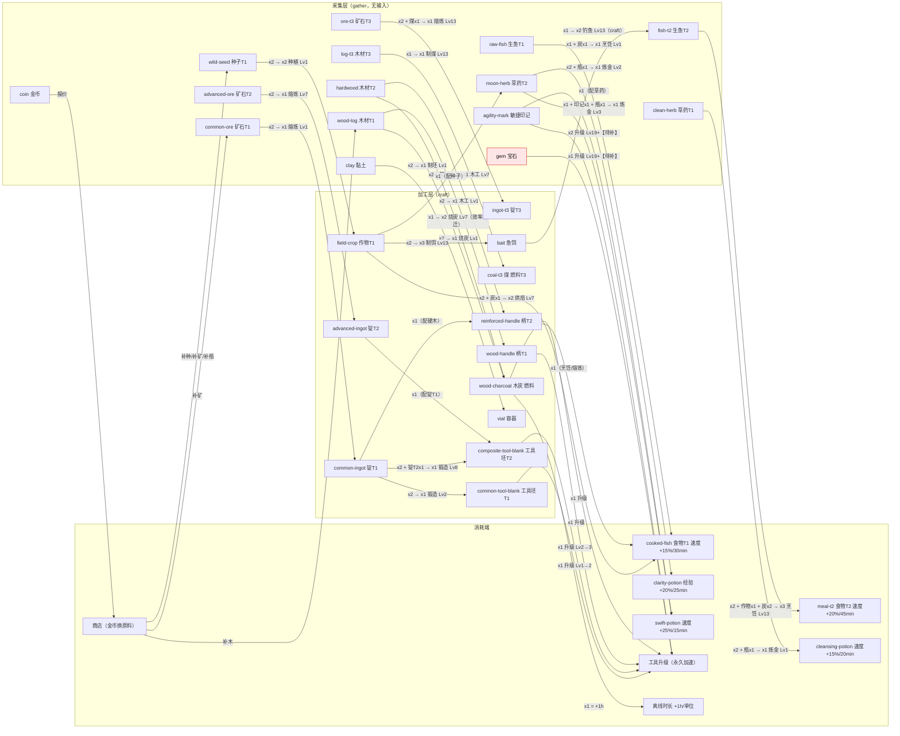

# 技能／资源／发展体系内容蓝图

> 历史范围：本文属于根目录十二技能原型（含content10.0.0的前序设计与切片），不约束当前发展营地。正文按原时点保留，其中“当前/下一步”不能作为新沙盘任务。当前资料见[内容资料库](内容资料库/README.md)，原型配套资料见[历史内容库](历史资料/技能原型内容库-20261016/README.md)。

调研与设计稿。目标：产出能直接落到 `src/content/data/*.json` 的内容蓝图，不新增引擎机制（确需新增处标注【新规则】）。
文中所有 ID 为功能性英文 kebab-case 建议，中文名为机械功能名（非世界观/专有名词）。

## 第 0 部分（附加）现状基线与关键结论

基线（读 `src/content/data/*.json` 与 `src/domain/skill-loop/*` 得到，非推测）：

| 事实 | 数值                                                                                                         |
| ---- | ------------------------------------------------------------------------------------------------------------ |
| 技能 | 12，等级上限 2–4（`metalworking` 4 级，其余 2–3 级）                                                         |
| 活动 | 30（gather 15 / craft 15），`requiredLevel` 1–4                                                              |
| 配方 | 16，全部被恰好 1 个活动使用                                                                                  |
| 物品 | 24；类目 7（raw-material / processed-material / tool-component / fuel / consumable / currency / trade-good） |
| 工具 | 3 条（mining / woodcutting / fishing），各 3 级，倍率 1000→800/820→650/680                                   |
| 离线 | `maxOfflineMs` 8h；燃料 `wood-charcoal` 1 单位 = +1h，上限 8h                                                |
| 商店 | 4 条报价，只花 `coin`，只买物品                                                                              |

引擎能力边界（决定本蓝图能做/不能做什么）：

- 活动两种：`gather`（无输入，可多输出）/ `craft`（吃配方输入，产出配方输出）。**任何"带输入的生产"一律建模为 craft**，包括"用鱼饵钓鱼"。
- 制作周期结束先检查材料，不足即 `stopped/insufficient-materials`；离线补算也照此中断 —— 这是离线进度最大的失速点。
- 增益单槽位，随结算时间递减（`tickBuffs` 按 creditedMs 扣减）；8h 离线必然耗尽（现状最长 30min，建议上限 60min）→ **增益是在线奖励，不计入离线期望**。
- 全局加速 = 各技能 `effect.globalSpeedBonusPermille - 1000` 之和，上限 ×2。
- 工具：一个技能最多一条线，只改周期时长，不改产出/经验。

现状已存在的三个内容缺陷（本蓝图必须修掉）：

1. `gem`：唯一来源 `heist-vault`，**0 个下游**（任何配方/工具升级都不消耗）→ 死胡同。
2. `vial`：来源是商店（coin），无生产配方 → 炼金被货币卡脖子，且与"制造"技能无连接。
3. `common-tool-blank` / `composite-tool-blank` / `wood-handle` / `reinforced-handle`：只供工具升级，3 条工具满级后**全部变死物**。

关键结论先说：

- **不新增技能**。12 个技能各自已有立足点，缺口在"连接"和"消耗端"，不在数量。
- **不做科技树状态**。时代/层用"等级门槛 + 材料"派生表达（见第 3、7 部分）。
- 第一刀只做 **T1→T2 双层切片**（纯数据增量，零引擎改动）。

---

## 第 1 部分 技能编目表

分类族（参照 Melvor 的 Raw Material Gathering / Artisan / Support / Combat 四族，本作无战斗族）：
**采集（gather）→ 加工（artisan）→ 辅助／货币（support）→ 消耗端（sink，非技能）**。

最小完备性判据：一个技能成立需要同时满足 —— ① Lv1 活动零跨技能输入（独立立足点）；② 主产出至少 2 个下游；③ 至少 1 条跨技能连接。

| 技能 ID        | 中文功能名 | 分类         | 主要产出                    | 主要消费端                                  | 依赖的其它技能                                   | 阶段          |
| -------------- | ---------- | ------------ | --------------------------- | ------------------------------------------- | ------------------------------------------------ | ------------- |
| `mining`       | 采掘       | 采集         | 矿石 T1–T5、黏土            | 金工（熔炼）、制造（黏土→容器）             | 无（Lv1 自足）                                   | 已有（T1 起） |
| `metalworking` | 金工       | 加工         | 锭 T1–T5、工具坯 T1–T5      | 工具线（全部采集/加工技能）、制造（强化柄） | 采掘（矿石）；T3 起 生火（燃料）                 | 已有（T1 起） |
| `woodcutting`  | 伐木       | 采集         | 木材 T1–T5                  | 生火（燃料）、制造（柄/容器）               | 无（Lv1 自足）                                   | 已有（T1 起） |
| `fishing`      | 钓鱼       | 采集→加工    | 生鱼 T1–T5                  | 烹饪（食物）                                | 无（T1–T2 自足）；T3 起 农业（鱼饵，改为 craft） | 已有（T1 起） |
| `firemaking`   | 生火       | 加工         | 燃料 T1–T3                  | 烹饪、金工（T3+ 熔炼燃料）、离线时长        | 伐木（木材）                                     | 已有（T1 起） |
| `cooking`      | 烹饪       | 加工         | 食物 T1–T5（速度增益）      | 玩家消耗（在线加速）                        | 钓鱼（鱼）、生火（炭）、农业（T2+ 作物）         | 已有（T1 起） |
| `crafting`     | 制造       | 加工         | 工具柄、容器（瓶）、组件    | 炼金（瓶）、工具线（柄）                    | 伐木（木材）、采掘（黏土）、金工（T2+ 锭）       | 已有（T1 起） |
| `herbalism`    | 草药学     | 采集         | 草药 T1–T5                  | 炼金                                        | 无（Lv1 自足）；农业供给种子                     | 已有（T1 起） |
| `herblore`     | 炼金       | 加工         | 药水 T1–T5（速度/经验增益） | 玩家消耗（在线加速）                        | 草药学（草药）、制造（瓶）、敏捷（T2+ 印记）     | 已有（T1 起） |
| `farming`      | 农业       | 加工（种植） | 作物、草药（种植）、鱼饵    | 烹饪、炼金、钓鱼（T3+ 鱼饵）                | 无（Lv1 需种子，商店可买）；偷窃/商店补种子      | 已有（T1 起） |
| `agility`      | 敏捷       | 辅助         | 印记 + 全局速度（等级效果） | 炼金（迅捷药水）、T4 工具升级材料           | 无（Lv1 自足）                                   | 已有（T1 起） |
| `thieving`     | 偷窃       | 辅助／货币   | 金币、宝石                  | 商店（买原料）、T4–T5 工具升级材料          | 无（Lv1 自足）                                   | 已有（T1 起） |

**必需 vs 冗余判定**

| 判定                 | 技能         | 理由                                                                                                  |
| -------------------- | ------------ | ----------------------------------------------------------------------------------------------------- |
| 结构性必需           | 采掘、金工   | 工具升级是本作唯一"永久能力提升"通道，金工是它的唯一来源                                              |
| 结构性必需           | 伐木、生火   | 燃料链：既是烹饪输入，又是离线时长（`offlineFuel`），还是 T3+ 熔炼输入                                |
| 结构性必需           | 钓鱼、烹饪   | 唯一食物线；食物是消耗端中唯一可持续、可重复的一类                                                    |
| 结构性必需           | 草药学、炼金 | 经验增益的唯一来源，决定了后期升级速度                                                                |
| 结构性必需           | 农业         | 中期交叉枢纽：同时供烹饪（作物）与炼金（草药），并反向供钓鱼（鱼饵）                                  |
| 结构性必需           | 偷窃         | `coin` 的唯一产出源，商店是资源图的安全阀                                                             |
| 薄弱需补强（非冗余） | 制造、敏捷   | 制造只靠"柄"与工具线相连，缺容器 → 补 `vial` 配方；敏捷产出只有 1 个下游 → 补"印记作 T4 工具升级材料" |
| 冗余候选             | 无           | 12 个全部有独立立足点 + 跨技能连接；删任意一个都会断一条消耗端或货币链                                |

**明确不新增的技能**（及理由）：

- 战斗族（攻击/防御/生命）：需要敌人、伤害结算、掉落表，属整套新规则合同，不在本阶段。
- 建造／据点：需要"建筑状态 + 建造命令 + 产出槽位"【新规则】，且会成为第二份状态源，不推荐。
- 交易／商队：其价值是"把多余物品换成 coin"，用一个 `sell` 命令即可表达，不必占一个技能。
- 拆解／回收：用配方表达即可（高级物品 → 低级材料），不必占一个技能。

---

## 第 2 部分 资源依赖图（Mermaid）

节点 = 物品，边 = 配方或用途，边标签 = 投入产出比 + 开放层。
淡红节点 = 当前内容中的死胡同/待补下游项。



**每个资源的下游计数（设计约束：≥2，货币类 ≥1 且必须有出口）**

| 资源                 | 来源                       | 下游                               | 数量                  | 死胡同？       |
| -------------------- | -------------------------- | ---------------------------------- | --------------------- | -------------- |
| common-ore           | 采掘 T1 / 商店             | 锭T1、直接锻造                     | 2                     | 否             |
| advanced-ore         | 采掘 T2                    | 锭T2、工具坯T2                     | 2                     | 否             |
| clay                 | 采掘 T1（副产）            | 容器、模具                         | 2                     | 否             |
| wood-log             | 伐木 T1 / 商店             | 木炭、柄T1                         | 2                     | 否             |
| hardwood             | 伐木 T2                    | 木炭（×2）、柄T2                   | 2                     | 否             |
| raw-fish             | 钓鱼 T1                    | 食物T1                             | 1→需补：食物T2 也可用 | 需补           |
| clean-herb           | 草药学 T1                  | 净化药水、T2 药水                  | 2                     | 否             |
| moon-herb            | 草药学 T2 / 农业           | 明晰药水、迅捷药水                 | 2                     | 否             |
| wild-seed            | 农业 T1 / 商店             | 种植、增产环                       | 2                     | 否             |
| field-crop           | 农业 T1                    | 烘焙、鱼饵、种植草药               | 3                     | 否             |
| common-ingot         | 金工 T1                    | 工具坯T1、柄T2                     | 2                     | 否             |
| advanced-ingot       | 金工 T2                    | 工具坯T2、柄T3                     | 2                     | 否             |
| wood-charcoal        | 生火 T1/T2                 | 烹饪、离线燃料、T3 熔炼            | 3                     | 否             |
| vial                 | 制造（黏土）【待补】/ 商店 | 3 种药水                           | 3                     | 否             |
| wood-handle          | 制造 T1                    | 伐木工具、钓鱼工具                 | 2                     | 否             |
| reinforced-handle    | 制造 T2                    | 伐木工具、钓鱼工具                 | 2                     | 否             |
| common-tool-blank    | 金工 T2                    | 采掘工具 II、金工工具 II【待补】   | 2                     | 现状 1，需补   |
| composite-tool-blank | 金工 T4                    | 采掘工具 III、金工工具 III【待补】 | 2                     | 现状 1，需补   |
| agility-mark         | 敏捷 T1–T3                 | 迅捷药水、T4 工具升级【待补】      | 2                     | 现状 1，需补   |
| coin                 | 偷窃                       | 商店 4+ 条报价                     | ≥4                    | 否（出口充分） |
| gem                  | 偷窃 T3                    | **0** → 补 T4/T5 工具升级材料      | 0                     | **是，必须修** |

---

## 第 3 部分 层级／时代时间线表

层级（tier）划分 = **6 级一层，5 层共 30 级**。层不是运行时状态，而是"等级门槛 + 材料链"派生出的资料标签。

| 时代（层）         | 进入条件                        | 新技能                           | 新材料                                                                                                   | 新工具                                                        | 玩家主要活动                                                               |
| ------------------ | ------------------------------- | -------------------------------- | -------------------------------------------------------------------------------------------------------- | ------------------------------------------------------------- | -------------------------------------------------------------------------- |
| T1 起步（Lv1–6）   | 无                              | 无新增；12 技能全部开启 Lv1 活动 | 矿石T1、木材T1、黏土、生鱼T1、草药T1、种子T1、作物T1；锭T1、木炭、柄T1、工具坯T1、容器、食物T1、净化药水 | 采掘/伐木/钓鱼 工具 Lv1→2                                     | 单技能独立跑；买第一把工具；用木炭解锁 8h 离线                             |
| T2 进阶（Lv7–12）  | 任一采集技能 Lv7 + 对应工具 Lv2 | 无新增                           | 矿石T2、木材T2、生鱼T2、草药T2；锭T2、柄T2、工具坯T2、食物T2、明晰/迅捷药水                              | 采掘/伐木/钓鱼 工具 Lv2→3；金工/制造 工具 Lv1→2【新增工具线】 | 第一次必须跨技能备料：伐木→生火→烹饪；采掘→金工→工具                       |
| T3 工业（Lv13–18） | 采掘+金工+伐木+生火 均 ≥Lv13    | 无新增                           | 矿石T3、木材T3、煤（燃料T3）、鱼饵、食物T3、高级药水、锭T3                                               | 全部工具线 +1 级                                              | 熔炼开始吃燃料（生火成为金工前置）；钓鱼转 craft（吃鱼饵，农业反向供钓鱼） |
| T4 精炼（Lv19–24） | 制造+炼金+敏捷 ≥Lv19            | 无新增                           | 矿石T4、木材T4、宝石消耗端、精炼组件                                                                     | 全部工具线 +1 级（消耗宝石/印记）                             | 偷窃产出的宝石首次成为硬需求；增益药水进入常驻循环                         |
| T5 核心（Lv25–30） | 全部 12 技能 ≥Lv25              | 无新增                           | 矿石T5、木材T5、顶级食物/药水、核心组件                                                                  | 全部工具线满级（第 5 级）                                     | 长周期高单位产出；以"工具满级 + 全技能满级"为终点                          |

**"每层给几个技能同时推进"**

- 每层新增活动的技能数：**5–7 个**（采集 2、加工 2–3、辅助 1）。
- 其余技能在该层不新增活动，但通过两条路径跟进：① 工具 +1 级（永久加速）；② 消耗端升级（更好的食物/药水）。
- 理由：单活动队列下，玩家一次只能推进一条链；若一层同时开 12 条新链，备料成本会把玩家锁死在采集上。

**避免"必须做 Lv N 配方才能升到 Lv N"的四条门槛规则**

1. **T1 零跨技能输入**：所有 Lv1–Lv6 配方只吃本技能产出（或商店货）。跨技能输入从 T2 起引入。
2. **每层最多引入 1 个新跨技能输入**（T2 引入"炭→烹饪"，T3 引入"燃料→熔炼"，T3 引入"鱼饵→钓鱼"）。
3. **升级只用本层最低活动**：从 Lv N 升到 Lv N+1 所需 XP，必须能在"该层最低级活动 × 约 1 个离线周期"内取得，不得依赖该层顶级活动。
4. **工具升级材料不跨层**：工具第 k 级的材料必须由 ≤ 第 k 层的加工活动产出，且该加工活动的等级门槛 ≤ 工具所属技能当前层。

---

## 第 4 部分 交叉依赖矩阵

行 = 供给方，列 = 接收方，格 = 行向列供给的东西（"—"表示无直接供给）。

| ↓供 \ 收→  | 采掘      | 金工             | 伐木      | 钓鱼        | 生火      | 烹饪        | 制造            | 草药学     | 炼金             | 农业      | 敏捷      | 偷窃     |
| ---------- | --------- | ---------------- | --------- | ----------- | --------- | ----------- | --------------- | ---------- | ---------------- | --------- | --------- | -------- |
| **采掘**   | —         | 矿石T1–T5        | —         | —           | —         | —           | 黏土            | —          | —                | —         | —         | —        |
| **金工**   | 工具坯    | 工具坯           | 工具坯    | 工具坯      | 工具坯    | 工具坯      | 锭（柄T2+）     | 工具坯     | 工具坯           | 工具坯    | 工具坯    | 工具坯   |
| **伐木**   | —         | —                | —         | —           | 木材T1–T5 | —           | 木材（柄/容器） | —          | —                | —         | —         | —        |
| **钓鱼**   | —         | —                | —         | —           | —         | 生鱼T1–T5   | —               | —          | —                | —         | —         | —        |
| **生火**   | —         | 燃料（熔炼 T3+） | —         | —           | —         | 燃料        | —               | —          | —                | —         | —         | 离线时长 |
| **烹饪**   | 增益      | 增益             | 增益      | 增益        | 增益      | —           | 增益            | 增益       | 增益             | 增益      | 增益      | 增益     |
| **制造**   | 工具柄    | 工具柄           | 工具柄    | 工具柄      | 工具柄    | 工具柄      | —               | —          | 容器（瓶）       | 工具柄    | 工具柄    | 工具柄   |
| **草药学** | —         | —                | —         | —           | —         | —           | —               | —          | 草药T1–T5        | —         | —         | —        |
| **炼金**   | 增益      | 增益             | 增益      | 增益        | 增益      | 增益        | 增益            | 增益       | —                | 增益      | 增益      | 增益     |
| **农业**   | —         | —                | —         | 鱼饵（T3+） | —         | 作物（T2+） | —               | 种子（补） | 草药（种植）     | —         | —         | —        |
| **敏捷**   | 全局加速  | 全局加速         | 全局加速  | 全局加速    | 全局加速  | 全局加速    | 全局加速        | 全局加速   | 印记（迅捷药水） | 全局加速  | —         | 全局加速 |
| **偷窃**   | 金币→商店 | 金币→商店        | 金币→商店 | 金币→商店   | 金币→商店 | 金币→商店   | 金币→商店       | 金币→商店  | 金币→商店        | 金币→商店 | 金币→商店 | —        |

注：敏捷/偷窃对每格的"工具坯/工具柄"列也成立 —— 工具升级材料同样流向它们的工具线；矩阵里已合并表达。

**必须互相供给的闭环（不可拆）**

| 闭环           | 链路                                                | 断裂后果                                     |
| -------------- | --------------------------------------------------- | -------------------------------------------- |
| 燃料三角       | 伐木 → 生火（木炭）→ 烹饪 + 离线时长 + T3 熔炼      | 断则食物链、离线收益、T3 金属链同时死        |
| 工具链         | 采掘 → 金工（锭→坯）→ 工具升级 → 采掘/伐木/钓鱼提速 | 断则全局产出停滞，所有技能失去"永久提升"通道 |
| 炼金链         | 草药学 → 炼金（草药）＋ 制造（瓶）→ 增益 → 全部技能 | 断则只剩食物一条增益通道，在线效率大幅下降   |
| 农业反向供钓鱼 | 农业（作物→鱼饵）→ 钓鱼（craft）→ 烹饪              | 断则钓鱼在 T3 后失去层级推进力，成为纯采集   |
| 货币安全阀     | 偷窃（金币）→ 商店 → 补种子/矿/木/瓶                | 断则任一环缺料时无法自救，只能硬等采集       |

**早期独立立足点**：12 个技能的 Lv1 活动全部零跨技能输入（gather 无输入；craft 的 Lv1 配方只吃本技能或商店货）。
**中后期强制交叉**：T2 起每个新配方至少带 1 个跨技能输入；T3 起每个新工具等级至少消耗 2 个技能的材料（如"坯 + 柄"、"宝石 + 印记"）。

---

## 第 5 部分 数值建议表

### 5.1 模型（全部确定性，无随机数）

单位成品工时（cycle-seconds）：

```
cost(item) = 周期时长 / 单次产出 + Σ_inputs [ cost(input) × (投入量 / 单次产出) ]
```

稳态活动配比（决定会不会缺料停机）：

```
采集时间 : 加工时间 = (投入量/采集单次产出) × 采集周期 : 加工周期
可持续条件：采集产出速率 (b/t_g) ≥ 加工消耗速率 (a/t_c)
```

### 5.2 XP 曲线

形态：**指数**（放置类标准；多项式曲线在"产出速率也随层指数增长"时会后期失速）。

```
Δ(L → L+1) = round(B × r^(L-1))
推荐：B = 180，r = 1.26，等级上限 30（5 层 × 6 级）
累计到 L30 ≈ 563,000 XP
```

| 等级  | 本级所需 ΔXP | 累计 XP | 当时可用最高速率（XP/分钟，满工具、无增益） | 本级耗时 |
| ----- | ------------ | ------- | ------------------------------------------- | -------- |
| 1→2   | 180          | 180     | 60（T1）                                    | 3 min    |
| 6→7   | 572          | 2,077   | 60（T1，T2 活动 Lv7 才开）                  | 9.5 min  |
| 12→13 | 2,287        | 10,393  | 110（T2）                                   | 21 min   |
| 18→19 | 9,151        | 43,654  | 200（T3）                                   | 46 min   |
| 24→25 | 36,630       | 176,814 | 360（T4）                                   | 102 min  |
| 29→30 | 116,334      | 563,040 | 640（T5）                                   | 182 min  |

分块合计：T1 段 35 min + T2 段 76 min + T3 段 166 min + T4 段 370 min + T5 段 603 min ≈ **20.8 h 有效活动 = 单技能满级**。

**曲线关系约束（最重要的一条）**：

```
时间/级 的增长比 = r_xp / r_rate
r_rate ≈ 1.10/级（由每层速率 ×1.75 得来：60/110/200/360/640）
r_xp 取 1.20–1.30 → 时间/级 增长 1.09–1.18（前快后慢，符合放置手感）
r_xp 若 < 1.15 → 一夜满级；r_xp 若 > 1.35 → 后期卡死
```

三档旋钮（按想要的全局时长选）：

| 档位       | r_xp | 单技能满级（有效活动小时）       | 12 技能全满 |
| ---------- | ---- | -------------------------------- | ----------- |
| 快         | 1.20 | ≈ 6–10 h（按分块法粗估，未精算） | ≈ 70–120 h  |
| 中（推荐） | 1.26 | ≈ 21 h（上表分块法逐段算出）     | ≈ 250 h     |
| 慢         | 1.32 | ≈ 50–80 h（粗估）                | ≈ 600–950 h |

### 5.3 每档活动周期与 XP

| 层  | 采集 durationMs | 采集 xpPerCycle | 制作 durationMs | 制作 xpPerCycle | XP/分钟（工具 1000‰，无增益） |
| --- | --------------- | --------------- | --------------- | --------------- | ----------------------------- |
| T1  | 7,000           | 7               | 9,000           | 11              | 60 / 73                       |
| T2  | 10,000          | 18              | 12,000          | 26              | 108 / 130                     |
| T3  | 13,000          | 43              | 15,000          | 58              | 198 / 232                     |
| T4  | 16,000          | 96              | 18,000          | 122             | 360 / 407                     |
| T5  | 20,000          | 213             | 24,000          | 268             | 639 / 670                     |

- 制作 XP 取采集的 **1.3–1.6 倍**：补偿玩家主动切活动、备料的注意力成本。
- 工具倍率建议：1000 / 860 / 740 / 640 / 550（每层一级，5 级 4 次升级）。**不要低于 500‰**：工具 550 × 增益 1250 × 全局 1450 ≈ 0.997，再低会逼近 1s 周期并触发数值上限检查。
- 全局加速：辅助技能每层 +10‰，单技能上限 +150‰，三技能合计 ≤ +450‰（总上限 ×2 由校验强制）。

### 5.4 离线 8 小时的期望进度

前提：离线只跑 1 个活动；现状增益最长 30min（`cooked-fish` 1,800,000ms），8h 后必然过期 → 离线期望一律不含增益。

| 阶段          | 8h 离线 XP（不切活动） | 期望推进（含中途切到更高层活动）      |
| ------------- | ---------------------- | ------------------------------------- |
| T1（Lv1–6）   | ≈ 28,800               | 第 1 夜：L1 → 约 L17（开局快是常态）  |
| T2（Lv7–12）  | ≈ 52,800               | 第 2 夜：约 L17 → L23                 |
| T3（Lv13–18） | ≈ 96,000               | 第 3 夜：约 L23 → L27                 |
| T4（Lv19–24） | ≈ 172,800              | 第 4 夜：约 L27 → L29                 |
| T5（Lv25–30） | ≈ 307,200              | 第 5 夜前后满级（实际受材料吞吐更慢） |

即：**单技能 ≈ 4–5 个离线夜**；12 技能 ≈ 30–50 夜（受备料与切活动节奏影响）。

硬约束：**只有采集活动能稳定跑满 8h**。制作活动一旦缺料就 `stopped`，实测可能只跑 20 分钟。因此离线默认应停在采集上，制作留作在线；UI 应显示"当前库存可运行 N 个周期"。

### 5.5 配方投入产出比

| 环节       | 投入                      | 产出               | 比例         | 理由                                             |
| ---------- | ------------------------- | ------------------ | ------------ | ------------------------------------------------ |
| 采集       | 1 周期                    | 1–3 单位（T5 2–4） | 单位随层递增 | 抵消高层配方"投入量变大"，减少切活动次数         |
| 熔炼 T1/T2 | 矿石 ×2                   | 锭 ×1              | 2:1          | 经典加工损耗；2:1 让采集工时≈加工工时            |
| 熔炼 T3+   | 矿石 ×2 + 煤 ×1           | 锭 ×1              | 2:1:1        | 引入燃料，制造跨技能强制连接                     |
| 锻造工具坯 | 锭 ×2（T3+ 加柄 ×1）      | 坯 ×1              | 2:1          | 与熔炼同构，便于记忆与校验                       |
| 烧炭 T1    | 木材 ×2                   | 炭 ×1              | 2:1          | 低效，体现层级差                                 |
| 烧炭 T2    | 硬木 ×1                   | 炭 ×2              | 1:2          | 效率跃迁 4×，给玩家"升层的实感"                  |
| 烹饪 T1    | 生鱼 ×1 + 炭 ×1           | 食物 ×1            | 1:1:1        | 与离线燃料共用炭，形成竞争关系                   |
| 烹饪 T3    | 生鱼 ×2 + 作物 ×1 + 炭 ×2 | 食物 ×3            | 批量 3       | 单次产出 ≥2 是"减少切换"的关键                   |
| 炼金 T1/T2 | 草药 ×2 + 瓶 ×1           | 药水 ×1            | 2:1:1        | 瓶来自制造，保证炼金不可独立                     |
| 炼金 T2+   | 草药 ×1 + 印记 ×1 + 瓶 ×1 | 药水 ×1            | 1:1:1        | 敏捷的立足点                                     |
| 制容器     | 黏土 ×2                   | 瓶 ×1              | 2:1          | 让"制造"接上炼金（现状缺口）                     |
| 种植       | 种子 ×2                   | 作物 ×2            | 1:1          | 净持平，靠商店/农业补种                          |
| 增产环     | 种子 ×3 + 作物 ×2         | 作物 ×6            | 净 +4        | 合法"净增益环"，但必须有外部种子来源且净产出 > 0 |
| 制饵       | 作物 ×2                   | 饵 ×3              | 2:3          | 农业→钓鱼的反向连接                              |

通用原则：

- 单位成品的 **采集工时 : 加工工时 控制在 0.8 : 1 ~ 1.5 : 1**。
- 单次制作产出 ≥ 2（T3 起），否则玩家每 2 个周期就要切一次活动。
- 每个配方最多 3 个输入（可读性与校验成本）。

---

## 第 6 部分 落地映射

### 6.1 可直接用现有 schema 表达的部分（逐字段）

| 机制                 | 文件                 | 字段                                                                           | 表达力                                                  | 限制                                                          |
| -------------------- | -------------------- | ------------------------------------------------------------------------------ | ------------------------------------------------------- | ------------------------------------------------------------- |
| 30 级 XP 曲线        | `skills.json`        | `levels[].level` / `levels[].xpRequired`                                       | ✅ 全表达                                               | 等级必须从 1 连续、XP 严格递增、Lv1 = 0                       |
| "类科技树"永久加成   | `skills.json`        | `levels[].effect.globalSpeedBonusPermille`                                     | ✅ 全表达（辅助技能每层 +10‰）                          | 只有"全局速度"一种；单格 1001–2000；跨技能累加，上限 ×2       |
| 技能解锁活动         | `activities.json`    | `requiredLevel`                                                                | ✅ 全表达                                               | 必须 ≤ 该技能已定义等级数                                     |
| 采集（含确定性副产） | `activities.json`    | `kind:'gather'` + `outputs[]`                                                  | ✅ 全表达，outputs 是数组 → 可写"主产 + 副产"固定比例   | 无输入；不能表达"带鱼饵的钓鱼"                                |
| 带输入的生产         | `activities.json`    | `kind:'craft'` + `recipeId`                                                    | ✅ 全表达（含钓鱼用饵、种植、增产环）                   | 配方被恰好 1 个活动使用，复用需复制配方                       |
| 配方                 | `recipes.json`       | `inputs[]` / `outputs[]`                                                       | ✅ 多对多、多产出、净增益环                             | 无概率、无随机副产（符合确定性约束）                          |
| 物品与类目           | `items.json`         | `id` / `categoryId`                                                            | ✅ 类目由加载器派生，可自由新增（fuel/container/parts） | 无卖价、堆叠、耐久、装备槽                                    |
| 消耗品（食物/药水）  | `items.json`         | `consumable.{speedMultiplierPermille, xpMultiplierPermille, durationMs}`       | ✅ 全表达                                               | 最多 1 个增益槽位；倍率 1001–2000；时长上限受"离线必过期"影响 |
| 工具线（永久提速）   | `tools.json`         | `levels[].durationMultiplierPermille`                                          | ✅ 全表达，5 级工具线                                   | 一个技能只能一条线；只改周期，不改产出/经验                   |
| 工具升级（消耗端）   | `tool-upgrades.json` | `toolId` / `sourceLevel` / `targetLevel` / `requiredItemId` / `requiredAmount` | ✅ 本作最好的消耗端：永久 + 有限 + 可测                 | 每次升级只能消耗 **1 种**物品，不能多材料/金币混合            |
| 离线时长             | `profile.json`       | `maxOfflineMs` / `offlineFuel.{itemId, extensionMs, maxExtensionMs}`           | ✅ 表达                                                 | **只能有一种燃料物品**；换高层燃料需【新规则】                |
| 商店（金币出口）     | `profile.json`       | `shopOffers[].{id, itemId, amount, coinCost, requiredLevel}`                   | ✅ 全表达，可按等级开报价                               | 只花 `coin`、只买物品；**没有卖出命令**                       |
| 初始状态             | 加载器派生           | `initialInventory` / `initialSkillXp` / `initialToolLevels`                    | ✅ 新增物品/技能/工具只改各自 JSON，初始记录自动派生    | 初始 XP 不得超过该技能 XP 上限                                |

落地技巧（重要）：

- **"需要输入的生产"全部用 `craft`**，包括种植、钓鱼用饵、增产环。`gather` 只用于真正的零输入采集。
- **"需要 T3 工具才能做 T3 活动"不需要新字段**：用 `requiredLevel` 即可 —— 工具升级材料本身有等级门槛，等级到了工具自然到位。
- **工具线是每个技能最好的消耗端**：把工具线拉到 5 级（4 次升级），每次进入新层都有新的永久升级可买，从根上避免"工具坯满级后无用"。

### 6.2 需要新增引擎规则的部分

| 需求                                              | 缺什么                 | 需要新增                                                                                                                           | 建议                                                           |
| ------------------------------------------------- | ---------------------- | ---------------------------------------------------------------------------------------------------------------------------------- | -------------------------------------------------------------- |
| 死胡同兜底（卖多余物品换金币）                    | 无 `sell` 命令         | `SkillLoopCommand` 加 `sell`；`profile.json` 加 `sellOffers[{itemId, amount, coinValue}]`；校验；schema 4 + 迁移                   | **推荐做**（第 3 步）【新规则】                                |
| 全局经验倍率 / 离线时长加成（"科技感"的主要来源） | `effect` 只有速度      | `SkillLevelThreshold.effect` 扩展为联合类型，加 `globalXpBonusPermille` / `offlineCapBonusMs`；`validation.ts` 加范围校验；UI 展示 | **推荐做**（第 2 步，成本最低的"类科技树"）【新规则】          |
| 多燃料 / 燃料分级                                 | `offlineFuel` 单物品   | 改 `offlineFuel` 为数组或加 `requiredLevel`                                                                                        | 暂不做：高层燃料只做配方输入，离线燃料固定木炭                 |
| 装备 / 词条                                       | 无装备槽与装备状态     | 物品加 `equipment` 字段 + 装备槽状态 + 穿脱命令 + 迁移                                                                             | 不做：用工具升级表达永久提升                                   |
| 科技树 / 时代解锁状态                             | 无"已解锁节点"状态     | 新增 `unlocks` 状态 + 解锁命令 + 校验 + 迁移                                                                                       | **不做**（见第 7 部分）                                        |
| 建造 / 声望                                       | 无建筑状态、无声望计数 | 同上，且会成为第二份状态源                                                                                                         | 不做                                                           |
| 战斗                                              | 无敌人/伤害/掉落       | 整套新规则合同                                                                                                                     | 不做                                                           |
| 副产随机 / 暴击                                   | 需要随机数             | ——                                                                                                                                 | **禁止**：domain 层不得引入随机数；用 `outputs[]` 固定比例代替 |

### 6.3 校验与迁移（工程动作）

红线四项的落地位置：

| 校验                               | 现状      | 位置                                                                |
| ---------------------------------- | --------- | ------------------------------------------------------------------- |
| 配方被恰好一个活动使用             | ✅ 已强制 | `scripts/validate-content-json.mjs` 与 `validation.ts` 双份         |
| XP 门槛严格递增                    | ✅ 已强制 | 同上                                                                |
| 每件物品都有来源（采集/配方/商店） | ✅ 已强制 | `scripts/validate-content-json.mjs` 的 source closure               |
| 不存在只有解锁后才能获得的输入     | ⚠️ 部分   | 现有只校验"输入有来源"，**未校验来源等级 ≤ 使用等级** → 建议新增 C4 |

建议新增的内容校验（全部为纯数据检查，无随机数）：

- **C4 输入可获得性**：`minSourceLevel(item) ≤ requiredLevel(使用该物品的活动)`；`minSourceLevel` 取所有产出该物品的活动的最小 `requiredLevel`，商店来源记为 0。
- **C5 下游 ≥ 2**：每件物品至少有 2 个下游（配方输入 / 工具升级 / 消耗品 / 离线燃料）；货币类 ≥1 且必须有商店出口。
- **C6 净增益环合法**：输入与输出含同种物品时，净产出必须 > 0，且该物品必须有外部来源。
- **C7 工具升级材料不跨层**：`minSourceLevel(requiredItemId)` 对应层 ≤ 该工具等级所属层。

迁移动作（每次内容 bump）：

1. bump `profile.json` 的 `contentVersion`（如 5.0.0 → 6.0.0）。
2. 在 `src/persistence/skill-prototype-save-migrations.ts` 加分支，走 `extendSameSchema`（加法：保留库存/XP/工具/回执/增益，新键零值初始化）。
3. 登记冻结定义：`SkillPrototypePreviousDefinitions` 目前只有 `p1–p4` 四个槽位 → **下一次 bump 需要新增 `p5` 槽位**（改类型 + 新增 `skill-prototype-v5.ts`）【代码改动】。
4. **禁止直接重命名或删除物品/技能 ID**：`preserveRecord` 遇到旧存档里的未知 ID 会直接拒绝加载（"旧存档的库存含有新版本无法解释的 ID"），原档不会静默丢失但会打不开。确需重命名 → 必须先加"ID 重映射"迁移分支【代码改动】。因此本蓝图**沿用现有 24 个物品 ID**，T3+ 新物品用 `-t3/-t4/-t5` 后缀新增。
5. 同批补 `src/themes/skill-prototype-v1.ts` 文案，否则主题校验失败。
6. 跑 `npm run check:content-json` + `npm run check:quick`。

### 6.4 最小可行第一步（推荐执行顺序）

| 步骤            | 内容                                                                                                                                                                                        | 引擎改动                     |
| --------------- | ------------------------------------------------------------------------------------------------------------------------------------------------------------------------------------------- | ---------------------------- |
| 第 1 步（先做） | 双层切片：12 技能全部扩到 Lv12；T2 材料 8 件；T2 配方 8 条；金工/制造新增工具线；**修 3 个死胡同**（gem → T4 工具升级材料；vial → 加"黏土 ×2 → 瓶"制造配方；agility-mark → 加 T4 工具升级） | 零                           |
| 第 2 步         | `effect` 扩展出 `globalXpBonusPermille`，把炼金/敏捷的等级效果做成"类科技树"的可见永久加成                                                                                                  | 小（类型 + 校验 + UI）       |
| 第 3 步         | 加 `sellOffers` + `sell` 命令，作为死胡同的兜底出口                                                                                                                                         | 中（命令 + schema 4 + 迁移） |
| 后置            | T3–T5 逐层扩展，每层重复"新材料 + 新配方 + 工具 +1 级 + 消耗端升级"                                                                                                                         | 零                           |

---

## 第 7 部分 风险与死锁清单

| #   | 风险                                                         | 触发条件                                                  | 后果                                         | 规避方案                                                                              |
| --- | ------------------------------------------------------------ | --------------------------------------------------------- | -------------------------------------------- | ------------------------------------------------------------------------------------- |
| R1  | **自锁**：升到 Lv N 需要只能由 Lv > N 的配方产出的材料       | 配方输入的最小来源等级 > 使用该配方活动的 `requiredLevel` | 技能永久卡死                                 | 校验 C4；T1 配方零跨技能输入；每层最多引入 1 个新跨技能输入                           |
| R2  | **工具自锁**：工具升级材料需要更高层工具才拿得到             | 工具材料跨层                                              | 工具线断裂，产出永久停滞                     | 校验 C7；工具第 k 级材料只来自 ≤ 第 k 层                                              |
| R3  | **死胡同**：`gem` 0 下游、工具坯满级后无用、多余低级材料囤积 | 物品下游 < 2；商店只能买不能卖                            | 仓库只增不减，玩家感知"努力白费"             | 校验 C5；工具线拉到 5 级（每层都有升级可买）；gem 接 T4/T5 工具升级；第 3 步加 `sell` |
| R4  | **离线失速**：制作活动缺料停机                               | 玩家睡前停在制作活动上                                    | 8h 离线只结算 20 分钟                        | 采集产出速率 ≥ 加工消耗速率（5.1 公式）；离线默认建议采集；UI 显示"可运行 N 周期"     |
| R5  | **单活动队列**：12 技能需要 12 夜才轮一遍                    | 单队列是硬约束                                            | 后期推进感骤降                               | 跨技能依赖按层批量备料（一次备满跑很久）；"离线队列"属新规则，暂不做                  |
| R6  | **增益离线无效**：现状增益最长 30min，8h 离线必过期          | 玩家以为挂着增益睡觉有用                                  | 期望落差、差评                               | 明确定位为在线奖励；离线期望表（5.4）不含增益；UI 需明示"增益会随离线时间流逝"        |
| R7  | **只能囤不能卖**：无卖出命令                                 | 任何产出过剩                                              | 通货膨胀、仓库垃圾                           | 校验 C5 + 第 3 步 `sellOffers`                                                        |
| R8  | **数值上限**：工具 × 增益 × 全局 叠乘后周期趋近 1s           | 工具 < 500‰ 或增益 > 1500‰                                | 触发 `NUMERIC_LIMIT`，活动报错               | 工具倍率下限 500‰；三个乘数之积 ≥ 0.5（即最快 ×2）；校验已覆盖 ceil 安全整数          |
| R9  | **配方复用冲突**：同一配方被两个活动用                       | 数据误写                                                  | 校验失败，启动报错                           | 复制配方换 ID（已知成本，接受）                                                       |
| R10 | **净增益环陷阱**：增产环净产出 ≤ 0                           | 配方写错                                                  | 玩家越种越亏，种子耗尽                       | 校验 C6                                                                               |
| R11 | **曲线错配**：r_xp 与 r_rate 不匹配                          | r_xp < 1.15 或 > 1.35                                     | 一夜满级 / 后期卡死                          | 5.2 三档旋钮；每层速率按 ×1.75 递增                                                   |
| R12 | **ID 重命名/删除**：旧存档被拒绝加载                         | 内容整理时改名                                            | 玩家进度打不开                               | 禁止改名；确需改则先加 ID 重映射迁移                                                  |
| R13 | **科技树自锁**：解锁节点 X 需要只能由 X 解锁后获得的材料     | 若引入科技树状态                                          | 硬卡死，且无法用简单的等级校验发现           | **不引入科技树状态**；时代用派生标签表达                                              |
| R14 | **第二份状态源**：建造/声望/科技树各自存状态                 | 若按常规做法实现                                          | 违反"单一状态源"，离线补算与迁移都要分别处理 | 只保留 `inventory / skillXp / toolLevels / buffs / currentActivity`；其余一律派生     |

### 科技树 vs 材料层级（第 7 问的取舍）

| 维度       | 材料层级（推荐）                                              | 科技树                                                               |
| ---------- | ------------------------------------------------------------- | -------------------------------------------------------------------- |
| 玩家体验   | 纵向：换更好的矿/木/配方，直觉强，与 Melvor 一致              | 横向：消费资源解锁分支，有"研究"仪式感，但容易变成"点完就没了"的清单 |
| 数据复杂度 | 低：物品 + 配方 + `requiredLevel`，是当前 schema 原生形态     | 高：需要节点表、前置表、解锁状态、解锁命令                           |
| 平衡风险   | 低：每层独立可测，出问题只影响一层                            | 高：节点前置易成环（R13），且节点一旦点错不可逆                      |
| 状态       | 无新增（等级与库存即状态）                                    | 新增"已解锁集合" → 第二份状态源，违反硬约束                          |
| 观感补救   | 用 `effect` 做永久加成 + 主题文案做"时代"标签，可获得大半观感 | ——                                                                   |

**推荐**：材料层级为主 + 技能等级 `effect` 作为"微型科技树" + 主题层做时代文案。最小可行第一步 = 给敏捷/炼金/偷窃的等级加 `globalSpeedBonusPermille`（现有字段，零改动）+ 在主题层把"层一/层二"写成时代名。

---

## 第 8 部分 参考来源

| #   | 来源                                                                                                                                                                                         | 类型                                                        | 本稿用到什么                                                                                                                     |
| --- | -------------------------------------------------------------------------------------------------------------------------------------------------------------------------------------------- | ----------------------------------------------------------- | -------------------------------------------------------------------------------------------------------------------------------- |
| 1   | Anthony Pecorella, _The Math and Design of Idle Games_, GDC Europe 2016（Kongregate）<br>https://media.gdcvault.com/gdceurope2016/presentations/Pecorella_Anthony_Quest%20for%20Progress.pdf | **公开发布的设计演讲**                                      | 成本指数增长 / 产出线性增长；AdCap 生成器系数 1.07–1.15；"最优购买"诊断方法                                                      |
| 2   | Kongregate, _A Brief Look at the Idle Games Genre_<br>https://www.kongregate.com/en/pages/idle-games                                                                                         | 公开发布的开发者文章（Anthony Pecorella）                   | 指数增长为何是放置品类核心；prestige 的作用与"墙"的概念                                                                          |
| 3   | Melvor Idle 官方更新说明 v0.17（Mastery 重做）<br>https://melvoridle.com/update/update_v017.html                                                                                             | **官方设计说明**                                            | 熟练度池与检查点（10/25/50/95%）、里程碑式解锁的设计意图                                                                         |
| 4   | Melvor Idle Wiki — Skills / Mastery<br>https://wiki.melvoridle.com/index.php?title=Category:Skills                                                                                           | **社区数据站**（非官方）                                    | 技能四族分类（采集 / 工匠 / 辅助 / 战斗）、跨技能供给表；熟练度 XP 公式形态 `Σ⌊i+300·2^(i/7)⌋/48`（≈ 每级 ×1.104）。仅作结构参照 |
| 5   | Kittens Game（bloodrizer）开源代码与 README 设计原则<br>GitHub 镜像 https://github.com/smeyn/kittensgame ；官方站 http://kittensgame.com/web                                                 | **开源项目**（原仓库 bitbucket.org/bloodrizer/kitten-game） | README "General Design Principles"：优先复用既有建筑与资源；每个瓶颈要有多种解法；每个解法制造一个新问题；先难后给升级           |
| 6   | _What might I learn from the design of Legends of IdleOn?_<br>https://arestless.rest/blog/thoughts-on-legends-of-idleon/                                                                     | 二手分析文章                                                | 跨技能依赖链（要头盔→抓虫→做网→挖矿→做镐）的可解性设计；对 Kittens Game 原则的转述                                               |
| 7   | 经济/成长曲线调参整理（社区 Skill 页面）<br>https://lobehub.com/skills/erikhazzard-vasir-game__tuning-economy-progression                                                                    | 社区整理的二手资料（非权威）                                | XP 曲线参数区间（放置类指数比 1.15–1.25）、time-to-level 目标区间                                                                |

**合规声明**：以上仅引用公开发布的设计演讲/文章、开源项目与其设计原则、社区数据站的**结构分类与公式形态**。未复制任何商业游戏的数值表、美术、文案或专有名词；本稿所有 ID 与名称为功能性命名。若后续要写入游戏，命名仍须按 `docs/工程规范.md` 走内容资料库与主题文案流程。

**未验证/需实测项**（本稿不作结论）：

- 5.2–5.4 的 XP 速率与耗时为"纸面计算 + 区间建议"，未做模拟；落地前建议用脚本快进 8h/24h/7d 验证一次。
- 第 2 部分的 Mermaid 图为设计图，非运行时数据；实际物品 ID 以写入 `items.json` 为准。
