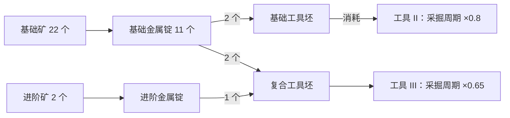
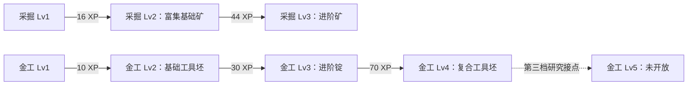

# 成长与科技资料

更新时间：2026-10-12。治理入口见 [README](README.md)，进度只见 [PLAN](../../PLAN.md)。**技能与生产发展图从 P0 就共同设计**；故事侧技术/知识库独立维护，入库不自动变成游戏机制。下列参数是 P0 纸面候选，未进入 content、未试玩，待用户验收。

## 成长系统各自负责什么

| 类型                | 玩家获得什么                         | 首轮处理                                | 权威落点                               |
| ------------------- | ------------------------------------ | --------------------------------------- | -------------------------------------- |
| 技能经验/等级       | 持续训练，开放新活动/配方            | 第一、二档均需真实节点                  | content 门槛、domain 派生、themes 展示 |
| 活动/配方解锁       | 多出可执行的选择                     | 与资源来源/用途一起设计                 | content 有限前置与输入输出             |
| 工具提升            | 材料换长期效率                       | 第一档工具 II、第二档工具 III，效果有限 | content 成本/效果、domain 生效时点     |
| 发展路线图          | 看懂当前条件与下一步                 | P0 起维护，可列表或简单图展示           | 从相同机械定义投影，文档说明设计依据   |
| 故事/知识进展       | 理解世界与证据，已有物品增加叙事用途 | 候选独立研究，批准后逐任务接入          | 独立故事库＋包外审核映射               |
| 逐活动精通/Mastery  | 长期专注同一活动的另一成长轴         | 后续候选；不假装不存在这种核心延展      | 启用前另定经验/效果/存档合同           |
| 装备/出售/研究/战斗 | 新的材料用途、准备或发展选择         | 分别评估，不为了画树整体加入            | 实际支持的有限规则与版本定义           |

**发展路线图可以是纵向或横向，不需要互斥。** 原先“长期分支且不能全购才能设计科技树”的限定已撤回；它最多适用于需要主动取舍的独立研究系统，不能阻止技能→配方→工具的发展规划。

## P0 两档发展蓝图：纸面候选，未实现

首发蓝图采用采掘 `mining`＋金工 `metalworking` 两个技能；金工含冶炼与工具坯配方。旧 gathering/crafting 与 metal/repair-kit 候选不构成必须沿用的 ID。资源、活动、周期、XP 和相同终点路线的完整候选表见[资源与生产链](资源与生产链.md)。

物料流与解锁图分开记录。基础金属锭跨档使用，工具投资与先练级形成先后差异；相同终点路线纸面用时为 231.8 秒和 252.2 秒。详细算式、停止场景和候选状态见资源台账；时间未经过游戏实测，不证明平衡或最优。第三档没有运行时映射，不提前上玩家锁定卡。

| 技能 | 候选等级里程碑                            | 达成后出现的内容                           | 下一档接点                         |
| ---- | ----------------------------------------- | ------------------------------------------ | ---------------------------------- |
| 采掘 | Lv1 0 XP；Lv2 16 XP；Lv3 44 XP            | Lv2 富集基础矿；Lv3 进阶矿                 | Lv4 门槛与内容待第三档设计，不开放 |
| 金工 | Lv1 0 XP；Lv2 10 XP；Lv3 30 XP；Lv4 70 XP | Lv2 基础工具坯；Lv3 进阶锭；Lv4 复合工具坯 | Lv5 门槛与内容待第三档设计，不开放 |

Lv4/Lv5 只是研究接点，不是已经定义的经验门槛，不进入第一、二档运行时内容或 UI；后续必须先补齐来源、用途和同终点路线，不能让玩家看到空锁定节点。

| 节点/关系    | 必须说明                               | P0 记录要求                              |
| ------------ | -------------------------------------- | ---------------------------------------- |
| 采集新原料   | 对应技能门槛、如何获得、供给谁         | 第一、二档来源；零材料起步可达           |
| 新加工配方   | 输入先可得、对应技能经验、产物用途     | 前置是必要条件还是仅建议；AND/OR 写清    |
| 工具提升     | 成本、实际效果、生效时点、后续投资价值 | 与下一档投入竞争，但不能形成不可恢复死局 |
| 跨档物品用途 | 升档后保留什么用途、何时退出           | 配方明确引用，不靠维护磨损强造永久需求   |
| 新技能候选   | 对现有技能提供什么产物/用途/选择       | 只有新名字和 XP 条时不新增               |
| 末端         | 本轮终点与下一段接点                   | 可以有演示边界，不显示空等级承诺         |

## 技术/能力卡与文献库的连接

现实技术史、作者虚构、角色信念与可玩能力分开。独立故事库记录文献来源、实际阅读范围、知识编辑 ID、观测/争议与认知依赖；工程台账只链接其 ID/版本和采用理由，不复制全文或给故事库写 schema。

准备入游戏的能力卡最小字段：

| 字段                                   | 要回答的问题                                           |
| -------------------------------------- | ------------------------------------------------------ |
| 稳定编辑 ID、拟机械 ID、版本与双轴状态 | 候选/批准/历史？未实现还是已有实际映射？               |
| 功能名、世界内别名、来源               | 哪个文献/知识卡支持背景？是事实、解释还是虚构？        |
| 前置                                   | 技能等级、配方/工具事实、任务事实分别是什么？          |
| 来源与成本                             | 原料在哪里得？挤占哪个生产/工具用途？                  |
| 获得方式                               | 等级自动开放、即时购买、任务奖励还是新的持续研究活动？ |
| 有限效果与生效点                       | 开放哪个活动/配方，或改变哪个已有参数？何时生效？      |
| 玩家结果                               | 增加什么选择，如何预览门槛与缺口？                     |
| 代码/文案/兼容映射                     | 无映射必须明示；影响 content/schema 时如何处理？       |

技术树可先是这些能力的发展索引，不必另发明“科技点”。若需要研究占用活动槽、互斥/撤销、独立货币或随机发现，先比较其是否加强技能核心，再扩玩法合同，不把它们当资料建库的前提。

## 阶段共同完成的范围

P0 两档发展关系与文献/知识引用边界；P1 第一档实现与文案/资料投影；P2 第二档验证及扩展成本；P3 下一步/门槛/回访可读性；P4 已批准故事事实映射。这里只说明资料职责，不维护阶段进度，完成状态以唯一 PLAN 为准。

## 旧版研究资产：历史

当前 v14 继承 v13 研究准备：共同根节点要求未登记求援回执；三节点各消耗 20 界点，无节点间前置，玩家装备一个行动准备。属于旧局前配置，不能当作新技能发展树。

| 机械 ID           | 内容 ID / 显示名                          | 旧效果               | 新版处理                 |
| ----------------- | ----------------------------------------- | -------------------- | ------------------------ |
| production-budget | research-supply-model / 补给测算          | 首座生产设施成本减免 | 保留旧版解释，不进入原型 |
| battle-bracing    | research-tide-bracing / 界潮支架          | 一次主动迎战减伤     | 同上                     |
| evidence-ledger   | research-evidence-handling / 证据保全规程 | 首次调查成本减免     | 同上                     |

依据为 src/content/expedition-v13.ts 的 researchRoot/researchNodes、src/themes/expedition-copy.ts 的 RESEARCH_COPY 及领域 Profile 字段。更名不改变旧持久 ID。历史文明/科技资料见[旧副本资料库](../历史资料/失落航标-v12/副本资料库/README.md)。
