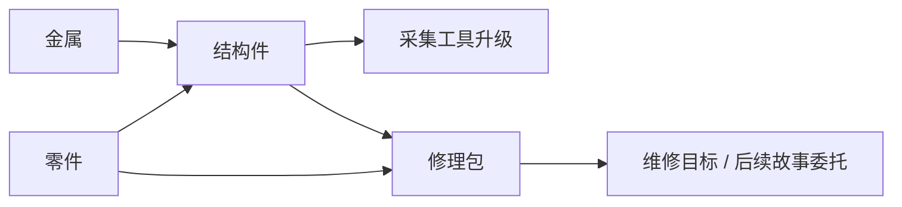

# 资源与生产链

更新时间：2026-10-11。治理入口见 [README](README.md)。本页记录代码现状与候选经济，运行时生效参数仍以对应 content 定义为准。

## 当前 v14 驻地资源

| ID                 | 显示名   | 来源                            | 消费端                               | 当前边界           |
| ------------------ | -------- | ------------------------------- | ------------------------------------ | ------------------ |
| `reclaimed-alloy`  | 回收合金 | 初始库存 12；回收金属岗位       | 结构板、货栈扩建                     | 已接通             |
| `charge-cell`      | 蓄能芯   | 初始库存 10；回收蓄能芯岗位     | 结构板、屏障组件、医疗包、框架、扩建 | 部分下游未闭合     |
| `biofiber`         | 生物纤维 | 初始库存 8；培育岗位            | 医疗包                               | 医疗包未接消费端   |
| `structural-panel` | 结构板   | 工程 Lv1 配方                   | 扩仓、屏障组件、框架                 | 扩仓/屏障已接通    |
| `barrier-kit`      | 屏障组件 | 工程 Lv2 配方                   | 首世界界锚加固，最多稳定度 +18       | 已接通，受上限限制 |
| `medical-kit`      | 医疗包   | 救护 Lv2 配方                   | 无已接入的驻地医疗包消费端           | 悬空，不进入原型   |
| `anchor-shard`     | 锚晶碎片 | 当前未接来源                    | 框架配方                             | 不可达候选         |
| `echo-record`      | 回声记录 | 当前未接来源                    | 框架配方                             | 不可达候选         |
| `anchor-frame`     | 界锚框架 | 工程 Lv3 且需回执；稀有输入未接 | 未接返场效果                         | 完整链未实现       |

依据：`src/content/outpost-v14.ts`、`src/themes/outpost-copy-v14.ts`，以及 `src/domain/expedition/engine.ts` 的界锚支持动作。当前生产率每名工作人员每小时为合金 6、电芯 8、生物纤维 4；它们不是原型数值。

## 新核心：两档生产切片共同设计

以 Melvor 式技能成长与加工协作为核心，不固定“交一个修理包”为终点。推荐功能样例为采掘＋金工，具体技能/ID/参数在 P0 冻结，阶段状态只见 [PLAN](../../PLAN.md)。

| 档位       | 来源→加工→用途                                      | 成长关系                                          | 状态                   |
| ---------- | --------------------------------------------------- | ------------------------------------------------- | ---------------------- |
| 第一档     | 基础矿料→基础金属锭→工具坯→工具 II                  | 采集积累采掘经验；冶炼/制作积累金工经验           | P0 提案，未实现        |
| 第二档     | 进阶矿料→进阶金属锭；两档金属锭→复合工具坯→工具 III | 技能门槛开放新采集/配方；基础材料继续参与后续加工 | P0 提案，未实现        |
| 第三档接点 | 更高档材料或另一技能的协作产物                      | 需有新增用途与选择后再采用，不显示成可玩节点      | 后续候选，无运行时映射 |

两档只是证明生产与成长架构的最小范围，不是物品/技能数量的永久限制；完整关系见[成长与科技](成长与科技.md)。工具首轮是永久效率提升，不因某次题材研究就引入磨损；任务是后续消费端之一。

每个入游戏的物品记录机械 ID/种类、来源、前置、配方消费端、工具或其他用途、阶段/批准/实现状态、文案映射、技术背景引用及兼容影响。生效数值只以对应 content 为准，资料中的设计参数标明版本与状态。

经济推演记录起始状态、每次活动切换、周期/产出/XP、终态与预备材料能支持的加工时间。采集占比没有统一 ≤50% 门槛；加工耗尽后停机可解释、可预备、可恢复，才是首轮要检验的问题。在线/离线倍率比较必须同状态同活动同时间，不能拿不同技能的 XP 速率比代替。

## 旧四物品样例：已撤回作为首发默认

以下保留前序研究样例与算术复核，均无运行时映射。2026-10-11 核心纠偏后不作为 P1/P2 清单；若后续题材需要，须重新评审，不把旧 v14 更名后继续使用旧经济。

| 候选 ID           | 名称 / 类目     | 来源                   | 用途                                 |
| ----------------- | --------------- | ---------------------- | ------------------------------------ |
| `metal`           | 金属 / 原料     | 收集金属               | 制作结构件                           |
| `spare-parts`     | 零件 / 原料     | 采集等级解锁的拆取零件 | 结构件、修理包                       |
| `structural-part` | 结构件 / 加工品 | 制作配方               | 工具升级或修理包                     |
| `repair-kit`      | 修理包 / 消耗品 | 制作等级解锁的配方     | 功能性维修目标；以后经评审接故事委托 |

## 旧样例参数与算术记录

来源为用户提供研究报告。这些参数用于快速规则试验，未宣称已经平衡、经过试玩或被实现；工具与目标消耗要一起评估。

| 候选内容    | 前置       | 周期     | 输入             | 输出与经验                               |
| ----------- | ---------- | -------- | ---------------- | ---------------------------------------- |
| 收集金属    | 采集 Lv1   | 4 秒     | 无               | 金属 1；采集 XP 2                        |
| 拆取零件    | 采集 Lv2   | 6 秒     | 无               | 零件 1；采集 XP 3                        |
| 制作结构件  | 制作 Lv1   | 8 秒     | 金属 2、零件 1   | 结构件 1；制作 XP 4                      |
| 制作修理包  | 制作 Lv2   | 10 秒    | 结构件 1、零件 1 | 修理包 1；制作 XP 5                      |
| 采集工具 II | 一次性升级 | 即时命令 | 结构件 3         | 后续采集周期 ×0.8                        |
| 维修目标    | 一次性提交 | 即时命令 | 修理包 3         | 完成基础目标，不默认授予新资源或故事证据 |

该旧样例采集 Lv2 = 12 XP，制作 Lv2 = 16 XP；初始库存为 0。更高等级如没有对应解锁，不应让 UI 假装仍有下一成长目标。它不决定新两档路线的 XP、停止条件或配方；当前行为提案见[核心合同](../规划/轻量放置核心合同.md)。

报告给出目标优先 136 秒、先工具 187.2 秒的路线，以及 256 秒追加原始采集工作量的回本算术。它们假设理想切换且两路线都留 1 个结构件。工具优先保留升级前的制作经验，因此只要求完成同一个维修目标时，之后做 3 个结构件已够，候选算术为 168 秒；若再补齐同样剩余库存，才为 187.2 秒。本轮仅复核算术，未运行原型规则、完整搜索路线或证明最优；实现时必须指定比较目标、等级与库存终态，不照抄总时间作测试期望。

## 生产链验收

- 每种可见资源有可达来源和真实消费端；隐藏候选允许未闭合，但必须标明。
- 解锁不能需要只有解锁后才能取得的资源；等级/配方/任务前置不能形成阻塞循环。
- 以实际命令与规则分别跑技能/下一档优先、工具优先；记录每步耗时、库存、技能 XP、剩余材料和相同目标终态，而非只加总周期。
- 两路线都能完成；长期效率必须服务尚有用途的资源，不能仅以闲置囤货证明工具价值。
- 同一时刻的材料消费、产出、XP 与任务领取保持原子；失败不部分扣费，重试不重复收益。
- 改数值评估 content 版本与旧规则补算；改权威状态/ID 含义同时评估 schema 与迁移。显示类目和中文名不能替代这些审查。
