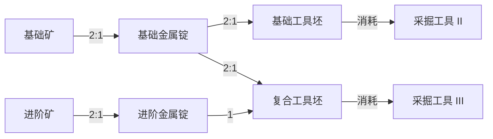
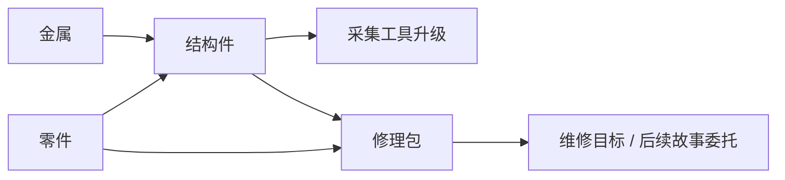

# 资源与生产链

更新时间：2026-10-12。治理入口见 [README](README.md)。本页区分旧 v14 现状、P1 第一档快照与当前 P2 两档运行时；最终机械值以版本化 content 为准。主入口采用 `src/content/skill-prototype-v2.ts`（content `2.0.0`），XP 在最高已实现门槛封顶（采掘 44 XP、金工 70 XP），封顶后生产继续。P2 自动化阶段验收已完成，不代表最终平衡或真人试玩。

## 当前 v14 驻地资源

| ID                 | 显示名   | 来源                            | 消费端                               | 当前边界           |
| ------------------ | -------- | ------------------------------- | ------------------------------------ | ------------------ |
| `reclaimed-alloy`  | 回收合金 | 初始库存 12；回收金属岗位       | 结构板、货栈扩建                     | 已接通             |
| `charge-cell`      | 蓄能芯   | 初始库存 10；回收蓄能芯岗位     | 结构板、屏障组件、医疗包、框架、扩建 | 部分下游未闭合     |
| `biofiber`         | 生物纤维 | 初始库存 8；培育岗位            | 医疗包                               | 医疗包未接消费端   |
| `structural-panel` | 结构板   | 工程 Lv1 配方                   | 扩仓、屏障组件、框架                 | 扩仓/屏障已接通    |
| `barrier-kit`      | 屏障组件 | 工程 Lv2 配方                   | 首世界界锚加固，最多稳定度 +18       | 已接通，受上限限制 |
| `medical-kit`      | 医疗包   | 救护 Lv2 配方                   | 无已接入的驻地医疗包消费端           | 悬空，不进入原型   |
| `anchor-shard`     | 锚晶碎片 | 当前未接来源                    | 框架配方                             | 不可达候选         |
| `echo-record`      | 回声记录 | 当前未接来源                    | 框架配方                             | 不可达候选         |
| `anchor-frame`     | 界锚框架 | 工程 Lv3 且需回执；稀有输入未接 | 未接返场效果                         | 完整链未实现       |

依据：`src/content/outpost-v14.ts`、`src/themes/outpost-copy-v14.ts`，以及 `src/domain/legacy/expedition/engine.ts` 的界锚支持动作。当前生产率每名工作人员每小时为合金 6、电芯 8、生物纤维 4；它们不是原型数值。

## 新核心：两档生产切片共同设计

以 Melvor 式技能成长与加工协作为核心，不固定“交一个修理包”为终点。P1 第一档与 P2 第二档均已进入当前入口。活动在技能经验封顶后仍继续正常产出；P1/P2 集中验收状态只见 [PLAN](../../PLAN.md)。

| 档位       | 来源→加工→用途                                      | 成长关系                                          | 状态                   |
| ---------- | --------------------------------------------------- | ------------------------------------------------- | ---------------------- |
| 第一档     | 基础矿料→基础金属锭→工具坯→工具 II                  | 采集积累采掘经验；冶炼/制作积累金工经验           | P1 已通过自动化验收    |
| 第二档     | 进阶矿料→进阶金属锭；两档金属锭→复合工具坯→工具 III | 技能门槛开放新采集/配方；基础材料继续参与后续加工 | P2 已实现并通过验收    |
| 第三档接点 | 更高档材料或另一技能的协作产物                      | 需有新增用途与选择后再采用，不显示成可玩节点      | 后续候选，无运行时映射 |

两档只是证明生产与成长架构的最小范围，不是物品/技能数量的永久限制；完整关系见[成长与科技](成长与科技.md)。工具首轮是永久效率提升，不因某次题材研究就引入磨损；任务是后续消费端之一。

每个入游戏的物品记录机械 ID/种类、来源、前置、配方消费端、工具或其他用途、阶段/批准/实现状态、文案映射、技术背景引用及兼容影响。生效数值只以对应 content 为准，资料中的设计参数标明版本与状态。

## P1 历史快照与 P2 当前两档定义

P1 第一档参数保留于 `src/content/skill-prototype-v1.ts`（content `1.0.0`），供 P1 存档校验和迁移；当前两档生效参数位于 `src/content/skill-prototype-v2.ts`（content `2.0.0`），显示文案位于 `src/themes/skill-prototype-v1.ts`。早期 P2 用 schema `1` 保持 profile/schema 稳定；P3 当前为 content `2.0.0`/schema `2`，增加待确认回访回执。P1 content `1.0.0`/schema `1` 迁移到当前格式时保留库存、XP、工具、当前活动和周期进度，并为新增机械 ID 初始化零值；早期 P2 schema `1` 单独迁入 schema `2`。具体迁移实现见 `src/persistence/skill-prototype-save-migrations.ts`，运行时版本选择由 `src/main.tsx` 组装。

| ID / 技能        | P1 content `1.0.0` 第一档定义（历史快照）                                                                                                                                  |
| ---------------- | -------------------------------------------------------------------------------------------------------------------------------------------------------------------------- |
| `mining`         | Lv1 0 XP；Lv2 16 XP。`mine-common-ore`：8 秒、基础矿料 ×1、采掘 2 XP；`mine-rich-common-ore`：Lv2、10 秒、基础矿料 ×2、采掘 4 XP。                                         |
| `metalworking`   | Lv1 0 XP；Lv2 10 XP。`smelt-common-ingot`：6 秒、基础矿料 ×2 → 基础金属锭 ×1、金工 5 XP；`forge-common-tool-blank`：Lv2、10 秒、基础金属锭 ×2 → 基础工具坯 ×1、金工 6 XP。 |
| `mining-tool-ii` | 消耗基础工具坯 ×1，采掘周期为基础周期 ×0.8；升级只影响下一完整周期。                                                                                                       |
| 首档其他边界     | 新档三种物品均为 0；单活动重复；离线上限 8 小时；没有第二档内容。XP 到达最高已实现等级门槛后停止增加，活动仍继续生产。                                                     |

### P2 content `2.0.0`：第二档已实现参数

下表为当前两档版本化机械定义，可用于从零档复现；其中功能词仍不是故事专名。发生机械调整时同步 content、主题文案、兼容审查和本资料库；周期在 content 中以毫秒表达，表中换算为秒。

### 技能、经验门槛与活动

| 技能 ID        | 功能名 | 经验门槛与开放内容                                                                                                           |
| -------------- | ------ | ---------------------------------------------------------------------------------------------------------------------------- |
| `mining`       | 采掘   | Lv1=0 XP；Lv2=16 XP 开放富集基础矿；Lv3=44 XP 开放进阶矿；Lv4 的门槛与内容待第三档设计，不开放                               |
| `metalworking` | 金工   | Lv1=0 XP；Lv2=10 XP 开放基础工具坯；Lv3=30 XP 开放进阶金属锭；Lv4=70 XP 开放复合工具坯；Lv5 的门槛与内容待第三档设计，不开放 |

技能等级各自派生，活动只给所属技能经验，不跨技能发 XP。基础矿可在 Lv1 重复采集；达到对应等级后多出生产效率更高的选择，不会自动改当前活动。

金工 Lv2 设为 10 XP，是因为 Lv1 已开放的基础冶炼每次给 5 XP；两次冶炼即可先达到 Lv2，再开放第一项锻造配方，避免“必须先做 Lv2 配方才能升 Lv2”的自锁。

| 内容 ID                      | 行为/配方      | 所属技能与前置 |  周期 | 输入 → 输出                                  | 每次 XP |
| ---------------------------- | -------------- | -------------- | ----: | -------------------------------------------- | ------: |
| `mine-common-ore`            | 采集基础矿     | 采掘 Lv1       |  8 秒 | 无 → 基础矿 ×1                               |  采掘 2 |
| `mine-rich-common-ore`       | 采集富集基础矿 | 采掘 Lv2       | 10 秒 | 无 → 基础矿 ×2                               |  采掘 4 |
| `mine-advanced-ore`          | 采集进阶矿     | 采掘 Lv3       | 12 秒 | 无 → 进阶矿 ×1                               |  采掘 4 |
| `smelt-common-ingot`         | 冶炼基础锭     | 金工 Lv1       |  6 秒 | 基础矿 ×2 → 基础金属锭 ×1                    |  金工 5 |
| `forge-common-tool-blank`    | 锻造基础工具坯 | 金工 Lv2       | 10 秒 | 基础金属锭 ×2 → 基础工具坯 ×1                |  金工 6 |
| `smelt-advanced-ingot`       | 冶炼进阶锭     | 金工 Lv3       |  9 秒 | 进阶矿 ×2 → 进阶金属锭 ×1                    | 金工 10 |
| `forge-composite-tool-blank` | 锻造复合工具坯 | 金工 Lv4       | 14 秒 | 基础金属锭 ×2＋进阶金属锭 ×1 → 复合工具坯 ×1 | 金工 14 |

玩家以基础采掘工具 I 开局。立即工具命令不占主活动：`mining-tool-ii` 消耗基础工具坯，采掘周期取基准的 0.8；`mining-tool-iii` 消耗复合工具坯，采掘周期取基准的 0.65（相对工具 I 的绝对倍率，不与 0.8 相乘）。升级结算旧周期后生效；金工周期不受采掘工具影响。没有耐久、维修或随机省料。

### 物料与解锁分别表达

解锁图与物料图不是同一张生效图：

各物品的来源和首轮用途：基础矿来自前两项基础采掘活动，全部加工为基础锭；基础锭用于工具 II 和工具 III 的共同材料，完成两档后仍有储备；进阶矿冶炼为进阶锭；两种工具坯各自只用于一次永久工具提升。不存在只有解锁后才能获得的输入、材料自锁或需要故事任务才能继续的门槛。科技/知识文献与人物因果只在独立 [`story-library/`](../../story-library/README.md) 维护，不作为这些等级门槛的暗含前置。

### P0 纸面路线与 P2 规则核对

共同终点定义为：获得工具 II 与 III；采掘至少 Lv3、金工至少 Lv4；消耗基础矿 22、进阶矿 2；剩余基础金属锭 7，其他首轮物品为 0。物料算式为 8 次基础采掘＋7 次富集采掘＝22 基础矿；11 次冶炼＝11 基础锭；两个工具配方各消耗 2 锭；进阶矿 2 个制成 1 个进阶锭并用于复合工具坯。P0 纸算术的未封顶经验合计是采掘 52 XP、金工 85 XP；当前 P2 规则按已选封顶行为结算为采掘 44 XP、金工 70 XP。第三档门槛与玩法均未定义。

| 场景         | 纸面步骤与耗时                                                                                                             | 活动切换                  | 终态/说明                                                                                          |
| ------------ | -------------------------------------------------------------------------------------------------------------------------- | ------------------------- | -------------------------------------------------------------------------------------------------- |
| 新档首个工具 | 基础矿采 4 次（32 秒）→基础锭冶炼 2 次（12 秒）→基础工具坯 1 次（10 秒）→即时升级                                          | 2 次                      | 54 秒；采掘 8 XP、金工 16 XP、工具 II；验证零库存可起步                                            |
| 技能优先     | 先采 8 次基础矿、7 次富集矿，达到采掘 Lv3（134 秒）；再取得工具 II；工具 II 后采 2 次进阶矿（19.2 秒）；完成共同终点的加工 | 7 次                      | 总计 252.2 秒；先取得第二档资源资格，再获得效率工具                                                |
| 工具优先     | 先采 4 次基础矿并加工/提升工具 II；工具 II 后完成剩余 4 次基础采掘、7 次富集采掘和 2 次进阶采掘，再完成共同终点加工        | 8 次                      | 总计 231.8 秒；同终点比技能优先少 20.4 秒，代价是先投入基础材料并稍晚取得采掘 Lv3                  |
| 备料后离开   | 金工 Lv1、库存基础矿 18，设置连续冶炼基础锭；每周期 6 秒，完成 9 次后基础矿耗尽                                            | 0 次循环内（选活动 1 次） | 54 秒后产出 9 个锭、金工 45 XP；不能自动转去锻造，停因是下一周期缺基础矿，回访后由玩家选择下一活动 |

纸面路线时间按“活动串行、无额外点击延迟、周期倍率精确乘算”计算。P2 domain 测试已按真实规则复现工具优先 231.8 秒/8 次切换、技能优先 252.2 秒/7 次切换；两者终态库存、封顶 XP 与工具一致。工具 III 后仍可继续当前复合工具坯活动；14 秒后因缺少进阶金属锭停止，库存不变。测试结果验证当前规则与纸面算术一致，不证明最优路线、真实在线/离线体验或游戏乐趣。切换数按更换当前活动 ID 计，工具升级命令不占活动槽，切换本身不计入活动耗时。

经济推演记录起始状态、每次活动切换、周期/产出/XP、终态与预备材料能支持的加工时间。采集占比没有统一 ≤50% 门槛；加工耗尽后停机可解释、可预备、可恢复，才是首轮要检验的问题。在线/离线倍率比较必须同状态同活动同时间，不能拿不同技能的 XP 速率比代替。

## 旧四物品样例：已撤回作为首发默认

以下保留前序研究样例与算术复核，均无运行时映射。2026-10-11 核心纠偏后不作为 P1/P2 清单；若后续题材需要，须重新评审，不把旧 v14 更名后继续使用旧经济。

| 候选 ID           | 名称 / 类目     | 来源                   | 用途                                 |
| ----------------- | --------------- | ---------------------- | ------------------------------------ |
| `metal`           | 金属 / 原料     | 收集金属               | 制作结构件                           |
| `spare-parts`     | 零件 / 原料     | 采集等级解锁的拆取零件 | 结构件、修理包                       |
| `structural-part` | 结构件 / 加工品 | 制作配方               | 工具升级或修理包                     |
| `repair-kit`      | 修理包 / 消耗品 | 制作等级解锁的配方     | 功能性维修目标；以后经评审接故事委托 |

## 旧样例参数与算术记录

来源为用户提供研究报告。这些参数用于快速规则试验，未宣称已经平衡、经过试玩或被实现；工具与目标消耗要一起评估。

| 候选内容    | 前置       | 周期     | 输入             | 输出与经验                               |
| ----------- | ---------- | -------- | ---------------- | ---------------------------------------- |
| 收集金属    | 采集 Lv1   | 4 秒     | 无               | 金属 1；采集 XP 2                        |
| 拆取零件    | 采集 Lv2   | 6 秒     | 无               | 零件 1；采集 XP 3                        |
| 制作结构件  | 制作 Lv1   | 8 秒     | 金属 2、零件 1   | 结构件 1；制作 XP 4                      |
| 制作修理包  | 制作 Lv2   | 10 秒    | 结构件 1、零件 1 | 修理包 1；制作 XP 5                      |
| 采集工具 II | 一次性升级 | 即时命令 | 结构件 3         | 后续采集周期 ×0.8                        |
| 维修目标    | 一次性提交 | 即时命令 | 修理包 3         | 完成基础目标，不默认授予新资源或故事证据 |

该旧样例采集 Lv2 = 12 XP，制作 Lv2 = 16 XP；初始库存为 0。更高等级如没有对应解锁，不应让 UI 假装仍有下一成长目标。它不决定新两档路线的 XP、停止条件或配方；当前行为提案见[核心合同](../规划/轻量放置核心合同.md)。

报告给出目标优先 136 秒、先工具 187.2 秒的路线，以及 256 秒追加原始采集工作量的回本算术。它们假设理想切换且两路线都留 1 个结构件。工具优先保留升级前的制作经验，因此只要求完成同一个维修目标时，之后做 3 个结构件已够，候选算术为 168 秒；若再补齐同样剩余库存，才为 187.2 秒。本轮仅复核算术，未运行原型规则、完整搜索路线或证明最优；实现时必须指定比较目标、等级与库存终态，不照抄总时间作测试期望。

## 生产链验收

- 每种可见资源有可达来源和真实消费端；隐藏候选允许未闭合，但必须标明。
- 解锁不能需要只有解锁后才能取得的资源；等级/配方/任务前置不能形成阻塞循环。
- 以实际命令与规则分别跑技能/下一档优先、工具优先；记录每步耗时、库存、技能 XP、剩余材料和相同目标终态，而非只加总周期。
- 两路线都能完成；长期效率必须服务尚有用途的资源，不能仅以闲置囤货证明工具价值。
- 同一时刻的材料消费、产出、XP 与任务领取保持原子；失败不部分扣费，重试不重复收益。
- 改数值评估 content 版本与旧规则补算；改权威状态/ID 含义同时评估 schema 与迁移。显示类目和中文名不能替代这些审查。
