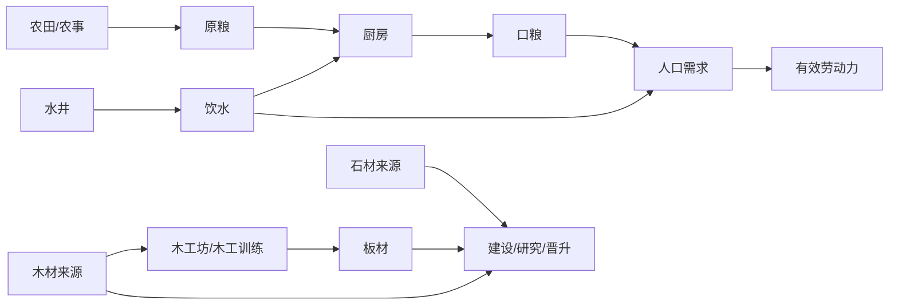

# 资源与生产链

更新：2026-10-19；当前阅读快照为 schema5/content `d1-c-1`。实际数值源为[camp-content](../../next/civ-idle/shared/sandbox/camp-content.ts)，运行倍率/运输/施工仍沿原生逻辑；本文不建立第二份经济配置。

## 六资源与用途

| 资源 | 当前主要来源 | 当前去向 |
| --- | --- | --- |
| 原粮 | 农田、农事训练、合格农田协助 | 厨房、扩地、研究/晋升 |
| 木材 | 伐木场、伐木训练、林地协助 | 建设/升级、木工坊与木工训练、研究/晋升 |
| 石材 | 采石场、采石训练、石脉协助 | 建设/升级、研究/晋升 |
| 板材 | 木工坊、木工训练（消耗木材） | 后续研究、升级与晋升 |
| 饮水 | 水井、开局有限储备、符合条件的求援 | 居民饮用、厨房加工 |
| 口粮 | 厨房、开局有限储备、符合条件的求援 | 居民食用 |

人口供给生产与运输劳力，但不因建设住房直接增加；原粮必须加工为口粮。当前不产生铁、工具物品、电力、污染或科技点。

## 建筑基础配方快照

每秒、每个已建等级的名义基础值；不是当前库存实测速率。未计研究/2星、劳力/供给/仓容/运输等限制，真实预览沿[camp-preview](../../next/civ-idle/shared/sandbox/camp-preview.ts)与原生BuildingLogic。

| 建筑 | 输入/秒 | 输出或能力 |
| --- | --- | --- |
| 农田 | 无 | 原粮0.20/秒 |
| 伐木场 | 无加工输入；需适建林地 | 木材0.20/秒 |
| 采石场 | 无加工输入；需适建石脉 | 石材8/60（约0.1333）/秒 |
| 木工坊 | 木材0.20 | 板材0.10/秒 |
| 仓库 | 无持续配方输入 | 1星200、2星300集中仓容/已建等级；营地中心另有基础200 |
| 住房 | 无持续配方输入 | 10床/等级；基础庇护20床另计 |
| 水井 | 无 | 饮水0.30/秒 |
| 厨房 | 原粮0.10＋饮水0.05 | 口粮0.08/秒 |

施工/升级使用独立订单材料，不把每秒配方当建造价格。1星成本成长常量1.18，具体多级订单总成本沿原生函数与预览，本文不复制整个逐级价格表。

## 点击、技能与自动产出

- 建筑并行自动运行；一个专注作业独立重复，完成才扣料/给产物/XP。技能基准周期与奖励只在[成长与科技](成长与科技.md)列示。
- 点击协助共享10个模拟秒节奏；当前单次木材1/石材0.5/原粮1，成功才给对应技能1XP，满级实际XP为0。按真实地块和设施资格执行，不把点击地图/拖镜头当采集。
- 技能等级只提高训练产物数量；技能倍率不扩散到自动建筑、点击奖励或XP。协助/训练不设另一套钱包，收益沿原库存与命令链。
- 缺料/仓容不足时等待，恢复后继续；默认不要求逐栋暂停/手动收获。已排施工不等于已建成等级。

## 人口收支和开局

当前初始20成人/20床，木材30、石材20、口粮24、饮水36。每成人每模拟秒需要口粮0.002/饮水0.003；厨房耗水与居民饮用分别计一次。劳力沿唯一人口模型；当前无自然死亡或致死瘟疫。

人口移入、食水配给、救援资格与时间只见[camp-population](../../next/civ-idle/shared/sandbox/camp-population.ts)和[C1采用值](../规划/C1食物与人口采用值.md)，不将未来供热/年龄数值提前写入本表。普通离线目前最多4h；未来重大事件全局暂停是已确定待实现合同，不是现有页面已生效功能。

## 库存与速率术语

| 口径 | 事实来源 | 展示要求 |
| --- | --- | --- |
| 可用库存 | 已完成状态建筑内的资源，沿campAvailable | 用于支付/训练/配给；不要用总量代替资格判断 |
| 施工占用 | 施工/升级中设施内材料 | 不当作随时可支付余额 |
| 运输中 | 原运输记录携带材料 | 与施工占用分开，不能用总量减可用一概称在途 |
| 总量 | 当前聚合投影为可用＋施工占用＋在途 | 详情明确范围；旧campTotalStock仅算建筑内，不能把函数名字当完整定义 |
| 集中仓容 | 营地中心及已生效仓储能力 | 与可用库存不是同一余额；训练/协助的实际限制继续同源判断 |
| 自动收支 | HUD当前生产/加工IO减人口需求 | 数值带/秒，详情明确未计训练/建造；不是全来源实测或离线总产量 |

库存聚合沿[camp-stock](../../next/civ-idle/shared/sandbox/camp-stock.ts)与[camp-status](../../next/civ-idle/shared/sandbox/camp-status.ts)，不新写另一套求和。离线摘要的净变化可能为负，不能称“全部产出”；收益已入账，无额外领取步骤。

当前纯函数/浏览器交付证据见[D1-C交付](../证据/发展沙盘/D1/C/交付.md)。本次仅核对源码并整理资料，没有重新证明整段新档经济平衡。
