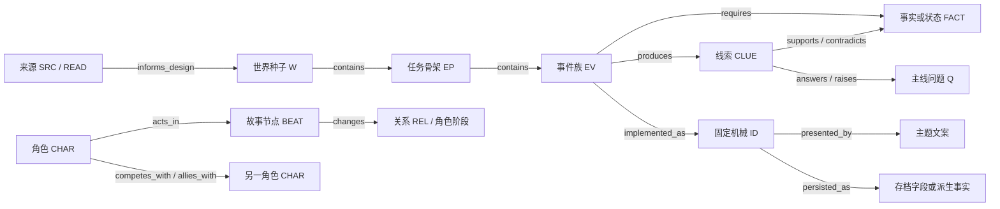

# 交叉记录与资料治理规范

日期：2026-10-07。版本：0.3。状态：现行编辑规范；Markdown 为唯一编辑源，校验脚本提供轻量门禁，不新增数据库、依赖或后台服务。

## 调研结论

交叉记录不是在几份文档之间互相多加链接，而是能回答三类问题：**这个设定从哪里来？它和哪些事实/任务有关？玩家做了什么之后，游戏里哪条规则和反馈承接了它？**

- W3C 的 PROV Primer 用 Entity、Activity、Agent 描述资料、编辑活动和责任方，并将不同版本、引用来源与生成活动联系起来。这里借用“来源链”和“修订链”的思路，不引入整套 RDF/OWL 技术栈。[PROV Primer](https://www.w3.org/TR/prov-primer/)
- W3C SKOS 用稳定概念标识、首选标签、别名及层级/关联关系组织概念。这里采用“稳定 ID 不随显示名称改动、别名回写命名台账”的最小做法，不要求把作品设定改写成 SKOS/RDF。[SKOS Primer](https://www.w3.org/TR/skos-primer/)
- NASA 的需求验证矩阵建议用唯一标识追踪每项需求，并注明需求来源和验证方式。这里仅将该做法用于可验收的玩法/内容合同和文档门禁；文学候选、历史解释与角色信念不是工程“需求”，不强行伪装成可测试断言。[NASA Appendix D：Requirements Verification Matrix](https://www.nasa.gov/reference/appendix-d-requirements-verification-matrix/)
- 互动叙事设计师 Emily Short 对 storylets 的总结是：可插拔的短叙事单元既能推进长篇主线，也能相互作用，新增一段内容时不必重写其余章节。适合把“重复剧情骨架”记成可组合章节单元，而不是复制整篇副本。[Storylets Play Together](https://emshort.blog/2019/12/03/storylets-play-together/)
- AAAI 的 NarrativeGenie 将剧情节拍组织为有先后约束的事件图，再根据玩家状态调整事件顺序。这支持“事件有前置/后续关系，生成结果受图约束”的设计，不支持让模型无条件决定真相或规则。[NarrativeGenie（AAAI AIIDE 2024）](https://ojs.aaai.org/index.php/AIIDE/article/view/31868)
- 一篇 2026 年轻量 RPG 框架研究提出在预定剧情中给 LLM 有限表达空间，并讨论自由度与连贯性之间的取舍；它的 Demo 用户样本只有 20 人，适合作为设计假设，不能当作本项目效果已被证明。[A Lightweight Role-Playing Game Design Framework Based on LLMs](https://journals.sagepub.com/doi/10.3233/FAIA260065)

据此，推荐采用**小型有类型的叙事图 + 来源台账 + 实现映射**。不需要一开始就做通用图数据库。先把少数关键关系写清楚，并运行范围有限的静态校验；更深的结构检查等 ID 和内容结构稳定后再逐步增加。

还要区分“编辑台账可交叉引用”和“游戏运行时能读取”：当前游戏静态导入 TypeScript 内容，不读取本目录的 Markdown。未来如需游戏/LLM 消费叙事图，应使用经过筛选的机器可读投影，不能把本规范的 Markdown 表格误当作现成运行时接口。具体字段、现有游戏 ID 映射和安全边界见[机器可读内容桥接方案](机器可读内容桥接方案.md)。

## 一、记录的层次和 ID

保留已有编号并按职责补充，不把文档索引号直接当存档 ID：

| 记录              | ID 例子            | 作用                                                                                       |
| ----------------- | ------------------ | ------------------------------------------------------------------------------------------ |
| 外部素材来源      | `SRC-09`           | 记录作品/论文/网页及可见信息、可信度、阅读范围。                                           |
| 阅读/证据片段     | `READ-xx`          | 记录具体章节、页面段落或源码位置；不把简介当全文阅读。                                     |
| 世界类型族        | `UF-xx`            | 多维题材标签，如时间错位、交通设施、身份冲突。                                             |
| 文明发展路径      | `PATH-xx`          | 记录跨时代的资源、知识、制度、技术依赖与交叉；它是资料库分类，不是存档或科技等级 ID。      |
| 成长系统/研究图   | `PROG-xx`          | 记录远征、永久能力、研究节点、装配选择与故事证据之间的设计关系；不直接等于运行时存档字段。 |
| 长线故事弧        | `ARC-xx`           | 记录跨卷主问题、阶段答案、汇流点和人物变化；不是副本 ID 或游戏存档字段。                   |
| 世界种子          | `W-03`             | 稳定的地点、局部规则、历史和冲突。                                                         |
| 任务骨架          | `EP-xx`            | 可跨世界复用的剧情节奏及决策槽位。                                                         |
| 本局变化条件      | `MOD-xx`           | 改变一次进入角度、前提或压力的候选项。                                                     |
| 事件族            | `EV-xx`            | 稳定触发点、允许异常范围和合法响应 ID；LLM 只生成某次事件实例。                            |
| 角色              | `CHAR-xx`          | 记录独立目标、方法、能力、已知与误信、代价、当前阶段和下一步行动。                         |
| 关系边            | `REL-xx`           | 记录两名角色之间可追溯、可能不对称或阶段性变化的关系。                                     |
| 故事节点          | `BEAT-xx`          | 记录角色作出的关键行动、触发条件、后果和可见证据；与可复用事件族 `EV` 区分。               |
| 叙事事实/主线问题 | `FACT-xx` / `Q-xx` | 分别记录作者要维护的事实主张和仍待回答的问题。                                             |
| 生成候选          | `GEN-xx`           | 保存待筛选的模型草稿及输入记录；不自动成为正式设定。                                       |
| 可实现的机械内容  | 代码内稳定 ID      | 例如 `forest-signal`、`keeper-debrief`；由 `src/content` 及 domain 类型负责。              |

世界卡里的同一事实只设一个权威记录，其余页面引用 ID 并按需展示摘要。改名字不改 ID；废止时标记 `superseded-by`，不复用旧 ID。`UF/W/EP/MOD/EV/FACT/Q/PROG` 是资料库编辑索引，不默认新增存档字段。

## 二、每条记录的公共头

先在 Markdown 顶部使用简洁字段，不要求 YAML 解析：

```text
记录 ID：W-03
记录类型：世界种子
版本：0.1
故事状态：候选 / 已评审 / 正式设定 / 已退役
实现状态：未计划 / 规划 / 已实现 / 已验证 / 待验收
真相范围：作者真相 / 人物所知 / 玩家已知 / 本局临时现象
来源：SRC-09；阅读范围见来源表
最后修改：YYYY-MM-DD；修改人/用途：……
```

来源可信度、故事成熟度、真相可见度和代码实现度是四个独立维度，不能用“已验证”一个词混在一起。`SRC-09` 可以是 S1 来源，但它的某条设计启发仍不因此成为我方世界事实；“代码里存在”也不表示 Windows 运行或玩家理解已验收。

状态统一使用以下字段，不合并成一个总状态：

| 字段                    | 允许值                                                  | 含义                                                               |
| ----------------------- | ------------------------------------------------------- | ------------------------------------------------------------------ |
| `story_status`          | 候选 / 已评审 / 正式设定 / 已退役                       | 作者设定是否已评审和冻结；正式设定仍可在保留历史的前提下显式修订。 |
| `implementation_status` | 未计划 / 规划 / 已实现 / 自动验证 / 人工待验收 / 已验收 | 代码及其验收证据；自动测试不代表设备、可用性或玩家验收。           |
| `truth_visibility`      | 作者真相 / 角色相信 / 玩家已知 / 本局临时 / 未知        | 信息对谁可见；角色陈述若未被独立证据核验，应记为“角色相信/声称”。  |
| `source_scope`          | 全文 / 指定章节 / 摘要 / 页面元数据 / 官方说明          | 实际阅读范围；不能把摘要写成全文研读。                             |

资料的默认追溯链为：`SRC/READ → PATH/W/EP → BEAT/EV → FACT/CLUE/Q → CHAR/REL → code ID/copy/save → check/e2e/manual evidence`。缺少后半段时明确记“无实现映射”，不得用相似文案填成已实现关系。

## 三、关系词汇表

交叉索引采用有方向的关系。一个关系至少写明起点、关系、终点、条件/范围、状态和证据位置。

| 关系                       | 方向                                           | 含义                                                                                                                    |
| -------------------------- | ---------------------------------------------- | ----------------------------------------------------------------------------------------------------------------------- |
| `informs_design`           | `SRC/READ/PROG/PATH/W/BEAT → UF/W/EP/PATH/ARC` | 来源或已评审的项目设计输入了哪类后续设计；必须区分来源事实和我方推断，不能写成外部来源证明我方剧情。                    |
| `converges_at`             | `PATH/CHAR/W → BEAT`                           | 多条路径或人物在同一个冲突节点相遇；须写清共同对象和各自不同的判断/代价。                                               |
| `contains`                 | `UF/W/EP → EP/EV/MOD`                          | 世界/骨架可包含的模块。                                                                                                 |
| `requires`                 | `EP/EV/选项 → FACT/CLUE/状态`                  | 某事件出现或某选项可选的前置条件。                                                                                      |
| `produces`                 | `W/EP/EV/选项 → CLUE/状态`                     | 完成后可能产生的结果；标明本局临时还是成功回归后永久。                                                                  |
| `supports` / `contradicts` | `CLUE/证据 → FACT`                             | 证据支持或挑战某项主张；支持不等于证明，冲突可有意保留。                                                                |
| `known_by`                 | `FACT/CLUE → 角色/玩家状态`                    | 谁知道、相信或已经亲眼见过什么；必须带章节/条件，避免把角色认知与事实本身混为一谈。                                     |
| `appears_in`               | `CHAR → W/EP/BEAT`                             | 标明角色在副本/章节中的呈现方式（直接碰面、独立行动痕迹、档案、返航后对话等）；须写明连续性凭据，不默认角色与玩家同行。 |
| `acts_in`                  | `CHAR → BEAT`                                  | 哪个角色在此节点采取行动；须记录可见理由、行动条件和结果。                                                              |
| `changes`                  | `BEAT → CHAR/REL`                              | 哪个故事节点改变了角色阶段或关系状态；不能把变化只写成无来源的“变强了”。                                                |
| `competes_with`            | `CHAR → CHAR`                                  | 目标或有限机会冲突；不自动表示仇恨或永久敌对。                                                                          |
| `owes` / `protects`        | `CHAR → CHAR`                                  | 有方向的义务、债务或保护关系；写明触发事实与当前有效范围。                                                              |
| `trusts` / `distrusts`     | `CHAR → CHAR`                                  | 角色对另一人的判断，可与对方的判断不同；注明证据、强度变化和节点。                                                      |
| `allies_with`              | `CHAR → CHAR`                                  | 有期限或条件的合作；必须记录共同目标、约束和退出条件，不代表编入玩家队伍。                                              |
| `answers` / `raises`       | `FACT/章节/CLUE → Q`                           | 哪条事实阶段性回答哪一问，或提出新问题。                                                                                |
| `foreshadows`              | `W/EP/EV/CLUE → W/EP/Q`                        | 为之后的内容留出方向，不提前揭晓隐藏真相。                                                                              |
| `unlocks`                  | `选项/结算 → W/EP/EV`                          | 明确的开锁关系；要同时有文案和机械实现证据。                                                                            |
| `variant_of`               | `MOD/EP → EP`                                  | 变化条件或返场章节基于哪个稳定骨架。                                                                                    |
| `implemented_as`           | `W/EP/EV/CLUE → code ID`                       | 叙事定义映射到哪些稳定机械 ID、源文件和条件。                                                                           |
| `presented_by`             | `code ID → theme key/copy`                     | 哪个主题文案呈现这个机械事实。                                                                                          |
| `persisted_as`             | `code result → SaveBundle field`               | 玩家重启后仍成立的事实保存在哪里；若无需保存，注明派生方式。                                                            |

关系类型以本表为准；如果需要增加新词，先更新规范并回查索引中同义词。实现状态与故事状态分栏填写，`候选 + 自动验证` 并不代表候选设定已经成为游戏事实。

避免没有范围的“相关”“参考”“关联”。若两个角色都知道一件事，也要分别记 `known-by` 和对应章节门槛，不能只靠章节排列猜测。

`REL` 是可回链的关系记录，不是把人物关系冻结成永久标签。同一对人物可因不同 `BEAT` 从竞争转为有条件结盟，再因违约恢复竞争；需要保留关键变化及其证据，而不是覆盖掉旧状态。关系词描述方向，参与者各自的理解分别记录。竞争记录还须指出有限目标或机会；若没有实际冲突，不仅为了“群像感”贴上竞争标签。

## 四、最小交叉索引示例

序章当前真实关系链集中记在[交叉索引](交叉索引.md)，那里是这些边的唯一台账。下图表示一条新内容应能走通的追溯路径；候选内容可停在中途，但要标出缺少哪类边，不能用候选文案伪装成代码事实。



## 五、LLM 生成物如何入账

把模型结果当作一项新的生成活动，而不是新世界事实：

1. **生成前**：给模型一小段相关关系子图，至少含世界 ID、当前事件族、角色/玩家可知状态、允许引用的事实 ID、禁止揭晓的 `FACT`、近期已发生事件和固定响应 ID。不要把整个资料库或完整存档发给它。
2. **模型输出**：回传 `eventFamilyId`、短标题/现场细节、`usedFactIds`、可选响应 ID 和“本局临时”标记。模型不得新增永久 `CLUE`、资源数值、解锁条件或 save 字段。
3. **机器校验**：检查所有 ID 存在、关系状态可见、前置条件成立、响应在白名单内、没有重复/自相矛盾引用。任何不通过就使用固定事件文案。
4. **人工升格**：有意思的生成内容先写成 `GEN-xx` 候选记录，注明模型、日期、提示词版本、输入 ID、输出、审核人和修改来源；审核后再拆到 `W/EP/EV/FACT`，不能直接把模型日志当 canon。
5. **游戏保存**：本项目存档只写已定义的机械 ID 和必要选择事实。运行时自由文本暂不进入 `SaveBundle`；如果以后要跨重启保留原文或生成事件历史，需另审缓存/迁移/备份合同。

机器检查能抓出断链、错误 ID 和非法选项，不能可靠判断隐喻是否泄露真相、角色是否语气崩坏或推理是否成立；这些要由作者走查和试玩验证。

## 六、每次添加或修改的走查顺序

1. 建立/查找唯一 ID，声明这是来源事实、我方候选、作者真相、角色观点还是玩家已知事实。
2. 补来源或明确标为原创；写可观察证据与不能推出的结论。
3. 添 `requires/produces/supports/contradicts/answers/unlocks` 等定向边，说明触发、视角和回归条件。
4. 反查受影响的世界卡、任务骨架、事件、主线节点、主题文案、代码 ID、存档字段和迁移要求。
5. 检查所有外链 ID 可定位、关系方向没有倒置、冲突是否有意、重入时是否沿用玩家已知状态。
6. 若是机械变化，先更新 domain/content 合同和持久化影响，再改描述；记录“已实现/已验证/待验收”依据。

## 七、资料库工程化合同

Markdown 是作者编辑和审阅的权威来源；脚本只校验这些文件，不生成或维护第二份设定副本。各稳定 ID 只在一个责任位置定义，其他文件只引用：

| ID 范围                      | 唯一定义位置                             | 校验方式                                               |
| ---------------------------- | ---------------------------------------- | ------------------------------------------------------ |
| `SRC`                        | `docs/规划/故事背景与素材管理.md` 来源表 | 查重并检查全库引用可定位                               |
| `W`                          | `docs/副本资料库/W-*.md` 世界卡文件名    | 检查文件索引与引用                                     |
| `PATH`                       | 四张路径卡的文档头                       | 检查四个 ID 可定位                                     |
| `Q`、`REL-CAND`、`BEAT-CAND` | `交叉索引.md` 对应登记表                 | 查重并检查全库引用可定位                               |
| `CHAR-CAND`                  | `群像角色卡与成长弧.md` 角色卡标题       | 查重并检查全库引用可定位                               |
| `BEAT-XC`                    | `四路径交叉场景.md` 场景表               | 查重并检查全库引用可定位                               |
| 游戏机械 ID                  | `src/domain` 与 `src/content` 类型/配置  | 由内容投影和工程类型检查负责；此脚本不另造代码 ID 清单 |

`交叉索引.md` 是关系边的唯一台账；命名台账维护首选显示名和别名；世界卡、路径卡与人物卡维护各自内容。新增关系词必须先进入本规范。实际关系词从本表读取，索引出现未登记的词即阻断检查。

每条可验收的机械/交互合同至少应有稳定 ID、来源或设计依据、适用条件、预期可观察结果、实现映射和验证方法。验证证据标记为静态检查、单测、浏览器流程、桌面人工验收或玩家试玩；一种证据不得替代另一种。纯文学候选记录保留出处、视角、状态和因果，不要求伪造实现映射。

现行门禁 `npm run check:narrative-docs` 检查项目 Markdown 的本地链接、上述核心 ID 的重复/悬空引用、交叉索引关系词和其中显式记录的工程路径。`npm run check` 会运行此门禁。它不验证外网地址是否仍有效、不校验 Markdown 标题锚点、不推断未登记命名空间的 ID，也不裁定历史解释、因果充分性、角色语气或文学质量；这些仍由来源复核和作者走查负责。

名称或正文修订时保留稳定 ID 和旧称别名；设定退役后标明替代记录，不复用旧 ID。只有当记录进入游戏机械合同后，增删稳定机械 ID、条件或持久字段才触发代码兼容和显式存档迁移审查。

## 八、分阶段落地

- **第 1 阶段：人工台账**——保留 Markdown；每张卡都有公共头和关系表；`交叉索引.md`只记主线关键边与实现映射。现在就能做，不改变代码和存档。
- **第 2 阶段：样板推演**——先用 `W-01` 河流支线和 `W-02` 古城双分支走通已有代码 ID 的交叉映射，再选候选 `W-03` 写两个相同 `EP` 的不同世界实例，检查骨架复用是否产生真实差异。运行时投影方案见[机器可读内容桥接方案](机器可读内容桥接方案.md)。
- **第 3 阶段：静态校验（首版已接入）**——门禁检查本地链接、核心 ID、关系词和显式实现路径。候选/实现状态的语义仍须作者按证据维护；脚本不会因为正文出现“已实现”就擅自判定通过。
- **第 4 阶段：LLM 运行时（未实施）**——模型只消费经过过滤的关系子图，产出事件候选；验证器和 domain 决定能否呈现和结算。任何 provider、网络权限、收费、隐私开关与文本缓存都单独评审。

推荐的衡量指标：悬空引用数应为 0；主线问题均能追到证据与回归回应；所有玩家可选项均能追到固定效果与保存事实；每个新增副本都有和最近内容不同的规则/证据/决策轴；LLM 生成的永久事实数在批准前始终为 0。
