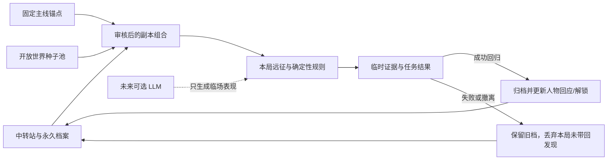

# 《失落航标》大背景与副本总框架

更新：2026-10-07。版本：总纲草案 0.2。用途：统一跨文档说法，作为世界卡、主线、玩法和未来动态事件的共同框架。本文是整理稿；候选世界、竞争者成长、程序抽取和 LLM 事件均未因此进入游戏。

## 一、作品定位

《失落航标》是一款本地优先的桌面经营放置游戏，外层是失序世界探索与逐步揭开的返航悬疑。玩家在中转站醒来，管理四名投影队员，进入一个个有局部规则的“回响片段”，建立营地、处理生存压力、带回证据，再用证据选择下一段旅程。

**一句话故事：**

> 一个失去记忆的返航者，在反复接入的世界片段中寻找回家坐标；每一份证据都让出口更清晰，也让“要接谁回来、谁有权决定、返航要付出什么”变得更难回答。

故事要同时支撑两种游玩：固定章节推动人物与主线答案；开放副本池提供可重复的经营挑战、局部故事与突发变化。主线有阶段性闭环，重复游玩不要求每局都揭晓重大真相。

## 二、大背景：航标与回响片段

### 2.1 当前采用的基础模型

- **中转站**：玩家醒来的主空间。它接收返航证据、保存已经归档的记忆和坐标、呈现人物回应，也承担远征之间的准备与选择。它不是单纯的结算界面。
- **航标**：连接中转站与远征片段的返航定位设施。当前记录显示坐标并不完整；“知道去哪里”不自动等于“知道该接谁回来”。
- **回响片段**：远征可进入的局部现实。它可以是一座林地、一座城、一段交通线路、一间研究设施、一场灾害区域，也可以是受限时间与规则影响的片段。副本不必等于一颗完整星球或一条从头到尾的历史。
- **回归与归档**：玩家在片段中取得的证据先属于本局。成功回归后才进入中转站档案；失败或主动撤离会失去尚未带出的本局发现，已归档的证据保留。
- **重入**：重复进入是重新连接同一片段。它支持经营循环与补取遗漏证据，不意味着主线事实被重置，也不把投影队员的失败写成永久死亡。

### 2.2 刻意保留的宇宙悬念

目前只把“回响片段与同一场航标事故有关”作为创作基础，**不急着宣布所有片段究竟属于同一世界的不同年代、平行世界、模拟空间，还是被系统截取的记录**。森林和古城的年代已经互相矛盾，未来副本可以来自不同类型的地点、社会和异常规则；它们是否共享一条客观历史，应该由证据逐步回答，不能靠设定集提前盖章。

这份留白是扩展空间，不是随意改设定的许可证。每张世界卡必须说明它与已知事实的关系：证实、质疑、提供旁证，或仅作为独立远征；冲突需要记录证据来源和玩家目前能推出的范围。

### 2.3 作者真相层（未向玩家完整公开）

现有故事设定集给出的秘密锚点如下，写作时可据此保持因果一致，但不得当作当前玩家已知：

1. 航标最初用于返航实验，目标是从时间片段中接回失散者；实验失败后，片段顺序被反复重排，部分投影记忆被擦除。
2. 岑是早期返航者留下的值守投影，掌握部分重启记录，也有记忆缺口。他曾为避免错误返航延迟开门，后来又把找回某个人当成继续重启的理由。
3. 玩家过去曾到过中转站与森林。森林里的署名警告是真的；“第一次返航”特指第一次启动完整出口，不是玩家第一次回到中转站。
4. 当前获得的坐标只点亮出口的一部分。最终返航必须核实目的地、返航对象和代价，而不能只靠修好一扇门。

这四点是作者真相锚点，不等于最终结局细节已经定稿。最终对象、名单版本、岑最后的选择和玩家承担的代价仍要由后续证据与玩法选择共同决定。

## 三、故事持续动力

长线不是“去过更多副本”本身，而是四个互相牵引的问题：

1. **目的地**：航标坐标指向哪里？不同片段的时间与地理关系是什么？
2. **对象**：信号另一端是谁？坐标指向地点，还是实际等待返航的人？
3. **记录可信度**：谁保存、删改或分开了记录？同一事实为何有多个版本？
4. **选择与代价**：谁有权决定返航名单？若无法救回所有人，玩家愿意承担哪种后果？

每个主线副本至少回答一个旧问题，并以可观察证据提出一个新问题。一般副本不必承担主线揭谜，可以拓展人物关系、资源策略、世界类型或返场目标，但需要形成自己的小闭环。

## 四、人物与信息边界

| 角色         | 当前设定                                         | 叙事职责与边界                                                                 |
| ------------ | ------------------------------------------------ | ------------------------------------------------------------------------------ |
| 玩家／返航者 | 失忆，能进入回响片段并把成功带回的证据归档       | 由行动检验任务方说法；身份与过去逐步揭示，不开局直接讲明                       |
| 岑／值守员   | 熟悉坐标与中转站，能准备补给，对部分记录有所隐瞒 | 提供有限视角；可以犹豫、误判或承认责任，不能替代证据，也不能知道一切           |
| 四名队员     | 固定的投影工作人口，可采集、建设和守备           | 当前是经营单位，不是四条独立人物成长线；具名关系、伤亡或个人背包需要新玩法合同 |
| 失散者       | 呼号另一端可能有人等待                           | 构成救援动机；当前没有真正登场的救援 NPC 或已实现的营救任务                    |

**信息分层：**作者真相 → 角色各自所知 → 玩家已取得的证据 → 玩家当前可作出的推断。对话不能把这四层压成一层。证据可以支持或挑战判断，不应在未获证时直接宣布谜底。

### 4.1 群像结构：让人物彼此改变，而非扩充玩家队伍

本作的群像应是一张**有方向、有历史的关系网**。人物网络叙事研究把故事事件视为社会网络节点之间局部互动逐渐累积的结果；互动叙事研究也展示了“角色有限自主行动 + 高层剧情约束”的组合方式。[Sack, _Character Networks for Narrative Generation_](https://drops.dagstuhl.de/entities/document/10.4230/OASIcs.CMN.2013.183) [Riedl, Stern & Dini, _Mixing Story and Simulation in Interactive Narrative_](https://ojs.aaai.org/index.php/AIIDE/article/view/18770) 对本作的落点是：不能只给每个人分配一个职业、阵营或文明路径，而要写清楚**谁和谁争什么、欠什么、误解什么、又因什么改变判断**。

群像成员是独立返航者、其他调查者或幸存者等叙事角色；他们可以与玩家争夺路线、证据解释权、资源、信誉或有限的返航机会，不默认加入玩家队伍。四名投影队员仍是当前的经营人口，不因此自动获得个人成长线。岑仍是中转站值守员，不是替所有角色裁决对错的主持人。

同一批角色若要跨副本返场，资料必须记录其连续性凭据：本人曾经返航、档案中留下的记录、片段中的重复投影，或仍待核验的身份。不能只因两个时代出现相似名字、面孔或符号，就断言是同一个人；这与总框架保留“片段究竟是什么”的悬念相容。

#### 独立成长：升的是处境、能力与判断，不是统一等级

每个主要竞争者至少有一条不依赖玩家同行的行动线。成长可以表现为能力变强，也可以是判断修正、关系破裂、资源积累、代价加重、路线转换、目标收缩或退出舞台。每次返场要让读者看见上次选择造成了什么；离场期间的变化只能来自明确的故事节点和可追溯行动，不靠现实时间挂机。

建议把角色进展记录成状态向量，而非单个等级：

```text
当前目标 / 采用的方法 / 实际掌握的能力
现有资源与可动用关系 / 对哪些事实有何种证据
尚未验证的信念 / 已付代价与未偿义务
与其他角色的关系变化 / 上次行动的后果 / 下一步计划
```

每个变化至少能回答“由哪次选择或哪条证据触发、角色付出什么、其他人看见什么”。这让独立升级具有戏剧后果：对手可能赢得一条路线，却失去盟友；可能获得真相，却失去让别人相信自己的资格。

#### 竞争不等于反派化，也不等于永远敌对

竞争成立需要三项同时出现：**目标彼此冲突、资源或机会有限、选择会产生可见后果**。例如两人都想启动一次返航校准，但一个要先核实信号对应的姓名，另一个要趁窗口救出正在消失的人。价值观不同可以让冲突持续；暂时的共同威胁可以促成有期限、有条件的合作，但合作结束后不自动变成队友。

人物关系要互相连接，而非人人只围绕玩家：竞争、旧债、师承、亲缘、尊重、证词冲突、互相利用和临时契约都可以成为边。对照人物的作用，是通过差异让双方的选择和局限更清楚，不是让一个人成为另一个人的“错误答案”。[Oregon State University, _What is a Foil?_](https://liberalarts.oregonstate.edu/wlf/what-foil-oregon-state-guide-literary-terms)

#### 群像候选角色功能（尚未定名或冻结）

以下是动机与冲突的起点，不与四条文明路径一一配对；同一角色可以混用工程测量、仪式、异常调查、口述传统或修行方法：

| 功能候选   | 独立目标                                         | 擅长与盲点                                                   | 可以发生的变化                                           |
| ---------- | ------------------------------------------------ | ------------------------------------------------------------ | -------------------------------------------------------- |
| 证据保全者 | 尽量保住互相矛盾的原始记录，阻止单一机构垄断解释 | 擅长追溯来源；可能把保存记录置于眼前的人之上                 | 从“什么都不能删”走向承担公开、封存或取舍的责任           |
| 救援优先者 | 先找到具体失散者，不接受只带回坐标或数据         | 擅长建立信任和动员地方关系；可能把未经验证的呼号当成确切身份 | 从不计代价地救人，转向确认当事人的意愿并面对救援边界     |
| 规则校验者 | 让返航判断可复核，降低错误接回或重复灾害的风险   | 擅长试验、测量和建立规程；可能把难以量化的证词排除在外       | 从把规程当答案，转向知道何时规程本身需要被质疑           |
| 身份拒绝者 | 不愿被航标、档案或某种传承定义为可被取回的“对象” | 擅长识别身体、记忆和环境变化；可能因防止被利用而隐瞒关键信息 | 从拒绝一切记录，转向决定哪些关系和证据可以被自己授权保存 |

这里的“身份”是角色当前对外呈现的功能，不是定稿人物小传。每一位都需要私人牵挂、能力边界、一次可能失败的选择，以及至少一条和其他竞争者的关系线，避免四人沦为四种立场的宣讲员。

详细候选人物卡、成长弧和首条群像线见[群像角色卡与成长弧](群像角色卡与成长弧.md)。

#### 冲突示范：有限返航窗口（写作候选，玩法未实现）

中转站只能在本次窗口校准一个坐标。救援优先者掌握一段呼号记录，认为另一端是正在消失的具体人物；规则校验者发现时间间隔吻合，却认为身份仍未核实；证据保全者手上有第三份相互矛盾的旧档，坚持先保护原件。三人可以短暂合作校验信号、互相交换部分证据，但窗口到来时仍必须各自作出选择。后续章节显示谁成功、谁付出代价、谁因新证据改变判断，而不是把不同意见归结为“好人救人、坏人抢资源”。

#### 交叉记录与动态呈现边界

资料库中每名角色都要有稳定 `CHAR` ID；每条关系用稳定 `REL` ID 记录两端人物、关系类型、触发事件、双方各自理解、公开证据和当前状态。每次关键返场再记录：

```text
故事节点 `BEAT` ID / 所处副本 / 本次争夺的目标与有限资源
每名角色的行动、可见理由、真实信息边界和承担的代价
关系边的变化 / 能支持或推翻哪些事实 / 角色下一步计划
```

未来若由 LLM 呈现临场反应，只可依据已审核的角色状态、证据可见性和选项来组织说法；角色是否升级、是否改投目标、关系或永久事实如何变化，都须由固定剧情节点与规则结算，不能让模型临时改写存档。若将来把竞争者进展做成跨重启的游戏状态，须另立玩法合同、存档字段、显式迁移与验证，并通过 runtime 命令更新。以上是叙事与资料库方案，不表示独立竞争者、NPC 自主行动或个人成长系统已经进入游戏。

## 五、无限副本框架

“无限”指素材池和组合方式可持续扩展，不表示每个世界都由模型凭空创造，也不代表当前已经有程序化抽取器。一个可运行的副本实例由审核素材组合：

```text
副本实例 = 世界种子 W
         + 任务骨架 EP
         + 本局变化条件 MOD
         + 当前已知状态
         + 已审核事件包 EV
```



### 5.1 世界从多个轴交叉，不按题材单选

一张世界卡可以同时挂多个标签，避免把每个副本锁死成一种“类型”：

| 轴       | 可扩展方向（示例）                                                 |
| -------- | ------------------------------------------------------------------ |
| 环境压力 | 暴雪、洪水、污染、缺氧、热浪、食物短缺                             |
| 空间形态 | 林地、城区、遗迹、列车、海上设施、地下站、轨道舱、边境聚落         |
| 异常机制 | 时间错位、循环、空间重叠、身份不一致、记忆缺失、生态失控、规则条件 |
| 社会冲突 | 资源分配、撤离顺序、信任、隐瞒、责任归属、群体选择                 |
| 剧情作用 | 建立疑问、核对证词、护送、修复、抉择、回收旧线索、角色返场         |
| 玩法压力 | 时间窗口、燃料/材料分配、队员岗位、路线风险、调查机会、证据冲突    |

标签只用于查找和搭配。新世界须拥有自己的地点因果、局部规则、证据和决策，不能只是旧世界换名、换色或加敌人血量。

### 5.2 任务骨架：重复节奏，替换局部机制与结论

多数副本可共享六段节奏：

1. **进入与委托**：说明为什么出发、要带回什么、失败会损失什么。
2. **发现局部规则**：玩家观察一个异常，并知道如何验证，而非猜作者心思。
3. **资源与关系取舍**：时间、木石、燃料、岗位、路线或信任发生真实竞争。
4. **突发变化**：故障、求救、补充记录或路线改变，使当前计划需要调整。
5. **验证与结算**：把证据和行动结果对照；基础目标与可选发现分别处理。
6. **回归与余波**：带回证据，主空间出现回应、档案更新、补给变化或新契约。

复用的是“进入—观察—取舍—突发—验证—回归”的体验节奏；不复用同一个谜底、同一套玩法数值或每局都指认岑。世界规则和证据负责让相似骨架产生不同经历。

### 5.3 事件与 LLM 的位置

突发事件先由规则和已审核内容确定：发生时机、事件族、选项 ID、代价和后果都固定。将来接入 LLM 时，它只负责在白名单中实时组织本局现场描述、临时证词语气、队员反应等表现，不能改写真相、制造永久线索、发明数值或直接操作存档。

```text
固定规则判定触发
  → 选择已审核事件族 EV
  → 提供当前可见的最小事实子图
  → LLM 生成一次性事件表现
  → 校验结构、事实 ID、长度和响应白名单
  → 合法则展示；否则回退本地固定文案
  → 玩家通过 runtime 命令作出选择，规则层结算
```

本地固定内容必须独立可玩；模型关闭、断网、超时或输出非法都不应阻断远征。生成段落默认是本局临时表现，不进入永久档案；只有经过编辑评审并获得稳定 ID 的内容才可成为正式证据。当前项目尚无游戏内 LLM 接口，这一节是目标设计。

### 5.4 文明演变：多条历史路径，不走同一条科技等级表

本节概述时代材料与四条起始路径；长篇主线如何逐层扩大、文明观察维度、更多路径族、交叉方式和研究缺口，见[文明交织的长弧与可扩展故事架构](文明交织的长弧与可扩展故事架构.md)。该文是候选总纲，不取代本设定集中的当前事实。

“石器时代到高级文明”可以成为故事的时间纵深，但不能变成所有文明都必经的单线升级。历史哲学综述提醒，固定文明阶段容易把复杂历史写成单因、必然的进步线；更稳妥的概括是多因素、偶然性和多条发展路径并存。[Stanford Encyclopedia of Philosophy: Philosophy of History](https://plato.stanford.edu/entries/history/) 一项 2026 年比较考古研究比较了 63 条社会变化轨迹，发现若干重复出现的发展路径，同时指出这些路径并非决定论式必然结果。[PNAS comparative archaeology study](https://doi.org/10.1073/pnas.2610959123)

科技与工程路径的专项文献整理、时代骨架、技术线交叉方式和候选故事主干，见[科技文明路径调研与故事蓝图](科技文明路径调研与故事蓝图.md)。该稿仍属候选，不会自动改写《失落航标》作者真相或进入游戏。

年代标签只做创作坐标，不是文明优劣等级。大都会艺术博物馆的南亚时间表显示，同一地区的北部与南部新石器、石铜并行的阶段并不完全重合；其材料也展示了陶器、铜器、刻印、书写、城市和贸易逐步交织，而非一个技术突然替代全部旧生活。[The Met: South Asia, 8000–2000 B.C.](https://www.metmuseum.org/de/toah/ht/02/ssa.html) 旧亚述商人泥板则同时记录交易、借贷、诉讼、家书、贸易网络和跨地区婚姻，提示文明层次要写进日常生活、制度与人际关系，不能只展示武器更强或机器更大。[The Met: Old Assyrian lawsuit tablet](https://www.metmuseum.org/art/collection/search/325846)

可以使用下列**松散时代带**来安排大跨度副本；每条文明线可跳过、并行、衰退或重组其中一段：

| 时代带（创作坐标）       | 可以观察的社会变化                                     | 可以带入故事的问题                                     |
| ------------------------ | ------------------------------------------------------ | ------------------------------------------------------ |
| 石器、骨器与采集生活     | 火、工具、季节观察、迁徙路线、口述记忆                 | 一个无法解释的现象怎样进入禁忌、歌谣、记号或生存经验？ |
| 定居、农牧与陶器         | 粮食储存、历法、水利、手工业分工、季节仪式             | 谁负责记住周期，谁能决定粮食与水的分配？               |
| 金属、文字与早期城市     | 专门工艺、远距离原料、刻印、账目、城墙、神庙或档案机构 | 记录被谁保管；交易路线怎样把物件与信仰带到别处？       |
| 区域国家、帝国与知识传统 | 道路、税收、法律、学派、祭仪、官僚与地方传统的协商     | 中央制度如何解释地方现象，地方又如何保存自己的版本？   |
| 机械、航海与测量时代     | 印刷、钟表、地图、远洋路线、仪器和新型组织             | 旧传说被怎样测量；谁有资格解释测量结果？               |
| 工业与电气时代           | 矿产、能源、工厂、铁路、通信、规模化动员               | 新能源解决了什么，又把代价转移给谁？                   |
| 信息与自动化时代         | 传感网络、计算、数据库、模型、平台治理                 | 记录变多后，谁控制分类、身份和真伪判断？               |
| 高级或跨行星文明         | 大尺度能源、长距航行、人工智能、生命改造或时空工程     | 文明能力扩大后，返航、身份与责任是否更难界定？         |

这张表是世界卡作者的工具，不是历史事实清单。不能把“石器”写成没有知识、艺术、信仰或复杂社会，也不能默认高级技术就代表更高道德、更准确的历史记忆。

#### 四条可交叉的文明路径

同一文明可以同时发展多条路径；不同文明也可以各自擅长一条，并在贸易、战争、迁徙、师承或资料传抄中彼此影响。下列阶段都是写作问题，不是固定等级：

| 路径               | 早期基础 → 制度化 → 高级形态                                                                                                                                                    | 关键限制与戏剧冲突                                                                             |
| ------------------ | ------------------------------------------------------------------------------------------------------------------------------------------------------------------------------- | ---------------------------------------------------------------------------------------------- |
| **科技与工程**     | 材料与火 → 农业、陶器和金属 → 书写、测量、工艺标准与基础设施 → 机械、能源、工业和通信 → 计算、自动化、星际/时空工程                                                             | 原料与能源、供应链、维护能力、知识垄断、事故责任；新技术解决旧约束时也制造新的依赖             |
| **神学与制度信仰** | 对季节、祖先、地貌的解释与仪式 → 专职祭司、历法、圣地或经典 → 教团、法统、朝廷与地方信仰的协商 → 分裂、改革、融合、世俗化或新型信仰共同体                                       | 解释权由谁掌握，仪式保护谁，信仰如何吸收异象与失败；不能把它只写成“古人不懂科学”的错误答案     |
| **灵异与异常研究** | 地方禁忌、亲历叙述、避险习俗 → 可重复的仪式步骤、目击簿与禁行区 → 档案、调查团体、相互竞争的解释 → 受控试验、隔离设施、公共应急制度 → 被利用、被商品化、失控或重新归于未知      | 目击证词可能受限但不能被嘲讽；仪式有效不自动证明某套宇宙解释为真；分类方法本身可能伤害被分类者 |
| **修行与生命技艺** | 体能、呼吸、饮食、草药与节律 → 对生命力/环境共振的体验与传授 → 师承、流派、戒律、传承文本和资源场所 → 与医术、军事、统治或生产结合 → 普及、垄断、生态耗竭、异化，或与高技术融合 | 寿命、师资、稀缺资源、身体代价、传承失真与社会等级；不能只靠境界命名和战力数字制造发展         |

神学、灵异和修行不必被设定成“科技尚未发展时的解释”。在高技术社会，它们可能仍承担伦理、共同体、身体实践、身份与风险治理；反过来，早期社会也可能拥有高水平观察、工程和贸易，只是保存知识的媒介不同。科技、信仰与修行可以互相采用工具，也可能争夺同一份证据的解释权。

#### 铺垫手法：让同一现象经过几代人，而不是连续讲设定

文学上可把反复出现的意象当作逐步累积的线索。关于叙事母题的研究指出，反复意象可在一次叙事中逐步累积意义，也会跨传统和时间获得新作用；物质文化研究中的“物件传记/意义层”方法，则强调同一件东西会随持有者、使用方式与社会环境改变意义，旧解释可能被覆盖，也可能重新浮现。[Morgan, motif theory](https://folia.unifr.ch/global/documents/307413) [Colwell, object palimpsest](https://doi.org/10.1086/719851)

跨时代相似需要区分三种来路：**直接继承**（器物、制度或群体确实延续）、**传播改写**（经贸易、迁徙、征服、学派或口传传过去）、**独立重现**（不同地方遇到相似异常，分别造出相似记号）。前两种要找得到传递媒介；第三种不能仅凭图案相像就断定有共同文明。资料库要分别登记来源和证据强度。

因此，跨时代铺垫应遵循以下顺序：

1. **先给可感知的重复**：相同节律、缺损符号、方向、短句、材料痕迹或声音，不立刻解释是什么。
2. **再给当代用途**：早期人群用它安排迁徙或水利；后来的城邦把它纳入历法、祭礼、税册或贸易印记。它先改变生活，再成为谜语。
3. **展示物件传承和改写**：同一器物被修补、熔铸、移交、封存或复制。每一代都留下新层，旧层有可观察痕迹。
4. **让不同路径分别解释**：祭司认为这是祖先回应，修行者从身体节律中感到危险，调查者记录重复条件，工程师测出固定间隔。先让解释各自有证据，也保留各自盲点。
5. **用独立证据交叉校验**：地层/年代、材质与修补痕迹、口述/文书、仪式时间、仪器记录、路线/供应账册至少两类互相支持或冲突。一个图案或一个预言不能单独证明跨时代因果。
6. **让理解改变行动，再造成后果**：某代人据此开渠、封门、迁徙或启动设备；后世继承的是工程、制度和代价，不只是前人的名词。
7. **最后才收拢主线解释**：新答案应能解释旧细节并保留仍未知之处；角色自白不能替代证据链。

每一代必须有本时代的完整冲突与阶段结算。埋下的东西可以跨越数个副本兑现，但不能让读者连续很久只收集谜语。母题回来时至少增加一种新信息：用途、持有者、代价、来源、误读或因果。

#### 与《失落航标》对接的多路径示范（候选，不是既定真相）

可以用一个稳定的“周期性返航信号”母题串起跨文明线；这只是写法演示，不把它直接宣布为现行作者真相：

| 层次              | 玩家看到的材料                                                            | 当地路径如何理解                                                               | 这一层回答与留下的问题                                     |
| ----------------- | ------------------------------------------------------------------------- | ------------------------------------------------------------------------------ | ---------------------------------------------------------- |
| 石器采集社会      | 骨片或岩面上一组重复刻痕，旁边有迁徙路线和失踪者的记号                    | 生存记时、祖灵传说、远处山谷的禁入规则同时存在                                 | 证明这群人观察到周期并为之调整生活；不能证明“祖灵”解释为真 |
| 定居与早期城市    | 同样的间隔被写进蓄水、播种或季节仪式历法                                  | 神庙保存周期，地方长者声称历法比王朝更早                                       | 说明知识进入制度，也出现谁控制日期和粮水分配的问题         |
| 金属与贸易网络    | 刻印出现在不同城邦的器物上，材质来源、重量单位和封泥各有差异              | 商人把符号当作通行/结算标记，祭司当作禁忌，统治者当作授权                      | 贸易传播能解释符号相似；还需证明它们共享同一信号来源       |
| 修行或灵异传统    | 一支传承记下“呼吸/听觉与信号同步”的练习，另一地档案记下遵循禁忌可避开失踪 | 有人将其视作修行法门，有人视作边界仪式，也有人质疑幸存者偏差                   | 方法可能改变观察能力，但个人体验无法独自判断返航对象       |
| 工业测量时代      | 仪器记录到相同的脉冲间隔，旧历法出现能匹配的周期误差                      | 工程师称其为外部信号；宗教团体认为仪器只测到了“回应”的一部分                   | 周期获得可复测证据；信号的意图和接收者仍未知               |
| 高级文明/航标实验 | 多种记录被输入返航系统，系统能定位片段却无法稳定确认对象身份              | 技术部门要求继续校准；信仰共同体反对把“人”简化为坐标；修行者警告片段会响应观测 | 坐标、对象和代价被明确拆开，接回某人是否正确成为真正抉择   |

多路径不是四种皮肤替换，而是四套知识与行动方式对同一问题产生不同的可验证收益、社会权力和失败代价。它们可以争论、合作、借用彼此的工具；任何一条都不默认掌握完整真相。高级文明也可能误用早期人的记录，技术更先进但历史理解更差。

#### 文明/母题交叉记录字段（资料库建议）

跨时代故事建议给每条文明支线与核心母题稳定 ID，并记录：

```text
文明线 ID / 母题 ID / 副本世界 ID
时间层与地区 / 生产与资源条件 / 知识保存方式 / 权力结构
路径标签：technology | theology | paranormal | cultivation
本时代的物件形态、社会用途和解释者
本时代能证实的事实 / 只能推测的内容 / 反证与冲突
和前后时代的传递媒介、证据强度、断裂点
实现状态 / 文案 ID / 玩法机制 ID / 来源 SRC 与阅读范围
```

历史调研按“具体地区 + 大致年代 + 可见材料 + 可靠度/争议”记录，不只写“古代文明”“神秘东方”或“欧洲中世纪”。一个细节如果借鉴某一实际传统，需要列来源、解释其语境，再说明如何原创转化；不能把不同宗教、修行传统或原住民文化合并成一个泛化的“古老智慧”。

以上文明路径是叙事和世界资料设计框架。当前游戏只实现 `PROG-01` 的一个共同研究根和三种单槽准备工具（科技/信仰/灵异/修行文明路径都没有成为独立升级系统）；科技树历史叙述、神学共同体、灵异治理和修习成长分别见 `PATH-01`～`PATH-04` 候选卡。跨时代文明档案、竞争者独立状态和路径交叉场景仍未进入游戏。任何新增资源、命令、存档或玩家选择都需要独立玩法合同与显式迁移评审。当前版本边界见 [PLAN](../../PLAN.md)。

## 六、交叉记录体系

每个重要内容用稳定 ID 做网状连接，不靠重复复制整段设定：

```text
来源 SRC / 阅读片段 READ
  → 启发或原创活动
世界种子 W ↔ 任务骨架 EP ↔ 变化条件 MOD ↔ 事件包 EV
                                  ↓ requires / produces / unlocks
                         线索 CLUE / 事实 FACT
                                  ↓ supports / contradicts / answers
                               主线问题 Q
角色 CHAR → appears_in → 副本 W / 骨架 EP / 故事节点 BEAT
角色 CHAR → acts_in → 故事节点 BEAT → changes → 角色 CHAR / 关系 REL
角色 CHAR ↔ 关系 REL ↔ 其他角色 CHAR
                 ↓ known_by / evidence / consequence
       线索 CLUE / 事实 FACT / 下一步计划
                                   ↓ implemented_as
                         src/content 中的规则 ID
                                  ↓ presented_by
                         src/themes 中的文案 ID
```

- 分类关系描述题材层级和检索交叉；角色关系描述竞争、债务、信任、保护与有条件合作。
- 故事节点记录角色独立行动，关系边记录由哪次行动改变以及双方各自的理解。
- 角色出现在某副本时记录是直接碰面、独立行动痕迹、档案还是返航后对话；这不等于编入玩家队伍。
- 剧情关系描述前置条件、产物、解锁、证据支持/冲突和问题回答。
- 来源关系记录参考、改写、审核和版本沿革。
- 每条重要关系写明起点、关系、终点、条件/范围和证据位置；悬空 ID 必须清零。

目前资料库 Markdown 是作者工作台；游戏从 TypeScript 内容定义读取规则，从主题层读取文案，不会直接解析 Markdown。未来若要给组合器或 LLM 使用，先建立经过筛选的机器可读投影，并校验 ID、关系与可见性；不能把整份作者设定库作为模型上下文。

## 七、当前主线节奏与范围

| 阶段                      | 阶段问题与证据                                         | 规划作用                                         | 状态                                                  |
| ------------------------- | ------------------------------------------------------ | ------------------------------------------------ | ----------------------------------------------------- |
| 序章：迷雾森林 W-01       | `forest-signal` 指向旧城；河岸测绘可分出观测/补给路线  | 建立中转站、经营循环、归档和首个有任务后果的分支 | 已实现；完整新档浏览器流程正在复验，桌面/玩家验收另列 |
| 序章：古城遗迹 W-02       | `ruins-record` 的建站日期晚于森林信号                  | 形成可核对的时间矛盾，得到第一段坐标             | 已实现；与森林共用木石和怪潮基础规则                  |
| 第一卷：雪线观测站 W-03   | `snow-observatory-record` 与 `snow-order` 归档记录先后 | 回答进入先后不等于文明年表；提出操作者与返航代价 | 已实现独立环境模式和首卷归档                          |
| 第二卷候选：多站列车 W-04 | 有地点坐标，但乘员姓名缺失                             | 明确目的地与返航对象是两个问题                   | 世界卡候选，玩法未实现                                |
| 第二卷候选：镜像城区 W-05 | 地图、路牌、维护档案有多个版本                         | 核验任务来源，不凭同一编号定罪                   | 世界卡候选，玩法未实现                                |
| 后续候选：重复的一日 W-06 | 日期重复，人员经历和记录版本不同                       | 区分共同日期、个人经历和证言制度                 | 世界卡候选，玩法未实现                                |
| 后续候选：漂流设施 W-07   | 自动系统统计了维护，却遗漏人工停机                     | 决定谁分配资源、维护和覆盖自动规则               | 世界卡候选，玩法未实现                                |
| 后续候选：异常研究所 W-08 | 匹配系统能重复给出结果，却缺当事人授权                 | 区分信号来源、身份连续性和返航意愿               | 世界卡候选，玩法未实现                                |
| 卷尾：返航名单            | 现有证据不能证明所有候选对象的身份与意愿               | 玩家选择接谁、承担何种可见代价                   | 方向草案；名单细节和结局未冻结                        |

主线锚点只是开放副本池中的少量固定章节。侧线世界可以不推进“返航名单”，但需回答自己的局部问题、改变一个本局体验，并把结果安全回归；允许复玩，不重复发放已归档主线事实。

## 八、内容进入游戏的规范流程

```text
灵感/参考来源
  → 来源与阅读范围记录
  → 候选世界卡 W + 交叉标签
  → 选择可复用 EP、MOD、EV
  → 明确目标、条件、代价、回归结果和失败边界
  → 玩法合同评审
  → 机械规则写入 src/content / src/domain
  → 玩家文案写入 src/themes
  → 引用检查、规则验证、桌面体验验收
  → 标记“候选 / 代码已接入 / 已验证 / 待验收”
```

文档、代码、存档各有权威边界：

| 内容                               | 权威来源                                                         |
| ---------------------------------- | ---------------------------------------------------------------- |
| 世界总框架与玩家/作者信息边界      | 本总纲 + [故事线设定集](../故事线设定集.md)                      |
| 世界卡、候选池、任务骨架和素材来源 | [副本资料库](README.md)、对应世界卡、素材管理                    |
| 游戏规则、触发、奖励与持久化事实   | `src/domain`、`src/content` 和既有保存/迁移合同                  |
| 实际显示的文字与主题表现           | `src/themes`                                                     |
| 关系台账和来源链                   | [交叉索引](交叉索引.md) 与 [治理规范](交叉记录与资料治理规范.md) |
| 未来机器可读投影边界               | [机器可读内容桥接方案](机器可读内容桥接方案.md)                  |

## 九、扩展副本必须交代什么

每个新副本，无论主线或开放池，至少明确：

1. 它属于哪些类型轴，地点和局部因果是什么。
2. 玩家为什么进入，本局基础目标和可选目标是什么。
3. 独有规则/玩法压力是什么，至少一个重要决策不能用森林现有怪潮数值替换。
4. 玩家能观察到哪些事实；事实支持什么、不能推出什么。
5. 失败、撤离、重试和成功归档分别有什么结果。
6. 与旧世界、人物、问题、代码 ID 和主题文案有哪些交叉关系。
7. 返场时哪里改变，哪些重复奖励或对白需要去重。
8. 哪些为固定内容，哪些可由受约束的临时事件呈现。

## 十、规范化后的总框架摘要

- **一个主空间**：中转站承接档案、人物与选择。
- **一个长期谜题**：航标想把谁送回哪里，决定是否可信，代价由谁承担。
- **一张独立行动的群像关系网**：返航者与调查者各有目标、方法、成长和代价；关系会竞争、结盟、破裂或变化，不默认编入玩家队伍。
- **一片可扩展的回响片段池**：题材、地点、异常和社会冲突多轴交叉，不把世界数量固定在 W-01 至 W-08。
- **多条文明演变路径**：技术、神学、灵异研究和修行可以并行、冲突、互相借鉴；从石器到高级文明是可选的历史纵深，不是所有文明必须通过的单线等级。
- **两种内容引擎**：固定主线保证答案与人物变化；开放组合保证重复经营与持续探索。
- **一套重复节奏**：进入、观察、取舍、突发、验证、回归。
- **一张可追溯内容网**：来源、世界、骨架、事件、线索、问题、规则和文案通过稳定 ID 连接。
- **一条 LLM 边界**：未来模型只让已审核的事件在本局鲜活起来；事实、选项、成本、结算和存档仍由确定性内容与规则控制。
