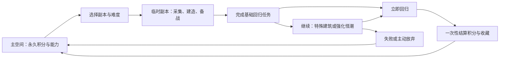

# 主空间与生存副本设计

日期：2026-10-03。状态：本文保留首轮副本设计与候选参数；v0.2 已按试玩反馈实施主空间、木石建设、怪潮、两世界和永久兑换，并继续加入原创序章与调查线索。当前代码以 `src/content/expedition.ts`、`src/content/story.ts` 为机械事实，主线合同见 [无限流主线与世界包](./无限流主线与世界包契约.md)，实际检查见 [验收记录](../../../2026-10-03--工程基础搭建验收.md)。文中收藏、任意世界模板和完整小说/影视内容仍为后续方向。

## 核心循环

永久成长提供下一轮的起步优势与新选择；每轮仍需从临时资源开始解决当前世界的任务。切换背景只是主题变化，增加副本需要真正配置不同任务和规则。

## 数据边界

| 对象         | 保存内容                                                                                               | 不保存内容                              |
| ------------ | ------------------------------------------------------------------------------------------------------ | --------------------------------------- |
| `Profile`    | 永久积分、已兑换能力、世界/蓝图解锁、特殊建筑收藏、已结算轮次                                          | 当前木石、实际建筑、当前伤害            |
| `Run`        | 世界 ID/内容版本、难度、临时资源、工具、建筑、据点生命、怪潮序号、任务事实、时间节点、入本永久能力快照 | 可随意修改的永久奖励、当前 UI 主题      |
| `Settlement` | 轮次 ID、成功/失败/放弃、积分来源明细、总积分、内容版本                                                | 再次领奖按钮的任意金额参数              |
| `SaveBundle` | 同一个档案内的 Profile、activeRun、lastSettlement                                                      | 分散在多个文件且各自写入的永久/临时余额 |

副本结束清除当前木石、工具和实际建筑。特殊建筑可留下收藏或蓝图；下一轮是否产生加成由明确的永久奖励规则决定，不能直接搬走整座建筑。

首版一次只有一个活跃副本，轮次序号递增。Profile 保存 `settledThroughRunSequence`，同一序号不得再次加分，无需建立无限增长的领取日志。

## 第一个原创副本：暮雾营地

先使用原创荒野题材，便于把采集、建设、防御和奖励做成完整闭环。具体小说/影视题材以后通过世界定义和独立文案/美术替换；采用已有作品前确认素材来源及可用范围。

首本初始规模：木头、石头两种资源；据点生命一种失败指标；五种基础建筑和一座特殊建筑。三个固定怪潮节点，前两波构成基础回归任务，第三波属于自愿的额外挑战。

| 建筑     | 作用                                                 |
| -------- | ---------------------------------------------------- |
| 避难棚   | 建立据点，满足基础目标                               |
| 伐木台   | 自动产木                                             |
| 采石场   | 自动产石                                             |
| 围栏     | 提高据点防御                                         |
| 箭塔     | 增加战斗输出                                         |
| 纪念望楼 | 基础目标完成后开放的额外建造目标，成功回归后记录收藏 |

首轮候选节奏为 3 分钟、4 分钟、4 分钟备战段；合计约 11 分钟可推进的副本时间，实际停留多久取决于玩家确认与中断。数值需要试玩调整，不能把该时间当作已验证体验。

基础回归条件：建成避难棚，守住前两波怪潮。据点生命降至 0 则本轮失败。满足基础条件后立即开放回归，玩家可以停止冒险并获得基础奖励。

候选积分：成功回归 20；建成纪念望楼并回归额外 5；通过第三波额外 10；在该波开始前主动启用强化条款并通过，额外 5。普通挑战可重复获取，首次收藏奖励按 Profile 去重。失败/主动放弃不发本轮积分，已有永久积分和能力不受影响。积分和建筑价格属于待试玩参数。

“历史建筑”先表现为每个世界的特殊建筑挑战及主空间收藏，后续可加入跨世界蓝图解锁。普通生存本可以是望楼，古城本可以是不同原创建筑；物理建筑仍属于当前轮。

## 适合摸鱼的时间与怪潮规则

首版怪潮采用等待确认的确定性战斗，避免后台中断造成突然死亡。

1. 开始备战段后，资源生产和副本时间一起推进，收益受仓储容量限制。
2. 时间只推进到下一次怪潮节点；进入 `awaiting-wave` 后该段生产和时间都停止。
3. 玩家查看风险预览并点击“迎战”；按生命、建筑、防御和已选强化条款即时计算结果。动画只表现结果。
4. 胜利后从当前确认时刻开始下一段；此前的额外离线时间不带入下一段，不会连续补出多轮怪潮。
5. 关闭/隐藏/后台与在线等待遵循同一规则。最多留下一个待处理怪潮，关闭应用不扣血，也不等同于放弃副本。

当前增量原型有 8 小时离线补算；生存副本将采用新的世界时间策略，不能直接沿用无限持续生产再叠怪的行为。运行时仍负责消费已处理时间并保存，避免反复重开刷收益。

## 主空间首批永久能力

先做三个一次性兑换，避免一开始引入无限等级和复杂乘区：采集效率 +10%、新副本据点最大生命 +15%、解锁一个备战配方。价格按两三次普通回归能获得一个新选择的目标调整，先不加入付费。

只能在主空间兑换，效果在下一次入本生成快照。副本进行中不能购买后即时改变本轮难度计算。永久成长不豁免基础任务、不自动完成怪潮，也不把临时资源永久化。

当前代码仍只有上述三项永久能力，没有科技树。跨远征研究节点、有限专精配置和文明路径的成长接口另见[科技树与游戏成长并行方案](../副本资料库/科技树与游戏成长并行方案.md)；它是候选设计，不能视为已实现或已验收。

## 对话：设计流程与游戏内交互

用户已确认两者都要。

我们通过聊天设计游戏时，将决定写成可追踪的规则：目标、允许动作、资源/费用、前置条件、成功/失败结果、时间策略、奖励及验收。数值写入世界/奖励配置；规则语义变化需要修改纯规则代码及测试；不能只改对白就让游戏获得尚未实现的能力。

每次改玩法都记录影响：当前副本是否仍按原版本继续、存档是否需迁移、数值是否可追溯补算。共享的模块边界和命名规范保持一致。

游戏内先做可配置的选项对白，不接大模型。每个对白节点包含触发条件、文本、选项、稳定命令以及后续节点。例如：

| 对话选项                     | 对应命令                         | 规则限制                                      |
| ---------------------------- | -------------------------------- | --------------------------------------------- |
| “收集一些木头”               | `gather(resourceId)`             | 资源存在、当前阶段允许、单次固定收益/动作约束 |
| “搭建围栏”                   | `build(buildingId)`              | 配方解锁、资源足够、建造上限；一次原子扣费    |
| “让下一波更强，我要额外积分” | `chooseWaveModifier(modifierId)` | 只在该波迎战前选择，风险和加分提前显示        |
| “已经完成任务，我要回主空间” | `returnToHub(runId)`             | 检查真实任务和怪潮事实；对白不能自行认定完成  |
| “兑换采集强化”               | `exchangeReward(rewardId)`       | 只能主空间、积分足够、尚未购买                |

通用系统文字与剧情文案分离；对白可绑定通用命令，也可只展示信息。NPC 名称、对白和建筑名称不能作为机械 ID。

以后若加入自由文字/大模型，对话只能提出白名单命令或解释状态。模型不接受任意奖励金额、不创建配置中不存在的建筑、不直接写存档；命令仍经过按钮使用的同一验证。较高后果的回归、放弃和兑换在 UI 展示清楚后由玩家选择。首版本地对白无需账号、网络或模型费用。

## 原子能力与提交语义

| 能力         | 输入                     | 权威输出与关键限制                                                |
| ------------ | ------------------------ | ----------------------------------------------------------------- |
| 进入副本     | worldId、difficultyId    | 校验解锁/当前无副本，生成新轮次与永久能力快照，完整保存后开放操作 |
| 采集         | resourceId               | 按固定规则增加该资源，不接受调用者提供的任意收益                  |
| 建造         | buildingId               | 校验配方/材料/上限，费用与建筑一起提交                            |
| 推进时间     | 当前状态、注入时间       | 到下一危险边界停止，处理仓储/倒退时间/离线截断                    |
| 选择强化条款 | modifierId               | 开战前锁定，本轮奖励只认实际启用并通过的条款                      |
| 迎战         | 当前波次                 | 确定性计算伤害/胜利，结束后才开放下一备战段                       |
| 回归预览     | runId                    | 根据已存事实列出积分明细，预览不发奖励                            |
| 一次性结算   | runId、reason            | Profile 积分、去重序号、Run 结束与 Settlement 在同一快照原子保存  |
| 永久兑换     | rewardId                 | 主空间原子扣费并写永久能力，下轮生效                              |
| 对话选项     | dialogueNodeId、optionId | 校验当前节点/前置，转换到上述命令，不绕过验证                     |

结算必须先暂停新动作、等待旧写入，再构造固定候选。保存成功后才进入主空间并允许兑换。保存失败保留同一个候选重试/导出，不允许再战斗或开新本。写入前崩溃仍是原副本，写入后重启只看到已结算状态，重复请求返回 `ALREADY_SETTLED`。

## 实施次序与兼容

1. 本轮：修复本地存档、完成基础工程和可运行入口，落实此设计合同。
2. 下一条可玩纵切：主空间 → 进入同一个首本 → 木石采集/建造 → 一波怪潮 → 回归结算 → 兑换 → 再入本验证永久能力；暂不加其他副本。
3. 首本完整化：前两波基础目标、第三波及望楼可选目标、对白节点、风险预览、失败与放弃。
4. 第二副本：复用资源/建造/怪潮/结算能力，增加有差异的任务规则与主题，再扩充内容。

将当前单局 `GameState` 升级为 `SaveBundle` 是显式存档格式升级。旧原型档必须保留并明确决定迁移/继续方式，不能默默重置，也不能把旧“材料”当永久积分。

关键验收：重复结算不加分；写入失败不开放主空间；重启不重复奖励；临时建筑不跨轮；永久能力只在下轮生效；关闭不退出副本；离线不扣血、不叠怪、不重复收益；强化不能事后选择；对白与按钮使用同一门槛；不同机械版本不能追溯使用新产量。
