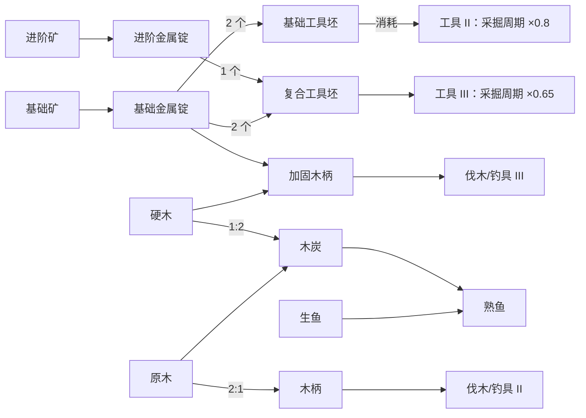
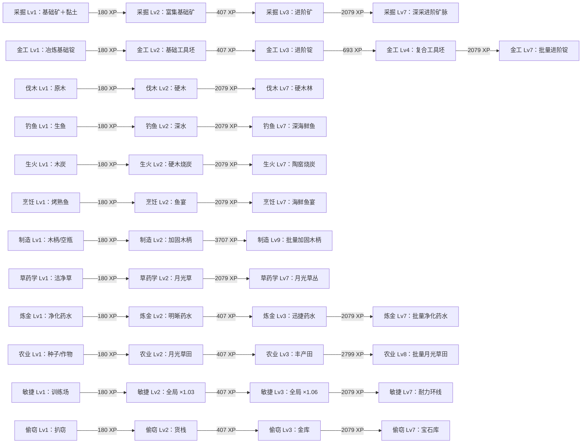

> 历史快照：本文件仅记录根目录十二技能原型，按2026-10-19整理前版本保留；文中“当前/已实现/下一阶段”均属原时点，不适用于发展营地。当前资料见[内容资料库](../../内容资料库/README.md)。归档仅加本说明并修正本地链接，原始字节已在忽略缓存留副本，哈希见本目录归档记录。

# 成长与科技资料

更新时间：2026-10-14。治理入口见 [README](README.md)，进度只见 [PLAN](../../../PLAN.md)。**技能与生产发展图共同设计，十二技能均已扩到 Lv1–Lv30（content `10.0.0`，T1→T5 五层切片）**。XP 到技能当前最高已实现等级门槛后停止增长，但生产继续。内容 JSON 校验（含新增 C4–C7）、全套门禁与启动冒烟已通过；仍没有真人试玩和平衡反馈。

## 成长系统各自负责什么

| 类型                | 玩家获得什么                       | 首轮处理                           | 权威落点                               |
| ------------------- | ---------------------------------- | ---------------------------------- | -------------------------------------- |
| 技能经验/等级       | 持续训练，开放新活动/配方          | 当前两档均需真实节点               | content 门槛、domain 派生、themes 展示 |
| 活动/配方解锁       | 多出可执行的选择                   | 与资源来源/用途一起设计            | content 有限前置与输入输出             |
| 工具提升            | 材料换长期效率                     | 五条工具线各 5 级（II–V）          | content 成本/效果、domain 生效时点     |
| 消耗品/buff         | 熟鱼等消耗品换限时加速（扩展候选） | S4 定合同；多 buff 不叠乘          | content 效果、domain 计时              |
| 燃料/离线上限       | 木炭扩展离线结算上限（扩展候选）   | S4 定合同；扩展有上限且扣减        | content 参数、domain 离线结算          |
| 发展路线图          | 看懂当前条件与下一步               | 维护中，可列表或简单图展示         | 从相同机械定义投影，文档说明设计依据   |
| 逐活动精通/Mastery  | 长期专注同一活动的另一成长轴       | 后续候选；不假装不存在这种核心延展 | 启用前另定经验/效果/存档合同           |
| 装备/出售/研究/战斗 | 新的材料用途、准备或发展选择       | 分别评估，不为了画树整体加入       | 实际支持的有限规则与版本定义           |

**发展路线图可以是纵向或横向，不需要互斥。** 它最多适用于需要主动取舍的独立研究系统，不能阻止技能→配方→工具的发展规划。

## 时代（派生视觉层，第一批新增）

时代是**零状态的派生层**：不写入存档、不占 schema，由 `src/domain/skill-loop/eras.ts` 的纯函数 `getEraId(state, definition)` 推导，读档后永远与事实一致。七档按**累计曲线占比**划带（`ERA_CUMULATIVE_PERCENT = [0, 1, 5, 15, 35, 60, 85]`，占比 = 全技能已得 XP 之和 ÷ 全技能上限之和）：原始（<1%）→ 青铜（≥1%）→ 青翠（≥5%）→ 工业（≥15%）→ 精密（≥35%）→ 极光（≥60%）→ 合成（≥85%）；曲线重定后各带自动随天花板移动。记录页的里程碑文案（任一技能 ≥Lv7、全体 ≥Lv7/Lv10、5 条工具线满级）仍由 `ERA_THRESHOLDS` 提供，与时代分带互相独立。视觉落点：`src/themes/eras.ts` 七套 OKLCH 调色板（primitive/bronze 暖琥珀 → verdant 春绿 → industrial 冷蓝 → precision 青 → aurora 靛紫 → synthetic 品红，色温连续）+ 元数据，外壳注入 CSS 变量并在 `<main>` 标 `data-era`；`scripts/check-theme-contrast.mjs`（`check:theme-contrast`，已纳入 `npm run check`，按 `ERA_DEFINITIONS` 键动态枚举）保证每套调色板正文/背景 ≥ 4.5:1、次要 ≥ 3:1（门禁按 OKLCH 转 sRGB 后计算）。七档均已在浏览器实测：`scripts/visual-evidence/era-evidence.spec.ts` 注入达到各带下界的存档后逐个截图，存于 `docs/证据/时代演进/era-*.png`（7 时代 × 420×600/360×480 共 14 张，git 跟踪，可复跑复现）。时代只影响观感与文案，不参与任何数值结算。

### 视觉系统（美术与色彩批，2026-10-16）

主题依据是一句物理场景：「深夜熄灯的书桌前，只有屏幕亮着，一个人在挂机。」（写于 `src/themes/eras.ts` 文件头与 `docs/工程规范.md`），由此强制推出深色底、单一光晕、低环境光；任何改色提案必须能对照这句推导。

- **色彩策略「承诺」（Committed）**：每个时代的面板底色本身带时代色相（OKLCH chroma 0.02–0.04），一个饱和强调色承载 30–60% 视觉表面；7 套调色板均为 OKLCH，明度远离 0/100。
- **语义色相（tone）**：每时代 3 个 tone（gather 采集 / craft 加工 / support 辅助），用于技能行与仓库行的图标容器、组头色点与状态条高亮；技能/类目到 tone 的映射单一出处在 `src/app/skill-prototype/derivations.ts`。
- **时代背景美术**：7 张 AI 生成的深色低对比位图（768×1024 JPEG，平均亮度 5.1%–11.9%）位于 `src/themes/assets/eras/`，经 `--era-scene` 注入固定图层，来源与许可登记于 `src/themes/assets/SOURCES.md`；industrial/precision/synthetic 另有 data-era 选择的细纹理（斜纹/仪表网格/全息网格）。
- **切换时代同时改变**：场景位图、极光色相、面板底色相、强调色（4 类，超过「≥3 类」的验收线）。
- **对比度门禁扩容**：正文/次要/强调/tone 对背景、面板、浮层三类表面逐一校验；实测最低 7.02:1（要求 ≥4.5/≥3）。
- **字阶**：三层主链 1.25/1/0.8rem（相邻比恰为 1.25）+ 非层级 caption 0.7rem（工具性小字，注释说明不参与层级比）；正文 ≥12px、caption ≥11px。
- **图标**：43 个自绘内联 SVG 统一 24×24 网格、描边 1.75、圆角端点；主行显示尺寸 1.4rem，行外加 tone 图标容器。

## 当前发展关系（content `6.0.0`）

当前运行时使用十二个技能：采掘、金工、伐木、钓鱼、生火、烹饪、制造、草药学、炼金、农业、敏捷、偷窃。资源、活动、周期、XP 和路线验收见[资源与生产链](资源与生产链.md)。

### 技能等级效果（content `7.0.0` 扩展）

`SkillLevel.effect` 从单一全局加速扩为三个可选字段，一律取当前等级值、不跨等级累加（要让加成持续生效，内容在后续等级重复声明该值）：

| 字段                       | 效果                                 | 承载技能与数值（7.0.0）                                      |
| -------------------------- | ------------------------------------ | ------------------------------------------------------------ |
| `globalSpeedBonusPermille` | 全部活动周期倍率（<1000 缩短周期）   | 敏捷：Lv2 ×0.971、Lv3 ×0.943（content 8.0.0 起改为周期倍率） |
| `globalXpBonusPermille`    | 周期完成的技能经验倍率，与消耗品相乘 | 草药学：Lv5-Lv7 x1.03、Lv8-Lv10 x1.06、Lv11-Lv12 x1.10       |
| `offlineCapBonusMs`        | 离线结算窗口加成，总窗口封顶 24 小时 | 农业：Lv4-Lv6 +1h、Lv7-Lv9 +2h、Lv10-Lv11 +4h、Lv12 +6h      |

公式唯一实现在 `src/domain/skill-loop/rates.ts`（新增导出 `getGlobalXpMultiplier`、`getOfflineCapBonusMs`、`getOfflineCapMs`；`getXpPerCycle` 合并消耗品与全局两级倍率，引擎同源调用）。技能详情页展示当前等级的全部效果行，离线规划卡在加成大于 0 时标注「等级加成」。出售报价见[资源与生产链](资源与生产链.md)的「出售报价（content 7.0.0）」。

### 精通系统（content `8.0.0`，schema `4`）

每活动精通等级 + 每技能精通池，全部由存档的 `masteryXp`/`masteryPool` 两个记录键纯派生，不存任何等级或检查点标志：

- **精通 XP**：每完成周期 `max(1, round(活动基础 XP × 精通系数))`；系数表（Lv1 ×1.00 → Lv12 ×1.12）集中在 `src/domain/skill-loop/mastery.ts` 并注明为 Melvor 的简化曲线；精通等级复用所属技能的经验曲线，到顶停止。
- **精通池**：入账的 25%（向下取整）进所属技能池；池上限 = 1200 × 该技能活动数；检查点 10/25/50/95% 为纯池比较——消耗跌回阈值即失效，无存储标志。生效档位给该技能两类加成：周期时长 ×0.95/0.90/0.85/0.80（工具约定），技能经验 ×1.05/1.10/1.15/1.20；最终倍率「工具 × 消耗品 × 全局 × 精通 ≥ 0.3」由内容校验枚举保证（原为 0.5，2026-10-16 速度口径统一批下调，理由见 CHANGELOG）。
- **池消耗**：`spend-mastery-pool` 按 1:1 把池 XP 兑成指定活动的精通经验；三类边界（池不足 / 未知活动 / 越过该活动精通上限）分别报 `INSUFFICIENT_MASTERY_POOL` / `UNKNOWN_ACTIVITY` / `MASTERY_POOL_CAP_EXCEEDED`。
- **UI**：活动行精通行、技能详情精通卡（填充率 + 4 档检查点 + 按活动注入）、记录页精通总览；全部派生，零第二状态源。「因消耗失效」为会话内高水位瞬态展示（刷新后只剩生效/未达成），是零存储约束下的取舍。

物料流与解锁图分开记录。基础金属锭跨档使用，工具投资与先练级形成先后差异；两条路线的 domain 测试终点、用时与切换数见资源台账。新技能线（伐木/钓鱼/生火/烹饪/制造）与消耗端（熟鱼 buff、木炭燃料）是 schema 3 增量，旧档经显式加法迁移保留库存/经验/工具/当前活动。路线一致性不等于平衡或最优证明。

跨技能依赖（不是同一技能的纵向解锁，而是横向闭环）：种子↔作物↔田产草药；草药→药水（加速/经验）；敏捷印记→迅捷药水；偷窃硬币→商店→基础材料/种子/空瓶；敏捷等级→全局周期加速。

十二个技能共用一条曲线：0 / 180 / 407 / 693 / 1053 / 1507 / 2079 / 2799 / 3707 / 4851 / 6292 / 8107 XP（Lv1–Lv12）。

| 技能   | T1 段（Lv1–Lv6）主要内容                       | T2 段（Lv7–Lv12）新增                       | 当前状态              |
| ------ | ---------------------------------------------- | ------------------------------------------- | --------------------- |
| 采掘   | Lv1 基础矿（＋黏土）、Lv2 富集矿、Lv3 进阶矿   | Lv7 深采进阶矿脉（×2）                      | 最高门槛 8107 XP 封顶 |
| 金工   | Lv1 基础锭、Lv2 工具坯、Lv3 进阶锭、Lv4 复合坯 | Lv7 批量进阶锭、Lv8 批量基础锭、Lv10 宝石坯 | 最高门槛 8107 XP 封顶 |
| 伐木   | Lv1 原木、Lv2 硬木                             | Lv7 硬木林（×2）                            | 最高门槛 8107 XP 封顶 |
| 钓鱼   | Lv1 生鱼、Lv2 深水钓鱼                         | Lv7 深海鲜鱼（×2）                          | 最高门槛 8107 XP 封顶 |
| 生火   | Lv1 烧炭、Lv2 硬木烧炭                         | Lv7 陶窑烧炭（×2→×4）                       | 最高门槛 8107 XP 封顶 |
| 烹饪   | Lv1 烤熟鱼、Lv2 鱼宴                           | Lv7 海鲜鱼宴、Lv10 什锦大餐                 | 最高门槛 8107 XP 封顶 |
| 制造   | Lv1 木柄与烧制空瓶、Lv2 加固木柄               | Lv9 批量加固木柄                            | 最高门槛 8107 XP 封顶 |
| 草药学 | Lv1 洁净草、Lv2 月光草                         | Lv7 月光草丛（×2）                          | 最高门槛 8107 XP 封顶 |
| 炼金   | Lv1 净化、Lv2 明晰、Lv3 迅捷                   | Lv7 批量净化、Lv9 批量迅捷                  | 最高门槛 8107 XP 封顶 |
| 农业   | Lv1 种子/作物、Lv2 月光草田、Lv3 丰产田        | Lv8 月光草田（×4）                          | 最高门槛 8107 XP 封顶 |
| 敏捷   | Lv1 训练场、Lv2（×1.03）、Lv3（×1.06）         | Lv7 耐力环线（印记 ×4）                     | 最高门槛 8107 XP 封顶 |
| 偷窃   | Lv1 扒窃、Lv2 货栈、Lv3 金库                   | Lv7 宝石库（硬币 ×12＋宝石）                | 最高门槛 8107 XP 封顶 |

T2 切片同时补掉三个既有死胡同：`vial` 增加“黏土 ×2 → 空瓶”制造配方；`gem` 接到 `crafting-tool-ii` 与宝石工具坯配方；`common-tool-blank` / `composite-tool-blank` 各接到金工工具 II / III，下游从 1 变 2。敏捷 Lv4–Lv12 目前只有等级没有额外效果，属已知缺口（见蓝图第 2 步）。

未开放的更高等级只是后续接点，不是已定义经验门槛，不进入运行时内容或 UI；后续必须先补齐来源、用途和同终点路线，不能让玩家看到空锁定节点。

| 节点/关系      | 必须说明                               | 记录要求                                 |
| -------------- | -------------------------------------- | ---------------------------------------- |
| 采集新原料     | 对应技能门槛、如何获得、供给谁         | 来源；零材料起步可达                     |
| 新加工配方     | 输入先可得、对应技能经验、产物用途     | 前置是必要条件还是仅建议；AND/OR 写清    |
| 工具提升       | 成本、实际效果、生效时点、后续投资价值 | 与下一档投入竞争，但不能形成不可恢复死局 |
| 跨技能物品用途 | 升级后保留什么用途、何时退出           | 配方明确引用，不靠维护磨损强造永久需求   |
| 新技能候选     | 对现有技能提供什么产物/用途/选择       | 只有新名字和 XP 条时不新增               |
| 消耗端         | 谁消耗、消耗后得到什么、是否有上限     | 重复消耗必须说明净效果与退出方式         |
| 末端           | 本轮终点与下一段接点                   | 可以有演示边界，不显示空等级承诺         |

## 技术/能力卡与文献库的连接

现实技术史、作者虚构、角色信念与可玩能力分开。故事文献独立维护（题材选定后另建入口）；工程台账只链接其 ID/版本和采用理由，不复制全文。技术树可先是这些能力的发展索引，不必另发明“科技点”。若需要研究占用活动槽、互斥/撤销、独立货币或随机发现，先比较其是否加强技能核心，再扩玩法合同。

准备入游戏的能力卡最小字段：

| 字段                                   | 要回答的问题                                           |
| -------------------------------------- | ------------------------------------------------------ |
| 稳定编辑 ID、拟机械 ID、版本与双轴状态 | 候选/批准/历史？未实现还是已有实际映射？               |
| 功能名、来源                           | 哪个文献/知识卡支持背景？是事实、解释还是虚构？        |
| 前置                                   | 技能等级、配方/工具事实、任务事实分别是什么？          |
| 来源与成本                             | 原料在哪里得？挤占哪个生产/工具用途？                  |
| 获得方式                               | 等级自动开放、即时购买、任务奖励还是新的持续研究活动？ |
| 有限效果与生效点                       | 开放哪个活动/配方，或改变哪个已有参数？何时生效？      |
| 玩家结果                               | 增加什么选择，如何预览门槛与缺口？                     |
| 代码/文案/兼容映射                     | 无映射必须明示；影响 content/schema 时如何处理？       |

## 阶段共同完成的范围

当前两档实现与文案/资料投影已完成；离线回访回执已实现；Windows 实机可读性以阶段末验收记录为准。七技能与消耗端扩展按 PLAN 的 S4→S5→S6 推进。这里只说明资料职责，不维护阶段进度，完成状态以唯一 PLAN 为准。

## 速度口径统一（content 8.0.0 起的数值批，2026-10-16）

引擎把四个速度倍率全部乘在周期时长上，`getEffectiveCycleMs` 是唯一公式（见 `src/domain/skill-loop/rates.ts`）。因此**只有 <1000 才是变快**，>1000 的写法会让周期变长。2026-10-16 把长期写反的六个字段全部翻到周期倍率口径：

| 字段（所属）                        | 原值 | 现值 | 实际效果                      |
| ----------------------------------- | ---- | ---- | ----------------------------- |
| `cooked-fish` 消耗品速度            | 1150 | 870  | 周期 ×0.87（原为 ×1.15 变慢） |
| `meal-t2` 消耗品速度                | 1200 | 833  | 周期 ×0.83（原为 ×1.20 变慢） |
| `cleansing-potion` 消耗品速度       | 1150 | 870  | 周期 ×0.87                    |
| `swift-potion` 消耗品速度           | 1250 | 800  | 周期 ×0.80                    |
| 敏捷 Lv2 `globalSpeedBonusPermille` | 1030 | 971  | 周期 ×0.971                   |
| 敏捷 Lv3 `globalSpeedBonusPermille` | 1060 | 943  | 周期 ×0.943                   |

经验类字段（`xpMultiplierPermille` / `globalXpBonusPermille`）方向本来就对，保持 1001–2000 不变。速度类字段的校验范围改为 500–1000（下限与工具倍率一致，上限表示「不得比基准更慢」）；冻结的 schema ≤3 快照保留历史数值与旧范围，因为 codec 要按它们复现旧存档的周期时长。

最坏叠加（工具 × 消耗品 × 全局 × 精通）受 **0.3 地板**约束，取代原来的 0.5：0.5 是在速度效果尚未真正缩短周期时定的，翻转后最坏组合合法地落到 0.319（T3–T5 工具等级加入后），对应最短基础周期 7,000 ms 的 2,237 ms。

## T3–T5 内容切片（content `9.0.0`）

按 [内容蓝图](../../内容蓝图-技能资源发展体系.md)第 3 部分把内容从 T1/T2 扩到五层：技能等级 Lv12 → Lv30（曲线续写 5.2），每档按 5.3 取周期与 XP（T3 13,000/43 与 15,000/58、T4 16,000/96 与 18,000/122、T5 20,000/213 与 24,000/268）。新增 29 件物品、57 个活动、36 条配方、11 条工具升级，ID 一律带 `-t3/-t4/-t5` 层后缀，既有 ID 一个未改。逐条机械值见[资源与生产链](资源与生产链.md)。

三条新层级的强制交叉（蓝图第 4 部分）：

1. **燃料三角加深**：伐木（T3–T5 木材）→ 生火（石炭）→ T3–T5 熔炼燃料，金属链从此依赖生火。
2. **农业反向供钓鱼**：农业 T3 起产作物 → 鱼饵 → 钓鱼改为 `craft`（吃饵）→ 烹饪。
3. **机壳纵向升级链**：赤铁机壳 → 星纹机壳 → 核心组件 → 核心药剂，终端收在消耗品上（C5 要求每件非消耗品至少两个去处）。

工具线拉到 5 级，每层都有一次永久提升可买。受 C7（工具材料不跨层）限制，Lv4/Lv5 升级沿用 T1/T2 的坯/柄/宝石并提高份数；T3+ 新材料不能当工具升级材料。

**时代派生层自动跟随内容上限**：`getEraId` 的合成档判定是「12 技能达到内容上限 + 5 条工具线满级」，内容上限改成 Lv30 后该档自动后移到 Lv30，无需改 `ERA_THRESHOLDS`；`scripts/visual-evidence/era-evidence.spec.ts` 的注入用例已同步。
