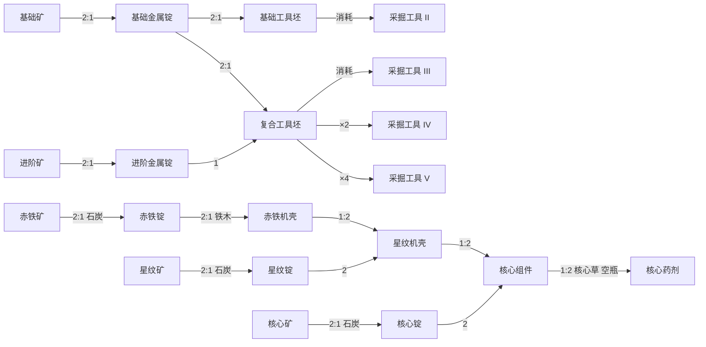
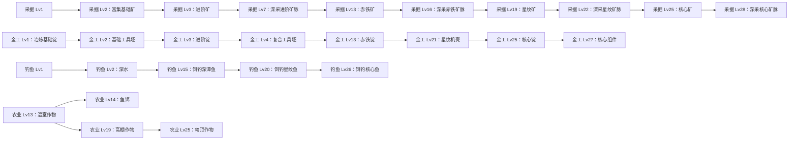
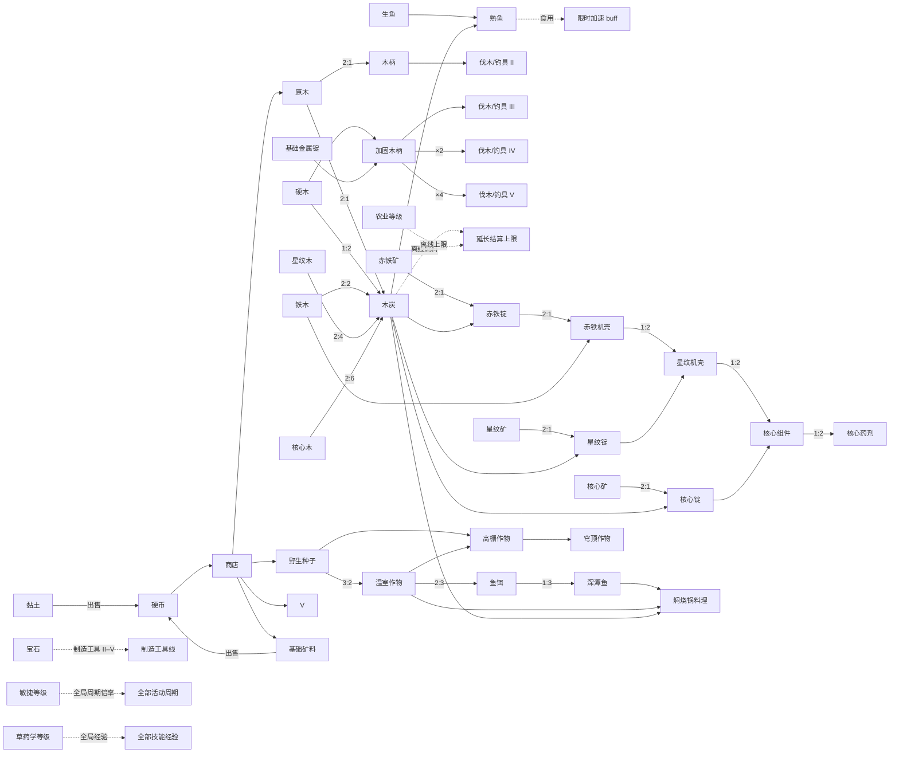

> 历史快照：本文件仅记录根目录十二技能原型，按2026-10-19整理前版本保留；文中“当前/已实现/下一阶段”均属原时点，不适用于发展营地。当前资料见[内容资料库](../../内容资料库/README.md)。归档仅加本说明并修正本地链接，原始字节已在忽略缓存留副本，哈希见本目录归档记录。

# 资源与生产链

更新时间：2026-10-16。治理入口见 [README](README.md)。最终机械值以版本化 content 为准。主入口采用 `src/content/data/*.json` + `load-prototype-content.ts` 装配（content `10.0.0`，schema `4`），**十二技能 × Lv1–Lv30（T1→T5 五层切片）**全部实现；XP 在 Lv30 门槛封顶，封顶后生产继续。旧版本存档（`1.0.0`–`8.0.0`）有显式加法迁移（见 `src/persistence/skill-prototype-save-migrations.ts`）；content `5.0.0`–`8.0.0` 的冻结定义来自 `src/content/data-v*/` 快照 + `src/content/skill-prototype-v*.ts`，不随 `data/` 漂移。

内容即数据：改机制只改 `src/content/data/` 下的按域 JSON，经 `scripts/validate-content-json.mjs` 把关（结构、交叉引用、配方唯一使用、XP 单调、工具升级路由、物品来源闭合、C4–C7）。

下表为当前生效机械定义，可用于从零档复现；功能词仍不是故事专名。发生机械调整时同步 content、主题文案、兼容审查和本资料库；周期在 content 中以毫秒表达，表中换算为秒。

### 速度口径（content 8.0.0 起统一为周期倍率）

引擎把工具、消耗品 `speedMultiplierPermille`、敏捷 `globalSpeedBonusPermille`、精通速度档四个倍率全部**乘在周期时长**上，因此只有 <1000 才是变快。2026-10-16 统一为周期倍率口径后：

| 字段                                                                    | 生效值（按层/档）                                                                         | 校验范围  |
| ----------------------------------------------------------------------- | ----------------------------------------------------------------------------------------- | --------- |
| 工具 `durationMultiplierPermille`                                       | 采掘/伐木 1000/800/650/600/550，钓具 1000/820/680/620/570，金工/制造 1000/860/740/660/600 | 1–1000    |
| 消耗品 `speedMultiplierPermille`                                        | 熟鱼 870、净化药水 870、什锦大餐 833、迅捷药水 800、三级食物 820/790/770                  | 500–1000  |
| `globalSpeedBonusPermille`（敏捷 Lv2/Lv3）                              | 971 / 943                                                                                 | 500–1000  |
| 精通速度档（池 10/25/50/95%）                                           | 950 / 900 / 850 / 800                                                                     | 500–1000  |
| 经验类（消耗品 `xpMultiplierPermille`、草药学 `globalXpBonusPermille`） | 明晰 1200、三级药水 1250/1330/1420；草药学 1030/1060/1100                                 | 1001–2000 |

四者相乘的最坏合法组合受 **0.3 地板** 约束（`src/domain/skill-loop/validation.ts`，枚举全部工具 × 消耗品 × 全局 × 精通组合）：当前最坏为 550 × 770 × 943 × 800 = **0.319488**，对应最短基础周期 7,000 ms 的 2,237 ms。真正的崩溃守卫是 `scaled > 0` 与安全整数检查。地板从 0.5 下调的理由见 CHANGELOG「速度口径统一批」。

### 技能、经验门槛与活动

十二个技能共用一条经验曲线。L1–L12 沿蓝图 5.2（`Δ(L→L+1) = round(180 × 1.26^(L-1))`）；L13–L30 尾段按内容 10.0.0 重定为公比 1.04 的等比续写（`scripts/audit-pacing.mjs` 调参：12 技能全满 36–48 小时、末 3 级 ≤ 总曲线 25%，Lv1–L12 数值原样保留），上限由 563,004 降到 **56,548**：

| 等级         |   1 |   2 |   3 |   4 |    5 |    6 |    7 |    8 |    9 |   10 |   11 |   12 |   13 |    14 |    15 |
| ------------ | --: | --: | --: | --: | ---: | ---: | ---: | ---: | ---: | ---: | ---: | ---: | ---: | ----: | ----: |
| 门槛 XP      |   0 | 180 | 407 | 693 | 1053 | 1507 | 2079 | 2799 | 3707 | 4851 | 6292 | 8107 | 9995 | 11959 | 14002 |
| 本级所需 ΔXP | 180 | 227 | 286 | 360 |  454 |  572 |  720 |  908 | 1144 | 1441 | 1815 | 1888 | 1964 |  2043 |  2125 |

| 等级         |    16 |    17 |    18 |    19 |    20 |    21 |    22 |    23 |    24 |    25 |    26 |    27 |    28 |    29 |    30 |
| ------------ | ----: | ----: | ----: | ----: | ----: | ----: | ----: | ----: | ----: | ----: | ----: | ----: | ----: | ----: | ----: |
| 门槛 XP      | 16127 | 18337 | 20635 | 23025 | 25511 | 28096 | 30784 | 33580 | 36488 | 39512 | 42657 | 45928 | 49330 | 52868 | 56548 |
| 本级所需 ΔXP |  2210 |  2298 |  2390 |  2486 |  2585 |  2688 |  2796 |  2908 |  3024 |  3145 |  3271 |  3402 |  3538 |  3680 |    —— |

| 技能 ID        | 功能名 | 各等级开放的内容                                                                                                                                                                                                                                                                         |
| -------------- | ------ | ---------------------------------------------------------------------------------------------------------------------------------------------------------------------------------------------------------------------------------------------------------------------------------------- |
| `mining`       | 采掘   | Lv1 基础矿（副产黏土）；Lv2 富集基础矿；Lv3 进阶矿；Lv7 深采进阶矿脉（×2）；Lv13 赤铁矿（×2）；Lv16 深采赤铁矿脉（×3）；Lv19 星纹矿；Lv22 深采星纹矿脉；Lv25 核心矿（×2）；Lv28 深采核心矿脉（×3）                                                                                       |
| `metalworking` | 金工   | Lv1 基础锭；Lv2 基础工具坯；Lv3 进阶锭；Lv4 复合工具坯；Lv7 批量进阶锭；Lv8 批量基础锭；Lv10 宝石工具坯；Lv13 赤铁锭；Lv16 批量赤铁锭；Lv17 批量赤铁机壳；Lv19 星纹锭；Lv21 星纹机壳；Lv22 批量星纹锭；Lv23 批量星纹机壳；Lv25 核心锭；Lv27 核心组件；Lv28 批量核心锭；Lv29 批量核心组件 |
| `woodcutting`  | 伐木   | Lv1 原木；Lv2 硬木；Lv7 硬木林（×2）；Lv13 铁木（×2）；Lv16 铁木林（×3）；Lv19 星纹木；Lv22 星纹木林；Lv25 核心木（×2）；Lv28 核心木林（×3）                                                                                                                                             |
| `fishing`      | 钓鱼   | Lv1 生鱼；Lv2 深水钓鱼；Lv7 深海鲜鱼（×2）；Lv15 饵钓深潭鱼（×3）；Lv20 饵钓星纹鱼（×3）；Lv26 饵钓核心鱼（×3）                                                                                                                                                                          |
| `firemaking`   | 生火   | Lv1 烧炭；Lv2 硬木烧炭；Lv7 陶窑烧炭（硬木 ×2 → 炭 ×4）；Lv13 窑烧石炭（铁木 ×2 → 炭 ×2）；Lv19 窑烧焦炭（星纹木 ×2 → 炭 ×4）；Lv25 窑烧核心炭（核心木 ×2 → 炭 ×6）                                                                                                                      |
| `cooking`      | 烹饪   | Lv1 烤熟鱼；Lv2 鱼宴；Lv7 海鲜鱼宴；Lv10 什锦大餐；Lv16 焖烧锅料理；Lv17 焖烧锅大餐；Lv21 精炼口粮；Lv23 精炼大餐；Lv27 核心口粮；Lv29 核心大餐                                                                                                                                          |
| `crafting`     | 制造   | Lv1 木柄、烧制空瓶；Lv2 加固木柄；Lv9 批量加固木柄；Lv14 赤铁机壳；Lv20 精制星纹机壳；Lv26 精制核心组件                                                                                                                                                                                  |
| `herbalism`    | 草药学 | Lv1 洁净草；Lv2 月光草；Lv7 月光草丛（×2）；Lv13 赤焰草（×2）；Lv19 星纹草（×2）；Lv25 核心草（×2）                                                                                                                                                                                      |
| `herblore`     | 炼金   | Lv1 净化药水；Lv2 明晰药水；Lv3 迅捷药水；Lv7 批量净化药水；Lv9 批量迅捷药水；Lv13 经验药剂；Lv16 批量经验药剂；Lv19 星纹药剂；Lv22 批量星纹药剂；Lv27 核心药剂；Lv29 批量核心药剂                                                                                                       |
| `farming`      | 农业   | Lv1 种子与播种作物；Lv2 月光草田；Lv3 丰产田；Lv8 月光草田（批量）；Lv13 温室作物；Lv14 鱼饵；Lv19 高棚作物；Lv25 穹顶作物                                                                                                                                                               |
| `agility`      | 敏捷   | Lv1 训练场；Lv2（全部活动周期 ×0.971）障碍环线；Lv3（×0.943）耐力试炼；Lv7 耐力环线（印记 ×4）；Lv13 蒸汽环线（×6）；Lv19 仪表环线（×10）；Lv25 全息环线（×16）；其余等级无额外等级效果                                                                                                  |
| `thieving`     | 偷窃   | Lv1 扒窃；Lv2 货栈；Lv3 金库；Lv7 宝石库（硬币 ×12＋宝石）；Lv13 工业金库（×20＋宝石）；Lv19 精炼金库（×40＋宝石 ×2）；Lv25 核心金库（×80＋宝石 ×3）                                                                                                                                     |

技能等级各自派生，活动只给所属技能经验，不跨技能发 XP。基础活动可在 Lv1 重复；达到对应等级后多出生产效率更高的选择，不会自动改当前活动。

**每档周期与 XP 取蓝图 5.3**（T1/T2 在 2026-10-16 的 T1 校准批对齐，T3–T5 在 T3–T5 内容批新增）：

| 层  | 采集 durationMs | 采集 xpPerCycle | 制作 durationMs | 制作 xpPerCycle | XP/分钟（工具 1000‰，无增益） |
| --- | --------------- | --------------- | --------------- | --------------- | ----------------------------- |
| T1  | 7,000           | 7               | 9,000           | 11              | 60 / 73                       |
| T2  | 10,000          | 18              | 12,000          | 26              | 108 / 130                     |
| T3  | 13,000          | 43              | 15,000          | 58              | 198 / 232                     |
| T4  | 16,000          | 96              | 18,000          | 122             | 360 / 407                     |
| T5  | 20,000          | 213             | 24,000          | 268             | 639 / 670                     |

跨技能输入从 T2 起引入（黏土→进阶锭、宝石→工具坯）；T3 起每个新配方至少带 1 个跨技能输入（石炭→熔炼、鱼饵→钓鱼、作物→烹饪、机壳→上层机壳）。

| `mine-common-ore` | 采集基础矿料 | 采掘 Lv1 | 7 秒 | 无 → 基础矿料 ×1＋黏土 ×1 | 采掘 7 |
| `mine-rich-common-ore` | 采集富集矿层 | 采掘 Lv2 | 7 秒 | 无 → 基础矿料 ×2 | 采掘 7 |
| `mine-advanced-ore` | 采集进阶矿层 | 采掘 Lv3 | 7 秒 | 无 → 进阶矿料 ×1 | 采掘 7 |
| `mine-advanced-ore-deep` | 深采进阶矿脉 | 采掘 Lv7 | 10 秒 | 无 → 进阶矿料 ×2 | 采掘 18 |
| `smelt-common-ingot` | 冶炼基础金属锭 | 金工 Lv1 | 9 秒 | 基础矿料 ×2 → 基础金属锭 ×1 | 金工 11 |
| `forge-common-tool-blank` | 锻造基础工具坯 | 金工 Lv2 | 9 秒 | 基础金属锭 ×2 → 基础工具坯 ×1 | 金工 11 |
| `smelt-advanced-ingot` | 冶炼进阶金属锭 | 金工 Lv3 | 9 秒 | 进阶矿料 ×2 → 进阶金属锭 ×1 | 金工 11 |
| `forge-composite-tool-blank` | 锻造复合工具坯 | 金工 Lv4 | 9 秒 | 基础金属锭 ×2＋进阶金属锭 ×1 → 复合工具坯 ×1 | 金工 11 |
| `smelt-advanced-ingot-batch` | 批量冶炼进阶金属锭 | 金工 Lv7 | 12 秒 | 进阶矿料 ×4＋黏土 ×1 → 进阶金属锭 ×2 | 金工 26 |
| `smelt-common-ingot-batch` | 批量冶炼基础金属锭 | 金工 Lv8 | 12 秒 | 基础矿料 ×4 → 基础金属锭 ×2 | 金工 26 |
| `forge-composite-tool-blank-gem` | 宝石镶嵌工具坯 | 金工 Lv10 | 12 秒 | 宝石 ×1＋进阶金属锭 ×2 → 复合工具坯 ×1 | 金工 26 |
| `chop-wood-log` | 砍伐原木 | 伐木 Lv1 | 7 秒 | 无 → 原木 ×1 | 伐木 7 |
| `chop-hardwood` | 砍伐硬木 | 伐木 Lv2 | 7 秒 | 无 → 硬木 ×1 | 伐木 7 |
| `chop-hardwood-grove` | 砍伐硬木林 | 伐木 Lv7 | 10 秒 | 无 → 硬木 ×2 | 伐木 18 |
| `catch-raw-fish` | 钓生鱼 | 钓鱼 Lv1 | 7 秒 | 无 → 生鱼 ×1 | 钓鱼 7 |
| `catch-raw-fish-deep` | 深水钓鱼 | 钓鱼 Lv2 | 7 秒 | 无 → 生鱼 ×2 | 钓鱼 7 |
| `catch-fish-t2` | 捕捞深海鲜鱼 | 钓鱼 Lv7 | 10 秒 | 无 → 深海鲜鱼 ×2 | 钓鱼 18 |
| `burn-charcoal` | 烧制木炭 | 生火 Lv1 | 9 秒 | 原木 ×2 → 木炭 ×1 | 生火 11 |
| `burn-charcoal-hardwood` | 硬木烧炭 | 生火 Lv2 | 9 秒 | 硬木 ×1 → 木炭 ×2 | 生火 11 |
| `burn-charcoal-kiln` | 陶窑烧炭 | 生火 Lv7 | 12 秒 | 硬木 ×2 → 木炭 ×4 | 生火 26 |
| `cook-raw-fish` | 烤熟鱼 | 烹饪 Lv1 | 9 秒 | 生鱼 ×1＋木炭 ×1 → 熟鱼 ×1 | 烹饪 11 |
| `cook-fish-feast` | 烹制鱼宴 | 烹饪 Lv2 | 9 秒 | 生鱼 ×2＋木炭 ×2 → 熟鱼 ×2 | 烹饪 11 |
| `cook-fish-feast-t2` | 烹制海鲜鱼宴 | 烹饪 Lv7 | 12 秒 | 深海鲜鱼 ×1＋木炭 ×1 → 熟鱼 ×2 | 烹饪 26 |
| `cook-meal-t2` | 烹制什锦大餐 | 烹饪 Lv10 | 12 秒 | 深海鲜鱼 ×2＋田产作物 ×1＋木炭 ×2 → 什锦大餐 ×3 | 烹饪 26 |
| `craft-wood-handle` | 制作木柄 | 制造 Lv1 | 9 秒 | 原木 ×2 → 木柄 ×1 | 制造 11 |
| `craft-clay-vial` | 烧制空瓶 | 制造 Lv1 | 9 秒 | 黏土 ×2 → 空瓶 ×1 | 制造 11 |
| `craft-reinforced-handle` | 制作加固木柄 | 制造 Lv2 | 9 秒 | 硬木 ×2＋基础金属锭 ×1 → 加固木柄 ×1 | 制造 11 |
| `craft-reinforced-handle-batch` | 批量制作加固木柄 | 制造 Lv9 | 12 秒 | 硬木 ×4＋基础金属锭 ×2 → 加固木柄 ×2 | 制造 26 |
| `gather-clean-herb` | 采集洁净草 | 草药学 Lv1 | 7 秒 | 无 → 洁净草 ×1 | 草药学 7 |
| `gather-moon-herb` | 采集月光草 | 草药学 Lv2 | 7 秒 | 无 → 月光草 ×1 | 草药学 7 |
| `gather-moon-herb-grove` | 采集月光草丛 | 草药学 Lv7 | 10 秒 | 无 → 月光草 ×2 | 草药学 18 |
| `brew-cleansing-potion` | 熬制净化药水 | 炼金 Lv1 | 9 秒 | 洁净草 ×2＋空瓶 ×1 → 净化药水 ×1 | 炼金 11 |
| `brew-clarity-potion` | 熬制明晰药水 | 炼金 Lv2 | 9 秒 | 月光草 ×2＋空瓶 ×1 → 明晰药水 ×1 | 炼金 11 |
| `brew-swift-potion` | 熬制迅捷药水 | 炼金 Lv3 | 9 秒 | 月光草 ×1＋敏捷印记 ×1＋空瓶 ×1 → 迅捷药水 ×1 | 炼金 11 |
| `brew-cleansing-potion-batch` | 批量熬制净化药水 | 炼金 Lv7 | 12 秒 | 洁净草 ×4＋空瓶 ×2 → 净化药水 ×2 | 炼金 26 |
| `brew-swift-potion-batch` | 批量熬制迅捷药水 | 炼金 Lv9 | 12 秒 | 月光草 ×2＋敏捷印记 ×2＋空瓶 ×2 → 迅捷药水 ×2 | 炼金 26 |
| `gather-wild-seed` | 收集野生种子 | 农业 Lv1 | 7 秒 | 无 → 野生种子 ×1 | 农业 7 |
| `plant-field-crop` | 播种田产作物 | 农业 Lv1 | 9 秒 | 野生种子 ×2 → 田产作物 ×2 | 农业 11 |
| `grow-moon-herb` | 栽培月光草 | 农业 Lv2 | 9 秒 | 野生种子 ×2＋田产作物 ×1 → 月光草 ×2 | 农业 11 |
| `cultivate-abundant-harvest` | 培育丰产田 | 农业 Lv3 | 9 秒 | 野生种子 ×3＋田产作物 ×2 → 田产作物 ×6 | 农业 11 |
| `grow-moon-herb-batch` | 栽培月光草田 | 农业 Lv8 | 12 秒 | 野生种子 ×4＋田产作物 ×2 → 月光草 ×4 | 农业 26 |
| `run-agility-course` | 跑障碍训练场 | 敏捷 Lv1 | 7 秒 | 无 → 敏捷印记 ×1 | 敏捷 7 |
| `run-obstacle-circuit` | 跑障碍环线 | 敏捷 Lv2 | 7 秒 | 无 → 敏捷印记 ×2 | 敏捷 7 |
| `run-endurance-trial` | 跑耐力试炼 | 敏捷 Lv3 | 7 秒 | 无 → 敏捷印记 ×3 | 敏捷 7 |
| `run-endurance-circuit` | 跑耐力环线 | 敏捷 Lv7 | 10 秒 | 无 → 敏捷印记 ×4 | 敏捷 18 |
| `pickpocket` | 扒窃路人 | 偷窃 Lv1 | 7 秒 | 无 → 硬币 ×2 | 偷窃 7 |
| `burgle-storehouse` | 窃取货栈 | 偷窃 Lv2 | 7 秒 | 无 → 硬币 ×5 | 偷窃 7 |
| `heist-vault` | 洗劫金库 | 偷窃 Lv3 | 7 秒 | 无 → 硬币 ×6＋宝石 ×1 | 偷窃 7 |
| `heist-gem-vault` | 洗劫宝石库 | 偷窃 Lv7 | 10 秒 | 无 → 硬币 ×12＋宝石 ×1 | 偷窃 18 |
| `mine-ore-t3` | 采掘赤铁矿 | 采掘 Lv13 | 13 秒 | 无 → 赤铁矿石 ×2 | 采掘 43 |
| `mine-ore-t3-deep` | 深采赤铁矿脉 | 采掘 Lv16 | 13 秒 | 无 → 赤铁矿石 ×3 | 采掘 43 |
| `chop-wood-t3` | 砍伐铁木 | 伐木 Lv13 | 13 秒 | 无 → 铁木 ×2 | 伐木 43 |
| `chop-wood-t3-grove` | 砍伐铁木林 | 伐木 Lv16 | 13 秒 | 无 → 铁木 ×3 | 伐木 43 |
| `gather-herb-t3` | 采集赤焰草 | 草药学 Lv13 | 13 秒 | 无 → 赤焰草 ×2 | 草药学 43 |
| `burn-coal-kiln` | 窑烧石炭 | 生火 Lv13 | 15 秒 | 铁木 ×2 → 木炭 ×2 | 生火 58 |
| `smelt-ingot-t3` | 冶炼赤铁锭 | 金工 Lv13 | 15 秒 | 赤铁矿石 ×2＋木炭 ×1 → 赤铁锭 ×1 | 金工 58 |
| `smelt-ingot-t3-batch` | 批量冶炼赤铁锭 | 金工 Lv16 | 15 秒 | 赤铁矿石 ×4＋木炭 ×2 → 赤铁锭 ×3 | 金工 58 |
| `craft-casing-t3` | 装配赤铁机壳 | 制造 Lv14 | 15 秒 | 赤铁锭 ×2＋铁木 ×1 → 赤铁机壳 ×1 | 制造 58 |
| `forge-casing-t3-batch` | 批量锻造赤铁机壳 | 金工 Lv17 | 15 秒 | 赤铁锭 ×4＋铁木 ×2 → 赤铁机壳 ×3 | 金工 58 |
| `harvest-crop-t3` | 收获温室作物 | 农业 Lv13 | 15 秒 | 野生种子 ×3＋田产作物 ×2 → 温室作物 ×4 | 农业 58 |
| `craft-fish-bait` | 制作鱼饵 | 农业 Lv14 | 15 秒 | 温室作物 ×2 → 鱼饵 ×3 | 农业 58 |
| `catch-fish-t3-bait` | 饵钓深潭鱼 | 钓鱼 Lv15 | 15 秒 | 鱼饵 ×1 → 深潭鱼 ×3 | 钓鱼 58 |
| `cook-food-t3` | 烹制焖烧锅料理 | 烹饪 Lv16 | 15 秒 | 深潭鱼 ×2＋温室作物 ×1＋木炭 ×2 → 焖烧锅料理 ×3 | 烹饪 58 |
| `cook-food-t3-feast` | 烹制焖烧锅大餐 | 烹饪 Lv17 | 15 秒 | 深潭鱼 ×3＋木炭 ×3 → 焖烧锅料理 ×5 | 烹饪 58 |
| `brew-potion-t3` | 熬制强效经验药剂 | 炼金 Lv13 | 15 秒 | 赤焰草 ×2＋空瓶 ×1 → 强效经验药剂 ×1 | 炼金 58 |
| `brew-potion-t3-batch` | 批量熬制经验药剂 | 炼金 Lv16 | 15 秒 | 赤焰草 ×4＋空瓶 ×2 → 强效经验药剂 ×3 | 炼金 58 |
| `run-circuit-t3` | 跑蒸汽环线 | 敏捷 Lv13 | 13 秒 | 无 → 敏捷印记 ×6 | 敏捷 43 |
| `heist-t3-vault` | 洗劫工业金库 | 偷窃 Lv13 | 13 秒 | 无 → 硬币 ×20＋宝石 ×1 | 偷窃 43 |
| `mine-ore-t4` | 采掘星纹矿 | 采掘 Lv19 | 16 秒 | 无 → 星纹矿石 ×2 | 采掘 96 |
| `mine-ore-t4-deep` | 深采星纹矿脉 | 采掘 Lv22 | 16 秒 | 无 → 星纹矿石 ×3 | 采掘 96 |
| `chop-wood-t4` | 砍伐星纹木 | 伐木 Lv19 | 16 秒 | 无 → 星纹木 ×2 | 伐木 96 |
| `chop-wood-t4-grove` | 砍伐星纹木林 | 伐木 Lv22 | 16 秒 | 无 → 星纹木 ×3 | 伐木 96 |
| `gather-herb-t4` | 采集星纹草 | 草药学 Lv19 | 16 秒 | 无 → 星纹草 ×2 | 草药学 96 |
| `burn-coke-kiln` | 窑烧焦炭 | 生火 Lv19 | 18 秒 | 星纹木 ×2 → 木炭 ×4 | 生火 122 |
| `smelt-ingot-t4` | 冶炼星纹锭 | 金工 Lv19 | 18 秒 | 星纹矿石 ×2＋木炭 ×2 → 星纹锭 ×1 | 金工 122 |
| `smelt-ingot-t4-batch` | 批量冶炼星纹锭 | 金工 Lv22 | 18 秒 | 星纹矿石 ×4＋木炭 ×4 → 星纹锭 ×3 | 金工 122 |
| `craft-casing-t4-refined` | 精制星纹机壳 | 制造 Lv20 | 18 秒 | 星纹木 ×2＋星纹锭 ×1 → 星纹机壳 ×1 | 制造 122 |
| `forge-casing-t4` | 锻造星纹机壳 | 金工 Lv21 | 18 秒 | 赤铁机壳 ×1＋星纹锭 ×2 → 星纹机壳 ×1 | 金工 122 |
| `forge-casing-t4-batch` | 批量锻造星纹机壳 | 金工 Lv23 | 18 秒 | 赤铁机壳 ×2＋星纹锭 ×4 → 星纹机壳 ×3 | 金工 122 |
| `harvest-crop-t4` | 收获高棚作物 | 农业 Lv19 | 18 秒 | 野生种子 ×4＋温室作物 ×2 → 高棚作物 ×4 | 农业 122 |
| `catch-fish-t4-bait` | 饵钓星纹鱼 | 钓鱼 Lv20 | 18 秒 | 鱼饵 ×2 → 星纹鱼 ×3 | 钓鱼 122 |
| `cook-food-t4` | 烹制精炼口粮 | 烹饪 Lv21 | 18 秒 | 星纹鱼 ×2＋高棚作物 ×1＋木炭 ×3 → 精炼口粮 ×3 | 烹饪 122 |
| `cook-food-t4-feast` | 烹制精炼大餐 | 烹饪 Lv23 | 18 秒 | 星纹鱼 ×3＋高棚作物 ×2＋木炭 ×4 → 精炼口粮 ×5 | 烹饪 122 |
| `brew-potion-t4` | 熬制星纹药剂 | 炼金 Lv19 | 18 秒 | 星纹草 ×2＋空瓶 ×1 → 星纹药剂 ×1 | 炼金 122 |
| `brew-potion-t4-batch` | 批量熬制星纹药剂 | 炼金 Lv22 | 18 秒 | 星纹草 ×4＋空瓶 ×2 → 星纹药剂 ×3 | 炼金 122 |
| `run-circuit-t4` | 跑仪表环线 | 敏捷 Lv19 | 16 秒 | 无 → 敏捷印记 ×10 | 敏捷 96 |
| `heist-t4-vault` | 洗劫精炼金库 | 偷窃 Lv19 | 16 秒 | 无 → 硬币 ×40＋宝石 ×2 | 偷窃 96 |
| `mine-ore-t5` | 采掘核心矿 | 采掘 Lv25 | 20 秒 | 无 → 核心矿石 ×2 | 采掘 213 |
| `mine-ore-t5-deep` | 深采核心矿脉 | 采掘 Lv28 | 20 秒 | 无 → 核心矿石 ×3 | 采掘 213 |
| `chop-wood-t5` | 砍伐核心木 | 伐木 Lv25 | 20 秒 | 无 → 核心木 ×2 | 伐木 213 |
| `chop-wood-t5-grove` | 砍伐核心木林 | 伐木 Lv28 | 20 秒 | 无 → 核心木 ×3 | 伐木 213 |
| `gather-herb-t5` | 采集核心草 | 草药学 Lv25 | 20 秒 | 无 → 核心草 ×2 | 草药学 213 |
| `burn-coke-t5` | 窑烧核心炭 | 生火 Lv25 | 24 秒 | 核心木 ×2 → 木炭 ×6 | 生火 268 |
| `smelt-ingot-t5` | 冶炼核心锭 | 金工 Lv25 | 24 秒 | 核心矿石 ×2＋木炭 ×3 → 核心锭 ×1 | 金工 268 |
| `smelt-ingot-t5-batch` | 批量冶炼核心锭 | 金工 Lv28 | 24 秒 | 核心矿石 ×4＋木炭 ×6 → 核心锭 ×3 | 金工 268 |
| `craft-core-t5-refined` | 精制核心组件 | 制造 Lv26 | 24 秒 | 核心木 ×2＋核心锭 ×1 → 核心组件 ×1 | 制造 268 |
| `forge-core-t5` | 锻造核心组件 | 金工 Lv27 | 24 秒 | 星纹机壳 ×1＋核心锭 ×2 → 核心组件 ×1 | 金工 268 |
| `forge-core-t5-batch` | 批量锻造核心组件 | 金工 Lv29 | 24 秒 | 星纹机壳 ×2＋核心锭 ×4 → 核心组件 ×3 | 金工 268 |
| `harvest-crop-t5` | 收获穹顶作物 | 农业 Lv25 | 24 秒 | 野生种子 ×5＋高棚作物 ×2 → 穹顶作物 ×4 | 农业 268 |
| `catch-fish-t5-bait` | 饵钓核心鱼 | 钓鱼 Lv26 | 24 秒 | 鱼饵 ×3 → 核心鱼 ×3 | 钓鱼 268 |
| `cook-food-t5` | 烹制核心口粮 | 烹饪 Lv27 | 24 秒 | 核心鱼 ×2＋穹顶作物 ×1＋木炭 ×4 → 核心口粮 ×3 | 烹饪 268 |
| `cook-food-t5-feast` | 烹制核心大餐 | 烹饪 Lv29 | 24 秒 | 核心鱼 ×3＋穹顶作物 ×2＋木炭 ×6 → 核心口粮 ×5 | 烹饪 268 |
| `brew-potion-t5` | 熬制核心药剂 | 炼金 Lv27 | 24 秒 | 核心组件 ×1＋核心草 ×2＋空瓶 ×1 → 核心药剂 ×1 | 炼金 268 |
| `brew-potion-t5-batch` | 批量熬制核心药剂 | 炼金 Lv29 | 24 秒 | 核心组件 ×2＋核心草 ×4＋空瓶 ×2 → 核心药剂 ×3 | 炼金 268 |
| `run-circuit-t5` | 跑全息环线 | 敏捷 Lv25 | 20 秒 | 无 → 敏捷印记 ×16 | 敏捷 213 |
| `heist-t5-vault` | 洗劫核心金库 | 偷窃 Lv25 | 20 秒 | 无 → 硬币 ×80＋宝石 ×3 | 偷窃 213 |

### 商店报价（content 5.0.0）

固定硬币价格的即时兑换（`purchase` 命令，不占主活动、不给 XP）：

| 报价 ID          | 兑换        | 价格   |
| ---------------- | ----------- | ------ |
| `buy-vial`       | 空瓶 ×2     | 6 硬币 |
| `buy-wild-seed`  | 野生种子 ×3 | 4 硬币 |
| `buy-wood-log`   | 原木 ×2     | 4 硬币 |
| `buy-common-ore` | 基础矿料 ×2 | 4 硬币 |

### 出售报价（content 7.0.0）

固定价格的即时出售（`sell` 命令，可重复，原子扣物给硬币，不占主活动、不给 XP）；出售是硬币的第二个来源（偷窃之外），也是黏土等富余材料的出口：

| 报价 ID           | 出售        | 价格   |
| ----------------- | ----------- | ------ |
| `sell-clay`       | 黏土 ×4     | 1 硬币 |
| `sell-common-ore` | 基础矿料 ×4 | 2 硬币 |
| `sell-wood-log`   | 原木 ×4     | 2 硬币 |
| `sell-wild-seed`  | 野生种子 ×4 | 2 硬币 |
| `sell-clean-herb` | 洁净草 ×4   | 2 硬币 |

同物买卖时出售单价严格低于商店买入单价（基础矿料 0.5/个 vs 买入 2/个，原木 0.5/个 vs 2/个，野生种子 0.5/个 vs 1.33/个），「买入再卖出」必亏，无法套利造币；该不变式由 `check:content-json` 把关。

玩家以各技能基础工具 I 开局。立即工具命令不占主活动，工具只影响所属技能，升级在下一周期生效，没有耐久、维修或随机省料：

| 工具线              | 各级周期倍率                 | 升级材料（Lv2 / Lv3 / Lv4 / Lv5）                  |
| ------------------- | ---------------------------- | -------------------------------------------------- |
| `mining-tool`       | 1000 / 800 / 650 / 600 / 550 | 基础工具坯 ×1 / 复合工具坯 ×1 / 复合工具坯 ×2 / ×4 |
| `woodcutting-tool`  | 1000 / 800 / 650 / 600 / 550 | 木柄 ×1 / 加固木柄 ×1 / 加固木柄 ×2 / ×4           |
| `fishing-tool`      | 1000 / 820 / 680 / 620 / 570 | 木柄 ×1 / 加固木柄 ×1 / 加固木柄 ×2 / ×4           |
| `metalworking-tool` | 1000 / 860 / 740 / 660 / 600 | 基础工具坯 ×1 / 复合工具坯 ×1 / 复合工具坯 ×2 / ×4 |
| `crafting-tool`     | 1000 / 860 / 740 / 660 / 600 | 宝石 ×1 / 宝石 ×2 / 宝石 ×3 / 宝石 ×4              |

> **C7 的直接后果**：工具升级材料的层由工具等级（1–5）经 `tierOfLevel` 计算，永远落在 T1，因此 Lv4/Lv5 升级只能沿用 T1/T2 的坯/柄/宝石并提高份数，T3+ 新材料（`casing-t3` 等）不能当工具升级材料。要放开必须先改 C7 的层判定（规则改动）。

### 消耗品与离线上限燃料（schema 3 起）

| 机制     | 定义                                                                                                              |
| -------- | ----------------------------------------------------------------------------------------------------------------- |
| 熟鱼     | `consumable`：`speedMultiplierPermille` 870（全部活动周期 ×0.87，快 13%）、`durationMs` 30 分钟游戏时间           |
| 净化药水 | 周期 ×0.87（快 13%）、20 分钟                                                                                     |
| 迅捷药水 | 周期 ×0.80（快 20%）、15 分钟                                                                                     |
| 明晰药水 | `xpMultiplierPermille` 1200（技能经验 +20%）、25 分钟                                                             |
| 什锦大餐 | 周期 ×0.83（快 17%）、45 分钟；T2 食物，由深海鲜鱼＋作物＋木炭产出                                                |
| 三级食物 | 焖烧锅料理 820（×0.82）、精炼口粮 790（×0.79）、核心口粮 770（×0.77），时长 60/75/90 分钟                         |
| 三级药水 | 经验 +25% / +33% / +42%，时长 50/60/75 分钟                                                                       |
| 增益规则 | 单一增益槽：`consume` 扣 1 个并刷新持续时间，多 buff 不叠乘；周期时长在周期开始时定格；到期即移除，不补不退       |
| 木炭     | `offlineFuel`：`extensionMs` 1 小时/份、`maxExtensionMs` 8 小时；仅当离开超过 8 小时基础上限时按需扣减            |
| 敏捷     | `globalSpeedBonusPermille`：Lv2 ×0.971、Lv3 ×0.943，取当前等级值不累加；周期倍率 = 工具 × 增益 × 敏捷 × 精通      |
| 草药学   | `globalXpBonusPermille`：Lv5–Lv7 ×1.03、Lv8–Lv10 ×1.06、Lv11–Lv30 ×1.10，取当前等级值不累加；与消耗品经验倍率相乘 |
| 农业     | `offlineCapBonusMs`：Lv4–Lv6 +1 小时、Lv7–Lv9 +2 小时、Lv10–Lv11 +4 小时、Lv12 +6 小时；总窗口封顶 24 小时        |
| 商店     | `shopOffers` + `purchase` 命令：固定硬币价格即时兑换，不占主活动、不给 XP                                         |
| 出售     | `sellOffers` + `sell` 命令：固定价格、可重复、原子扣物给硬币；同物买卖时出售单价严格低于买入价（防套利）          |

### 物料与解锁分别表达

解锁图与物料图不是同一张生效图：

各物品的来源和首轮用途：基础矿来自前两项基础采掘活动，全部加工为基础锭；基础锭用于工具 II 和工具 III 的共同材料；进阶矿冶炼为进阶锭；原木/硬木流向木炭与木柄；生鱼配木炭成熟鱼（食用加速）；木柄与加固木柄升级伐木/钓具；T3 起矿石需要石炭才能熔炼（生火成为金工前置），钓鱼需要农业供饵，烹饪需要作物。不存在只有解锁后才能获得的输入、材料自锁或需要故事任务才能继续的门槛。

## 跨技能物料流（已实现）

每个入游戏的物品记录机械 ID/种类、来源、前置、配方消费端、工具或其他用途、阶段/批准/实现状态、文案映射、兼容影响。生效数值只以对应 content 为准，资料中的设计参数标明版本与状态。
