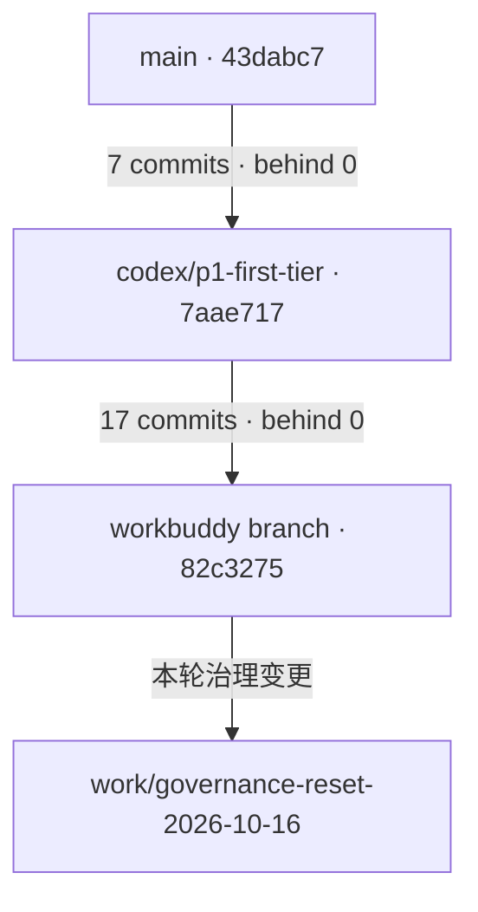

# 仓库治理审计与基线重置

本记录是 **2026-10-16 的冻结证据**，不是实时计划。当前工作只维护在根 [PLAN](../../PLAN.md)，逐文件依据见[分类台账](2026-10-16-文件分类.json)。

结论：保留当前技能原型与七层架构，选择 WorkBuddy 分支的 `82c3275` 为唯一集成候选；先重置状态职责，再解除历史校验对当前源码的耦合，之后才压缩历史和提炼方法。没有证据支持现在重做代码架构、批量删除 legacy 或安装知识平台。

## A. Reality Baseline

### 输入、分支与提交关系

| 项目                                   | 现场事实                                                                                                                                                                                        |
| -------------------------------------- | ----------------------------------------------------------------------------------------------------------------------------------------------------------------------------------------------- |
| 仓库                                   | `xuxiaoyu233/game`，private，默认分支 `main`。                                                                                                                                                  |
| main                                   | `43dabc7681ec0feeffd0fccbeb6a544119eeeb2c`，2026-10-12 的 P0 文档提交。入口仍组装 `ExpeditionApp`、v14 远征、v13 旧档与故事投影。                                                               |
| codex/p1-first-tier                    | `7aae717883096bca3cc042a7b86cfccca7c4a1c5`，领先 main 7、落后 0；merge-base = main HEAD。已接两档技能原型及 U1/U2。                                                                             |
| workbuddy/codex-p1-first-tier-fa465c8a | `82c3275188102a152512470ed19256c599937dcf`，领先 Codex 分支 17、落后 0；merge-base = `7aae717`；领先 main 24、落后 0，merge-base = main HEAD。                                                  |
| 新治理工作分支                         | `work/governance-reset-2026-10-16`，base/input HEAD 为完整 `82c3275188102a152512470ed19256c599937dcf`；输入 tree `9e4813b812cdb47bbb6618904e3d8d9e9dafb649`。                                   |
| 初始 PR / Issue                        | open PR 为 0。唯一 open Issue 为 [#2](https://github.com/xuxiaoyu233/game/issues/2)，仍要求驻地经济、自动防守、运输与副本回收。                                                                 |
| tags / releases                        | 远端 `git/matching-refs/tags/` 返回空列表，releases 空列表。旧文档的本地标签声明不证明标签已经推到远端。                                                                                        |
| Actions                                | tree 内只有 `.github/workflows/quality.yml`。最近查询到 22 次运行；输入 HEAD 的 [run 38374374984](https://github.com/xuxiaoyu233/game/actions/runs/38374374984) 为 push 成功。                  |
| 保护能力                               | 三分支列表均 `protected: false`；main 详情的 required status checks 为 off/空。保护详情接口返回 integration 权限 403，rulesets 返回“升级 Pro 或公开仓库”403。不能把详情不可读解释成已启用保护。 |

现场比较依据为 GitHub compare 的 ahead/behind 与 merge-base，另读取候选最近 30 个提交及父提交。固定比较：[main→Codex](https://github.com/xuxiaoyu233/game/compare/43dabc7681ec0feeffd0fccbeb6a544119eeeb2c...7aae717883096bca3cc042a7b86cfccca7c4a1c5)、[Codex→候选](https://github.com/xuxiaoyu233/game/compare/7aae717883096bca3cc042a7b86cfccca7c4a1c5...82c3275188102a152512470ed19256c599937dcf)、[main→候选](https://github.com/xuxiaoyu233/game/compare/43dabc7681ec0feeffd0fccbeb6a544119eeeb2c...82c3275188102a152512470ed19256c599937dcf)。三个输入 HEAD 之间没有分叉。main→候选比较列出 161 个变化文件，不是一个纯文档差异。关键链包括 `a4cceaf` 第一档、`8b15344` 第二档/回执、`7aae717` 三页签、`544b68f` 核心 legacy 分区、`dba1534` 展示/内容分区、`8fe7cb6` 导航回归、`8c01bb0` 外壳拆分和 `4040762` 技能中心导航；`82c3275` 登记最后一批完成。

**唯一集成候选选 `82c3275` 的理由：** 它完整包含 main 与 Codex 分支的修改，并拥有当前运行入口、legacy 边界和最新导航；退回另外两个 HEAD 会遗漏已完成实现。它仍是候选，不等于 main、正式发布或完整设备验收基线。治理 PR 以该候选分支为 base，避免夹带 24 个此前代码提交；晋升 main 必须另行审阅和验证，本轮不合并任何分支。

### 运行实现与验证范围

候选入口 `src/main.tsx` 装配 `SkillPrototypeApp`、content v2、skill-loop 规则、通用 Runtime、codec/迁移、平台端口和主题。包元数据仍是 `0.8.0`，实例为 profile `skill-prototype-v1`、content `2.0.0`、schema `2`。有两项技能、六种物品、**七项活动**及两次工具升级；S2 文档写六项活动已不准确。未实现银行格子新版和新增占位页不能算作已经交付。代码中的商店页当前承接实际工具提升，不能把整个页面统称为无效占位。

TypeScript AST 检查 import、export 与字面量 dynamic import，分离 type-only 边：从入口的值引用潜在闭包为 34 个源码/样式文件，含类型时为 37；同时包含浏览器/桌面两个条件分支，**不是实际 bundle 测量**。当前入口没有 legacy 可达项，生产代码中未发现 current→legacy 导入。测试可引用旧域，`game-runtime.test.ts` 跨现行/旧域复用是合理消费者。七层和平台边界检查在本轮实际通过。

一项重要保留理由：`src/content/skill-prototype-v2.ts` 直接组合 v1 定义，入口也将 v1 交给显式迁移。故 `skill-prototype-v1.ts` 同时服务当前定义和旧原型迁移，不能因文件名旧或注释称“only migrate”而删除。六层 legacy 与当前仍被消费的冻结 v1 不是同一种生命周期。

输入 HEAD 的 web job 原始日志已实际读取，确认 `check`、84 份文档检查、21 个单测文件/281 项通过；该次 web build、Playwright、Windows job 均 skipped。这是输入版本的远端验证，不是本轮修改后的检查。push 分级已经获得运行证据，PR 全量路径须由实际 PR 运行确认。

### 旧 PLAN 中必须保留的独有证据边界

- P4-C 原记录载明 2026-10-12 使用隔离 portable 构建，二进制 SHA-256 为 `C7226E991A278D9EF74FE4CC7B315B8F47068D39FA83F6500C0311E19735A0ED`，profile 为 `skill-prototype-v1`。用户现场观察了置顶开关、托盘隐藏/恢复、退出重启及非零进度恢复。这是**仓库中记载的历史人工签收**，本轮没有重复这些操作。
- 其 native-check/native-build/desktop-acceptance 原件指向忽略 Git 的 `.cache/evidence/p4-c-2026-10-12/`，本轮无法从仓库恢复日志或二进制。记录中的 11 项原生测试、schema 2 主备档与用户观察保留其来源强度，不声称已独立复现。
- P3 曾记录 `os error 5`，P4-C 隔离路径未复现。两次路径/操作未证明完全相同，根因仍未知。新证据支持历史成功路径，不支持“仅沙箱问题”结论。
- U3 和 S2 的 11/11、12/12 E2E 属旧本地记录；最新 push 并未重跑它们。完整无引导试玩仍缺，初次单人界面反馈不能升级为平衡性或乐趣验收。

旧 PLAN 的完整前后语境通过 [输入 commit 的 PLAN](https://github.com/xuxiaoyu233/game/blob/82c3275188102a152512470ed19256c599937dcf/PLAN.md)追溯。这里仅抽出脱离执行计划后仍需要引用的证据边界，没有复制整篇旧计划。

## B. Research Comparison

以下是本轮实际读取的原站文档。表中“采用”指适用于本项目的设计判断，不表示已经安装工具或完成后续实施。

| 当前问题                              | 方法与实际读取资料                                                                                                                                                                                                                                                                                                                                                                                                                          | 采用与应用方式                                                                                                                                 | 不采用或限制                                                                                                                   |
| ------------------------------------- | ------------------------------------------------------------------------------------------------------------------------------------------------------------------------------------------------------------------------------------------------------------------------------------------------------------------------------------------------------------------------------------------------------------------------------------------- | ---------------------------------------------------------------------------------------------------------------------------------------------- | ------------------------------------------------------------------------------------------------------------------------------ |
| PLAN 同时承担过程、规则、历史和解释   | [Diátaxis](https://diataxis.fr/)，另读 [Tutorial](https://diataxis.fr/tutorials/)、[How-to](https://diataxis.fr/how-to-guides/)、[Reference](https://diataxis.fr/reference/)、[Explanation](https://diataxis.fr/explanation/)                                                                                                                                                                                                               | 采用职责区分：合同作 Reference，修改步骤作 How-to，理由进入 Explanation/Decision；教学只在有新人需求时编写。                                   | 不机械建四个空目录，不把计划和验收硬塞进四类。                                                                                 |
| 架构只有分层/路径，过程和质量目标散落 | [arc42](https://arc42.org/overview/)，实际读第 [1](https://docs.arc42.org/section-1/)、[2](https://docs.arc42.org/section-2/)、[3](https://docs.arc42.org/section-3/)、[5](https://docs.arc42.org/section-5/)、[6](https://docs.arc42.org/section-6/)、[8](https://docs.arc42.org/section-8/)、[9](https://docs.arc42.org/section-9/)、[10](https://docs.arc42.org/section-10/)、[11](https://docs.arc42.org/section-11/)节                 | G3 采用质量目标、约束、环境、模块、运行场景、横切概念、决定与风险的检查问题。重点补启动补算/保存失败/导入关闭场景，并链接现有合同。            | 不复制完整模板；不在新架构页再写阶段进度、日志和另一套存档路径。                                                               |
| 难从系统边界下钻到模块                | [C4 System Context](https://c4model.com/diagrams/system-context)、[Container](https://c4model.com/diagrams/container)、[Component](https://c4model.com/diagrams/component)                                                                                                                                                                                                                                                                  | 采用分层视图。Context 说明用户、应用和外部接口；Container 区分 WebView 前端、Rust host 和数据存储；Component 再解释七层模块。                  | domain/runtime 等源码层不是七个 C4 Container；不建立全套 UML 或逐类图。                                                        |
| “为什么这样做”在多处重复              | [MADR](https://adr.github.io/madr/)及其完整/最小模板说明                                                                                                                                                                                                                                                                                                                                                                                    | G3 按需记录单活动选择、旧档隔离/迁移和 CI 分级等高影响决定：背景、驱动、方案、决定、后果、验证。旧决定注明来源，不能伪造当时批准过程。         | 不为每次改名、拆组件或小修复建 ADR；不倒填所有历史。                                                                           |
| 文档和代码容易漂移                    | [Write the Docs：Docs as Code](https://www.writethedocs.org/guide/docs-as-code/)                                                                                                                                                                                                                                                                                                                                                            | 已有 Markdown/Git/CI；补具体 PR 审阅、责任边界和可回溯验证。导航先保留小规模手写任务地图，之后按需要派生。                                     | 不把 lint 成功当语义正确，不为追求全自动先建发布平台。                                                                         |
| 执行人、批次、状态污染长期正文        | [GitHub Issue/PR templates](https://docs.github.com/en/communities/using-templates-to-encourage-useful-issues-and-pull-requests/about-issue-and-pull-request-templates)、[Issue Forms](https://docs.github.com/en/communities/using-templates-to-encourage-useful-issues-and-pull-requests/syntax-for-issue-forms)、[Milestones](https://docs.github.com/en/issues/using-labels-and-milestones-to-track-work/about-milestones)              | PLAN 保持路线；Issue 管问题、负责人、验收和任务进展；PR 管具体 diff、基线与验证；labels 用分类，milestone 只在确有阶段聚合时用。               | 不在 Issue 复制整篇 PLAN；不建立同义阶段编号。模板须进入默认分支才自动可见，在候选分支新增不等于已启用。                       |
| 口头要求 PR+CI，但实际可绕过          | [GitHub Protected Branches](https://docs.github.com/en/repositories/configuring-branches-and-merges-in-your-repository/managing-protected-branches/about-protected-branches)                                                                                                                                                                                                                                                                | 将工作约定与平台 enforcement 分开。后续在私有仓库套餐/管理能力允许时配置明确 required checks，再现场验证；否则如实记录限制并采用人工 PR 复核。 | 不擅自公开仓库、升级付费套餐或宣称保护已启用；仅有 CI YAML 不能强制合并门槛。                                                  |
| HEAD 手工保存大量旧计划               | [GitHub Releases](https://docs.github.com/en/repositories/releasing-projects-on-github/about-releases)、[Template repository](https://docs.github.com/en/repositories/creating-and-managing-repositories/creating-a-template-repository)                                                                                                                                                                                                    | Git commit 保存改前文本；tag/release 用于真正里程碑/交付版本。必要外部交付、人工验收与来源记录仍可留独有证据。                                 | 不以 Git 存在为由删除所有研究；不为每批小改建远端 release，也不立即创建模板仓库。                                              |
| 修改流程每次重新解释                  | [Backstage Software Templates](https://backstage.io/docs/features/software-templates/)与 [Golden Paths 原站说明](https://backstage.io/blog/2020/09/08/announcing-tech-docs/)                                                                                                                                                                                                                                                                | G4 借支持明确的默认路径：How-to、Issue 输入、PR 检查项与复用检查命令。                                                                         | 不安装 Backstage，不搭服务目录或强推唯一实现方式。                                                                             |
| 人类按关联浏览资料困难                | Obsidian 的 [Properties](https://help.obsidian.md/properties)、[Backlinks](https://help.obsidian.md/plugins/backlinks)、[Local Graph](https://help.obsidian.md/plugins/graph)、[Bases](https://help.obsidian.md/bases)、[Canvas](https://help.obsidian.md/plugins/canvas)、[Markdown](https://help.obsidian.md/obsidian-flavored-markdown)、[本地文件与 Git](https://help.obsidian.md/obsidian)                                             | 借 metadata、反向引用、局部关系和派生视图。Obsidian 可选，直接打开同一源目录，不复制正文；Bases 读取本地文件与属性，Canvas 用于临时理解关系。  | 不要求 Wikilinks、Canvas 或插件才能理解仓库；Canvas 文本卡不自动拥有 backlinks，不能当作资料登记系统。vault 不取代 Git。       |
| 需要统一、可搜索的仓库浏览入口        | MkDocs Material 的 [Navigation](https://squidfunk.github.io/mkdocs-material/setup/setting-up-navigation/)、[Search](https://squidfunk.github.io/mkdocs-material/setup/setting-up-site-search/)、[Tags](https://squidfunk.github.io/mkdocs-material/setup/setting-up-tags/)、[Metadata](https://squidfunk.github.io/mkdocs-material/plugins/meta/)、[Offline](https://squidfunk.github.io/mkdocs-material/setup/building-for-offline-usage/) | 条件候选。对只读仓库知识门户，其导航/搜索/标签比个人笔记编辑器更贴近目标；从同一 Markdown 构建。                                               | 当前不安装。引入 Python 构建与配置也有成本；离线文件打开会限制 fetch 等功能，不能承诺与在线功能相同。                          |
| 希望在 VS Code 与 AI 中沿图检索       | [Foam Overview](https://docs.foam.md/)、[Queries](https://docs.foam.md/features/foam-queries/)、[CLI](https://docs.foam.md/tools/cli/)、[MCP](https://docs.foam.md/tools/cli/mcp/)                                                                                                                                                                                                                                                          | 条件实验候选。现有官方文档已经有 backlinks/graph、查询、CLI 和 stdio MCP，可与开发者编辑器共用一份文件；MCP 默认只读。                         | 不沿用“Foam 只有插件”旧印象；未安装或验证本仓库兼容性。查询/扩展语法和写权限会增加工具约束，不同时装多个工具试图修复职责问题。 |
| 不同生命周期被压成 current/archive    | [PARA 原站](https://fortelabs.com/blog/para/)                                                                                                                                                                                                                                                                                                                                                                                               | 只借行动性区别：正在执行、长期责任/方法、参考资源、已退出；项目仍使用七类知识职责。                                                            | 不建 PARA 四目录；不把目录名当证据。                                                                                           |
| 新人第一次就要读大计划                | [NN/g Progressive Disclosure](https://www.nngroup.com/articles/progressive-disclosure/)                                                                                                                                                                                                                                                                                                                                                     | 采用入口先简后深、任务可直接下钻；30 秒/3 分钟/10 分钟是本项目设计目标，不是原站规定或本轮实测。                                               | 不把五层导航变成必经向导；常用任务不需先打开研究/历史。                                                                        |
| 反例：需要另一套块/图谱工作流         | [Logseq 官方 README](https://github.com/logseq/logseq/blob/master/README.md)                                                                                                                                                                                                                                                                                                                                                                | 暂不采用。其知识/任务管理与 Markdown/Org 支持有价值，但本仓库已经有篇章式文档与 GitHub 执行系统，引入新的图谱工作流没有证据收益。              | 不声称它“不支持 Markdown”或“不支持 CLI”；不以工具能力缺失作为未经核实的否决理由。                                              |
| 反例：需要完整文档网站工程            | [Docusaurus 官方文档](https://docusaurus.io/docs)                                                                                                                                                                                                                                                                                                                                                                                           | 暂不采用。React 扩展能力成立，但目前只需要明确职责与静态浏览，另一套网站构建/组件/部署会增加维护。                                             | 不因游戏用了 React 就顺带创建第二个 React 产品。                                                                               |

各官网能力是来源事实；对本仓库的适配、成本和先后顺序是本轮推断。部分 GitHub 文档旧 URL 打开失败后使用官方现行路径核对；Obsidian 页面跳转至新 help 路径；Logseq 文档站未能提取正文，改读官方仓库 README。不使用第三方工具榜单推导采用结论。

## C. Historical Errors 与原假设逐项复核

表中的路径均指输入 commit；“本轮”只表示实际改动范围，后续项不冒充已解决。

| # / 类型     | 事实及证据路径                                                                                 | 判断                                                                                              | 建议与本轮处理                                                                          |
| ------------ | ---------------------------------------------------------------------------------------------- | ------------------------------------------------------------------------------------------------- | --------------------------------------------------------------------------------------- |
| 1 责任       | `PLAN.md` 101,183 bytes，含 S0–P4 过程、规则/参数、审查、签收和分工。                          | 超出路线职责；问题是混合权威，不是超过某个字节数。                                                | 本轮重置，旧文从 Git 引用，保留必要证据摘要。                                           |
| 2 状态       | README 仍称 U3 待执行，PLAN 与 `8fe7cb6` 已完成；核心合同/架构表仍称 P3/P4-C 待实机签收。      | 已证实复制状态产生漂移。                                                                          | 本轮入口撤复制阶段权威，指向 PLAN；各旧版本事实保留范围。                               |
| 3 责任       | 工程规范称一个事实源，README/架构/合同/内容入口/交接仍各有当前状态。                           | 规则存在但信息模型没有落实。                                                                      | 本轮只在 PLAN 维护最新阶段/验证，资料页改为职责与版本记录。余下深层重复在 G1。          |
| 4 抽象       | 核心合同同时写全局单活动、44/70 XP、0.8/0.65 工具倍率和阶段检查。                              | 有效的本项目合同；不能整体冒充通用方法。                                                          | 本轮明示项目范围，G3 分离并发模型选择与实例参数，不重写行为。                           |
| 5 抽象       | 资源/成长/命名三页同时写原则、v14/P1/P2、撤回候选与数值推演。                                  | 编辑台账并非无用；混合会误导复用。                                                                | G3 SPLIT 方法与实例，保留路线算术和映射，当前仅改入口范围。                             |
| 6 历史治理   | 11 个旧规划正文已复制到 HEAD 的规划快照，Git 已能恢复原正文。                                  | 部分是可退出 HEAD 的历史任务，部分含独有验收/批准，不可一概删除。                                 | 台账中 6 项条件性 GIT-HISTORY-ONLY，其余保留；G2 先处理入链，未批量删。                 |
| 7 历史治理   | 11 个 `docs/规划` 薄导航有实际旧文入链；如产品打磨导航被旧合同/工程记录链接。                  | 兼容价值成立一部分，但外部链接未知。                                                              | 全部 DEFER；先转入链、再决定保留理由，不能因很薄直接删。                                |
| 8 历史治理   | `check-narrative-library.mjs` 强制历史注册表、人物、世界和关系词，并检查旧索引所列源码路径。   | archive 是当前 `npm check` 的实际依赖；legacyVariantOf 只接受迁移后对应路径，仍会固定旧源码存在。 | G2 分开全仓链接、现行资料、冻结版本校验，本轮保持脚本不变。                             |
| 9 过程       | README、故事入口、story-library 及架构写死 WorkBuddy/Codex 的停用/分工。                       | 一次任务角色被固化为长期知识，且与当前用户授权冲突。                                              | 本轮移出长期入口，执行者归 Issue/PR；原交付来源中的作者名作为证据可以保留。             |
| 10 事实/状态 | Issue #2 仍按旧驻地扩张路线指挥下一开发项。                                                    | 与已选技能原型及本轮治理暂停要求冲突。                                                            | 本轮关闭为 not_planned，保留正文并标明退出路线，不能关闭为完成。                        |
| 11 Git/制度  | quality.yml 要求 PR；branch protected=false；rulesets 套餐 403，保护详情权限 403。             | 存在工作约定，没有可证实的平台强制。                                                              | PLAN 明确限制；本轮使用 PR，不改套餐/可见性/账号权限。G1 再选择可行 enforcement。       |
| 12 工程      | 六层 legacy 分区与边界检查已经落地；入口和生产导入 legacy 为零。                               | “legacy 仍未合理隔离”假设被事实否定。                                                             | KEEP，不重复分区。测试/旧版合同仍是合法消费者，未授权删除。                             |
| 13 状态/责任 | S1 顶部称 core-partition 待评审，后文决策表已执行；S2 与 PLAN 都维护批次，旧执行者也各自保留。 | 阶段内有合理工程工作，但多套批次状态产生漂移。                                                    | 本轮撤旧表执行权，未完成项由当前 PLAN 重新排入；不新建对应 G 阶段副本。                 |
| 14 责任      | XP/配方/倍率在 content、三页台账、PLAN、架构/合同重复。                                        | content 是生效值，资料副本可作版本证据，不应全都独立编辑为“当前”。                                | 本轮从 PLAN/入口移除非必要参数；G3 保留设计理由与派生映射，评估生成视图，未引入生成器。 |
| 15 抽象/过程 | 曾先提出 current/shared 层，S1 v2 已撤回；S2 声称外壳决定第三档/故事放哪里。                   | current/shared 的纠偏有效，应保留；UI 容器不能反向决定新机制。                                    | 不再按目录先行设计；G1/G3 以职责与模型决定位置，保留 UI 历史约束但不自动扩占位。        |
| 16 历史治理  | v12 根快照与子目录交叉索引主体重复，差异主要是历史注、链接及格式；根快照仅由归档 README 链接。 | 可合并候选，有可定位的入链和差异；不能仅同名判断。                                                | 台账 MERGE，G2 核独有语义后转链；本轮不动正文。                                         |
| 17 事实      | S2 说六项活动，v1 四项+v2 三项，实际七项。                                                     | 实例计数已漂移，不能用文档数量作为实现基线。                                                      | 记录纠正；G1 处理原方案的证据范围，不改游戏。                                           |
| 18 事实/责任 | v1 注释称 only 校验/迁移，但 v2 直接 import 并 spread v1。                                     | 版本号/注释均不足以判生命周期，源码消费者成立。                                                   | KEEP；G3 可纠正注释或重新说明冻结兼容层，未删代码。                                     |
| 19 证据      | 长期签收原件统一落忽略目录，仅 PLAN 留结论，当前 clone 不能恢复。                              | 可复核性缺口；Git 历史能恢复文字，不能恢复未跟踪日志。                                            | 本轮保留必要摘要并修规范的证据职责；原件获取和 artifact 留存列 G1，不倒填验证。         |

因此，“架构必须重做”“所有薄导航没价值”“所有 archive 都能删”“最新绿色 CI 包括实机”等假设均不成立。保留其余仍然有效的边界与纠偏，不为显示修改量推翻合理规则。

## D. Repository Audit

输入 tree 有 270 个文件对象：268 个文本文件实际取回并逐个校验 Git blob SHA，两个图标二进制只核对 tree 元数据，未做图像检查。84 份 Markdown 无遗漏纳入分类，另覆盖 10 项主要脚本/工作流/工具链锁定配置，共 94 项。

现行根文档、架构/规范/合同、内容资料、故事/交接入口及 S1/S2 正文完成治理内容审读；所有历史 Markdown 完成全文件状态/章节/引用扫描及治理问题定向阅读，**不声称逐句重审全部历史小说、重读其外部引用或验证文学因果**。代码以装配、依赖、版本、迁移和检查逻辑为范围，未逐行业务审计。每项的 read coverage 与 input blob 在台账内。

台账字段包括 path、kind、scope、authority、lifecycle、current consumer、runtime dependency、incoming references、duplicate facts、historical value、reason to exist、recommended action，额外记录 CI consumer 和阅读范围。入链分析包含标准 Markdown 相对链接和完整路径字面量；不把计数零当作外部消费者不存在的证明。所有 Markdown 均未被游戏运行时消费，但均被文档门禁消费，两者不能混淆。

| 推荐动作         |  数量 | 主要对象/理由                                                        |
| ---------------- | ----: | -------------------------------------------------------------------- |
| KEEP             |    49 | 旧来源、世界/人物卡、独有验收、架构/定向检查等有消费者或独有价值。   |
| KEEP + SLIM      |    11 | README、AGENTS、架构/规范、内容/故事/交接入口，先收敛状态职责。      |
| REWRITE          |     4 | PLAN、旧工程任务提示、叙事检查、CI scope；只有 PLAN 在本轮完整重写。 |
| SPLIT            |     6 | 核心合同、资源/成长/命名台账与 S1/S2 的方法、实例、决定、过程混合。  |
| MERGE            |     1 | v12 根交叉索引快照，待先核差异并修入链。                             |
| ARCHIVE          |     5 | 根 docs 下早期调研/架构/验收/计划，有价值但不属当前 Reference。      |
| GIT-HISTORY-ONLY |     6 | 已退出的历史计划/候选快照，须先修引用及复核独有证据；本轮未移除。    |
| DEFER            |    12 | 11 个规划薄导航与旧副本库兼容入口，消费者/CI 责任未解除。            |
| MOVE / DELETE    | 0 / 0 | 未发现必须本轮直接移动或删除的对象。                                 |

以上是**后续处置建议，不是实际改动计数**。本轮没有移动、合并或删除历史文件。发现 17 项历史注册/发现文件被专门叙事规则依赖，另有全仓链接消费；不能先删历史再把失败检查放宽。源码的旧“41 不可达/31 仅测试”结论仅作当时快照，不沿用作最新删除清单。

## E. Target Knowledge Architecture

### 先定义责任

| 类别                   | 谁写、写什么                                                                               | 不写什么                             | 生命周期与消费者                                             | CI / metadata / GitHub                                                         |
| ---------------------- | ------------------------------------------------------------------------------------------ | ------------------------------------ | ------------------------------------------------------------ | ------------------------------------------------------------------------------ |
| Durable Framework      | 方法维护者从证据提炼活动并发选择、经济 Source→Transform→Sink、统一时间推进、存档与验证原则 | 当前矿/锭、XP、故事、执行者、待办    | 长期有效，跨实例复用时重新检查适用条件                       | CI 校链接/必要示例；按需 kind/scope/status，不设实时阶段字段。                 |
| Reference Architecture | 实现维护者解释本项目边界、装配、保存路径、关键场景与约束                                   | 阶段日志、用户单次观察、另一份配方表 | 随实现变，工程读者/AI 按任务消费                             | 架构检查约束代码，Reference 链接源码；metadata 仅有实际检索消费者时加。        |
| Concrete Game Instance | 游戏实现/设计者维护规则、有限定义、文案和版本化设计理由                                    | 通用必然规律、未批准机械规则         | 随 content/schema 或文案变化，运行时/测试/编辑读取各自责任源 | 生效数据进类型和校验；文档实例注明版本，可生成视图但禁止双写。                 |
| Evidence               | 验证者/研究者记录输入、方法、结果、失败和未覆盖项                                          | 无依据的最新完成状态                 | 冻结，可被计划/决定引用                                      | 必要摘要可入 Git，较大日志作 artifact/交付；须记录持久可取路径或明确缺口。     |
| Execution              | 任务执行者维护本次输入 HEAD、范围、负责人、状态和交接                                      | 永久污染方法与架构                   | Issue/PR 完结即退出当前集合                                  | GitHub Issue/PR 为任务源；PLAN 只留当前路线和指针。                            |
| Decision               | 对有成本/风险的方案作取舍的人记录背景、驱动、备选、决定及后果                              | 每个小改或伪造历史批准               | accepted/superseded，架构/计划按需引用                       | 少量 MADR 式记录；旧决定注明来源，PR 负责本次批准过程。                        |
| History                | 维护者只保留兼容、固定引用、独有研究/验收或 Git 无法替代的原件                             | 第二套活动计划和重复历史数据库       | 版本冻结，按需追溯                                           | 不让历史必须与最新源码路径同步；仍有效兼容测试保留，其他冻结检查绑定历史版本。 |

同一文件含多类信息可以暂时存在，但必须明确其主要权威与版本范围；分类不是要求先建七个目录。本轮只增加任务地图和冻结审计，不新建空 Framework、ADR 或 Evidence 目录体系。

### 仓库定位的三个选项

| 选项                            | 当前成本                         | 复用/扩展                                | 状态漂移与 AI 理解                               | 维护复杂度             | 判断                                                                     |
| ------------------------------- | -------------------------------- | ---------------------------------------- | ------------------------------------------------ | ---------------------- | ------------------------------------------------------------------------ |
| A 全部继续混放 game             | 最低写入成本                     | 很难分离实例和方法，第二项目仍需人工辨认 | 高，旧实例容易变成全局规则                       | 随历史持续增长         | 不推荐继续混放；现有内容仍暂保留待职责收敛。                             |
| B game 内保留有限抽象 Framework | 中等，需要有依据地分离并链接实例 | 当前可验证方法，不立即跨仓维护           | 主要风险是方法层又复制当前状态；通过明确职责控制 | 一个仓库、有限责任文件 | **当前推荐，G3 实施**。game 仍首先是一款游戏，方法是受证据支持的附属层。 |
| C 成熟后抽 playbook/template    | 当前最高，需版本、示例与兼容管理 | 多项目收益可能最大                       | 跨仓重复与回传更新风险最高                       | 两套发布/消费者协调    | G5 条件评估；真实第二消费者出现后再决定，不现在新建。                    |

Framework 的语义示例应是资源来源/转化/消费、活动并发的取舍、暂停切换恢复和材料耗尽，而不是将采矿生产链或全局一个槽位写成所有游戏默认。实现参考可以推荐当前七层，但明确其条件和替代方案。

### Progressive Disclosure

| 深度目标 | 当前入口与用途                                   | 后续补充                                        |
| -------- | ------------------------------------------------ | ----------------------------------------------- |
| 30 秒    | README：产品、main/候选区别、PLAN 与文档地图     | 新人实测入口理解，不以字数代替可用性。          |
| 3 分钟   | docs 地图：按任务到 PLAN、架构、规范、行为或实例 | 不复制最新状态，不把多个索引排成必读长链。      |
| 10 分钟  | 直接定位机制、内容、存档、验证的代码和合同       | G3/G4 补关键运行场景及短 How-to，指向现有命令。 |
| 需要追溯 | 决定/研究/验收→版本化原件→Git commit             | 历史只在解决“为什么/当时验证了什么”时打开。     |

当前地图已经提供任务到责任文件的可点击路径；尚未做独立新人计时。MkDocs、Obsidian、Foam 若以后采用，仅增强同源视图，不替代入口责任和 GitHub 执行状态。

## F. PLAN Reset

原 PLAN 的主要问题是同一文件既保存大量已结束阶段，又承担机制、架构、证据和当前状态。把正文全复制到另一个 archive 只会建立第二套历史系统。

本轮 PLAN 重置为 Goal / Current Reality / Governance Reset / Current Stage / Roadmap / Current Work / Exit Criteria / Deferred。G0–G5 合并了原候选中的重复盘点、元数据和工具阶段：资产分类已在 G0 完成，不再重做一次；G1 先解决集成/状态，G2 先拆 CI 生命周期再压历史，G3 明确方法/实例，G4 建常用修改路径并按需选检索视图，G5 才判断跨项目抽取。

旧 P4-D/S2 剩余 UI、试玩与后续消费端保留历史约束但暂停执行，不因换计划自动批准或否决。没有新建 `PLAN-old.md`、`PLAN-v2.md` 或整篇旧计划快照。根 PLAN 只留当前与下一阶段的工作粒度，具体执行状态在 Issue/PR。

## G. Actual Changes

| 文件                            | 改前问题                                               | 本轮改后职责与依据                                                                     |
| ------------------------------- | ------------------------------------------------------ | -------------------------------------------------------------------------------------- |
| `PLAN.md`                       | 101,183 bytes，路线/数值/阶段史/执行者混合             | 当前路线和当前/下一阶段；基于三分支、代码与验证证据重置。                              |
| `README.md`                     | 重复状态且 U3 过期，固定 AI 整合者                     | 产品、版本发现、运行命令与入口。                                                       |
| `AGENTS.md`                     | 指向特定 S1 方案和旧阶段队列                           | 保留工程硬约束，只同步 PLAN/docs 地图和旧任务适用边界。                                |
| `docs/README.md`                | 缺少统一的按任务文档地图                               | 新增唯一任务导航，不复制阶段状态。                                                     |
| `docs/工程规范.md`              | 把 S0 排序、旧故事状态和忽略目录的证据约定写成长期规范 | 回归命名/工作流/检查规则，必要长期证据与临时日志分开。                                 |
| `docs/架构说明.md`              | 开头复制进度、固定 AI 写入者，多处待实机状态冲突       | 回归本项目模块和路径；阶段表限定历史范围，验证状态转指 PLAN/版本证据。未重写整个架构。 |
| `docs/规划/轻量放置核心合同.md` | 当前阶段与旧 P3 未签收混在行为合同中                   | 明示当前实例范围，移除过时验收断言，规则语义原样保留。完整 SPLIT 留 G3。               |
| `docs/内容资料库/README.md`     | 顶部未实现与后文已实现冲突，来源记录冒称本轮           | 回归版本化设计资料入口，前序阅读日志冻结标明，不冒称重新读取原件。                     |
| `docs/故事资料库.md`            | 旧 0.8 称仍运行，永久 AI 分工                          | 限定旧版正史与当前技能入口，使用任务角色；未改故事事实。                               |
| `story-library/README.md`       | 初始接收协议写死工具角色                               | 保留候选未入库边界，审阅角色由任务确定。                                               |
| `docs/交接/README.md`           | 多份旧阶段与工具权限复制                               | 简短交接协议、历史提示适用范围与独有 ZIP 来源证据。                                    |
| 本审计与 JSON 台账              | 缺少冻结的现实/逐文件处置依据                          | 一次性证据层，绑定输入 SHA，不能被当成实时状态库。                                     |

Issue #2 的旧路线需以 not_planned 退出；保留原问题正文，不能报为实现完成。本轮远端处理结果和治理 PR 链接以实际 GitHub 状态为准，不把修改建议写成已合并。

## H. Not Changed

本轮没有修改任何游戏源码、规则、数值、存档、故事正文、锁文件、CI workflow 或治理脚本，没有移动或删除 archive/legacy。没有创建 ADR 全集、工具配置或新仓库，也没有安装 Obsidian/Foam/MkDocs。

尚未实施的项有明确落点：G1 清深层入口的状态/权限残留、取得必要长期原始证据并安排候选晋升；G2 拆 current/legacy/archive 检查和逐项退出重复历史；G3 提炼方法与实例、补架构运行场景及重大决定；G4 再选择模板/metadata/检索工具。旧 S1/S2 文档正文保留为过程证据，当前执行权已经由 PLAN、AGENTS 和交接入口撤回；没有用新增一份阶段表掩盖它们。

当前分类台账中的 KEEP + SLIM / REWRITE / SPLIT 是建议，实际完成仅为上表的入口修正和 PLAN 重置，未声称全仓知识迁移已完成。保护、套餐和实际 Windows 环境均未更改。

## I. Verification

输入快照取回时逐个校验 268 个文本 blob 的 Git SHA，已修复本地传输写入不完整的两个副本，最终与远端输入完全一致。该传输问题不是仓库文件损坏。图标二进制未取回或更改。依赖随后按原锁文件安装，未改变锁文件。

本轮已实际运行输入版本的 `check:architecture`、`check:narrative-docs` 和 AST 依赖分析；变更后在 Linux / Node 24.19.0 运行 `npm run check`，退出码 0：Prettier、TypeScript、ESLint、架构、86 份 Markdown 链接/注册引用/关系词/路径检查和 21 个单测文件/281 项均通过。13 项文件差异限定为 10 份既有 Markdown、2 份新增 Markdown 和 1 份冻结 JSON 台账；没有源码、锁文件、CI 或脚本改动。对既有文件的 no-index diff 检查未输出空白错误。远端 PR CI 另由实际运行记录给出，不由本地结果推定。Linux 当前环境不能替代 Windows 实机；没有进行新的原生构建、桌面窗口操作或真人试玩。

审计使用个人库 `xuxiaoyu233/skills` 固定 commit `7fc5d80fa2f47a54aac36063bc56f345d2f78640` 中 active 的 Report Writing 与同版本 Writing Core；catalog 中 coding-engineering/project-planning 仍为 candidate，没有将它们冒充已加载正式 Skill。方法提供证据/比较纪律，仓库与当前用户任务决定事实和修改范围。
