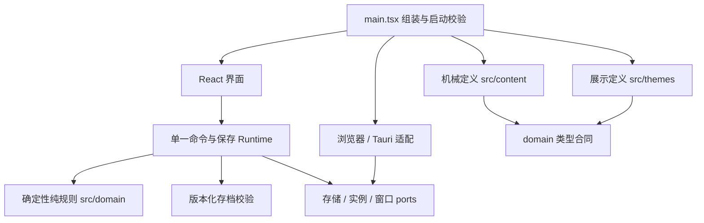
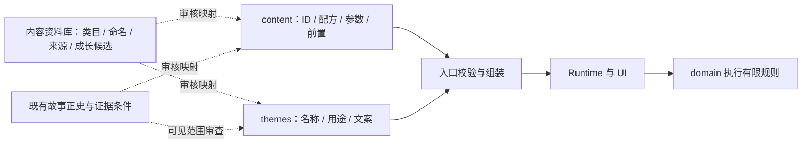

# 当前架构与轻量原型扩展边界

更新时间：2026-10-11。当前运行实现仍为产品 0.8.0 / content 14.0.0 / schema 9；下一阶段已选单主活动轻量原型。本文明确现有责任与计划扩展，未把后者写成已实现。唯一执行计划见 [PLAN](../PLAN.md)。

## 现有运行架构

`src/main.tsx` 组装 `EXPEDITION_V14_DEFINITION`，同时保留 v13 定义供显式旧档处理；v14 继承 v13 的世界/故事并加入驻地。UI 接收定义与快照，发命令而不直接调用规则后保存。app 不直接导入 content，runtime 只依赖 domain/persistence/platform ports，domain 不反向依赖外层。

| 路径                                | 当前责任                                                         | 原型扩展边界                                |
| ----------------------------------- | ---------------------------------------------------------------- | ------------------------------------------- |
| `src/domain`                        | 主空间、副本、驻地、契约、目标、事件、对话、结算与历史兼容纯规则 | 增加有限采集/制作活动合同，保留旧规则语义   |
| `src/content`                       | 世界、资源、配方、研究、故事条件等机械参数与 ID                  | 原型物品/技能/活动/配方/工具/任务包；未实现 |
| `src/themes`                        | 名称、描述、故事文案、色板与背景                                 | 通用名称与短任务文案投影，不参与扣费/解锁   |
| `src/runtime`                       | 独占启动、时间推进、串行命令、串行保存与屏障                     | 接新定义/命令，仍一次启动一个 Runtime       |
| `src/persistence`                   | 存档编码、版本、数值、ID 与领取关系校验                          | 原型 codec/隔离与以后正式兼容；未实现       |
| `src/platform/browser`              | IndexedDB、Web Locks、导入导出                                   | 原型 namespace，不能写旧档                  |
| `src/platform/desktop`、`src-tauri` | Tauri 适配、单实例、窗口/托盘、文件对话框与原子文件替换          | 原型存储隔离；若改外壳追加原生门禁          |
| `src/app`                           | 小窗界面、展示格式与主题偏好                                     | 技能/仓库/工具与全局活动条；未实现          |
| `docs/内容资料库/`、既有故事文档    | 来源、候选/批准状态、名称与内容关系                              | 编辑资料，禁止当作运行时状态或第二份计划    |

依赖与命名由 `scripts/check-architecture.mjs` 检查。新增 domain 子目录时，同步审查 content 可导入的类型路径白名单；不能为了方便关闭门禁或扩大反向依赖。

## 编辑资料、机械内容与展示的协作

资料库和正史维护编辑事实；生效机械参数只由对应版本 content 负责，生效文字由 themes 负责。没有解析 Markdown、自动生成数据、数据库或内容后台。审核映射现在依靠台账和代码评审，原型完整跨表语义检查尚待 P1。

资料记录区分批准状态、实现状态、可见范围。新故事事实先评审；候选不因写入文档变成锁定内容，作者隐藏真相不进入玩家展示。

具体规则：

- 更名/背景改动：修改 themes 及对应资料，不改稳定 ID 或存档。
- 新条目、配方、成本/阈值：修改 content，并按有限 ID 类型同步验证器；不声称只编辑资料自动生效。
- 新行为/特殊条件：修改 domain 的有限合同与实现，补定义/存档校验、必要迁移与测试；禁止把任意函数/脚本写进 content。
- 展示类目默认不持久化。若开始参与配方或容量规则，则属于机械变更。
- 正史关系与玩法判定分开；任务 ID 映射不能单靠中文相似度猜测。

资料入口见[内容资料库](内容资料库/README.md)与[故事资料库](故事资料库.md)。

## 当前内容与故事投影

旧驻地仍使用三岗位、单配方队列与材料预留；远征另有独立人员/临时资源。这是现状，不是新原型必须保留的玩法约束。

当前副本仍使用有限 `wood/stone` 引擎槽位，首世界映射到 `resource-energy-cell/resource-anchor-material` 与“能芯/锚材”。驻地 `charge-cell` 是另一份库存。改显示名不改变槽位含义，也不会自动形成跨库存转账；原型四物品必须另定合同。

当前活动故事来自 `src/content/story-v13.ts`（4 条线索、3 条线程、1 组对话）。`src/content/narrative/story-archive.ts` 的 v13 展示投影引用现有线索/世界/对话与主题文案；入口验证后只把 `{ clueId, copyId }` 白名单交给档案 UI。旧故事投影与冻结 content 仍为历史兼容保留，不能把它们计为新版故事规模。

内容条件和效果采用有限联合类型；现有世界含生存、环境和界锚等明确模式。参数化已支持的条件不需要新算法；新增温度、治疗或科技互斥等行为不能只改一张表。当前不是通用世界脚本引擎。

## 原型计划的模块边界

先建立小型类型化内容包，按技能、物品、活动、配方、工具、任务组织；是否各占一个文件按实际规模决定。行为合同见[轻量放置核心合同](规划/轻量放置核心合同.md)。以下能力尚未实现：

- 一个权威 currentActivity、明确的运行/暂停、周期进度与停止原因。
- 采集/制作共享同一主活动槽；开始/切换改变活动，浏览/选择不改变。
- 周期结束原子消费并发产物/XP；暂停保留进度，切换清零未完周期。
- 工具购买不占持续活动槽；倍率从下一完整周期生效，不重解释已推进时间。
- 任务消费既有物品，完成/奖励原子提交并防重复；故事文字只解释规则结果。
- 原型 namespace 和 codec 隔离；新浏览器/桌面档不覆盖旧主档/备份。

科技资料先在[成长与科技](内容资料库/成长与科技.md)存候选，首版不预建科技系统。是否增加分支，待已有经济与试玩证明需要。

## 存档、时间与失败恢复

以下现有工程合同继续保留：

1. 每次启动先拿独占 lease，读取/验证存档，依对应冻结版本补算或显式迁移，保存候选成功后才接受动作。首次写失败保留候选供重试，不重复收益。
2. runtime 串行动作并独立串行快照写入；旧写入 ack 不能清除更新状态的 dirty。重要动作提交成功才显示接受后的状态，失败保持可重试。
3. 导入/退出暂停新动作与 tick，取消未开始旧写，等待已开始写完；候选成功落盘才替换内存。
4. 时间由调用者注入；向后调时不发收益/不回退已确认时钟。旧副本仍遵守各自确认停点，原型另按活动材料/批次/离线上限停止，不能混用玩法停点。
5. 坏主档保留，用户显式恢复备份或导入；不静默重置。关闭窗口成功保存后再隐藏，保存并退出成功后再结束进程。
6. 存档保存稳定 ID 与规则事实，显示名、主题、派生摘要与编辑关系不入游戏主档。格式和机械内容兼容分别审查，schema 没变不代表数值补算必然兼容。

当前源码显式支持 v13→v14 等既有演进，历史定义继续保留。原型初期使用隔离档，不承诺旧资源/岗位/经验能无损转成新活动。正式迁移或新产品档须在玩法冻结后比较并确认；当前计划不预设新产品/content/schema 版本。

## 平台与验证边界

浏览器与桌面存档独立，debug/release 按各自平台约定隔离。旧《失落航标》及 IdleForge-data 与新版诸界救援局数据继续独立；原型还需增加自己的隔离边界。Windows 路径解析与原子替换由平台负责，原生 JSON 限制不代替 TypeScript 规则校验。

本轮只修改文档；未改变启动模式或存储目录。现有 exe 快照不自动代表当前 content/schema，新原型也没有构建包。

`check` 验证现有工程与资料链接；完整新原型行为要等代码落地后运行相应规则、runtime/codec、浏览器、原生与试玩验收。构建成功、文档门禁或浏览器检查均不能记作 Windows 托盘/置顶或真人体验通过。
