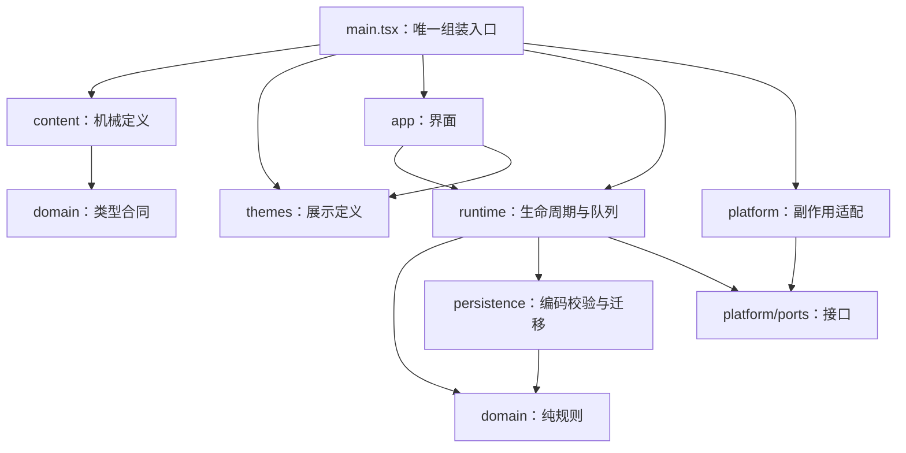

# 项目分层、目录与保存路径合同

更新时间：2026-10-12。唯一实施顺序见 [PLAN](../PLAN.md)：S0–P3、R0/R1、P4-A、P4-C 已完成并签收（P4-C 含 Windows 实机用户现场签收），当前执行 P4-D 真人试玩。本文是层、目录、数据位置和责任的唯一说明；不维护第二份进度。

**产品元数据当前仍为 0.8.0；工作分支 `src/main.tsx` 已挂载两档技能原型。** 主流程使用单一通用 Runtime 和隔离的 `skill-prototype-v1` profile；当前 content `2.0.0`、schema `2`，最高门槛为采掘 44 XP、金工 70 XP，封顶后只停止 XP、不中止生产。P3 的待确认离线回执是存档事实，不是第二份库存/XP真相；确认仅清除回执。P1 content `1.0.0`/schema `1` 与早期 P2 content `2.0.0`/schema `1` 均有显式迁移，旧 0.8 档案不被新 profile 自动读取或迁移。`check`、浏览器 E2E、原生检查与构建已通过；P4-C 隔离便携实机签收完成（置顶、托盘隐藏/恢复、退出重启恢复均为用户现场观察），原 `os error 5` 未复现且根因未定位，记录见 PLAN P4-C 节。

## 先解决哪些混乱

S0 开始时的静态基线快照（P1 切入口前）：Git 跟踪 src 94 个文件、docs 64 个文件，docs/规划 12 个文件。当时入口组装远征/驻地与旧版定义；“后来不再由当前入口直接使用”不能据此判为无用途。

S0 基线职责审查重点包括 `persistence/legacy/expedition-codec.ts`（2240 行）、`domain/legacy/expedition/engine.ts`（2210 行）和原 `app/legacy/ExpeditionPanels.tsx`（拆分前 1677 行，现已按主空间/行动界面拆分）。行数只是审查线索；后续仍按解码/验证/迁移、规则职责、界面展示与交互区分，不设机械行数指标。

旧规划存在明显版本跨度：产品打磨、0.7 玩法/交互、0.8 驻地合同与《诸界救援局》评审曾并列放在规划目录，容易被当成同时生效的要求。S0 已将 11 份旧正文集中归档，原路径只保留兼容导航；现行顺序只读 PLAN，现行技能放置行为只读轻量放置核心合同。

## 分层与允许的依赖

| 位置                          | 负责什么                                                 | 不应承担什么                               | 修改归属       |
| ----------------------------- | -------------------------------------------------------- | ------------------------------------------ | -------------- |
| src/main.tsx                  | 选择/校验机械与展示定义，创建平台和唯一 Runtime，挂载 UI | 游戏计算、历史迁移细节、任意文件路径       | 工程整合负责人 |
| src/domain                    | 状态/命令、推进、消费、解锁等确定性规则                  | 时钟/随机/DOM/网络/磁盘/React、显示文本    | 规则执行者     |
| src/content                   | 稳定机械 ID、版本、参数、配方、前置、有限效果            | 正史全文、文案、任意函数/条件脚本          | 机械内容执行者 |
| src/themes                    | 名称、解释、人物/任务展示、颜色和背景                    | 权威库存、解锁判定、扣费/奖励              | 文案接入执行者 |
| src/runtime                   | 启动独占、注入时间、动作/保存串行队列和屏障              | 自定义资源算法、直接读取资料、UI 偏好      | 工程整合负责人 |
| src/persistence               | codec、ID/版本/数值校验、显式迁移                        | OS 路径选择、偷偷重置坏档、决定主题        | 保存合同负责人 |
| src/platform/ports.ts         | 存储/实例/窗口接口                                       | 游戏规则或具体平台路径                     | 公共合同负责人 |
| src/platform/browser、desktop | IndexedDB/Web Locks/Tauri 的具体适配                     | 自行授予物品、改机械定义                   | 平台执行者     |
| src-tauri                     | 原生路径、文件原子替换、单实例、窗口/托盘、对话框        | TypeScript 游戏规则或任意用户 profile 路径 | 平台执行者     |
| src/app                       | 快照展示、浏览选择、发命令、可选展示偏好                 | 直接改游戏状态、保存游戏快照、另算解锁真相 | UI 执行者      |

app 可读注入的规则定义/快照及相应类型，不直接导入 content；runtime 只读 platform ports。content 只导入必要 domain 类型；生产代码依赖由 check-architecture 检查。新增子目录/导出时精确更新白名单，不关闭门禁或放宽全部核心层。

**legacy 分区（S1 建立，六层已完成）**：`domain/`、`persistence/`、`runtime/`、`app/`、`themes/`、`content/` 各有一个 `legacy/` 子目录，存放冻结的 0.8.0 旧实现，只供迁移与归档测试读取。现行生产代码不得 import `legacy/`，由 `check-architecture` 强制并带修复提示；`legacy/` 内部可互相引用，`*.test.ts` 放行。`ui-content-partition` 已删除该规则的目录前缀过渡白名单，违规必须为零。归档资料库交叉索引中记录的旧源码路径由 `check-narrative-docs` 接受其 `legacy/` 对应位置，路径彻底消失仍报错。

未来同类活动复用有限推进算法。新技能不需要第二个 Runtime；拆分文件不需要第二份游戏状态。当前 main 的长位置参数组装也列入 S0 审查，可在保行为前提下改善具名配置，不把重写构造函数当作新框架理由。

## 源码整理目标：保持既有顶层

现有七层和 src-tauri 继续使用，不引入 packages、第二套 app、泛化插件层或“大杂烩 shared”。只在真实职责需要时创建层内模块：

| 待落点                              | 用途                                 | 状态/建立时点                                                                                          |
| ----------------------------------- | ------------------------------------ | ------------------------------------------------------------------------------------------------------ |
| src/domain/skill-loop/              | 新技能状态、活动规则与校验           | P1 已建立；旧规则已归入 `domain/legacy/`，与现行规则物理分区                                           |
| src/content/skill-prototype-v1.ts   | 新原型技能/物品/活动/配方/工具定义   | P1 已建立；单包保持紧凑，不提前拆小文件                                                                |
| src/themes/skill-prototype-v1.ts    | 对应展示投影                         | P1 已建立；不含机械数值                                                                                |
| src/persistence/skill-loop-codec.ts | 新原型 codec/显式版本                | P1 已建立；不迁移旧档                                                                                  |
| src/platform/create-platform.ts     | 固定浏览器 profile、DB 与 lease 选择 | P1 已接入口；浏览器 namespace E2E 通过                                                                 |
| src-tauri/src/storage_location.rs   | 桌面默认/便携 profile 路径白名单     | native-check/build 通过；受限桌面写入报 os error 5，真实用户桌面运行留待 P3                            |
| 各层 `legacy/` 边界                 | 仍被导入/迁移/测试引用的历史实现     | S1 已完成六层分区（`core-partition`、`ui-content-partition`）；逐批引用核对后 `git mv`，现行代码零违规 |

expedition/outpost 等实现是 0.8 历史与兼容代码，现由 P1 技能主流程作为 `src/main.tsx` 唯一入口；不因此批量删除旧 codec/冻结定义，它们可能仍服务显式兼容、迁移、历史测试或文档。保留不等于仍向当前 profile 加载。

## S0 实际处置记录（2026-10-12）

| 原位置                                                                   | 处置与目标                                                                                                                                                                                                  | 依据、引用影响和保留理由                                                                                                                                                                   | 验证与回退                                                                                                      |
| ------------------------------------------------------------------------ | ----------------------------------------------------------------------------------------------------------------------------------------------------------------------------------------------------------- | ------------------------------------------------------------------------------------------------------------------------------------------------------------------------------------------ | --------------------------------------------------------------------------------------------------------------- |
| `docs/规划/` 下 11 份旧计划、旧玩法/界面方案、旧研究提示词、0.8 故事候选 | 正文移至 `docs/历史资料/规划快照/`；原文件名保留薄导航；新增 `docs/规划/README.md` 与历史快照索引                                                                                                           | 规划正文有交叉链接，v3 故事评审对 0.8 曾获批准，不能删除或改写成新版批准。迁移前核对了仓库 Markdown 对这些路径的引用，并把已迁移正文的相对链接改到归档目标；故事总索引明确批准范围         | `check:narrative-docs` 检查本地 Markdown 链接；旧路径到正文是一跳导航。回退可将归档正文移回原名并恢复前一版索引 |
| `src/app/legacy/ExpeditionPanels.tsx`（原 1677 行）                      | 未出发主空间拆至 `ExpeditionHubPanels.tsx`，行动中界面拆至 `ExpeditionRunPanels.tsx`；薄组装入口保留原 UI 状态；展示模型函数与共享 props 分别放到 `expedition-panel-model.ts`、`expedition-panels-types.ts` | 两个互斥界面分支原本共享单个组件；边界来自 `state.activeRun === null`，不是人为按行数切割。wrapper 保留原 tab、契约选择和建造目标状态；没有改 `dispatch`、规则、生命周期、codec 或保存路径 | `check`、`e2e`；代码无规则语义。回退可由 Git 差异恢复原单文件                                                   |
| 旧 codec、domain 规则、迁移和冻结 content                                | S0 时保留在原路径；P1 切换入口后仍由兼容/历史引用决定是否保留                                                                                                                                               | S0 盘点快照曾由入口组装远征 v14、v13 用于显式旧档处理；只保留静态与测试链能证实的模块，不把它们接入新 profile                                                                              | P1 入口与当前使用路径见下方；后续删除仍需引用复核                                                               |
| 当前/目标存档路径、`story-library/`                                      | S0 未迁移旧用户数据；P0 后建立 `story-library/README.md`，正文与游戏数据继续分离                                                                                                                            | P1 新 profile 路由仅创建/读取自己的 DB 与 profile；不探测、迁移或覆盖旧浏览器/桌面档                                                                                                       | 浏览器 E2E 与 Rust 路径/保存测试通过；未读取用户存档或启动真实桌面程序                                          |

S0 时的源码分类依据（历史快照）：入口挂载 `EXPEDITION_V14_DEFINITION`，并把 v13 交给 Runtime 处理旧档；v13 还被 v14 组合定义、迁移测试和故事归档测试导入。该证据支持兼容保留，不等于 P1 后仍在当前运行链。现在 `src/main.tsx` 组装技能原型，不读取 `docs/内容资料库/` 或 `story-library/`；后者已有独立职责索引。`.cache/`、`dist*`、`src-tauri/target/` 是门禁/构建生成位置，`artifacts/windows/` 是版本化交付快照。S0 未找到可安全移除的源文件，故该阶段代码删除数为 0。

S0 阶段门禁结果（2026-10-12 的历史快照）：当时 `check` 的 15 个测试文件/250 项通过，S0 UI E2E 11/11 通过；S0 没改 Rust/Tauri，因此未做原生构建。P1 当前门禁与更多 E2E 证据统一记录在 [PLAN](../PLAN.md)。浏览器 E2E 不代表 Windows 桌面实机验收。

S0 收尾验收判定：通过。判断依据为归档导航和代码职责静态复核、文档状态校正，以及 S0 当时工作树门禁。记录 S0 结束状态时 P0 蓝图尚未启动；后续阶段状态只见 PLAN。

本次处理前统计基线为 94 个 src 文件、64 个 docs 文件（docs/规划 12 个）；增加了 4 个 app 职责模块和两个目录索引，11 份正文进入历史区。文件总量变化本身不是瘦身指标，成果是当前规划目录不再承载重复的旧方案正文，互斥 UI 分支有独立维护位置。没有找到足以支持删除兼容/规则代码的证据，所以代码瘦身限于职责拆分。

## 文档、独立资料与交付物放哪里

| 位置                                             | 唯一用途                                        | 状态/维护方式                                                                          |
| ------------------------------------------------ | ----------------------------------------------- | -------------------------------------------------------------------------------------- |
| README.md                                        | 新执行者入口：方向、现状、命令、责任文档链接    | 保持简短，不复制阶段任务                                                               |
| PLAN.md                                          | 活动阶段、依赖、验收与唯一进度                  | 协调者整合                                                                             |
| docs/架构说明.md                                 | 分层、目录、保存路径与处置责任                  | 本文                                                                                   |
| docs/工程规范.md                                 | 编码、检查、协作规则                            | 引用本文的路径表，不再复制                                                             |
| docs/规划/轻量放置核心合同.md                    | 新玩法行为语义                                  | 有限规则合同，不写另一份路线图                                                         |
| docs/内容资料库/                                 | 工程概念、资源/成长候选、名称和包外审核映射     | 与 content 对照，非第二数值权威                                                        |
| story-library/                                   | 新故事文献、世界/人物/知识/因果的独立正文与入口 | README 职责入口已建立；候选正文未迁入/未批准；相对链接留在库内，不含 src 路径或 schema |
| docs/交接/                                       | 执行提示词、交付来源索引与职责说明              | 不塞原始大 ZIP 或每个任务的新主计划                                                    |
| docs/历史资料/                                   | 失效方案、旧产品设定、旧验收与设计依据          | 标适用版本与替代关系，只保留一个正文                                                   |
| .local-data/collaboration/incoming/              | 原始 ZIP/附件及来源指纹                         | 目标目录，忽略 Git；来源只读，不是现行资料正文                                         |
| .local-data/collaboration/working/               | WorkBuddy 等独立编辑/审阅工作副本               | 按任务/版本分目录，各作者只写自己副本                                                  |
| artifacts/collaboration/                         | 生成的阶段证据包/可分享交接 ZIP                 | 按阶段与输入版本保存，忽略 Git；PLAN 只留结论/证据指针                                 |
| artifacts/windows/                               | 已生成 Windows 包与版本证据                     | 旧 exe 是快照，不能冒充当前源码                                                        |
| .cache/、dist/、dist-desktop/、src-tauri/target/ | 临时检查/日志与构建输出                         | 忽略 Git；不当作资料源或用户数据目录                                                   |
| .tools/、node_modules/                           | 项目隔离工具链与依赖                            | 不因“瘦身”默认删除                                                                     |
| 路由控制/                                        | 独立协助工具与既有授权材料                      | 不属于游戏运行链，不默认迁移或清理                                                     |

story-library/ 中知识/证据编辑 ID 与机械 ID 分开；工程在包外维护经批准的映射、条件与可见范围。运行时不解析 Markdown。P0 已建立索引入口并扩展 `check:narrative-docs` 覆盖仓库根文档、`docs/` 和 `story-library/` 的本地链接；专门的 0.8 故事 ID/正史边界检查仍只针对其治理文档。门禁不扫描缓存、原始 ZIP 或任意个人目录。

## 当前与隔离旧存档路径：源码确认，非原生运行实测

定义 `<app-data>` = app.path().app_data_dir() 实际返回值；`<exe-dir>` = 当前启动 exe 的父目录；`<env>` = debug 为 development、release 为 release。不要猜用户机器的物理目录，Windows 路径可能重定向。本轮未启动桌面程序、读取用户存档内容或改变这些位置。

| 数据                   | 当前位置/名称                                                                                | 负责模块                              |
| ---------------------- | -------------------------------------------------------------------------------------------- | ------------------------------------- |
| 数据                   | 位置/名称                                                                                    | 负责模块                              |
| ---------------------- | -------------------------------------------------------------------------------------------- | ------------------------------------- |
| 当前浏览器主档/备份    | 当前 origin IndexedDB：skill-prototype-v1-`<env>` / snapshots / main、backup                 | browser-save-storage.ts               |
| 当前浏览器独占         | Web Lock：skill-prototype-v1:`<env>`:save                                                    | browser-instance-lease.ts             |
| 旧浏览器档（隔离保留） | IndexedDB：outpost-web-`<env>`-v1；旧 lease 为 outpost:web-save:v1，新入口不读取/迁移        | legacy browser storage                |
| 当前展示偏好           | localStorage：skill-prototype-v1:`<env>`:preferences；仅 themeId/compact                     | SkillPrototypeApp、app/preferences.ts |
| 旧展示偏好             | zhujie-rescue-bureau:`<web或desktop>`:preferences:v1；新 UI 不依赖、不覆盖                   | legacy app/preferences.ts             |
| 桌面默认 profile       | `<app-data>`/`<env>`/profiles/skill-prototype-v1/                                            | src-tauri/lib.rs、storage_location.rs |
| 桌面便携 profile       | 仅显式 --portable：`<exe-dir>`/ZhuJieRescueBureau-data/`<env>`/profiles/skill-prototype-v1/  | storage_location.rs                   |
| 桌面主档/备份/临时文件 | profile 根内 save.json、save.backup.json、save.tmp.json、save.backup.tmp.json                | save_repository.rs                    |
| 导入/导出              | 用户文件对话框选择的来源/目标；导入不等于接受为主档                                          | 两平台 storage、codec/runtime 屏障    |

浏览器 origin 也是隔离边界，改变主机名/端口不等于迁移了旧 DB。UI 偏好与游戏进度分开，偏好失败不允许清空游戏主档。默认桌面与便携是显式二选一，不探测另一目录后自动转档。

## 新原型路径合同：S0 固定、P1 实现并通过自动化验收

固定 profile ID 为 skill-prototype-v1，独立于故事品牌；environment 明确为 development/release。它是产品数据族标识，不是“每次 schema 变就新开空档”的捷径。内容/格式不兼容仍要显式校验/迁移，不得以换目录隐藏玩家进度。

| 数据               | 当前实现路径/命名                                                        | 实现状态                                              |
| ------------------ | ------------------------------------------------------------------------ | ----------------------------------------------------- |
| 浏览器主档/备份    | origin 下 DB skill-prototype-v1-`<env>`，snapshots/main、backup          | 主入口接通；E2E 创建原型库且确认旧库不替换            |
| 浏览器独占         | skill-prototype-v1:`<env>`:save，随同一 profile/environment 选择         | 隔离单测与入口 E2E 通过                               |
| 新展示偏好         | skill-prototype-v1:`<env>`:preferences，仅展示字段                       | 新 UI 使用；不读取/写入旧偏好键                       |
| 桌面默认           | `<app-data>`/`<env>`/profiles/skill-prototype-v1/                        | 白名单路径已实现；native-check/build 通过，实机待验收 |
| 桌面便携           | `<exe-dir>`/ZhuJieRescueBureau-data/`<env>`/profiles/skill-prototype-v1/ | 白名单路径已实现；native-check/build 通过，实机待验收 |
| 原型主档/备份/临时 | 新 profile 根内 save.json、save.backup.json 及相应同目录临时文件         | native 单测/构建通过；真实用户路径读写待实机验收      |
| 测试               | 测试夹具专用 DB/lease 与临时目录                                         | 浏览器旧 DB 隔离单测、真新档端到端均通过              |

profile 选择在入口/平台完成；Rust 只接受固定白名单 ID，不接受渲染层传入任意路径。机械参数不决定数据目录，UI 不另存游戏状态。启动报告/阶段证据登记最终解析的根、profile、环境、主/备份、lease 与 codec/content 版本；默认/便携与两环境都要验证无交叉写入。

同一数据根一次一个实例；并行开发不共用同一桌面 development profile，不能把进程内 Mutex 误认为所有开发进程都有跨进程独占。P1 覆盖浏览器 profile 隔离与 native 路径白名单测试；多个真实桌面进程的独占/恢复仍在 P3 实机验收范围。

## 协作的可写范围与整合

| 任务           | 可写范围                                                                                                       | 公共区处理                                                        |
| -------------- | -------------------------------------------------------------------------------------------------------------- | ----------------------------------------------------------------- |
| 唯一整合者     | 唯一 PLAN、架构/规范、入口/门禁/版本与包外映射                                                                 | 一次一项工程整合，负责合并与验收                                  |
| 工程阶段执行者 | 分配的 domain/content/themes/runtime/persistence/app/platform/src-tauri 与相应测试，在自己的 checkout/worktree | 公共合同改动在同一任务清单中说明，回传完整 diff，由整合者串行接入 |
| 故事候选       | 独立 working 目录里的 story-library 候选副本                                                                   | 不改代码/PLAN/生效数值；回传完整包、版本与差异                    |
| 资料接入执行者 | 经批准故事的展示投影和包外映射                                                                                 | 不修改故事事实或暗中加新规则                                      |

2026-10-12 起唯一整合者为 WorkBuddy（远程主线 `origin/codex/p1-first-tier`，已合并 Codex 停用前最后提交 `7aae717` 并复跑门禁）；若后续恢复分工，执行者模型不变，仍按本表隔离执行。

目录职责不是只能由某个工具永远修改；它要求本次任务有一个明确写入者。跨层必需修改在分配清单中列明，不产生反复用户审批；遇到会改变核心、格式或已批准故事的选择，回到方案比较。

每次交接写明任务/阶段、输入 HEAD 与资料版本、可写路径、公共合同变化、交付位置和唯一整合者。不用只写“负责游戏”或“负责故事”的宽泛描述。同一工作树不并行写；多个聊天不自动隔离磁盘，不能一边切分支一边让另一个任务写文件。

## 瘦身清单与验收边界

后续发现新的候选删除项时仍按“原位置→目标位置/删除→理由→静态/动态/历史/测试/构建引用→影响→检查→回退”追加证据；本轮没有证据的项保留，不写成死代码。

优先整理：失效计划正文、重复现行说明、目录入口和明确无用途模块。旧正文移动后修所有相对链接/索引，必要原路径保留薄导航；仍适用原子合同先迁入现行责任文档。兼容迁移/codec/冻结内容不能仅因较旧删掉；模块拆分保留原子行为和错误语义。

S0 阶段快照：当时入口组装 EXPEDITION_V14_DEFINITION，保留 v13 供显式旧档处理，技能原型尚未实现。P1 后当前入口及 profile 状态见本文开头与路径表；旧故事、旧副本和驻地数据仍是 0.8 历史/兼容内容，不自动并入新玩法。

S0 的整理验收确认一个入口/Runtime、依赖方向、主/备份与导入/关闭屏障、历史加载与文档引用；当时不执行 codec/content 删除、存档迁移、新原型保存路由或原生验收。后续 P1 已按独立 profile 实现路由并通过相应自动化门禁；各阶段证据见唯一进度源 PLAN。
