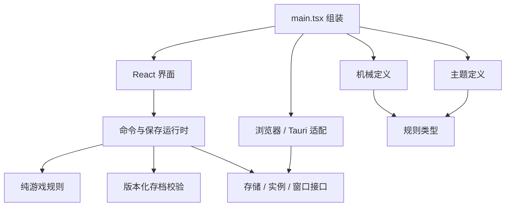

# 当前架构

## 各目录的责任

| 路径                   | 责任                                                                                 |
| ---------------------- | ------------------------------------------------------------------------------------ |
| `src/domain`           | 原型兼容规则，以及主空间、副本、怪潮、调查、契约、目标、事件、项目、对话与结算纯规则 |
| `src/content`          | 世界资源/建筑/怪潮/永久能力/契约目标事件项目机械参数与稳定 ID                        |
| `src/themes`           | 世界/目标/事件/项目/故事显示文案、色板、背景引用与主题校验                           |
| `src/runtime`          | 独占恢复、时间推进、命令队列、版本化保存队列、导入导出/关闭屏障                      |
| `src/persistence`      | 存档编码、版本/数值/ID/领取关系校验                                                  |
| `src/platform/browser` | IndexedDB 原子主档/备份、Web Locks、文件导入导出                                     |
| `src/platform/desktop` | Tauri 命令和窗口生命周期适配                                                         |
| `src/app`              | 小窗口界面、显示格式、主题偏好；不直接写游戏状态                                     |
| `src-tauri`            | 单实例、托盘、原生文件对话框、固定目录存档与 Windows 原子替换                        |

## 扩展主题与背景

主题可以替换工具名称、阶段描述、事件文案、色板和背景。新增主题需实现 `GameTheme`、通过 `validateTheme`、加入 `GAME_THEMES`。静态背景放在 `public`，引用本地图片路径；不需要改规则或存档。背景资源先校验来源和使用许可，再加入项目。

当前前哨站/星尘是展示主题，切换不影响森林/古城世界。世界资源与规则进入 `ExpeditionDefinition`，主线条件进入 `StoryDefinition`，显示文案另存 `src/themes`。副本内容已拆成 `contracts`、`objectives`、`events`、事件 `options` 与 `projects`：合同只列本局必做和可选目标，事件选项引用项目，项目引用目标和事件选择。运行时摘要派生目标进度/待处理事件/可用项目，界面仅发命令，不维护第二份事实。

故事档案有一份受审的展示投影：`src/content/narrative/story-archive.ts` 引用现有线索、来源世界/对话和主题文案 ID；`main.tsx` 启动时校验后，把 `{ clueId, copyId }` 白名单传给故事 UI。它覆盖当前代码里的故事线索和玩家可见文案，不解析 `docs/`，不包含候选世界或作者隐藏真相；这不是完整交叉索引图或 LLM 上下文。

内容配置支持建造数量、通过波次、完成项目、环境节点数与发电机完整度等有限目标条件。雪站使用独立环境模式合同；扩充条件联合类型时必须同时实现纯规则判定、配置校验、存档校验与迁移。温度/护送等新机制仍不能只改 JSON；当前没有任意脚本执行器或通用插件运行时。

## 存档与时间

主档只存规则事实。每个会话先拿独占 lease，再读取、校验、补算离线收益、保存候选，成功后才接受操作。首次写失败保留同一候选供重试，避免重复结算。向后调时不发收益、不回退时钟。生存副本止于下一波待确认节点；雪站止于下一环境/危险确认节点；额外离线时间只消费一次，不带入后续波次或节点。

运行时串行动作，独立串行快照写入；旧 ack 不能清除新 dirty。入本、建设、战斗、调查、对话、永久兑换、回归等重要变化先成功落盘再显示，失败保留原状态供重试。导入/退出暂停新动作和 tick，取消未开始旧写，等已开始写完成，再处理固定快照。候选存档保存成功才替换内存；失败维持原进度并补算等待时间。

坏主档保留，用户显式选择恢复备份或导入；恢复写入保留原备份。导出内存快照不依赖主档写成功。关闭窗口先成功保存再隐藏到托盘；保存并退出先成功保存再结束进程。

IndexedDB 和桌面文件档案独立，不会因打开浏览器预览覆盖桌面进度。桌面 debug/release 也分别存档。浏览器页面关闭是尽力保存，桌面关闭才有可等待的原生屏障。

`SaveBundle` 同时记录永久 Profile、一个临时 Run、最后 Settlement、原型 legacyArchive 与时间。结算将积分、线索、通关事实、已完成目标、契约、去重序号及结束副本一次写入。旧 v1 按原合同校验后保留全部规则事实，迁移为空的新主空间，不将旧材料转换成积分。

v0.3 存档为 schema3/content3.0.0；v4 引入 schema4/content4.0.0。内容 5.0.0 至 11.0.0 的冻结定义分别用于旧档补算和显式迁移。当前产品为 0.7.1、schema7/content12.0.0：包含研究准备、命名返场变体、雪站环境模式、三条可组合难度条款、每世界两条受控随机事件、人员转岗期和 10 秒手采冷却。v11 活动副本先按冻结 v11 规则补算再迁移；迁移后不追溯条款、转岗或随机事件。旧 v1 原型及后续 schema 的显式适配继续保留。Windows 原生置顶/托盘/保存重启交互仍待真实桌面验收。

Windows 默认存档目录会解析真实物理路径后建立主档/备份/临时文件，避免 MSIX 的跨盘路径重定向导致 os error 17。`--portable` 明确选择 exe 旁边的 `IdleForge-data`；不静默降级到其他文件夹。原生只做 JSON 语法与 8 MiB 上限校验，不决定规则或自动迁移字段。

## 当前范围

实现本机单人闭环、三个世界、序章主线与支线调查、有限永久能力和可替换主题。森林、古城共享营地与怪潮基础规则；雪站使用燃料、温度和设备修复。v12 受控事件池不等同程序化副本生成：事件仍由稳定内容 ID 与条件定义，种子由 runtime 注入并保存，domain 确定性选取。未接账号、云端、手机同步或 Sites 发布，未加任意脚本执行器、ECS 或插件系统。

开放式副本素材组合和受约束的 LLM 临场事件目前没有组合器、模型 port 或在线服务。《失落航标》时期的旧设计已归入[历史副本资料库](./历史资料/失落航标-v12/副本资料库/README.md)，不构成当前《诸界救援局》的实现计划；当前故事资料入口见[故事资料库总索引](故事资料库.md)，架构与存档行为仍以本文件前文和代码为准。

四人调度、20 秒转岗期、产出与防御路线、提前迎战、难度条款与事件抽选均属于纯规则；时间和随机种子由 runtime 注入，UI 经同一 runtime 发命令。资源面板用实际账目做图，不引入额外时钟或保存通道。独立故事创作依据为[故事线设定集](故事线设定集.md)。Windows 构建输出带版本号的 exe，启动文件指向最新版，同一便携数据目录继续复用；旧程序仍运行时必须先保存退出再切换。
