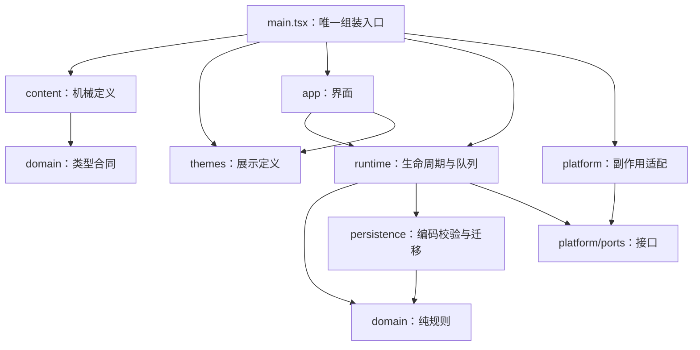

# 项目分层、目录与保存路径合同

2026-10-20视图补充：CivIdle逻辑Grid/稳定tile不变，`sandbox-art-catalog.townScene`把槽位投影为固定场景锚点；原图→统一帧→原图集，DOM缩略图引用同一源。此层不维护机械状态，也不存进度。最新产品为舒适放置，风险可选，详见根PLAN。

更新日期：2026-10-19（D1-C 落点）。唯一实施顺序见 [PLAN](../PLAN.md)。本文是层、目录、数据位置和责任的唯一说明；不维护第二份进度，不记载已删除的历史阶段。

## 2026-10-19：网页版优先与原型边界

当前营地以电脑浏览器/手机网页为主，复用现React/Pixi/原Grid、IndexedDB和单推进/命令/保存路径。Windows原生接入移出主线，不作为时代扩展的前置；网页迭代不增加Rust/Tauri/托盘或旧原型全套检查。旧桌面代码、存档与标识保留，只有明确维护时才适用其合同。普通模式沿既有4h离线自动积累；致死风险/重大事件暂停仅保留后期自愿挑战，也不启用账号或云同步。

## 2026-10-17：新旧工程适用范围

用户已选择采用开源底座改造发展沙盘。本文下面的 `src/**`、`GameRuntime`、内容管线和数据路径是**现有根目录技能原型合同**，继续保护其原入口与数据；不是要求把 CivIdle 全仓迁成相同目录。

- `next/profectus/`：已存在的隔离样机，保留作对照，不作为本次继续实现入口。
- `next/civ-idle/`：已完成 D0、D0-R 与 D1-A/B/C 的采用底座，保留上游 `shared/`、`src/scripts/` 和 React/Pixi。D1-C（工坊时代、三项许可、五基础建筑 2 星与 Lv20）已交并本地验证；当前按 PLAN 先V1网页适配与视觉体验，再C2，D2完善固定场景与时代风貌。V1沿原Grid/Camera/resize、单推进/命令/保存链和唯一catalog改善布局/镜头/展示，不新增状态框架；合同见[适配规格](设计/网页适配与视觉体验规格.md)。原版模块不为满足旧原型命名门禁全部重写；约定浏览器验收不代替 Windows 实机。
- A0 已建立 `next/civ-idle/art-preview.html` 独立只读外观入口，实际导入链与游戏启动/保存链分离，不创建 GameTicker；执行方数据访问检查与本轮源码复核范围见 [A0 复核](证据/发展沙盘/A0/复核-20261017.md)。它使用纯展示清单与资产，后续由 D1/D2 接到真实场景，不是另一套游戏运行时。状态以 PLAN 为准，不能代替 D0-R 数据修复。
- 自行新增的命令适配统一调用底座合法操作；规则/数值/展示不另建重复真相，外部时间与 IO 留在适配层。不能将上游循环与旧 GameRuntime 双重装配。
- 新工程独立包、锁、origin、namespace `development-sandbox-v1`。IndexedDB 同名库 `keyval` 保留字符串快照及 `.savedAt` 两键，同事务提交；内存/磁盘时间边界与 loading/recovering/ready/failed 生命周期控制推进。后台恢复先冻结新常规保存并等待旧队列完成，再补算、受控提交和开放推进；failed 状态拒绝残留任务。约定范围见[最新验收](证据/发展沙盘/D0-R/收口验收与全局评估-20261017.md)。D1 延续这些屏障，格式/机械内容变化显式迁移，不因换UI重建保存链。
- 根入口与旧技能数据不迁移、不覆盖；Tauri identifier 仍为 `org.zhujie.rescuebureau`。桌面接入与独立 profile 在 D3 方案确认后实施。

新行为以[发展沙盘首版规格](规划/发展沙盘首版规格.md)为准；进度与停止条件只看 PLAN。D0 的真实模块映射写入对应证据，待确认后再补本架构的新工程实际路径，不提前虚构模块。

## 2026-10-18：新沙盘内容与展示管理

依据[现成方案调研](规划/内容与资源管理调研-20261018.md)与[扩展规格](规划/文明式放置沙盘扩展规格.md)，沿用React/Pixi/Vite/CivIdle。下表按A/B及C1实际落点更新；晋升/时代等C职责明确为后续设计，不另建游戏状态源或通用编辑器。结果见[B交付](证据/发展沙盘/D1/B/README.md)。

| 位置                                                                                                        | 责任与边界                                                                                                                |
| ----------------------------------------------------------------------------------------------------------- | ------------------------------------------------------------------------------------------------------------------------- |
| 现有 `shared/definitions/*`、`shared/logic/Config.ts`                                                       | 建筑配方/建设基值、资源与 Upgrade 成本/效果的唯一机械定义，首版基于现有类型扩展。                                         |
| `shared/sandbox/camp-content.ts`、`camp-profile.ts`                                                         | A/B/C1采集/仓容/八建筑配方/食水人口与版本参数、Config一次安装、初始化与显式迁移/校验；研究成本/效果只在原Upgrade定义。    |
| `shared/sandbox/gather-rules.ts`、`camp-time.ts`、`camp-skills.ts`、`camp-economy.ts`、`camp-population.ts` | 纯采集/时间/技能周期规划、作业/XP表与原状态上的经济前置/库存投影；不持有第二库存，不访问DOM/时钟/磁盘。                   |
| `shared/sandbox/camp-map.ts`                                                                                | 原Grid与稳定slot/Tile ID映射，HQ+六初始位+四相邻位，expanded控制开放；不以图片坐标充当机械地图。                          |
| `src/scripts/sandbox/camp-commands.ts`、`camp-training.ts`                                                  | 单命令队列接采集/建造/训练/研究/升级/暂停/优先级；原postTickTiles在线/离线推进作业，复用原库存/施工/保存。                |
| `src/scripts/art/camp-assets.ts`、`camp-tile-art.ts`、唯一catalog                                           | 基础地块与五建筑Lv1/Lv5展示段、暂停/灌溉真实刷新，原TileVisual生命周期保留；图与机械分开。                                |
| `src/scripts/ui/sandbox/`、`src/css/sandbox-tokens.css`                                                     | CampHud/Tile/Skills/Research/Population/Settings读取原快照/IO与薄选择器，统一发命令；沿Singleton原路由，不创建进度store。 |
| `scripts/prepare-atlases.mjs`、`vite.config.ts`                                                             | 复用既有spritesmith生成器，等待PNG/JSON后再类型检查，Vite加载sandbox atlas；生成文件精确忽略，无新增依赖。                |
| `shared/sandbox/camp-goals.ts`、`camp-goal-plan.ts`                                                        | 下一步目标：纯决策（顺序/文案）与数据装配分离；只产出导航目标，不下单、不付费、不切训练。                                  |
| `shared/sandbox/camp-migration.ts`、`camp-queue.ts`、`camp-stock.ts`                                       | 版本分类与纯字段迁移、串行任务队列、六资源单次库存聚合；均无时钟/IO/浏览器依赖，可在 Node 直接测试。                      |
| `shared/sandbox/camp-offline-summary.ts`、`camp-status.ts`                                                  | 只读回访摘要与训练/采集/库存/时代投影；数据只来自原快照，不持有第二状态源。                                                |
| `tests/_load.mjs`                                                                                          | 递归加载 shared 纯模块的测试入口；禁止测试直接拉入 `src/scripts` 应用壳层，迫使可测逻辑留在 shared。                       |

原图/运行图/生成图集的确切目录和引用只见[美术规格](设计/沙盘美术接入规格.md)，科技、建筑、区域数值与状态只见[首版规格](规划/发展沙盘首版规格.md)，不在本架构另列成本表。

**当前状态落点**：建筑/库存继续只在原GameState.tiles，施工沿level/desiredLevel/status。GameState.developmentSandbox为schema5/content `d1-c-1`，含版本、manualGatherReadyTick、offlineRemainderSeconds、四技能skillXp、可空training、expanded、population、profile级era（pioneer/workshop）以及每座自有建筑的sandboxRank（1/2星，HQ不参与）。population保存成年人口、移入进度/总数、实际食水满足率/累计消耗、求援就绪tick，不另存居民列表或钱包。研究完成只在原unlockedUpgrades三项稳定ID。A1/A2原HQ/Lv0–1农田同速率可达状态显式迁移，身份/材料/冷却保留，训练初始化空；C1在旧B补算后迁移，旧不足一秒余量作废，正常C1余量保留；D1-C 在 C1 旧规则结清后补 era 与 sandboxRank=1，不清等级/库存/人口/训练。版本判定集中在 `camp-migration.classifyCampSaveVersion`；不换玩家库。未来/坏档先拒绝，不覆盖原字节。

**成长设计落点**：C1已接相邻地块权限/人口与生存事实；D1-C 已接 sandboxRank 与时代，不复用 BuildingTier。基础建筑 1 星上限 Lv10、2 星 Lv20（`campLevelCap` 按实例星级），民生设施保持 Lv5；仓库 Lv2 仍需仓储组织。技能等级从 XP 投影，原始研究/建筑/钱包不复制到第二状态源。

**主动采集**：按最新首版合同增加gather，收益进入原合法库存；全营地共享的 `manualGatherReadyTick` 是同一GameState事实，不是UI时间/体力币。资源与冷却同快照，失败不发/不消耗机会；离线仅让按钮重新就绪，不执行自动代点或积攒领取次数。首批数值和合法目标只见首版规格，架构不重复收益表。

**命令入口**：同一camp-commands队列已接gather/build/train/research/upgrade/pause/priority/expand/relief；先检查ready/隐藏/白名单/条件，再同步改事实并沿原saveGame提交。研究从已完成设施原库存完整扣费，排除施工/在途材料；等级只设原desiredLevel逐级供料；被动仓储不提供无意义的暂停/优先级。技能通过原postTickTiles调用camp-training，每模拟秒在线/离线共用，产物/耗料/XP同次完成，不另开timer或钱包。promote/enter-workshop/expand 均已接入；`promote` 完整校验后一次性扣费、保留等级，`enter-workshop` 无货币无等待、不自动升星。C0正常UI移除pause/priority，原命令留兼容与旧暂停档恢复。

**内容安装与缓存**：自有配置在启动的一处安装，追踪真实初始化顺序，保证价格、哈希、科技映射和成本缓存使用同版内容；必要时明确重建相关缓存。不在 React 渲染中改 Config，也不为实时编辑数值增加热更新系统。`IBuildingDefinition.max` 是同类建筑数量限制，不是建筑等级上限；等级用 profile 规则与命令共同限制。

**连续成长适配**：B已在IBuildingDefinition增加可选costGrowth，由自有profile安装1.18，原getBuildingCost集中计算×10，其他profile默认1.5；UI沿原getTotalBuildingCost。原升级/IO/运输保留，研究灌溉沿原buildingMultiplier加法；仓库每建成等级增加HQ200容量；C1的HQ Worker由人口唯一投影，旧固定20仅用于无population的B补算兼容。C1在原getAvailableWorkers跳过原幸福度倍率，以免与食水重复影响；原getSortedTiles按食水/基础资源自动排序，不新增分配器。技能初段阈值/作业/收益在camp-skills，XP只提高专注训练，不隐式叠到建筑IO。星级modifier与时代能力已由 D1-C 接入：四生产设施 2 星输出 +0.20 走原加法倍率（农田含灌溉 1.45），仓库每完成等级 200→300 且 HQ 基础 200 不乘；IO 缓存键含 rank，晋升即时生效。

**保存边界**：静态资源路径、CSS token、科技节点坐标、选中/悬浮/面板展开不写玩法进度。新增机械事实进入现有快照，与其时间原子提交；格式/内容版本变更先明确识别现有 D0 数据和迁移，不能换 namespace 当迁移。既有偏好仅沿原选项能力管理，不新增一条玩家保存队列。旧根技能/Profectus 数据维持隔离。

**图表与编辑工具**：六研究的玩家视图是数据投影，可用DOM/SVG，单屏不够再复用已装React Flow/Dagre，不先建编辑器。十建设位用类型化地图表；更多连通土地仍沿原Grid，Tiled仅为未来作者工具候选。

**完整产品扩展**：F01–F18与原六分支36项＋民生6项候选见[产品目录](规划/产品功能与科技目录.md)，首批六项不作为全局上限。只将当前内容包安装入机械定义，未实施的天气/污染/储能/回收不预建状态。等级/星级/时代上限来自内容表，不在组件写死四时代/40级；后续仍沿同一升级、研究、IO与保存路径。原 `getPowerRequired` 为4的电气化等级次幂，D6须核对与新连续等级/供给的匹配，不能因已有电气化接口就直接套到50级。

**单营地扩展与后续环境**：用户已明确选单个营地持续扩建。沿当前city、单一tiles/getGrid新增连通地块，镜头平移/缩放，不实现分区切换页、多城钱包或跨城物流。原地块组ID管理边界/适建，不代表独立沙盘。天气日程、片区污染与本地工作模式在后续阶段进入同一机械快照，按模拟tick推进，不按页面打开重抽。净速率/环境来源读取真实规则结果；原Worker不足整栋停产与需求取整须明确适配，不能用UI比例条替代。具体机制只见扩展规格。

前轮49项素材与25组旧研究稿保留；C1补两枚SVG后当前catalog为51项/35世界PNG。B新增campBuildingViews五建筑等级段，C1接三民生组合，D1-C的2星结构与工坊氛围为Pixi代码原型；具体结果见[D1-C交付](证据/发展沙盘/D1/C/交付.md)。V1先统一当前界面与结构辨识，D2补剩余正式资产，不以源素材数代替完成度。D0-R与A的恢复/保存屏障、启动不赠tick、亚秒离线余量与4h上限延续。

## 分层与允许的依赖

| 位置                          | 负责什么                                                 | 不应承担什么                               | 修改归属       |
| ----------------------------- | -------------------------------------------------------- | ------------------------------------------ | -------------- |
| src/main.tsx                  | 选择/校验机械与展示定义，创建平台和唯一 Runtime，挂载 UI | 游戏计算、任意文件路径                     | 工程整合负责人 |
| src/domain                    | 状态/命令、推进、消费、解锁等确定性规则                  | 时钟/随机/DOM/网络/磁盘/React、显示文本    | 规则执行者     |
| src/content                   | 稳定机械 ID、版本、参数、配方、前置、有限效果            | 正史全文、文案、任意函数/条件脚本          | 机械内容执行者 |
| src/themes                    | 名称、解释、展示文案、颜色、图标素材                     | 权威库存、解锁判定、扣费/奖励              | 文案接入执行者 |
| src/runtime                   | 启动独占、注入时间、动作/保存串行队列和屏障              | 自定义资源算法、直接读取资料、UI 偏好      | 工程整合负责人 |
| src/persistence               | codec、ID/版本/数值校验、显式迁移                        | OS 路径选择、偷偷重置坏档、决定主题        | 保存合同负责人 |
| src/platform/ports.ts         | 存储/实例/窗口接口                                       | 游戏规则或具体平台路径                     | 公共合同负责人 |
| src/platform/browser、desktop | IndexedDB/Web Locks/Tauri 的具体适配                     | 自行授予物品、改机械定义                   | 平台执行者     |
| src-tauri                     | 原生路径、文件原子替换、单实例、窗口/托盘、对话框        | TypeScript 游戏规则或任意用户 profile 路径 | 平台执行者     |
| src/app                       | 快照展示、浏览选择、发命令、可选展示偏好                 | 直接改游戏状态、保存游戏快照、另算解锁真相 | UI 执行者      |

app 可读注入的规则定义/快照及相应类型，不直接导入 content；runtime 只读 platform ports。content 只导入必要 domain 类型；生产代码依赖由 `check:architecture` 检查。新增子目录/导出时精确更新白名单，不关闭门禁或放宽核心层。

`GameRuntime` 是完全泛型的单运行时：单一动作队列、单一保存队列、启动/恢复屏障语义不变；domain 通过 `RuntimeDomain` 注入，不存在第二份运行时。新技能复用同一推进算法，不新建 Runtime、不建第二状态源。

## 源码结构

| 待落点                                             | 用途                                  | 状态                               |
| -------------------------------------------------- | ------------------------------------- | ---------------------------------- |
| src/domain/skill-loop/                             | 技能状态、活动规则、回执与校验        | 唯一规则实现                       |
| src/content/data/*.json                            | 当前 content 机械数据（4.0.0 起）     | 唯一事实源；主入口经 loader 装配   |
| src/content/load-prototype-content.ts              | JSON→SkillLoopDefinition 组装         | 派生初始记录；不含手写数值         |
| src/content/skill-prototype-v1.ts                  | content `1.0.0` 冻结定义              | 仅作迁移源，不直接装配             |
| src/content/skill-prototype-v2.ts                  | content `2.0.0` 冻结定义              | 仅作迁移源，不直接装配             |
| src/content/skill-prototype-v3.ts                  | content `3.0.0` 冻结定义              | 仅作迁移源，不直接装配             |
| src/themes/skill-prototype-v1.ts                   | 展示文案与主题校验                    | 与 content 同版本演进              |
| src/themes/assets/                                 | CC0 图标/界面素材                     | 素材许可随台账登记                 |
| src/persistence/skill-loop-codec.ts                | codec/显式版本                        | schema 与 content 版本联动         |
| src/persistence/skill-prototype-save-migrations.ts | 显式加法迁移                          | 新增内容版本必须配套迁移           |
| src/runtime/game-runtime.ts                        | 泛型运行时（队列/屏障/恢复）          | 只有 `createConfiguredGameRuntime` |
| src/runtime/skill-loop-runtime-domain.ts           | skill-loop 的 domain 装配             | 唯一玩法域装配                     |
| src/platform/create-platform.ts                    | 浏览器/桌面 profile、DB 与 lease 选择 | 入口装配                           |

0.8 旧玩法（远征/驻地/故事）、旧主题、旧 UI 与旧 codec 已于 2026-10-13 按用户决定删除；git 历史保留。删除前引用审计确认：旧通用层只服务已移除的 0.8 装配，`GameRuntime` 重构后无残留依赖。

## 内容管线（JSON 单一事实源）

参照 Melvor Idle（gameData.json + schema）与 IdleFantasy（assets/data 按域 JSON）的数据驱动模式：

- **内容即数据**：`src/content/data/` 按域分文件（profile/skills/items/activities/recipes/tools/tool-upgrades），Vite 静态导入进 bundle，无运行时 IO。当前 12 技能；技能超过 15 个时拆 `skills/<id>.json`。
- **可选规则字段**：`offlineFuel`（离线上限燃料）、`shopOffers`（即时兑换）、`SkillLevel.effect.globalSpeedBonusPermille`（全局加速）、`ConsumableEffect.xpMultiplierPermille`（经验增益）都由数据声明，引擎按存在与否生效。
- **加载器不存数值**：`load-prototype-content.ts` 只做 JSON→类型组装与初始记录派生（零值/工具 Lv1），新增物品/技能/工具只改各自的 JSON。
- **两道校验**：`scripts/validate-content-json.mjs`（结构 schema、交叉引用、不变量——配方唯一使用、XP 单调、工具升级路由、每物品有来源、无解锁自锁）纳入 `check`；`validateSkillLoopDefinition` 在组装时兜底。
- **主题同批**：`validateSkillPrototypeV1Theme` 要求文案与 content ID 精确匹配，新内容必须同批补 `src/themes`。
- **版本与迁移**：机械变更 bump contentVersion 并配显式迁移；同 schema 内的内容增量（如 3.0.0→4.0.0）保留全部状态事实只零值初始化新键，跨 schema 才清回执类字段。

## 文档与交付物放哪里

| 位置                              | 唯一用途                                     |
| --------------------------------- | -------------------------------------------- |
| README.md                         | 新执行者入口：方向、现状、命令、文档链接     |
| PLAN.md                           | 活动阶段、依赖、门禁约定与唯一进度           |
| docs/架构说明.md                  | 分层、目录、保存路径与处置责任（本文）       |
| docs/工程规范.md                  | 编码、检查、协作规则                         |
| docs/规划/                        | 行为合同与底座调研；阶段状态只在 PLAN        |
| docs/内容资料库/                  | 当前营地命名/生产/成长/建筑/语言/素材/参考；非第二机械数值权威 |
| docs/交接/                        | 执行提示词与职责说明                         |
| .cache/、dist*、src-tauri/target/ | 临时检查/日志与构建输出（忽略 Git）          |
| .tools/、node_modules/            | 项目隔离工具链与依赖                         |
| artifacts/windows/                | 版本化交付快照；旧产物不能冒充当前源码       |

## 当前与隔离存档路径

定义 `<app-data>` = Tauri app_data_dir 实际返回值；`<exe-dir>` = 当前启动 exe 的父目录；`<env>` = debug 为 development、release 为 release。

| 数据                   | 当前位置/名称                                                                 | 负责模块                              |
| ---------------------- | ----------------------------------------------------------------------------- | ------------------------------------- |
| 浏览器主档/备份        | origin IndexedDB：`skill-prototype-v1-<env>` / snapshots / main、backup       | browser-save-storage.ts               |
| 浏览器独占             | Web Lock：`skill-prototype-v1:<env>:save`                                     | browser-instance-lease.ts             |
| 展示偏好               | localStorage：`skill-prototype-v1:<env>:preferences`（仅 themeId/compact）    | SkillPrototypeApp、app/preferences.ts |
| 桌面默认 profile       | `<app-data>`/`<env>`/profiles/skill-prototype-v1/                             | src-tauri storage_location.rs         |
| 桌面便携 profile       | 仅显式 --portable：`<exe-dir>`/`<env>`/profiles/skill-prototype-v1/           | storage_location.rs                   |
| 桌面主档/备份/临时文件 | profile 根内 save.json、save.backup.json、save.tmp.json、save.backup.tmp.json | save_repository.rs                    |
| 导入/导出              | 用户文件对话框选择的来源/目标；导入不等于接受为主档                           | 两平台 storage、runtime 屏障          |

版本冻结说明：Tauri identifier `org.zhujie.rescuebureau` 决定默认存档根目录，改名会孤立玩家进度，因此冻结；版本号与显示命名统一走 package.json/tauri.conf.json/交付脚本。旧 `zhujie-rescue-bureau:*` 偏好键不读、不覆盖；旧浏览器/桌面 0.8 数据目录保持原状，不探测、不迁移、不删除。

同一数据根一次一个实例；并行开发不共用同一桌面 development profile。UI 偏好与游戏进度分开，偏好失败不允许清空游戏主档。默认桌面与便携是显式二选一。

## C0网页导航与后续生存边界

实际新增ui/sandbox/camp-navigation.ts只保存内存Tab/选地，沿原Singleton路由；CampSettingsPage调用原saveGame后导出已提交原始字节，不创建设置存档或第二保存链。机械schema/content不变，页面Tab切换不改ticker。Route面板加ARIA语义后，用sandbox局部CSS隔离上游XP主题样式，WorldScene初始镜头适配新导航高度。

C1已在同一GameState管理抽象成年人口，劳力替代固定HQ/住房Worker供给，口粮/饮水沿原库存集中扣一次。年龄/健康队列、季节/风险/事件种子和pendingEvent仍是后续设计；它们须与机械快照原子保存，规则不访问时钟/随机API，外层注入确定输入。重大事件暂停将是玩法事实，与loading/recovering/ready/failed存储生命周期分开；暂停时不推进任何产出，解决事件后墙钟重新锚定，不补等待收益。具体行为见[生存合同](规划/生存经营与事件体系.md)，不将C1人口基础误称完整生存系统已完成。

## C1实际接线

新增shared/sandbox/camp-population.ts为纯人口需求/移入/劳力与校验，数值在camp-content；src/scripts/sandbox/camp-survival.ts在原postTickTiles中执行集中食水扣费，沿原完成设施库存，和训练/生产同一tick。migrateCampToC1在Bootstrap旧离线结束后执行并由既有快照+savedAt事务提交，失败不启动ticker。旧亚秒余量到内容边界作废，正常C1余量照常保留。当前没有季节、年龄/死亡或pendingEvent状态，前述未来设计不能误读成已编码。

House移除原食水/Worker配方，仅按已完成等级提供床位；Aqueduct/Bakery沿原IO/运输薄适配。唯一catalog新增三民生组合与2枚代码SVG，原49项源不改。实际结果见[C1交付](证据/发展沙盘/C1/README.md)。
