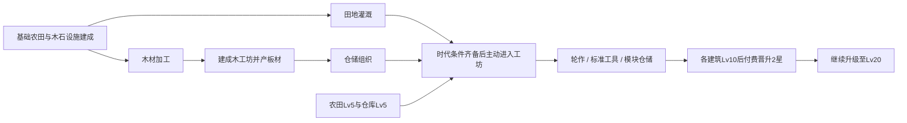

# 发展沙盘首版规格

**2026-10-19实施入口**：C1/C1-R主体已交，当前D1-C的冻结采用值、版本边界与范围见[D1-C工坊成长采用合同](D1-C工坊成长采用合同.md)及根[PLAN](../../PLAN.md)。本批五基础建筑2星/Lv20，技能仍Lv10，三个民生设施仍Lv5，离线4h；首次扩地已由C1实现。下文未更新的首版扩地费用/地块管理/8h与技能扩段草案不覆盖当前采用值；本批已实现并本地验证，结果见[D1-C交付](../证据/发展沙盘/D1/C/交付.md)，正式美术与真人平衡未完成。

更新：2026-10-18。本文是完整D1产品/行为合同，阶段状态只在根PLAN，不维护第二计划。A/B已接真实技能、五建筑、前三研究与Lv1–10；工坊成长已由 D1-C 实施，C2+ 的未来内容仍为建议；数值未做真人长期平衡。来源与取舍见[调研](内容与资源管理调研-20261018.md)，当前采用值与迁移见[B交付](../证据/发展沙盘/D1/B/README.md)。

**A实际采用值与偏差记录（保留时点）**：A仅一座Lv1农田，HQ200容量、木1/石0.5/粮1共享10模拟秒、农田10木/0.20粮每秒。当前B已扩展技能、五建筑、前三研究与Lv1–10，实际采用下文B补充，见[B交付](../证据/发展沙盘/D1/B/README.md)。A报告是历史切片，不能当当前仍只开放农田；C/D2其余数值仍为建议。

**最新范围修订**：A/B机械基线不改；C0已将日常建筑操作简化为自动运行，移除暂停/优先级按钮，旧暂停档仅留恢复入口。新增食物、住房、抽象人口与季节/重大事件以[生存合同](生存经营与事件体系.md)为准，取代下文旧长线“不增加人口”的限制。首次四位扩地前置C1，原D1-C工坊/晋升接续其后；本文的五建筑/四资源/六研究指原经济成长包，不是全产品上限。

**C1当前采用**：本轮已接八建筑/六资源、首次扩地、自动食水消耗、床位/人口移入和真实民生页；具体数值与迁移边界只见[C1采用合同](C1食物与人口采用值.md)，实际证据见[C1交付](../证据/发展沙盘/C1/README.md)。本文以下A/B和原D1-C五基础建筑成长表仍保留其范围，不能把旧HQ Worker20当作当前额外人口供给；当前 schema5/content `d1-c-1`，工坊与升星已由 D1-C 接入。

## 目标与范围

### B补充：技能与营地经济融合（2026-10-18）

用户授权下一阶段并要求增加Melvor式技能。参考[Melvor入门指南](https://wiki.melvoridle.com/index.php?title=Beginners_Guide)的采集→加工与被动农事、[官方v1.2说明](https://news.melvoridle.com/major-update-v1-2/)的后台/离线技能接续。Wiki正文部分403，引用范围限检索可见段落与官方说明；不声称读取最新全部公式，不复刻其完整熟练度池。

保留文明式营地扩张，并加入四技能：伐木、采石、农事、木工。一次专注一项作业，建筑继续自动并行。玩家选择作业→每若干模拟秒完成→原库存入库/实际耗料→技能XP→等级解锁更高作业。初段Lv1–10，不是全产品上限；技能经验与建筑等级分开，不引入角色总XP、逐人居民或第二熟练度货币。

数值只在camp内容/技能表安装：累计XP阈值0/20/55/110/190/300/450/650/900/1200；每技能等级给训练收益+2%，不直接叠到建筑IO。伐木/采石各三种作业，农事/木工各两种，Lv1/3/6逐步开放；农事需已建农田，精耕需灌溉，木工需加工研究与建成木工坊。手动协助保留10模拟秒共享节奏，成功附1点对应技能XP，自动建筑不额外刷训练XP。

作业进度按原postTickTiles每模拟秒推进，仓满/原料不足/设施暂停时无产出、无XP与无扣费，显示原因；切换作业清空未完成部分，同一作业重复开始不重置。技能进度/材料/XP同快照，恢复/失败屏障沿原队列；离线运行同一作业规则。加工耗料与奖励先完整校验，拒绝部分成功。

B历史交付为五建筑/四资源/前三研究、Lv1–10逐级/批量供料施工和暂停/恢复/优先级；当前C0已收起日常暂停/优先级，原命令仅留兼容。伐木场限林缘、采石场限石堆；其他三类在建设位，各类最多一座。基础农田/伐木/采石齐备后再开放等级，仓库Lv2仍需仓储组织，避免开局把材料投尽。仓库每建成等级增加HQ200集中仓容，原Warehouse库存/接口保留但不启用进口支线；HQ设施能力20，均有限且从同一原容量/Worker路径读取。成本增长1.18，研究数值沿下文前三项。

A2已有状态仅HQ与Lv0/1农田，农田0.20粮/秒、Lv0施工成本、初始200容量与冷却不变，原10设施能力已足以运行该单农田；新增训练初始化为空。故A1/A2显式升级时保留身份/资源/建筑/冷却/亚秒余量，不把B训练追溯到旧离线时间；后三项研究、升星与扩地已分别由 D1-C 与 C1 接入；8h 仍暂缓。B机械版本将显式校验，不兼容版本保留原数据。

完整产品的文明系列借鉴、金属/机械时代与后续防御见[扩展规格](文明式放置沙盘扩展规格.md)。用户最新选择为**单个营地持续扩展**，并要求增加等级与升星成长。D1据此调整为五建筑/四资源/六研究/两时代、建筑Lv1–20及1→2星；此前三级/三研究不再是执行上限。数值为推荐起点，尚未调平衡。首批素材见[交付](../证据/发展沙盘/资源准备-20261018/README.md)；文件存在不代表本规格已经实现。

玩家从一片可建设土地开始，可点击协助采集少量材料，通过自动生产、扩建、研究和时代升级，让沙盘持续发生看得见的变化。主循环为：点击协助/选择目标→建设→自动生产→加工/仓储→研究改造→扩地/时代推进。完整功能划分与长期六分支/36节点提案见[产品目录](产品功能与科技目录.md)，首批六研究不是长期上限。

首版固定一个营地、一张连续地图、开拓和工坊两个时代、五类可建造建筑、四种主资源、六项一次性研究、一次相邻扩地。建筑1星上限Lv10，2星上限Lv20；升星保留当前等级并开放下一段上限。等级增加日常收益，星级就是阶级，改变结构与能力，不再叠一条独立阶级/稀有度。机械内容用有限数据定义，不做通用脚本或模组系统。

A/B经济包不含人口、天气或灾害；最新长线已规划抽象人口与生存需求，不做逐人职业/寻路/搬运动画。PvE仍后置，不启用英雄/转生/市场/账号云同步。设施劳力已由 C1 人口唯一投影（旧固定 20 仅用于无 population 的 B 补算兼容），不能双重供给或改成无限资源。

## 点击如何获取资源

根据用户本次“怎么点击获取”的问题，修订此前完全不设手动获取的限制：**可选点击协助、自动产出为主**。初始材料仍足够建立基础链，不强制玩家采集后才能开局。这里是一轮可实现的数值起点，待D1真实体验调整，不是连点平衡已通过。

| 点击对象         | 上下文按钮 | 每次建议收益 | 开放条件                                       |
| ---------------- | ---------- | ------------ | ---------------------------------------------- |
| 已开放的木资源位 | 采集木材   | 木材1        | 起始木资源位可用；建成伐木场后仍可协助。       |
| 已开放的石资源位 | 采集石材   | 石材0.5      | 起始石资源位可用；建成采石场后仍可协助。       |
| 已建成农田       | 协助收成   | 粮食1        | 至少选中一座已建成农田；自动产粮无需点此按钮。 |

三项共用**每10模拟秒一次**的营地协助节奏；新档可立即执行一次，不积攒次数或每设施单开冷却。B有效协助成功附1点对应技能XP，空点/失败不给；持续训练走单一作业周期，不靠长按连发、点击暴击或独立体力币。手动基础收益保持，技能升级只提高训练收益。

命令为 `gather(resourceId, tileId)`，资源白名单只含Wood/Stone/Wheat，使用稳定Tile ID校验开放/木石资源位或建成农田；同一地块上的设施与手动协助共存，不由图片/中文标签决定合法性。锁地块、木工坊/板材、错误资源或未完成农田不能绕过条件。快速重复/冷却中/库存放不下时不授予、不消耗下次机会，也不部分入库。

冷却事实建议为同一GameState的 `manualGatherReadyTick`，新档为0，成功后设为当前权威tick＋10；迁移显式初始化并校验非负有限值，不能保存在组件计时器/localStorage。正常/离线推进会使按钮重新就绪，但不会离线自动点击、储存十几次机会或发“离线采集奖”。按钮从同一快照派生剩余时间，不以Date.now、CSS动画或setInterval发收益。

成功时先沿唯一命令路径消费先前时间，检查状态/目标/全部容量，再将本次资源与冷却事实一起修改并走原保存链。优先进入原HQ库存，并核对其合法容量/可运输语义；若原模型不支持该接收位置，采用原合法接收节点并在D1-A报告，不新建手动资源钱包或绕过仓满。恢复/加载/失败状态拒绝命令；保存失败保留内存资源及对应冷却，二者不能部分提交。

交互为“点地物选中→看明确收益→点采集”，避免选择/拖动镜头误授予。成功才出现一次图标/轻飘字；不可用时写明“还需几秒/仓储不足/先完成农田”。浮动资源动画只是表现，减少动效或重复播放不会再授予。手动协助收入不计入自动净速率，回访摘要只汇总实际结算结果。

## 建筑与资源

显示名不作为机械 ID。优先直接复用上游 ID 和已有资源，不为统一大小写而重命名整套上游内容。下表的玩家概念需在 D0 映射到真实定义；映射只有一份，不能建立重复库存。

| 玩家概念 | 优先复用的 CivIdle 定义 | 职责                               | 可见升级                     |
| -------- | ----------------------- | ---------------------------------- | ---------------------------- |
| 农田     | `WheatFarm` / `Wheat`   | 自动产粮；粮食用于研究与开垦补给   | 田垄增多、围栏扩展、灌溉设施 |
| 伐木场   | `LoggingCamp` / `Wood`  | 自动产木；建设及工坊原料           | 木棚、原木堆、简易吊架       |
| 采石场   | `StoneQuarry` / `Stone` | 自动产石；建设与研究               | 开采面、支架、石料堆         |
| 木工坊   | `LumberMill` / `Lumber` | 木材加工为板材，用于进阶升级和扩地 | 锯台、顶棚、附属设备         |
| 仓库     | `Warehouse`             | 提高底座原有库存/储存能力          | 堆场、货架、石木扩建         |

首版采用**粮食、木材、石材、板材**四种主资源。相较研究稿中的“工具”，板材能直接复用已有 `Wood→Lumber` 链，减少新增规则。暂不加入铁矿、冶炼、马匹、砖和货币；仓库默认成本若依赖 `Brick/Horse`，在自有首版内容中改为木/石/板材，不展开这些上游支线。

营地/HQ作为预置设施不计入五类基础建筑；HQ Worker 已由人口唯一投影，旧固定 20 仅用于 B 补算兼容。新增住房、水源与食物消耗已获产品方向授权，沿专门合同分批适配，不能直接全开上游依赖或保留两套供给。

## 第一轮数值起点

以下为供实现使用的初始配置建议，**未做真人平衡验证**。CodeBuddy 可结合底座 tick/等级倍率换算、调整，不必为保持表面周期数重写引擎；实际采用值须集中存入机械定义并在 D1 交付中列出差异与原因。

| 对象   | Lv1 建设成本     | Lv1 目标基础产能                 |
| ------ | ---------------- | -------------------------------- |
| 农田   | 木材 10          | 粮食约 12/分钟                   |
| 伐木场 | 木材 8、石材 4   | 木材约 12/分钟                   |
| 采石场 | 木材 10          | 石材约 8/分钟                    |
| 木工坊 | 木材 20、石材 10 | 每分钟木材 12→板材 6             |
| 仓库   | 木材 15、石材 10 | 按上游存储规则增加容量，不产资源 |

新档建议木材 30、石材 20，粮食/板材为 0。必须保证先建农田后仍可建立木/石生产；若建造阶段还需要运输或劳动力，也必须计入这项可达性。不能把初始资金不足交给玩家读档解决。仓库容量至少能容纳任一当前可达目标的单笔成本，避免“容量不足且扩容材料也存不下”的死锁。

等级继续复用原 `level/desiredLevel` 和供料施工，生产基值随有效等级线性增长，仓库沿原容量规则。为了支持连续成长，自有profile将等级成本增长因子建议设为1.18，原版其他profile保留1.5；修改原成本函数的配置入口，不在UI增加第二份公式。Lv1建设为C，Lv n→n+1建议为C×1.18^n；原construction仍有×10的定义换算，不能重复乘。批量成本沿原逐级求和与缓存，升星费单列，不改等级成本的缓存键。材料小数和显示精度沿底座。

只做纸面成本比较，C=10时Lv19→20原1.5曲线约22168，新1.18草案约232；这说明原曲线不宜直接延长，不证明新曲线已平衡。成长速度、库存上限与设施能力须在D1集中调参；不通过无限人力/库存绕过边界。开拓1星最多Lv10；进入工坊仅开放升星研究，不自动将建筑升星，也不清零等级。

### 产出节奏与升级反馈

沿当前GameTicker正常速度的每模拟秒推进一次；UI动画可以更频繁，合并飘字可每3–5秒一次，不能成为另一条收益发放路径。下面是前述配置的稳定态换算，其他加成均为1且材料/人力/库存充足，仍未做D1运行和平衡验收：

| 状态            | 基础粮/秒 | 实际稳定加成后的目标粮/秒 | 说明                                 |
| --------------- | --------- | ------------------------- | ------------------------------------ |
| 1星Lv1，无研究  | 0.20      | 0.20                      | 开局基值。                           |
| 1星Lv5，已灌溉  | 1.00      | 1.25                      | 时代门槛候选等级。                   |
| 1星Lv10，已灌溉 | 2.00      | 2.50                      | 可准备升星。                         |
| 2星Lv10，已灌溉 | 2.00      | 2.90                      | 升星增加0.20输出modifier，保留Lv10。 |
| 2星Lv20，已灌溉 | 4.00      | 5.80                      | 本版成长上限。                       |

这里按原 `totalMultiplierFor` 的加法语义换算：基础1＋灌溉0.25＋2星0.20＝1.45，不误写成1.25×1.20。数值为材料/人力/运输/空间充足时的理论目标，不等于实际入库速度；面板从同一内核计算前后值。

伐木Lv1同为0.20木/秒，采石约0.1333石/秒；木工坊Lv1约每秒消耗0.20木、产0.10板材。精度与存储沿现有数值路径，不通过每秒四舍五入库存来实现；实际采用值从唯一配置导出。底座原有IO支持小数，供料/运输和施工时延仍须真实走查。

顶栏显示库存、净速率与容量；升级前对比当前/预计产能，说明材料缺口、前置/等级限制。加工消耗必须计入净木速率，生产缺料/劳力不足/仓满时不能继续展示理论产速为实际入库。库存小数至少一位，速率按需两位；“材料齐备预计”和施工时间分开。

当前C1人口已统一投影进原Worker分配；旧固定HQ20只用于B补算，原10是A时点。C1核对原双缓冲/取整，并自动优先食水；工坊再结合Lv20冻结劳力预算，不用无限能力或UI比例假算。住房/食物已由C1接入，不加营地总经验。

营地天气、污染、周期考验和设施机械改造属于[扩展机制](文明式放置沙盘扩展规格.md)，不加入D1。首版先验证真实产出、等级/升星差异与离线一致，再叠环境约束。

节奏目标：新档立即能做首个建设决定；前几分钟建立采集链；约 5–15 分钟出现扩建、仓储或加工取舍；进入工坊时代目标约 30–60 分钟。上述为调参目标，不是验收时强行等待的时间，不以模拟快进宣称真人体验达标。

## 土地、研究与时代

首版采用固定视角与有限建设位/地块选择。D0 已确认使用 pointy 六角逻辑网格；优先保留原坐标、邻接与选择能力，不为外观先重写地图算法。当前建筑使用中心锚点，目标斜俯视画面的底部锚点、排序和点击尚未验证。D1 先完成农田/工坊小样，D2 再铺全量资产；有明显取舍时交实际截图与方案，不把逻辑复用写成表现层可直接换皮。

地图建议起始提供约六个可建造位置，覆盖农田、木/石资源、加工、仓储，留一个发展选择；一次扩地再开放相邻约四个位置。起始与新增土地在同一连续场景可见，扩地后旧建筑仍在原处，不切换营地或区域标签页。全部五类建筑必须有合法位置；新增土地先提供更多现有资源和空间，不额外增加资源种类。后续再增加向林缘/河岸/矿脉择向开拓，暂不做程序随机地图和无边界自由建造。

研究分为开拓三项（灌溉、加工、仓储）与工坊三项（轮作、标准工具、模块仓储），具体ID/成本/效果统一见下方科技表，不另存第二份研究目录。前三项建立完整基础链；后三项分别开放农田、生产设施、仓库的2星晋升。

研究扣费原子完成，只记录已研究事实，不新建独立研究币或研究倒计时系统。具体字段、草案成本和存储映射见下方“成长与内容管理”；保证所需材料在前置阶段可生产且可存储。

扩地消耗可获得的粮食、木材与板材，由已解锁的木材加工能力支撑，不要求进入新时代后才有的资源。进入工坊时代要求：开拓三项研究完成、至少一座农田Lv5、一座仓库Lv5，且木工坊已建成。**不要求2星或工坊研究**，避免升星和时代互锁。前置由规则唯一判断，UI只展示缺项；满足后由玩家主动确认进入。

时代推进保留资源、建筑、位置和研究，开放工坊三研究与2星晋升许可，并改变公共设施/道路/氛围。每座建筑仍需满足晋升条件并支付本地费用才变为2星；旧建筑可以与新结构并存。禁止仅换背景色、自动全营地升星、清空地图或用累计在线时长代替门槛。

## 生产与命令语义

- 多座建筑并行自动生产，不需要逐块点击收获；可选gather只授予本节小额协助收益，不重新领取已自动入库的资源。建造/升级进度沿用上游，不另写计时器。
- 扩建更多地块与升级现有建筑是两种选择：前者占地并增加设施，后者在原地增效并增加附属结构。可复用同一数据化建筑等级能力，不要求新增两套独立升级状态。
- 木工坊缺料时自动等待，原料恢复后按同一调度继续。C0收起日常暂停按钮，旧暂停档有恢复入口；建筑仍并行，专注训练独立。未来重大事件全局暂停见生存合同，不与普通缺料混淆。
- 展示真实净产能、可用库存/容量、缺料/仓满/设施能力不足的原因。若底座库存分布于地块，汇总展示与可支付余额都来自原模型，不能在 UI 新建“全局仓库真相”。
- 建造/升级沿底座的供料施工：合法订单建立后，材料运输、施工与缺料等待由原内核处理，不在 UI 再预扣一遍。即时研究/扩地先检查全部可支付余额，再一次提交扣料与解锁，失败无副作用。位置不合法、等级上限或未达前置一律不建立订单。升级生效前按旧能力结算已过去的时间。
- 新增按钮通过同一个命令适配入口调用底座合法操作；单一游戏实例、时间推进与保存链。不把旧技能 Runtime 接在外面每帧再推进一次，不在组件里另写生产或扣费公式。

## 成长与内容管理（2026-10-18 推荐基线）

### 哪些等级存在

| 维度          | 首版范围                     | 获得/升级方式                                                         | 存储                                                                         |
| ------------- | ---------------------------- | --------------------------------------------------------------------- | ---------------------------------------------------------------------------- |
| 建筑等级      | Lv1–20                       | 材料供给与原施工；支持+1/+5/升至当前星级上限，仍逐级计费与施工        | 原 `tiles` 中的 `level/desiredLevel/status`，不另存建筑列表。                |
| 建筑星级/阶级 | 1星、2星                     | Lv10且满足研究/时代条件后，支付一次本地晋升费；升星保留等级，开放Lv20 | 同一建筑实例增加受版本校验的 `sandboxRank: 1 \| 2`；不复用上游BuildingTier。 |
| 科技          | 六项，各0/1次                | 满足前置后支付实际粮/木/石/板材，一次完成                             | 扩展既有 `unlockedUpgrades`，每项只有一个完成事实。                          |
| 时代          | 开拓、工坊                   | 建设/研究条件齐备后主动确认，不支付“时代经验”                         | 当前 GameState 内唯一的自有时代字段，原引擎时代查询做 profile 映射。         |
| 土地          | 营地初始地块、相邻扩地块     | 一次付费开放连续土地，无第二营地/区域切换页                           | 当前GameState的已解锁地块组ID，属于同一Grid。                                |
| 玩家/技能经验 | 无角色总XP；四技能初段Lv1–10 | 按实际作业/有效协助获得技能XP，等级解锁作业并提高训练收益             | 同一developmentSandbox.skillXp与training；非建筑等级或研究币，详见B补充。    |

等级管频繁的小提升，星级管阶段性的结构/能力变化，科技管全营地的知识与权限，时代管内容开放；不再加入含义重叠的营地XP、建筑熟练度或独立阶级条。长期候选为3星上限Lv30、4星上限Lv40，按后续阶段实际体验冻结，不预建四套升级系统。

### 升星的最小合同

- 达到当前星级上限、相应研究已完成、时代允许、建筑建成且没有未完成升级订单，才可晋升。1→2星要求Lv10；成功后仍为Lv10，可以继续按原施工升级到Lv20。
- 晋升是新 `promote` 命令：检查生命周期与全部条件，结算先前时间，完整校验扣料计划后同步扣费/改星级，再沿现有保存链提交。不走第二条施工计时器，不把普通升级重复收费。失败零副作用，已2星时重复点击不再扣费。
- 四类生产建筑2星候选为输出modifier增加0.20；仓库2星候选为同等级有效容量提高50%，需沿原容量规则实现并从同一选择器预览。新星级开放上限、结构变化和实际能力，不能只贴星标。暂不增加仓库以外的独立容量加成，减少重复规则。
- 同类科技授予的是晋升许可，不在研究时先发一遍2星收益；本地晋升后才有结构与能力变化。灌溉则仍是一次全局+0.25，不另收“灌溉安装费”。
- 星级参与modifier/容量/visual key，不参与普通等级成本，避免现有批量成本缓存缺少星级键而串价。新档1星；可识别旧D1档迁移时显式赋1星并校验等级，未知内容版本继续拒绝，不靠字段缺失静默重置。

1→2星费用建议（粮/木/石/板材）：农田60/30/10/20、伐木场40/20/10/20、采石场40/20/20/20、木工坊60/30/20/30、仓库60/20/30/30。均是待调参起点；成本归唯一机械定义，不在UI或素材JSON复制。

### 科技表与展示

成本顺序为粮食/木材/石材/板材，单位均为当前四资源。下表为未调平衡的起始草案，实施时集中进入内容定义，再从实际配置导出采用值，不让组件硬编码第二份。

| 自有稳定 ID / 分支            | 前置                                 | 成本草案          | 效果                                            | 视图位置               |
| ----------------------------- | ------------------------------------ | ----------------- | ----------------------------------------------- | ---------------------- |
| `field-irrigation` / 农业     | 农田建成，基础木/石设施建成          | 30 / 10 / 5 / 0   | 农田目标产能 +25%，增加水渠部件；无新增水资源链 | 第一列农业行。         |
| `wood-processing` / 生产      | 伐木场、采石场建成                   | 40 / 20 / 15 / 0  | 解锁木工坊及板材链                              | 第一列生产行。         |
| `storage-organization` / 仓储 | 木材加工已研究、木工坊建成，已有板材 | 60 / 0 / 30 / 20  | 解锁仓库 Lv2 及后续容量升级                     | 第二列，连自木材加工。 |
| `crop-rotation` / 农业        | 工坊时代、田地灌溉已研究             | 120 / 40 / 0 / 20 | 开放农田2星晋升许可，不直接加产量               | 工坊列农业行。         |
| `standardized-tools` / 生产   | 工坊时代、木材加工已研究             | 0 / 80 / 40 / 40  | 开放伐木场/采石场/木工坊2星晋升许可             | 工坊列生产行。         |
| `modular-storage` / 仓储      | 工坊时代、仓储组织已研究             | 80 / 0 / 60 / 40  | 开放仓库2星晋升许可                             | 工坊列仓储行。         |

六研究可从资源和建筑条件理解；分支内有前置，农业与生产可以选择先后。时代节点不是一项研究：前三研究＋农田Lv5＋仓库Lv5＋木工坊建成→主动进入工坊→开放后三研究。研究不要求先2星，避免循环。依赖关系是有向无环图，不能把坐标顺序当成解锁规则。

首版研究数据最少包含 `id/category/requiresResearchIds/requiresBuildings/cost/effects`；展示数据单独以 ID 管理 `iconKey/labelKey/column/row`。状态由快照派生为“前置未达 / 缺材料 / 可研究 / 已研究”，不存储这些 UI 状态或节点坐标。不要沿用上游 TechPage 自动付费补齐一串前置的行为。

技术落点优先：在本fork的 `UpgradeDefinitions` 增加上述六项稳定ID，使用 `IUpgradeDefinition.requireResources` 和 `unlockedUpgrades`；项目研究目录引用ID，不复制成本或完成集合。原TechDefinitions的必要基础解锁作为兼容配置/投影，不能再独立推进玩家时代。不要直接调用会连带产生伟人/成就/Time Warp的旧研究页逻辑。

效果只通过既有 tick/modifier 或一次命令应用；禁止同时在 `onUnlocked` 永久加一次产量、每帧再乘一次，或 UI 与内核各加一遍。资源不足/重复研究/前置未达时零副作用；即时付款从现有库存生成完整扣料计划，统一校验后同步应用，不单独调用会将不足资源扣到 0 的 `deductResources` 冒充原子付款。

### 五类建筑的管理清单

| 目录条目（沿上游 ID） | 首版开放                     | 地块要求                 | 1星→2星的结构变化；等级只叠少量部件                       |
| --------------------- | ---------------------------- | ------------------------ | --------------------------------------------------------- |
| `WheatFarm` 农田      | 开局                         | 通用空地，无新水资源要求 | 开放田垄→有围栏/固定棚架的规整农田；灌溉部件独立叠加。    |
| `LoggingCamp` 伐木场  | 开局                         | 木材资源位               | 原木堆/简易工棚→有屋顶的堆料作业场。                      |
| `StoneQuarry` 采石场  | 开局                         | 石材资源位               | 裸露采面/石堆→有支架与轨车部件的采石点。                  |
| `LumberMill` 木工坊   | 木材加工研究后               | 通用生产位               | 开放锯台→有顶棚和加工结构的木工坊。                       |
| `Warehouse` 仓库      | 农田、伐木场、采石场均建成后 | 通用仓储位               | 露天堆场→有屋顶/货架的仓储建筑；Lv2及以上需仓储组织研究。 |

开局防死锁：基础木/石设施完成前，暂不开放重复农田、进阶建筑和升级订单，确保初始 30 木/20 石可以完成第一座农田、伐木场、采石场；按建议成本总需 28 木/4 石，留有余量。设施能力与真实施工耗料仍须计入验证，不能只做纸面余额。完成基础链后再开放正常扩建选择。HQ 是一个预置设施，不作为第六类可建造建筑，不要求先建住房。

每类内容记录上游ID、配方/建设基值、解锁条件、等级上限、占地类型与展示key。每个建成实例只在 `GameState.tiles` 内管理；同类建筑清单和汇总库存从这里派生，不另存一套。升级不重建对象ID或换位置；旧暂停状态沿原字段兼容，日常经营自动恢复缺料。

### 沙盘与区域

| 区域/位置             | 内容与管理                                                                                                                         |
| --------------------- | ---------------------------------------------------------------------------------------------------------------------------------- |
| HQ                    | 固定于原网格中心，预置；不占六个玩家建设位。初始木/石存入原库存模型，设施能力有明确数值来源。                                      |
| `starter` / S01–S06   | 六个初始建设位，使用原 Grid 的中心邻格并按固定顺序编为 slot ID；S01 建议农田，S02 木资源、S03 石资源，余下是通用生产/仓储/选择位。 |
| `extension` / E01–E04 | 从相邻第二圈确定四格，配置中固定列出；包含额外木/石与通用位。先锁定，扩地后可真实建造，不额外加资源种类。                          |

建议扩地初始成本为粮食 50、木材 30、板材 20；需要木材加工研究，不要求先进入工坊时代。是否已扩地不作为本版时代门槛，两者是可调整顺序的发展选择。扩地已由 C1 实现，实际费用以 C1 采用值为准；仍不宣称平衡已成立。

地图定义包含 `mapId/contentVersion/slots/regions/startingStructures`；slot 定义关联原 Tile ID、regionId、terrain/deposit、允许建筑类别。建设合法性由原地块信息与区域解锁共同决定。45×45 内核可保留，但其余位置不能经旧菜单/快捷键绕过白名单。选中、镜头和像素坐标不构成玩法地图真相。

分层为地形、建筑、附属部件、边界遮罩、选择/数字；星级决定主结构，等级段/研究决定部件，时代决定公共设施与风貌。扩地打开相邻边界并改变合法建设集合，不改变营地身份或复制地图。道路/水渠首版只是装饰与真实状态反馈，无路网寻路/供水规则。更多土地仍沿类型化地块表，不先做无边界编辑器。

### 内容与操作的唯一来源

- 静态定义沿底座组织：Config 中的建筑/资源/Upgrade 是机械定义源，自有目录只放首版白名单、关联/门槛、地图与时代配置；不在两处保存同一成本/产量。显示标签和布局独立于规则。
- 一次启动时安装首版配置，再建立价格/哈希/科技映射/缓存和初始化游戏；不在页面渲染中覆盖 Config，避免成本缓存仍使用旧值。
- 新命令统一为gather、build、upgrade、promote、pause/resume、research、expand、advance-era，经同一适配入口检查生命周期与规则，再调用底座。组件和快捷键不直接变更资源/冷却、等级、星级、研究或土地。
- 研究完成沿原 `unlockedUpgrades`；建筑沿原 `tiles`；仅本版缺少的时代/区域/内容版本扩展到当前 GameState。没有第二个 Redux/Zustand 进度 store、第二套 ticker 或保存队列。
- 节奏曲线、科技成本和等级上限必须可由同一内容表调整；图表/科技连线是定义与快照的投影，不是烘焙图片或持久化进度。

## 存档与离线

- 新 profile/namespace 为 `development-sandbox-v1`，具有独立格式/内容版本；与旧技能档、Profectus 样机和原版 CivIdle 分离。新游戏是明确的新档，不视为旧技能存档迁移。
- 首版不自动导入旧技能数据；发现其他 profile、未来版本、损坏内容时明确拒绝并保留原数据，不静默建新档覆盖。执行中的破坏性检查只使用临时测试存档。
- 由一套权威游戏时间和推进路径处理启动、后台恢复与离线，短离线也结算；摘要可另设显示阈值。当前上限保持 4 小时、超限截断并解释，营地存档不再把超额转为新增 Time Warp（旧存量保留）；负时间按 0，机械版本变化后禁止按新产量补算全部旧区间。8 小时仍是候选，须在季节/事件上线时重评。
- 缺料、仓满、建造/升级完成和生产链恢复都按同一规则处理；不得简单用退出时净速率乘离线时长，绕过供应链与容量。
- 离线结算需单次提交/确认消费，刷新与重载不能重复领取。摘要只解释已经结算的结果，不成为可反复增发的奖励按钮。
- 保存失败显示可恢复错误并保留内存进度；读取失败与确实无档分开，错误页也不能触发保存。快照及对应时间一起原子提交，补算完成先提交再开启常规推进，变更格式需识别并迁移现有 D0 数据。D0-R 先修复独立复核发现的缺口，不复制整套旧存档框架。

回访摘要至少有离开时长、实际补算时长、主要资源净变化、升级/研究/扩地的变化（若确实发生）、停产原因和一个可执行的下一步。没有变化的项不编造；本版研究和扩地由玩家主动操作，不能在离线摘要里冒称自动完成。

## 画面与交互

具体资产清点、通道/尺寸、复制位置与渲染接线以[沙盘美术接入规格](../设计/沙盘美术接入规格.md)为准。A0 先把已有主图、纹理和图标接到独立只读预览；D1 绑定真实建设并完成农田/工坊小样；D2 成套制作与收口。A0 不读写玩家数据，不代表 D0-R 已修或玩法已完成。

以 `next/profectus/public/art/midnight-workshop-v1.png` 保留深蓝/暖金与石木材质参考；按最新“先简单完成”要求，首版优先统一的简化 2D 图块，先评估现成六角素材包，具体来源与引用见美术规格。不同年代保持同一画法和比例，以材质、部件和设备演进区分，不要求首版复现整张概念图的细节。像素素材是备选方案，不因“UI 图素”一词自动将全项目变成像素画。世界观、角色和主线不构成本版前置。

沙盘是主界面：顶栏看资源和时代，选择地块/建筑后打开建设或升级面板，研究与扩地有清楚入口，回访时展示摘要。不把旧的技能菜单与经验树重新包装成主玩法。操作面板不能长期盖住全部建设反馈。

| 画面事件     | 最小可见结果                                                                      |
| ------------ | --------------------------------------------------------------------------------- |
| 新建         | 空地出现对应建筑，建造中/完成状态可分辨                                           |
| 扩建         | 新地块出现设施或田垄，地图填充程度改变                                            |
| 等级提升     | 数值每级真实提升，每星级2–3个等级段增加田垄/堆料/设备细节，不要求每级重画主结构。 |
| 升星         | 主轮廓、建筑材料或固定结构明显改变，显示真实能力/上限提升，不能只换星标。         |
| 灌溉         | 可辨认的水渠/储水装饰；无需真实水模拟                                             |
| 进入工坊时代 | 公共设施、道路/装饰、环境氛围三类变化；开放进阶研究，不代替本地升星。             |
| 区域扩展     | 地图边界/遮罩打开，并实际可建造                                                   |

场景使用地形/建筑/装饰/轻动效/交互层，建筑按底部锚点定位并正确排序。程序管理数值、文案、点击区、选择高亮与遮挡；生成图不烘焙 UI。缩放后点击目标与所见建筑保持一致，装饰不拦截主要操作。

D1/D2以五建筑×两星级共10种主结构为目标，配每星级少量等级段部件、研究附件和公共时代装饰，不制作5×20×2张完整图。已有25组等级/时代组合属于旧合同的原型输入，不自动视为新星级资产已齐。全景为RGB插画，保留概览；动态建设不能叠在画死的同位置建筑上。新图固定透视/比例/光向/锚点，检查alpha与组合。缺项按美术规格交提示词与明确占位，不冒称正式美术完成。

主流程覆盖 960×720、420×600；360×480 为压力尺寸，至少保证选择、首操作、关闭面板和返回可用。D0 不为适配全部窗口重做 UI；D2 再集中收口。尊重减少动效设置，动画不进入权威状态。

## 复用与改造原则

优先顺序：改已有内容配置→复用原功能并增加薄适配→在原模块修必要缺口。只有具体依赖证明无法满足时才讨论替换核心；不能把“目录命名不同”“上游不是纯函数”当作重写全仓的理由。

新旧原型分别运行，每个页面内部只有一个游戏实例。新底座允许保留上游 `shared/`、`src/scripts/` 与原 ID；自行新增的规则/数值/展示依旧分离，新逻辑不直接读取 DOM/磁盘/网络。阶段末报告实际复用源码与修改清单，防止变成只参考上游名字的自研游戏。

后续 PvE 只保留方向：自动防御、时代敌人、波次摘要。当前不预建战斗对象、装备系统、攻击计时器或“离线被打”规则。
