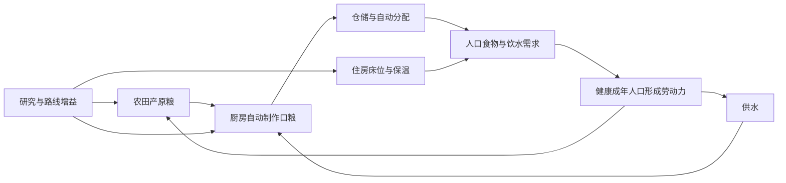

# 生存经营、季节与重大事件合同

> 2026-10-20范围修订：用户已明确“舒适经营为主，生存风险作为后期可选挑战”。本文季节致灾、自然死亡、瘟疫及重大事件暂停细则仅供后期自愿挑战采用，不能默认加入普通档或作为时代/美术前置；当前C1软性食水/住房规则保留。活动顺序以PLAN为准。

日期：2026-10-18。本文细化用户最新要求，阶段与完成状态只见根[PLAN](../../PLAN.md)。C1已接食物/饮水、住房/抽象人口与首次扩地，实际采用值见[C1合同](C1食物与人口采用值.md)。下面的季节、死亡与事件暂停仍是后续行为设计，阶段完成状态只看PLAN。它取代旧规格“不增加人口/住房消耗”的长线限制，保留单营地、点击放置、抽象人口、不做逐人寻路的定位。

## 体验和借鉴边界

玩家选择发展路线、建设和预备措施，日常生产、做饭、消耗、人口变化由游戏自动推进。短缺说明原因并自动恢复；不靠逐栋暂停、逐人派工、逐餐领取维持营地。

| 可核对来源                                                                                                                                              | 参考什么                                      | 本项目如何适配                                                                                                                  |
| ------------------------------------------------------------------------------------------------------------------------------------------------------- | --------------------------------------------- | ------------------------------------------------------------------------------------------------------------------------------- |
| [Frostpunk官方介绍](https://11bitstudios.com/games/frostpunk/)、[发行商商店说明](https://www.gog.com/en/game/frostpunk?countryCode=US&currencyCode=USD) | 社会生存、食物/供热/医疗与发展选择            | 使用聚合人口、储备、保温与政策，不复制逐人城市模拟。官网正文403；本次依据官方检索段落及商店发行说明，不声称通读手册。           |
| [Against the Storm开发者FAQ](https://eremitegames.com/faq-and-livestream/)、[官方Wiki增益系统](https://wiki.hoodedhorse.com/Against_the_Storm/Perk)     | 城建与肉鸽结合、条件增益和组合                | 采用阶段三选一与可见连锁收益；保留同一个营地，不采用反复重开城镇。FAQ为历史设计，Wiki标注数据可能过期，仅取结构，不抄当前数值。 |
| [Timberborn开发者2023年公告](https://store.steampowered.com/news/posts/?appids=1062090&enddate=1699969206&feed=steam_community_announcements)           | 干旱、污染影响土地/作物以及预备设施           | 将生态压力与相关灾害联系，提供预警与治理；不是现实气候模型，也不承诺复制该游戏当前平衡。                                        |
| 固定CivIdle源码 `e15fe039ed5c0794df05e52258bc9663761a140a`                                                                                              | 原生产/库存/运输、住房与食物ID、保存/离线推进 | 继续使用真实底座；人口、健康和重大事件是新增薄规则，不能把原Worker当已有人口系统。                                              |

“更爽”的方向是更清楚的成长和组合：一次研究打开整条产线、升级前后产速明显、季节目标达成给选择、组合生效给合并反馈。避免为了随机奖励增加第二钱包、频繁领奖或强制清图。

## 食物、住房、人口的闭环

原粮沿用 `Wheat`，供水优先沿用 `Water`，口粮优先复用 `Bread`，不为显示中文另造同义资源。第一轮厨房采用明确的原粮＋水薄配方，暂不引入Flour完整支线；名称/配方/成本在同一个内容表安装。现有Wheat库存与已完成研究保留，旧“粮食”显示在该版明确改为“原粮”，不能当成已经储存的口粮。未来鱼、肉、蔬菜用于膳食与抗性，须同时有来源、消耗和用途，分批启用。

| 系统           | 机械职责                                               | 界面应解释                                                    |
| -------------- | ------------------------------------------------------ | ------------------------------------------------------------- |
| 农田/厨房/供水 | 原粮产出、食品加工、实际饮用与加工耗水；原库存统一扣费 | 每秒毛产/耗料、净口粮、缺料来源，不把加工耗水又计入居民饮用。 |
| 仓储与配给     | 库存保障时长、保鲜能力、一个可选配给政策               | “当前条件预计可维持多久”；净供给非负时不伪造倒计时。          |
| 住房           | 床位、保温/卫生，等级和星级改变容量与结构              | 总人口/床位、拥挤、保温来源。建住房不直接生成居民。           |
| 人口增长       | 初始人口、移入与后续出生；受食物、床位和健康约束       | 增长条件与来源；儿童不能刚出生就提供成年劳力。                |
| 健康/死亡      | 后续自然衰老、疾病/灾害伤亡、恢复与实际死因记录        | 本期出生/移入/死亡及原因；原死亡不在刷新后撤销。              |
| 劳动力         | 从健康成年人口统一投影到原Worker路径，运输/生产共用    | 可用、忙碌、短缺；不再要求逐栋暂停来人工凑劳力。              |

底座 `Hut` 直接产Worker，`House`消耗Wheat/Water产Worker，`Apartment`也以食品交换Worker；这些不是出生、年龄或死亡。引入人口时必须一起适配：住房改为床位/保温；撤销固定HQ Worker20供给及住房原Worker产出，改为人口唯一投影；居民饮食由集中规则扣一次，不能再沿原住房配方重复扣。Worker双缓冲、取整、运输与整栋短缺停产需定向核对，必要时明确一种稳定的自动分配顺序，不能让UI比例条掩盖停产。

C1先接总人口/有效成年劳力、自动吃喝与住房，短缺先影响增长和效率；不在该批暗加衰老/致死瘟疫。C3再引入有限年龄队列与健康状态，年龄×健康的计数必须守恒，避免“病人、老人、死亡”重复减人。模拟日期可按游戏节奏压缩，生育、成年、衰老周期须在C3内容冻结时一起制定并记录，不把现实秒直接解释成寿命。研究技术等级、建筑等级和技能XP各有职责，人口不再叠全局经验条。

新档须有明确的初始人口、HQ基础庇护和有限口粮/饮水缓冲，足够建起首条生存链。不是无限供给，也不能开局先消耗到必死。住房/厨房/供水建设和首次扩地不能被工坊、升星或这些新建筑自身反向卡住。成年劳力归零时仍须有不依赖该劳力和不可生产材料的救援决策，代价可为暂时减益或消耗阶段增益，保留真实死亡记录和永久建设，不能出现只能清档的软锁。

## 空间、建筑和科技的扩展

目前HQ＋六初始位中，五基础建筑占五位，仅余一个通用位。新增三建筑之前，**先把四个相邻锁位的开放前置到C1**。费用只用当前可达木/石/原粮，门槛不依赖新生存链、工坊或升星。其后住房/供水/厨房占三位，保留后续医疗/供热空间；下一轮再沿原45×45白名单开放连通土地，不换城市或建第二库存。

| 内容批次      | 新建筑候选与复用                                                 | 与旧成长的关系                                                                                    |
| ------------- | ---------------------------------------------------------------- | ------------------------------------------------------------------------------------------------- |
| C1 食物与人口 | 住房优先适配House/Hut；水井复用原Water生产定义；厨房薄适配Bakery | 原五建筑不删除，合计八类；既有五类仍各限一座，住房/服务建筑数量与容量在该批明确，不能默认无限建。 |
| C2 季节与供热 | 一种聚合供热设施；先复用Wood，Coal留金属/机械链                  | 建设/燃料/保温取舍，暂不做逐户管网与单人冻伤。                                                    |
| C3 健康       | 一种卫生/医疗设施、有限治疗能力                                  | 先选简化医疗配方与覆盖范围，不同时增加完整药材产业。                                              |
| C4 生态       | 林地恢复/轮作治理优先为土地操作或政策                            | 不为每个生态指标都造一座占地建筑；土地变化要在同一场景可见。                                      |

长期科技不局限原36候选：在原六分支之外增加 `civic` 民生候选支。初始六候选ID为 `basic-shelter`（基础住房）、`communal-kitchen`（公共炊事）、`clean-water`（清洁饮水）、`food-preservation`（食品保鲜）、`insulated-housing`（保温住宅）、`public-health`（公共卫生）。加原36共42个候选，不表示已装入游戏。前3项先给可达的启用条件，后3项随季节/医疗分批冻结；完整前置、费用、效果与时代以唯一内容表为准。科技图仍是原 `unlockedUpgrades` 的投影，不维护第二完成集合。

`crop-rotation`原先是农田升星许可；生态上线后可增加轮作效果，但必须显式变更内容版本与迁移，不能无声改变旧离线产量。其他升级也按“等级增基础产能、星级改结构与上限、科技开能力、时代开内容、路线增益改组合”分工，避免五条进度都只加同一个百分比。

## 季节、天气与生态

季节是可预期日历，天气是当期条件，生态是经营累计结果。先做春夏秋冬与一类寒潮，解释农业产速、人口食水/保温需求；后续再加暴雨/干旱。首版实际周期、温度单位与倍率由C2集中冻结；C0不显示虚构温度或居民数。预警先告诉玩家影响对象、预计时点和已有效措施，再进入影响期。

生态采用有限的地块组指标：林地覆盖、土壤肥力、污染压力。过采改变林地，持续高强度耕种影响肥力，工业/燃烧增加对应污染；轮作、恢复林地、净水/清洁技术提供对策。指标作用范围、上限、恢复和成本都要能解释。

风险设计为 `clamp(季节/灾种基线 + 对应生态压力 - 防护, 0, 该灾种上限)`，这是游戏规则草案，不是现实气象公式。过垦可提高土壤退化/径流类损失，污染可提高相关健康事件风险；不能用污染任意提高地震概率或让一次错误永久滚雪球。每种惩罚必须在对策可达后启用，设预警、冷却、事件间隔与连续灾害上限。生态优良也要有可见的稳定产量或正向事件，而不是只有扣分。

风险在固定模拟边界评估，不按每次渲染抽奖。种子、事件序号、已生成选项和影响进度入同一快照；规则接收确定性输入，时钟/随机API留适配边界。刷新、换Tab、离线分块和重试保存不能改变同一事件结果。

## 离线与重大事件暂停：最终产品选择

用户先要求离线照常演算灾害与人口死亡，随后补充“或者遇到重大事件会暂停”。最终采用下面的分级规则，取代此前全离线致死或全离线保护两种极端建议。

| 等级          | 在线/离线行为                                      | 例子                                                                     |
| ------------- | -------------------------------------------------- | ------------------------------------------------------------------------ |
| 常规变化/提示 | 继续同一规则，记录实际结果                         | 生产、消耗、季节切换、普通健康变化、已上线的自然死亡。                   |
| 预警/普通影响 | 自动应用预先选定政策和抗性，继续推进               | 冬季减产、正常燃料消耗、轻度疾病恢复；有预报和原因。                     |
| 重大决策事件  | 到触发边界生成持久事件，**全局模拟暂停**，等待选择 | 首轮重大寒潮应对、重大疫情、突破防护的极端灾害；不能只停伤亡却继续生产。 |

暂停前已经发生的普通损失/自然死亡照实保留；重大事件后续分支损失在选择后按所选结果生效。暂停期间生产、训练、消耗、人口、季节与下一事件全部冻结，暂停时长不存成“待领取收益”，选择之后也不补发。必须显示“离开多久/实际演算多久/事件等待多久”，避免让玩家误以为长时间离线收益丢失。

重大事件不是每栋建筑的停产开关。正常经营始终自动进行；只有少量需要玩家决定的关口停世界。路线三选一奖励可继续经营并稍后选择，不一律升级为暂停事件，避免每个季节都迫使回来点确认。

### 状态与保存合同

1. 同一推进器按确定顺序处理每个模拟边界：原生产/训练 → 生存需求与已发生人口变化 → 季节/风险边界 → 如触发重大事件，写入 `pendingEvent` 并停止后续tick。具体先后在C2实现前冻结，在线、后台与离线一致。
2. `pendingEvent`最小事实含稳定实例ID、内容ID、触发tick、已生成选项/代价、暂停原因；事件种子/序号和状态一起保存。结果不由UI生成，刷新不重抽选项。
3. 原快照、事件与时间边界同事务提交；离线遇事件后，本次演算的消耗时间与放弃推进的等待时间分别记录。存在事件时后续打开只刷新墙钟锚点/显示等待，不推进世界。不能把`saveGame`最后写盘时间误用成模拟已结清时间。
4. 存在重大事件时，命令白名单只留读视图、保存/导出、恢复重试及 `resolve-event(eventInstanceId, choiceId)`；建设、研究、采集、训练切换拒绝，避免暂停中积累优势。拒绝/失败不扣费。
5. 选择先校验事件实例与可付费用，再一次性扣费/应用结果/清事件，开启新的墙钟边界；等待时间不补算。重复点击、重载、保存失败后重试不得重复死亡、扣费或授奖。保留至少一项当前状态可执行的无材料应急选择，其代价写清楚，不能把营地锁在永远付不起的事件页。
6. 沿用既有loading/recovering/ready/failed和保存队列；事件暂停是玩法状态，不冒充存储failed。恢复失败仍保留原档和事件，不静默清事件或建新档。

参考场景（目标合同，未执行）：离开2小时，模拟至第40分钟遇重大疫情 → 已结算40分钟普通收支/死亡，剩余80分钟为等待且不产出 → 重开仍是同一疫情 → 选择后从当前墙钟重新推进；不能再追算80分钟，也不能重复应用前40分钟。离线上限仍由内容包控制，当前4h不在本轮改成8h；无论上限多长都先受事件边界截断。

## 路线增益与操作减负

阶段里程碑/季节目标提供三选一“营地路线”增益。候选池只含当前有来源/用途的资源和已可达系统；相同随机种子下选项固定、重载不重抽。先少量手工配置，设槽位、叠加上限/互斥与持续范围，不先做卡包、稀有度抽卡或永久付费加速。

| 组合示例（候选） | 玩家感受到的变化                                 | 前置边界                                                   |
| ---------------- | ------------------------------------------------ | ---------------------------------------------------------- |
| 丰收储粮         | 食物有结余时提高下一季农业稳定性，余粮能支持扩张 | 口粮/保鲜已上线，不把仓满未入库的粮当结余。                |
| 木作循环         | 加工副产物支持供热，减少燃料竞争                 | 供热已上线；副产物可先作为原Wood节省效果，不再造专用货币。 |
| 暖居安养         | 保温达标与医疗结合提高恢复/劳动力稳定性          | 健康上线后启用，未上线不展示空效果。                       |
| 生态丰饶         | 恢复林地与轮作降低相关风险并给可见稳产收益       | 生态指标与对应风险同时上线。                               |

体验反馈合并为“研究完成/建筑晋升/路线组合生效”三类重点；普通产出轻提示可关，不为每tick弹窗。默认自动配置，后续最多一项配给政策与少量路线选择；缺料、仓满、劳力不足显示原因并在条件恢复后自动继续。玩家可以停止/切换专注技能作业，因为那是选择目标；移除的是日常建筑的暂停/优先级微操，二者不要混淆。

## 网页Tab与美术扩展

当前五Tab为营地/技能/研究/民生/设置，切换不新建ticker、不停止作业、不改变origin或存档。C1民生页使用真实人口/食水；C2有真实预报/事件后再加环境与事件入口，禁止填虚构温度或健康百分比。手机端允许页面内容纵向滚动，不将整张科技树缩成看不清的小字。

继续统一Kenney简化六角2D世界和同用途图标风格；时代改变部件/材质、季节改地表覆盖与光色、星级改主体结构。原夜间工坊图继续用于概览氛围，不直接铺成可任意建设的地板。不需要画会走动居民；住房灯火、床位标识、储粮量、烟囱/雪层/植被恢复表达经营结果。详情只见[美术接入规格](../设计/沙盘美术接入规格.md)。

首批新缺项为住房、水井、厨房三个同系列组合；供热/医疗/灾害覆盖分后续批次补。优先复用许可清楚的已备素材与代码覆盖，确需新位图才使用生图并记录提示词/原图/输出/锚点/许可来源；不为42个科技各画一张全景。图像存在不等于真实机制已实现。

## 交付与验证边界

唯一执行顺序、每批退出条件由PLAN维护。每批只冻结当批成本/速率/条件与存档变更，不把全部系统一次塞入工程。C1重点验证人口/床位/劳力守恒、食水只扣一次与开局空间可达；C2重点验证跨季节和重大事件暂停/重载/一次性选择；C3/C4再验证死亡原因、人口守恒和风险确定性。只为新增核心合同加最小用例，不逐建筑、逐等级、逐天气铺测试，也不重跑根旧技能/原生全套。

任何机械变更必须区分旧内容补算与新内容起点：识别旧版本，按可核对旧规则结清旧时间边界后原子迁移，再开始新消耗；无法安全兼容则保留原字节并明确拒绝，不能拿新规则追扣旧离线食物/死亡，也不能换数据库绕开迁移。新模拟时间、事件和人口事实仍进入同一个GameState与保存队列，不加第二模拟器或服务端账号。
