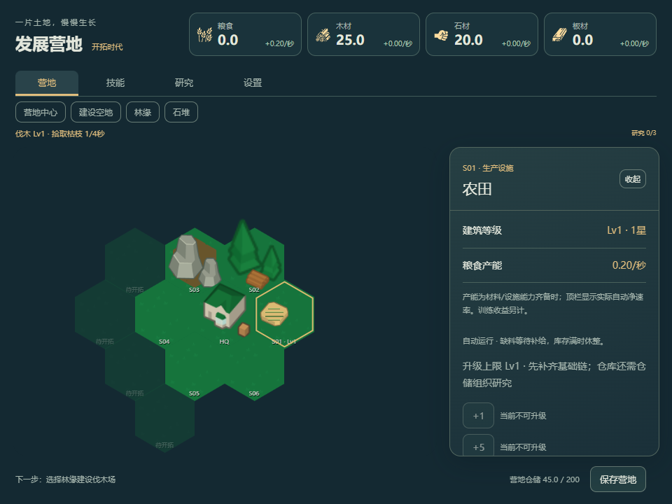
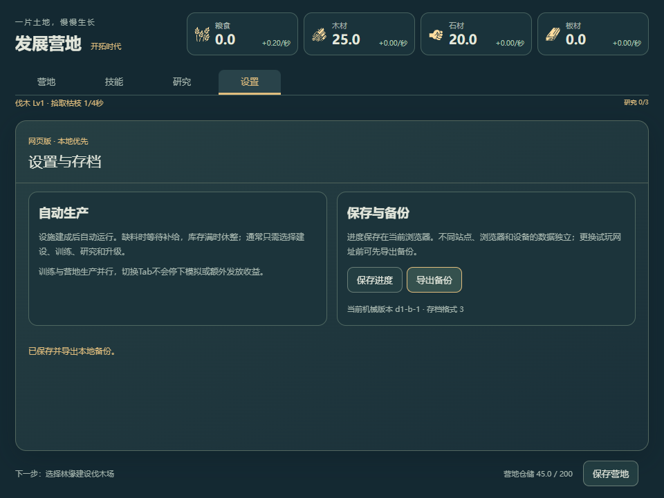

# C0交付：网页四Tab与自动经营简化

日期：2026-10-18。Codex本地实现与定向验证，待用户试玩；不是独立第三方或真人平衡验收。进度只见[PLAN](../../../../PLAN.md)，新生存系统的行为见[合同](../../../规划/生存经营与事件体系.md)。

## 实际交付与未实施范围

- 营地/技能/研究/设置四个真实Tab，支持方向键/Home/End、选中与tabpanel语义。切回营地保留选地，训练状态条持续显示；没有多营地或多地图。
- 建筑正常面板删除暂停/优先级按钮，默认自动运行，缺料/满仓自动等待；旧capacity=0档保留“恢复自动生产”一次入口。底座命令保留兼容，未篡改旧状态或删除技能停止/切换能力。
- 设置页保存沿原saveGame；备份先等待保存完成，再下载实际已提交原始JSON。失败反馈不假报成功，未增加导入/云同步/重置功能。
- 局部修复上游XP主题对tabpanel的灰色边框影响，调整导航/移动端布局及初始镜头，使11个开放/锁定槽位可见。手机场景仍较小，可用原镜头缩放与地块快捷定位；正式美学仍待后续阶段。
- **机械不变**：schema3/content `d1-b-1`、四技能/10作业、五建筑/四资源/前三研究、Lv1–10、4h离线上限与同一保存链。没有新增人口、食物消耗、天气、死亡、事件暂停、工坊时代或升星规则，不展示其虚假数据。

## 规划对齐

用户新增食物/人口/住房/自然死亡/瘟疫/季节/生态风险，并最终补充“或者遇到重大事件会暂停”。最终规划为普通离线变化继续，重大事件到边界全局暂停，等待不产出也不在选择后追补；重载保留同一事件与选项。该合同尚未编码。

唯一顺序已改为C1扩地/食物/人口 → 原D1-C工坊/升星 → C2季节/供热/重大事件与路线三选一 → C3健康生命周期 → C4生态风险。首次扩地前置是因为原五建筑只留一个通用位，不能容纳三个新生存设施。底座House的食物换Worker也不能冒充真实人口；C1需统一适配以免劳力/食水重复计数。

产品目录补F15–F18与6个民生候选，原36＋6共42候选，不等于已研究/实现42项。美术仍统一现有简化六角系列，民生设施/季节覆盖按批补，不增加走动居民；本轮未生图或修改旧PNG。

## 集中验证

Node24.21.0；生产dist在隔离Edge上下文运行，浏览器禁外部请求。每次使用合成新档，不接触用户实际浏览器数据。源码变化仅UI/路由/镜头，无新增规则单测或测试框架，未重跑根技能或原生门禁。

| 检查         | 实际结果                                                                                           |
| ------------ | -------------------------------------------------------------------------------------------------- |
| TypeScript   | `tsc --noEmit -p tsconfig.json` 0错误                                                              |
| 改动范围Lint | 6个TS/TSX文件Biome检查0错误；CSS另按项目格式整理                                                   |
| 生产构建     | Vite成功，1652模块，sandbox atlas92.82kB；继承约4.15MB主chunk与动态/静态重复导入提示，无新构建失败 |
| 四Tab语义    | 4个tab、aria-selected与面板标签对应                                                                |
| 跨Tab训练    | 真实采集/训练，切研究后继续推进，32木/3XP；原三研究可见                                            |
| 键盘与选地   | ArrowRight/Home/End切换，返回营地仍为林缘                                                          |
| 自动建筑     | UI建设农田并由原施工完成，正常页无暂停/优先级按钮                                                  |
| 实际导出     | 117306字节原始JSON，content为d1-b-1、技能进度存在，非展示样例                                      |
| 旧暂停档     | 明确修改隔离测试JSON的农田capacity=0，重载出现恢复入口，点击后恢复；不是声称旧真人档已验收         |
| 两窗口       | 960×720与420×600，四Tab可切换、横向溢出0；已查看最终营地/设置截图并修正边框与地图裁切              |
| 请求/异常    | pageerror、外部请求与HTTP≥400响应均0                                                               |

七项浏览器结果见[browser-verification.json](browser-verification.json)。原生/其他浏览器/多标签并发、长期节奏与正式美术未在本批验收；“无页面异常”不等于长期运行或桌面验收。

## 本地入口与静态产物

现有开发入口：[发展营地](http://127.0.0.1:1429/)，运行方式沿根README。生产验证使用1430临时端口，完成后关闭；不同origin的数据独立，不声称搬迁存档。

已准备[本地静态审阅ZIP](../../../../.cache/camp-web-c0-review.zip)，约4.23MB，含45个原dist运行文件、许可/素材来源与清单共51文件。SHA-256：`b3ed08212b36ebace5f9704a7e3003ed7b7ce1fdd943a33148325211f6e32664`。目录为`.cache/camp-web-c0-review/`，用HTTP服务打开，不直接双击file协议。运行文件与已验dist逐项一致，无源码缓存、玩家存档、密钥或账号信息；打包说明见[static-package-verification.json](static-package-verification.json)。它是本地审阅产物，不冒称Sites部署归档或站点已发布。

Sites技能本轮按local-only路径使用，未注册站点、申请写凭证或上传源代码；项目AGENTS明确“不要自行发布Sites”，需要用户明确部署指令才能做下一步。静态站点自身也不提供跨设备保存。

## 工作区边界与截图

分支`codex/p1-first-tier`、HEAD `98c2699af4bccbae4098cd300df92a8e6920c83e`保持；前轮改动保留。新增/修改在`next/civ-idle/`、根PLAN/README及相应规格/证据，原始脚本/浏览器fixture/静态包在忽略`.cache`。未改根`src/`、`src-tauri/`、`next/profectus/`、旧存档或Tauri identifier。未提交、推送或发布。

另见[桌面技能](desktop-skills.png)、[窄窗营地](mobile-camp.png)、[窄窗设置](mobile-settings.png)。最终文档链接/49素材哈希核对见[document-and-assets-verification.json](document-and-assets-verification.json)。
