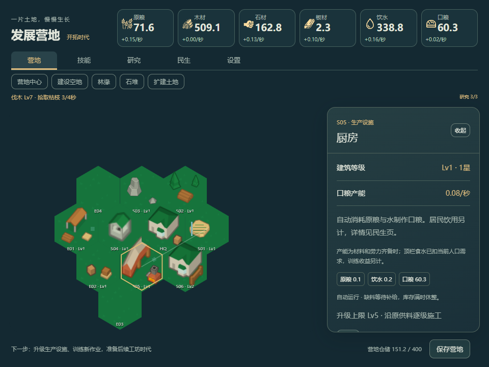
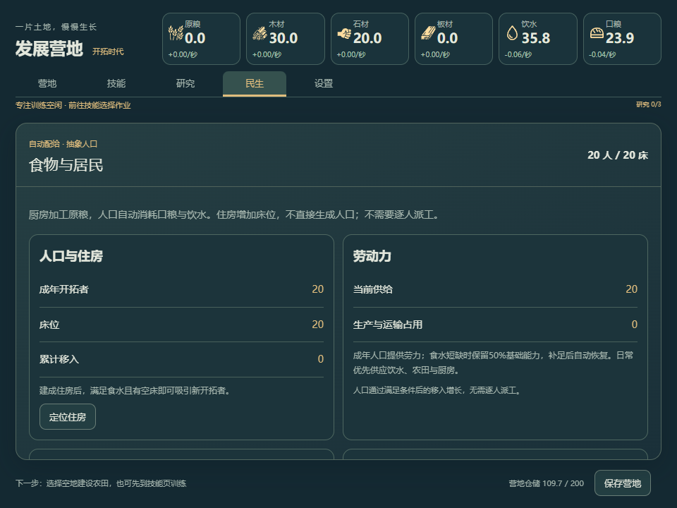

# C1交付：食物、住房与抽象人口

日期：2026-10-18。Codex按用户“请开始下一步”实施C1，并完成本地浏览器与生产构建验证，待用户试玩。唯一进度见[PLAN](../../../../PLAN.md)，本批实际数值见[C1采用合同](../../../规划/C1食物与人口采用值.md)。

## 玩家现在能做什么

- 基础农田/伐木/采石建成后，花10木、5石、5原粮开放四块相邻土地，一次付费/一次解锁，仍是同一张地图。
- 新增住房、水井、厨房，连原五类共八建筑；原四资源加饮水/口粮，共六资源。厨房每等级每秒0.10原粮＋0.05水→0.08口粮，水井0.30水/秒；住房每建成等级增加10床，三类民生设施上限Lv5。
- 初始20名成年开拓者、20基础床位、24口粮/36饮水。人口每人每秒自动消耗0.002口粮/0.003饮水。住房建成、有空床且食水满足，每120个满足条件的模拟秒移入1名成年人；建房不直接生人。
- 食水短缺先影响劳力与移入，保留50%基础劳力，补给恢复后自动继续。成年劳力投影到原Worker双缓冲，住房不再用食品产Worker，HQ固定20只用于旧B补算兼容；C1无第二劳力来源。
- 真实民生Tab显示人口/床位、劳力、实际食水消耗与储备，并可定位设施。六资源顶栏中，饮水/口粮速率扣除当前人口满额需求，标明是供需估算；训练与施工另计。无劳力/食水不足时有有限求援入口与冷却。
- 原四技能/10作业、三研究、原五建筑Lv1–10、仓储与批量施工继续使用，正常经营不增加日常暂停/派工微操。

当前所有居民均为聚合成年人口，不增加走动NPC。尚未实现工坊时代/晋升、季节/供热、出生衰老/自然死亡、瘟疫/灾害或重大事件暂停；这些仍按PLAN后续批次推进。离线上限仍4h，不宣称8h或Windows原生验收。

## 数据、底座与素材

schema4/content `c1-1`，原namespace `development-sandbox-v1`不变。新增同一profile内的expanded和population（人数、移入进度、满足率、累计实际消耗/移入、求援就绪tick）；没有新钱包/ticker/保存队列。

A1/A2先规范为B；B先按旧五建筑/训练规则结清旧离线，之后初始化C1人口与有限物资，并和新时间边界一起提交。初始物资只放入原建筑可用仓储，空间不足部分不偷偷存入隐藏余额、也不清旧材料。旧内容不足一秒的余量在迁移处明确作废，避免凑成新食水tick；正常C1亚秒余量继续保存。未来版本/坏人口拒绝并保留原字节，迁移提交失败沿原错误页重试。

复用上游House/Aqueduct/Bakery的ID、原施工/IO/运输与恢复链；Aqueduct适配为无水矿脉依赖的水井，Bakery裁剪Flour支线，House只提供床位。IntraTickCache只对C1 HQ输出作唯一人口投影，BuildingLogic对C1 Worker不再额外应用原幸福度倍率；Update沿原排序入口自动优先食水/基础链。旧B没有人口字段，旧补算不走这些C1分支。

美术使用原Kenney系列，唯一catalog接三类新建筑Lv1/Lv3组合；使用已备房屋、井、储水塔和炉灶部件。新增2枚自有代码SVG（水/口粮），清单由49变51；原49项源哈希保持。没有改原PNG、生图、换画法或宣布正式两星/时代素材已齐。

## 验证与证据

Node24.21.0，隔离Edge/SwiftShader。阶段末检查使用本工程路径，不跑根旧技能或Rust全套。新规则只加4个核心合同，连原8个共12项通过；未为每个UI/等级新增测试。

| 检查           | 实际结果与边界                                                                                                                                      |
| -------------- | --------------------------------------------------------------------------------------------------------------------------------------------------- |
| 类型/Lint/构建 | tsc0错误；19个改动TS/TSX/JSON文件Biome无error，原建议未批量处理；最终迁移余量小修复查类型与该文件Lint；Vite成功1655模块，原大chunk/重复导入提示保留 |
| 真实开局       | 未注入材料，选择训练并通过UI建成农田/伐木/采石，第36模拟秒；不是整段成长真人试玩                                                                    |
| 扩地与民生建设 | 原库存扣10木5石5原粮，11个总槽位开放；重复扩地拒绝。后段调用原tick快进，第117模拟秒三类民生设施建成，20人/30床，没有瞬间生人                        |
| 食水一次性     | 原tick推进5秒，20人实际消耗0.20口粮/0.30饮水，HQ投影20劳力，无住房额外Worker                                                                        |
| 持续经营/重载  | 原tick快进1500秒后30人/30床、10次移入，食水有结余；保存/重载保身份、人口、扩地与训练，不称长期平衡                                                  |
| 全内容可达     | 八类建筑通过原施工完成，原三研究可完成，住房Lv2提供40床；民生目标Lv6拒绝                                                                            |
| B交接          | 同一份真实B导出，在保留C0构建与C1各模拟30旧离线秒，tick/木石原粮板材/XP/训练一致；C1新增人口消耗与移入均0，不追扣旧时段                             |
| A2接续         | 前轮真实A2夹具保身份，规范B再到C1，技能0/训练空，无追溯新消耗；夹具自带raw封装，探针展开后核对                                                      |
| C1短离线       | 改时间戳模拟30秒，30人消耗1.80口粮/2.70饮水；固定时钟下立即重载不重复扣，非真实关机等待                                                             |
| 求援防软锁     | 明确注入0人口/空食水夹具，UI求援补3人及有限物资，冷却拒绝重复，3个tick后实际HQ劳力仍3而非额外加20                                                   |
| 拒绝与失败     | 负人口/未来版本拒绝，合成hidden/pagehide后原字节不变。注入savedAt提交失败，B磁盘原字节保持、tick17→17；解除故障后原重试入口一次提交C1               |
| 亚秒迁移边界   | 受控B余量0.75秒在内容交接处作废；随后C1离线0.25秒只保存0.25余量、无食水tick。最终生产构建同样通过                                                   |
| 两窗口         | 960×720/420×600五Tab可操作，横向溢出0；窄窗卡片速率越界已修正并按元素边界复查；代表截图已查看                                                       |
| 最终生产入口   | 实际食水消耗、导出/重载、两个新SVG200、五Tab窄窗通过。pageerror、外部请求、HTTP≥400均0                                                              |

主线见[browser-verification.json](browser-verification.json)，新增接续检查见[targeted-verification.json](targeted-verification.json)，最终生产见[production-verification.json](production-verification.json)，最终亚秒分支见[migration-boundary-production-verification.json](migration-boundary-production-verification.json)。文档链接与素材一致性见[document-and-assets-verification.json](document-and-assets-verification.json)。

仅新增核心规则4项；浏览器走查脚本/保存夹具均留忽略`.cache`，没有引入新的UI测试框架。探针曾因把A2的raw封装当快照、以及重载时重复注入故障而失败，修正探针后续查，保留仍有效的前序结果；游戏实际问题是旧亚秒余量跨内容边界，已修复并定向复核。原始日志在`.cache/c1-*`。

## 入口、下一批与未测项

本地入口仍为[发展营地](http://127.0.0.1:1429/)。刷新后会加载新版本并按上述合同迁移当前origin内的兼容旧档；无需换端口/新建档。若需手动启动，沿根README的隔离Node与Vite命令。1431开发验证、1432旧C0对照、1433生产验证为临时服务，结束后关闭；不同origin数据独立。

**下一批为原D1-C工坊成长包**：工坊时代、后三研究、Lv10晋升保等级→Lv20、实际结构/时代反馈；首次扩地已完成，不重复收费。离线延长/成本/劳力需结合当前食水重算后冻结，不直接照抄旧预算。此批结束不自行推进D1-C、C2或桌面。

未做真人长期节奏/平衡、多标签并发、其他浏览器、4h实际长等待/TimeWarp、真实磁盘配额、Windows托盘/置顶与重启验收。保存故障、时间戳和0人口为受控注入；在线真实早段与原tick快进分别记录。

分支`codex/p1-first-tier`、HEAD `98c2699af4bccbae4098cd300df92a8e6920c83e`保持，前轮改动保留；本批仅改`next/civ-idle/`与相关规划/证据/README，未改根`src/`、`src-tauri/`、`next/profectus/`、旧档或Tauri identifier。未提交、推送或发布Sites。

另见[真实早段](desktop-basic-chain.png)、[民生接续](desktop-population-final.png)、[窄窗生产](production-mobile.png)、[求援夹具](desktop-relief.png)。
