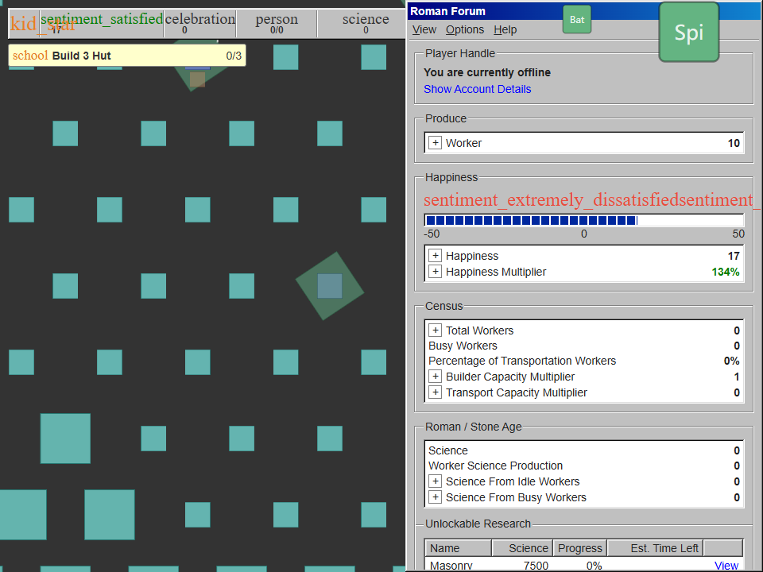
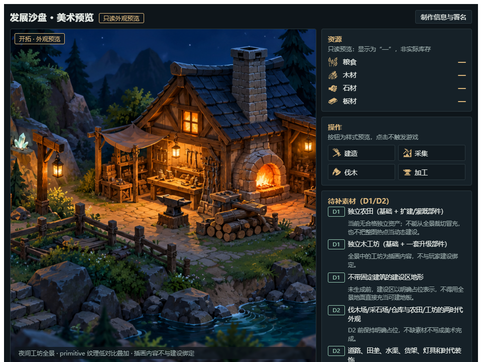

# D0-R 收口验收与全局评估

日期：2026-10-17。复核者：Codex。基线 `codex/p1-first-tier` / `98c2699af4bccbae4098cd300df92a8e6920c83e`。依据为当前源码、[F2 收口交付](F2-收口交付.md)、既有分项验收、当前浏览器画面与本轮定向探针。进度和执行任务只维护在根 [PLAN](../../../../PLAN.md)，本文不是另一份计划。

## 结论

**D0-R 在既定本地浏览器范围内验收通过，可以进入 D1。** 上轮 F1/F3/F4 的验收结果保留，本轮关闭剩余的 F2 队列与首次失败页遮挡问题；不继续另开数据修复阶段。CivIdle 底座路线可继续采用。

**当前阶段结果符合工程预期，当前玩家体验还未达到产品预期。** 已有可运行底座、安全恢复和只读美术预览，尚未交付“农田建设→自动生产→研究升级→扩地→时代变化”的首版闭环。下一轮应将玩法与美术合到真实游戏，不能将底座验证或预览交付当成新游戏已经完成。

## F2 独立验收

实现核对：`Global.tsx` 的 `drainSaveQueue()` 和队列清空唤醒、failed 状态拒绝残留任务；`ClientUpdate.tsx` 在补算前等待队列完成；`Bootstrap.tsx` 将首次引导延后到成功提交，并在失败页前撤下全局模态。

| 本轮独立场景                                                | 实际结果                                                                                                                                     |
| ----------------------------------------------------------- | -------------------------------------------------------------------------------------------------------------------------------------------- |
| 旧保存完成通知被延迟、隐藏保存已排队，再触发 600 秒后台恢复 | 等队列时 tick=1、recovering、常规 tick 被阻断，补算尚未开始。放行队列后，补算首批内存 tick=145，但磁盘保持 tick=1 / 时间 T，中间状态不落盘。 |
| 上述恢复完成并重载                                          | 内存与磁盘均为 tick=601、时间 T+600s；同一时钟下重载为 tick=602，只有正常启动 tick，旧例多出的 144 tick 已消失。                             |
| 新档首次提交失败直接重试                                    | lifecycle=failed、ready=false、shouldTick=false；无欢迎覆盖层，未由探针移除模态，直接点击重试后重载进入 ready。                              |
| 已有队列进入 failed 状态                                    | 第二个排队请求被拒绝，新到保存也被拒绝，未再次改变磁盘；drain 等待正常结束，没有死锁。                                                       |

证据：[独立验收与界面记录](收口验收结果-20261017.json)。原始探针、服务日志在 `.cache/codex-global-review-20261017/`。方法为 Node 24.21.0 + Edge headless、独立临时 origin `127.0.0.1:1428`、每例独立 context，冻结主 ticker/受控时钟、合成 visibility、注入保存失败及延迟完成通知；不是 Windows 原生操作或真实磁盘故障。浏览器与临时服务已结束，未访问真实玩家档。

类型/构建/生产 preview 沿用 CodeBuddy 本轮证据，本轮没有再次运行全套构建或旧技能测试。未验证范围仍包括真实 Windows 最小化/托盘/关闭、真实配额故障、多标签页并发、其他浏览器及正式玩法的节奏平衡；这些不扩写为本阶段已通过。

## 与用户预期逐项对照

| 用户预期                         | 当前事实                                                                                                                              | 判断与下一落点                                                                                                    |
| -------------------------------- | ------------------------------------------------------------------------------------------------------------------------------------- | ----------------------------------------------------------------------------------------------------------------- |
| 基于成熟项目优化，减少重复造轮子 | 已实际复用 CivIdle 的地图、定义、生产/运输与 tick，保存仅做本地安全适配                                                               | 路线符合；D1 继续复用核心，在自有内容与入口收敛玩法。                                                             |
| 放置自动发展，无具体居民         | 底座有自动生产能力；目前仍展示人口、幸福度、伟人等原版内容                                                                            | 技术基础成立，目标首版尚未实现；保留必要抽象设施容量，收起居民/幸福度经营及其他非首版入口。                       |
| 新档能先建农田，五建筑四资源     | 当前新档仍是 Rome、2025 地块（45×45）和 Fire/StoneTools/Logging/Shelter；界面目标仍为 Build 3 Hut，农田研究显示上游 Science 成本      | 与最终开局有明显差距，但属于尚未执行的 D1；优先改为固定有限地块、农田立即可建和可达的木/石开局。                  |
| 升级、扩地、时代让沙盘改变       | 尚无首版三研究、一次扩地及开拓→工坊的自有配置；贴图选择仍只按类型/城市，TileVisual 保留 noFrame 一次取图方式                          | D1 必须做真实门槛与 visual key 更新，不能仅换纹理或 Lv 文本。                                                     |
| 复用认可的夜间工坊美术           | A0 实际显示主景、纹理、四资源图标；独立农田、木工坊、空地资产仍缺                                                                     | 风格已确定，动态美术未完成；D1 用三类最小资产接真实状态，D2 再扩充其余建筑与时代变体。                            |
| UI 清楚、沙盘为主                | 真实入口仍是灰色原版面板；960×720 下侧栏约占半屏，Material icon 名称直接显示并挤占文字，还有账号、Science、伟人、转生、世界奇观等入口 | 当前体验未达目标；D1 就要做四资源/时代顶栏、选地块上下文面板、研究/扩地入口和本地图标，不等 D2 才修主流程可读性。 |
| 先发展，再 PvE                   | 当前未加入战斗、波次与具体居民系统                                                                                                    | 顺序符合，继续保持；先验收发展闭环。                                                                              |
| 简化验证、按阶段交付             | 本轮只复核剩余 F2 与截图，其他已通过项目复用；前几轮返工来自实际保存合同缺口                                                          | 关闭 D0-R，D1 阶段末集中验收；不把追加覆盖率或反复预览变成推进目标。                                              |

上述状态由当前源码和界面核对，而非只按报告标题判断。上游 `Warehouse` 仍需 `Lumber/Brick/Horse`，`LumberMill` 的 `Wood→Lumber` 可复用；4h 上限仍在 `shared/logic/Constants.ts`，8h、取消 Time Warp 与首版摘要都属于 D1 的明确待办。

## 当前画面对照

真实游戏入口（本轮已查看）：

只读美术预览（本轮已查看）：

两张图说明目前“可操作入口”与“目标风格”尚未合并。D1 交付应让玩家在同一个真实游戏中看到资源增长、建造、升级与时代反馈；A0 只保留为辅助素材预览。

## 下一轮应交付什么

沿唯一 PLAN 执行 D1：固定一张两区地图、五类建筑、四种主资源、三个研究、一次扩地、开拓/工坊两时代。先确保新档农田可建、木/石及板材链可达，再打通研究和时代；同时换掉遮挡主要沙盘的原版流程，将 A0 主题和农田/工坊最小素材绑定真实状态。可保留其他建筑的清楚占位，但不能把占位写成正式美术完成。

D1 的演示主线为：新档建农田→建立木/石与板材生产→升级农田→扩地/完成三研究→满足条件进入工坊时代→保存重载/离线回访。退出条件沿首版规格，明确正常等待与调试快进、占位与正式素材、浏览器与 Windows 的边界；不另开框架研究、只读预览或测试阶段。

本轮只更新验收、PLAN 和下一轮交接，没有替 CodeBuddy 实施 D1、生成新美术、提交或推送。D1 为下一执行任务，不能记录成已经开工或完成。
