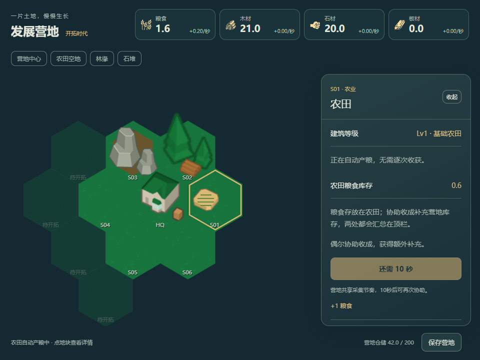
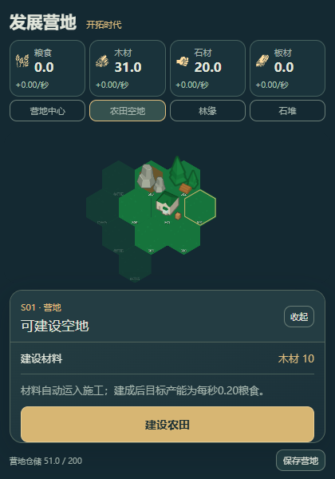

# D1-A交付：点击获取与真实农田

日期：2026-10-18。实施者：Codex，依据用户最新“请执行”。本报告记录本批实现和本地验证，不是独立第三方验收或真人试玩。唯一阶段状态见[PLAN](../../../../../PLAN.md)，完整D1仍待B/C。

现在可进入真实营地，点林缘采木/石堆采石，选农田空地下单，等待原运输与施工完成后持续自动增粮；可协助收成、保存和重载。地块按真实空地→施工→农田改变。没有具体居民，也没有第二份展示钱包。

## 启动与试玩

开发入口：[http://127.0.0.1:1429/](http://127.0.0.1:1429/)。A0只读预览仍在同端口`art-preview.html`。

```powershell
cd D:\小游戏\next\civ-idle
& 'D:\小游戏\.tools\node-v24.21.0-win-x64\node.exe' scripts/prepare-atlases.mjs
& 'D:\小游戏\.tools\node-v24.21.0-win-x64\node.exe' node_modules/vite/bin/vite.js --host 127.0.0.1 --port 1429 --strictPort
```

新环境仍按工程锁文件安装依赖。已有Node 24环境也可执行`pnpm dev --host 127.0.0.1 --port 1429 --strictPort`；dev脚本先准备图集。本轮未安装新依赖、未更改锁文件或全局PATH。

1. 点击“林缘”→“采集 · +1 木材”，顶栏木材30.0→31.0。也可直接点击对应六角地块。
2. 点击“农田空地”→“建设农田”。原系统运入并消耗10木，完成后每模拟秒产0.20粮，不用反复收成。
3. 建成农田的“协助收成”额外给1粮；木/石/粮共用10模拟秒冷却。保存、重载后库存与冷却保持。

若同一origin有D0旧样机存档，会显示保留原数据的处理页：可导出、重试或明确新建营地。本批没有把旧档静默重置或改到新namespace；1429是本轮可复现运行端口，不代表替代旧数据迁移。切换端口会形成另一浏览器origin，须区分数据空间。

## 实际范围与代码

| 内容       | 实际采用                                                                                                  |
| ---------- | --------------------------------------------------------------------------------------------------------- |
| 地图       | 原45×45 Grid保留；只显示/操作HQ、六初始位与四相邻锁位，未开放扩地购买                                     |
| 起始与容量 | HQ内30木/20石；常规容量200，沿原getStorageFor计量；无无限库存                                             |
| 可选采集   | 木1、石0.5、建成农田粮1；共享manualGatherReadyTick，不攒次数或离线代点                                    |
| 自动经济   | 仅一座Lv1 WheatFarm；原建造成本函数得10木，原IO输出0.20粮/秒；施工/运输沿原链                             |
| 库存落点   | 手动入HQ，自动粮存农田，两处由原库存选择器汇总；顶栏速率为自动生产净IO，施工耗料/手动另计                 |
| 保存       | 原development-sandbox-v1玩家空间与保存队列；新profile schema2/content d1-a-2，冷却/亚秒余量与原状态同快照 |
| 离线       | 原ticker/补算/原子提交；4h上限不变，8h留C；启动预热不凭空增加一秒，小数离线时间累积而不逐次向上取整       |
| 美术       | 7种地块状态，12项世界素材引用+4资源图标；深青/暖金界面，960×720与420×600可操作；均为prototype             |

实际模块位于`next/civ-idle/`：

- `shared/sandbox/camp-content.ts`：当前参数与版本；`camp-profile.ts`：Config安装、初始化、存档校验/迁移；`camp-map.ts`：原Grid槽位。
- `gather-rules.ts`：纯收益/冷却规划；`camp-time.ts`：整数离线tick与小数余量规划。没有第二个计时器或自动发粮路径。
- `src/scripts/sandbox/camp-commands.ts`：单命令队列，先检查ready/隐藏/目标/容量，再同步修改并沿原saveGame。建造只下原订单，不重复预扣；保存失败保留成对内存状态。
- `main.tsx`/`Bootstrap.tsx`：一次安装后启动原内核，验证先于旧兼容合并/恢复提交；营地HUD替换旧菜单；拒绝旧调试复制/其他建筑与隐式视野扩地。
- `scenes/WorldScene.ts`/`TileVisual.ts`、`art/camp-assets.ts`/`camp-tile-art.ts`：原相机/逻辑命中与TileVisual生命周期，唯一catalog选帧，实际施工状态改变部件。
- `ui/sandbox/CampHud.tsx`/`CampTilePage.tsx`、`src/css/sandbox-tokens.css`：读原库存/IO/施工进度并发命令，选中/收起仅为UI状态。
- `scripts/prepare-atlases.mjs`、`vite.config.ts`：复用既有spritesmith依赖，先等待图集PNG/JSON落盘再tsc，避免上游callback异步落盘竞态。7套原/新图集均可从输入重建，输出与指纹精确忽略。

上游修改逐项见[next/civ-idle/UPSTREAM.md](../../../../../next/civ-idle/UPSTREAM.md)。分支`codex/p1-first-tier`、HEAD `98c2699af4bccbae4098cd300df92a8e6920c83e`前后一致；保留前轮未提交改动。未改根`src/**`、`src-tauri/**`、`next/profectus/**`或旧素材原件，未提交/推送/发布。Tauri identifier仍为`org.zhujie.rescuebureau`。

## 存档与时间边界

`GameState.developmentSandbox`仅含schemaVersion/contentVersion/manualGatherReadyTick/offlineRemainderSeconds。当前机械只需要这些事实；没有提前建立时代、星级、研究进度或第二份建筑集合。

本批迭代的schema1/content d1-a-1与A2产量相同，校验完成后显式升级到schema2/content d1-a-2，保留身份、资源、建筑与冷却，新增余量初始化为0。D0无profile不能安全映射，未来版本、非法冷却和坏JSON均先拒绝，原字节/时间保留。未来产量或地图不兼容时仍须单独迁移，不能照旧版产量补算。

为防刷新过快结束采集冷却，营地启动仅预热原调度队列，不消费虚构tick；离线亚秒余量入同一原子快照，下次累计到整秒再推进。非营地默认路径与D0-R原生命周期/保存屏障保留。4h及Time Warp内核行为未在本批改为8h，相关完整回访产品留C。

## 一次集中验证

Node 24.21.0；Edge headless/SwiftShader；隔离浏览器上下文，不读取用户浏览器profile。记录包含真实UI流程和明确的故障注入，不等同真人或Windows原生验收。

| 检查         | 结果与证据                                                                                                                                                |
| ------------ | --------------------------------------------------------------------------------------------------------------------------------------------------------- |
| TypeScript   | `node node_modules/typescript/bin/tsc --noEmit -p tsconfig.json`，0错误；最终构建前通过                                                                   |
| Biome        | 本批20个规则/原接点/UI/清单文件，0错误，未修改无关上游格式；原日志`.cache/d1a-biome-final.log`                                                            |
| 最小合同组   | `node --test tests/camp-gather-contract.mjs`，4项通过：纯规划成对结果/不修改输入、共享冷却/保存值、失败边界、离线亚秒/4h；未新增测试框架或逐素材/等级用例 |
| 生产构建     | 图集准备→tsc→`node node_modules/vite/bin/vite.js build`成功，1645 modules；sandbox atlas 92.82kB；原日志`.cache/d1a-build-final.log`                      |
| 真实主线     | UI采木/重载/建农田/自动增粮/协助粮/保存重载通过；31木施工后为21木，约14.6秒观察到农田建成及0.6自动粮；该观察包括完成后等待，不作为精确施工时长            |
| 刷新与重复   | 同tick并发/切资源不重复发放；3次快速刷新约4.92秒推进5tick，原readyTick10仍未清零，没有每次重载额外赠一秒                                                  |
| 失败保护     | 非法建筑/重复农田/非法资源/锁地拒绝；HQ填到200的受控探针拒绝且库存/冷却不变；recovering拒绝                                                               |
| 原子保存故障 | 注入savedAt写入失败：木21→22与readyTick33（tick23）成对留在内存，磁盘原快照与时间均不变，saved:false；解除后沿原链成功保存                                |
| 版本/坏档    | A1→A2保留身份与资源；D0无profile/未来版本/非法冷却/坏JSON四种隔离fixture拒绝，合成隐藏/关闭事件后原字节与时间仍不变                                       |
| 两窗口       | 960×720主线、420×600选地/采集/滚动到建设按钮可用，横向溢出0；截图已人工查看                                                                               |
| 生产preview  | 1430端口临时preview：新档/采木30→31/重载31，实际图集HTTP200；页面异常、外部请求与HTTP≥400响应均为0                                                        |

开发主线12组场景的机器结果见[browser-verification.json](browser-verification.json)，`errors=[]`/`external=[]`；保存故障场景是有意注入，不能把结果解读成“没有任何保存报错”。生产冒烟见[production-verification.json](production-verification.json)。主线脚本`.cache/d1a-verify.mjs`，生产脚本`.cache/d1a-preview.mjs`，临时定位脚本/构建日志留忽略目录，不新增常驻测试体系。

本机受限沙箱下SWC原生缓存出现`ERR_SWC_NATIVE_CACHE`；本地普通用户权限运行经自动审批后正常，未修改ACL、全局缓存策略或依赖。构建仍有继承的动态/静态重复导入及大chunk提示（主包约4.12MB），本批未做无关全量裁剪；应在完整内容接入后按真实加载表现评估。

## 美术与截图

已有49项源素材SHA-256逐项复算一致。35 PNG打包不等于35种建筑已开放；6项future reserve未启用机械。旧25组建筑/时代/等级研究稿保留历史含义，仅引用WheatFarm/frontier-lv1作为当前农田原型。田垄是运行时Pixi Graphics标记，不是新生图/抠图或修改原PNG。原夜间工坊概念图仍在A0与风格参考，不能把画死的建筑当动态底板。

游戏署名按实际采用子集：世界Kenney CC0；wheat为Lorc，wood-pile/wood-beam为Delapouite，rock为John Redman，game-icons CC BY3.0与单色处理说明。Heroicons虽有预备输入，本批实际按钮是文字，未在游戏署名中冒称使用。





其他截图：[初始营地](desktop-initial.png)、[施工](desktop-construction.png)、[窄窗采集](mobile-wood.png)、[生产预览](production-preview.png)。开发截图早于最后一处署名文案更正，游戏行为一致；生产截图来自最终构建。

## 后续边界

本批停在A。木石自动设施、板材/仓库、前三研究/等级与批量升级留B；工坊时代、后三研究、升星、付费扩地与8h离线/完整摘要留C。两星级美术、更多细节/动效、全部窗口交互定稿留D2。无天气/污染/PvE实现。

未验证：真人早期经济和平衡、真实磁盘配额、多标签并发、真实窗口最小化/关闭、Windows桌面托盘/置顶、4h真实长等待/Time Warp完整流程、其他浏览器。本批生命周期/仓满/写盘失败部分使用受控探针或合成事件，不将其写成真实系统条件。用户试玩A后再推进下一批；不把可玩竖切标成完整游戏。
