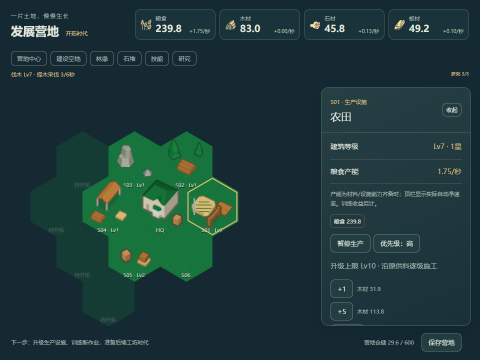
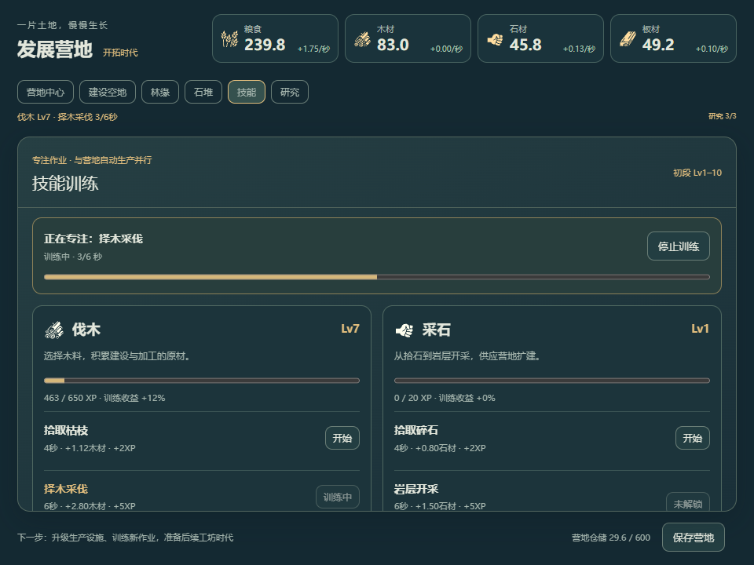

# D1-B交付：技能训练与基础经济

日期：2026-10-18。Codex按用户“优化玩法、融合Melvor式技能并开始下一阶段”实施。A成果保留，B已完成实现与约定本地验证，待用户试玩；完整D1仍待C。唯一进度见[PLAN](../../../../../PLAN.md)。本报告不是独立第三方、真人平衡或Windows原生验收。

## 现在怎么玩

入口：[发展营地](http://127.0.0.1:1429/)。原A营地会识别版本并迁移，资源/建筑/冷却保持；原D0无profile存档仍保留并提供导出/明确新档，不静默清空。

1. 点“技能”开始拾枝或采石，放着也能完成作业、积累资源和技能经验。一次专注一项，营地设施同时自动运转。
2. 建农田、林缘的伐木场、石堆的采石场，补齐基础经济；也可保留可选手动协助。初始材料足够建立基础链，不要求先训练或反复点击。
3. 研究“木材加工”→建木工坊→自动加工板材，木工训练也随之开放。研究灌溉提高农田产能，仓储组织开放仓库升级。
4. 升级设施时看合计材料，选择+1/+5/当前上限，原系统逐级送料施工。当前1星最高Lv10；技能等级与建筑等级是两条不同成长线。

```powershell
cd D:\小游戏\next\civ-idle
& 'D:\小游戏\.tools\node-v24.21.0-win-x64\node.exe' scripts/prepare-atlases.mjs
& 'D:\小游戏\.tools\node-v24.21.0-win-x64\node.exe' node_modules/vite/bin/vite.js --host 127.0.0.1 --port 1429 --strictPort
```

同一端口保留A0只读预览`art-preview.html`。不同端口属于不同浏览器origin，不能将换端口当存档迁移。依赖仍用既有锁文件，没有新增包/测试框架或更改全局PATH。

## 本批玩法与数值

| 系统      | 已实现                                                                                                                         |
| --------- | ------------------------------------------------------------------------------------------------------------------------------ |
| 四技能    | 伐木、采石、农事、木工；每项初段Lv1–10，XP只在同一profile里，等级从累计XP投影                                                  |
| 10作业    | 拾枝/择木/整木；碎石/岩层/整石；田间护理/精耕；手工锯板/批量裁板；Lv1/3/6与设施/研究门槛                                       |
| 训练节奏  | 每作业4–8模拟秒；新档空闲，玩家选一项；切换丢弃未完成部分，相同作业重复开始拒绝；训练在线/离线共用原tick                       |
| 经验      | 阈值0/20/55/110/190/300/450/650/900/1200；每技能等级训练收益+2%，不直接叠到建筑IO；实际有效协助附1 XP，无角色总XP/第二熟练度币 |
| 采集/加工 | 产物进原HQ库存；木工训练完整消耗原木并产板材；仓满/缺料不扣料、不产出、不获XP，条件恢复后继续                                  |
| 五建筑    | 农田10木、伐木场8木4石、采石场10木、木工坊20木10石、仓库15木10石；每类一座，木/石限定资源位                                    |
| Lv1自动IO | 农田0.20粮/秒；伐木0.20木/秒；采石8/60石/秒；木工坊0.20木→0.10板/秒；与技能训练并行                                            |
| 成长      | 基础三设施齐备后开放普通Lv1–10；仓库Lv2需仓储组织；成本1.18次幂，仍走原×10换算/逐级/批量成本与运输施工                         |
| 三研究    | 灌溉成本30粮10木5石，农田+25%并开放精耕；加工40粮20木15石，开放木工坊；仓储60粮30石20板，开放仓库升级                          |
| 仓储/能力 | 初始HQ200集中仓容，仓库每建成等级+200；原Warehouse接口/库存保留但不启进口支线；HQ Worker20，运输/生产仍受有限原能力约束        |
| 操作      | 生产设施暂停/恢复、普通/高优先级；被动仓储不提供无意义暂停；研究一次原子扣费，施工/在途材料不算可支付库存                      |
| 展示      | 技能与研究沿原路由，顶栏为原自动净IO，训练/协助/施工另计；5建筑有Lv1/Lv5展示段，实际灌溉/暂停/升级反馈                         |

数值是可玩起点，未做真人长期平衡。配置唯一在`camp-content.ts`/`camp-skills.ts`与原Config/Upgrade定义；组件不另算成本，显示收益/仓容直接引用同一常量/选择器。

## 复用与模块

参考[Melvor入门指南](https://wiki.melvoridle.com/index.php?title=Beginners_Guide)的采集→加工与被动农事、[官方v1.2说明](https://news.melvoridle.com/major-update-v1-2/)的后台技能/离线接续。Wiki部分正文403，仅据可见检索段与官方说明，不声称复刻最新公式。另只读检查旧根`src/domain/skill-loop/engine.ts`、`mastery.ts`及skills/activities数据：沿用材料/产物/XP同次完成、数据定义作业的原则；旧矿物/12技能/大熟练度池与第二运行时没有搬入新营地，也不迁旧根玩家档。

- `shared/sandbox/camp-skills.ts`：四技能/10作业/经验阈值及纯周期规划。
- `camp-economy.ts`：原快照上的研究前置、建设合法性、等级上限与可支付库存选择器；排除施工材料。
- `src/scripts/sandbox/camp-training.ts`：在原`postTickTiles`每模拟秒完成作业，原库存耗料/入库与XP成对提交。
- `camp-commands.ts`：同一Promise队列扩展train/research/upgrade/pause/priority；无第二钱包/ticker/save队列。
- 原`UpgradeDefinitions.ts`三稳定ID成为唯一研究成本/效果与`unlockedUpgrades`事实；原`BuildingLogic.getBuildingCost`读取可选costGrowth，其他profile默认1.5。
- `CampSkillsPage`/`CampResearchPage`、HUD/地块面板与局部CSS：复用React/Singleton路由和真实库存/IO，不引入编辑器/状态库。
- 唯一catalog新增`campBuildingViews`，原`TileVisual`子层按真实等级段、暂停、灌溉变化；22项世界/HUD引用，35 PNG仍沿原图集加载。

详细差异见[UPSTREAM](../../../../../next/civ-idle/UPSTREAM.md)，源/许可见[SOURCES](../../../../../next/civ-idle/assets-source/SOURCES.md)。49项源素材哈希不变，无生图/PNG编辑；田垄/水渠是Pixi代码原型，旧25稿不当作两星/两时代美术已完成。

## 迁移与验证

新profile为schema3/content `d1-b-1`，新增skillXp与可空training(activityId/progress)。A1/A2只可能有HQ与Lv0/1农田：生产0.20、施工Lv0成本、200容量均不变，原Worker10已够单农田运行；新增20能力不改变旧单农田可达产量。迁移完整保留身份/材料/建筑/冷却，A2亚秒余量保留；技能初始化0且训练空，不追溯旧离线。新旧仍同一玩家键，坏档先拒绝。

验证使用Node24.21.0、Edge headless/SwiftShader、隔离浏览器上下文；没有读取用户真实浏览器数据。原始脚本/日志留`.cache/d1b-*`，只留一组最小核心合同，不逐素材/逐UI扩用例。

| 检查                   | 实际结果                                                                                                                                         |
| ---------------------- | ------------------------------------------------------------------------------------------------------------------------------------------------ |
| TypeScript/Lint        | 最终tsc 0错误；本批19个规则/接点/UI/清单文件Biome 0错误                                                                                          |
| 核心合同               | 新技能4项，加原A组共8项通过：周期成对发放、仓满/缺料/门槛零收益、XP阈值/上限、分段保存后等价；没有新测试框架                                     |
| 生产构建               | 图集/tsc/Vite成功，1650 modules；sandbox atlas92.82kB；继承的大chunk/重复导入提示保留，主包约4.14MB                                              |
| 真实早段               | 8个实秒后32木/4技能XP；基础农田/伐木/采石通过UI和原供料建成，约tick21；再由原施工完成农田Lv2，没有注入开局材料                                   |
| 后续主线               | 明确调用原在线/离线规则的tick快进供测试推进，开放木工坊/仓库、板材链、三研究、技能Lv3作业切换、木工训练、农田+5至Lv7和仓库Lv2；不称真人等待/平衡 |
| 产能与容量             | 实际截图农田Lv7/灌溉=1.75粮/秒，仓库Lv1时HQ400、Lv2时600；暂停后稳定区间无新增粮，恢复/高优先级/等级/研究/XP/训练经重载保持                      |
| 受控失败               | 重复研究、目标Lv11、未来研究拒绝且不扣材料；仓满和木工缺原料均无产物/XP；恢复屏障拒绝开始训练                                                    |
| 原子保存               | 注入savedAt失败，训练事实留内存、saved:false；原磁盘字节和时间均不变；没有“成功保存”假报                                                         |
| 实际A2迁移             | 从改动前A2真实隔离新档导出fixture，B迁移保留身份、31木、readyTick10，技能0/训练空；不是拿B改标签充当旧档                                         |
| 离线一次性             | 改savedAt模拟20秒：原tick发5木/10XP；重载未重复结算，亚秒余量仍保存；非真实关机等待                                                              |
| 坏档                   | 负技能XP、未来content、未知训练三个fixture拒绝，合成pagehide后原字节/时间不变                                                                    |
| 两窗口                 | 960×720和420×600，训练/研究可操作，横向溢出0；代表截图已查看                                                                                     |
| 最终production preview | 实际图集200，四技能/10作业/三研究；采集+训练后32木/3XP，重载保持训练/经验；页面异常、外部请求、HTTP≥400响应均0                                   |

开发13组结果见[browser-verification.json](browser-verification.json)，最终构建冒烟见[production-verification.json](production-verification.json)。开发主线只运行本批增量；最末显示常量归一和被动仓储按钮收敛后，复用有效主线结果，复查类型/Lint并重建/走生产冒烟，没有再跑一整套旧游戏测试。

分支`codex/p1-first-tier`、HEAD `98c2699af4bccbae4098cd300df92a8e6920c83e`保持，前轮改动保留；未改根`src/**`、`src-tauri/**`、`next/profectus/**`、Tauri identifier或旧玩家档。未提交、推送或发布。





其他：[早期技能](skills-early.png)、[三研究完成](research-complete.png)、[窄窗技能](mobile-skills.png)、[窄窗研究](mobile-research.png)、[最终生产版](production-skills.png)。开发截图早于末尾“被动仓储不显示暂停”及显示常量归一，玩法主线一致；生产截图来自最终产物。

## 下一步与限制

下一批C接工坊时代、后三研究、Lv10晋升保留等级→Lv20、相邻扩地、8h离线/摘要；本批未做。远期技能可随时代补渔业/冶炼等，当前四技能/Lv10不是全产品上限，不先预建空系统。

仍需真人体验早期节奏、各作业收益/XP平衡、研发表现与建筑辨识度；正式两星/时代美术留C/D2。4h实际长等待/Time Warp、真实窗口后台/磁盘配额、多标签并发、其他浏览器、Windows托盘/置顶未在本批验收。受控故障/快进与真实系统条件分别记录，完整D1尚未完成。
